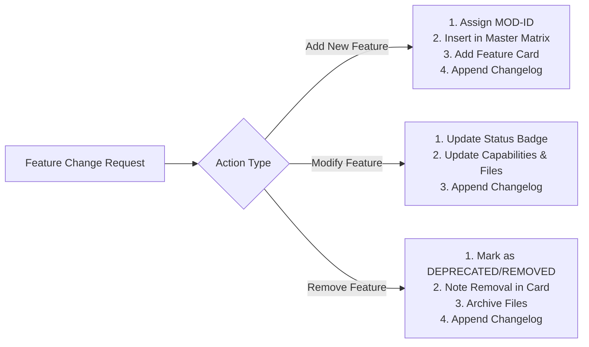
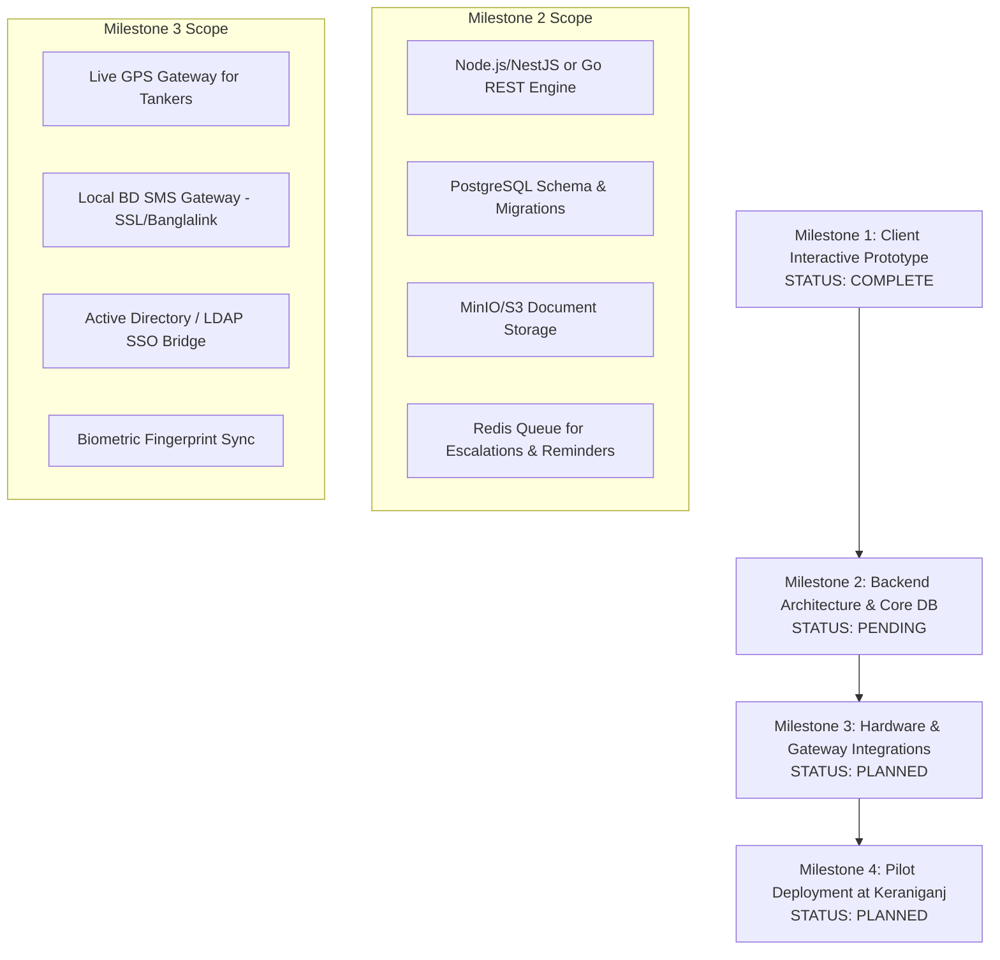

# BOGCL OneOps — Master Project Status & Feature Ledger
**Document Reference:** `BOGCL-OPS-LEDGER-2026-V1`  
**Current System Phase:** `v1.2.0-PROTOTYPE` (Interactive Frontend & State Store Suite)  
**Target Enterprise:** Bashundhara Oil and Gas Company Limited (BOGCL)  
**Last Updated:** 31 October 2026  
**Repository Branch:** `master`  
**Maintainer:** Lead Enterprise Architect / AI Engineering Pair  

---

## 📌 Document Purpose & Maintenance Protocol

This document serves as the **single source of truth (SSOT)** for the architectural, functional, and implementation status of the **BOGCL OneOps** enterprise system.

Whenever a feature is **added**, **modified**, or **removed**, this document must be updated according to the protocol below to maintain project continuity across engineering iterations.

### Protocol for Future Updates:



1. **Adding a Feature:**
   - Assign the next sequential ID (e.g., `MOD-18`).
   - Add a row to Section 3 (*Master Feature Matrix*).
   - Create a standardized *Feature Specification Card* in Section 4.
   - Record an `[ADDED]` entry in Section 8 (*Changelog*).

2. **Modifying a Feature:**
   - Locate the target `MOD-XX` card in Section 4.
   - Update the `Status`, `Implementation Files`, `Business Logic`, or `Backend Requirements`.
   - Record a `[MODIFIED]` entry in Section 8 with reasoning and affected components.

3. **Removing a Feature:**
   - Do **not** delete the module ID immediately to preserve traceability; mark status as `[DEPRECATED]` or `[REMOVED]`.
   - Document the rationale and affected code files for safe pruning.
   - Record a `[REMOVED]` entry in Section 8.

---

## 1. Executive Status & System Health Summary

| Dimension | Current Metric | Target Production Metric | Status |
| :--- | :--- | :--- | :--- |
| **Frontend Modules Implemented** | 16 of 16 Core Business Modules | 16 Modules + 2 Admin Panels | **100% Complete (Prototype)** |
| **Persona Dashboards** | 7 Distinct Role Dashboards | 7 Role Dashboards | **100% Complete** |
| **Lines of Code (Frontend)** | 67,047 LOC (TS, TSX, CSS) | ~75,000 LOC | **Feature Complete** |
| **TypeScript / Build Errors** | 0 errors (`npm run build` passes in ~2.2s) | 0 errors | **Healthy & Clean** |
| **Client State Management** | 9 Zustand Stores (InMemory + Synthetic) | Hybrid (Zustand + React Query) | **Complete (Mocked State)** |
| **Bilingual Localization** | 100% En / Bn (English & বাংলা) | 100% En / Bn | **Complete** |
| **Backend API (`server/`)** | 0% (Directory scaffolded, architecture defined) | REST/GraphQL + PostgreSQL | **Next Phase Milestone** |
| **Database & Migrations** | Mock Schemas in TypeScript types | PostgreSQL with 28 Tables | **Design Complete, DDL Pending** |
| **Hardware & IoT Telematics** | Synthetic math generator | Teltonika / Concox GPS Gateway | **Simulated** |
| **External Integrations** | Simulated (SMS, SAP, Biometric) | Production Gateways | **Simulated** |

---

## 2. Master Feature Registry & Status Matrix

| ID | Module Name | Primary View / Route | Primary Store | UI Status | Backend Status | Risk |
| :---: | :--- | :--- | :--- | :---: | :---: | :---: |
| **MOD-01** | Enterprise Notice Board & Broadcasts | `dashboard` (Notice Modal) | `noticeStore.ts` | `PROTOTYPE-READY` | `PENDING-API` | Low |
| **MOD-02** | Chairman Command Suite & Direct Address | `dashboard` (Chairman View) | `voiceBriefingStore.ts` | `PROTOTYPE-READY` | `PENDING-API` | Medium |
| **MOD-03** | Paperless E-Sign & Note-Sheets (e-Nothi) | `notesheet` | `notesheetStore.ts` | `PROTOTYPE-READY` | `PENDING-API` | High |
| **MOD-04** | Chain-of-Custody Parcel Tracker | `parcel` | `operationsStore.ts` | `PROTOTYPE-READY` | `PENDING-API` | Low |
| **MOD-05** | ISO 55001 Asset Lifecycle & EAM | `asset` | `assetStore.ts` | `PROTOTYPE-READY` | `PENDING-API` | High |
| **MOD-06** | Regulatory License & Compliance Pipeline | `compliance` | `operationsStore.ts` | `PROTOTYPE-READY` | `PENDING-API` | Medium |
| **MOD-07** | HSE Incident Management & CAPA | `incident` | `operationsStore.ts` | `PROTOTYPE-READY` | `PENDING-API` | Medium |
| **MOD-08** | Guest & VIP Protocol Passes | `guest` | `operationsStore.ts` | `PROTOTYPE-READY` | `PENDING-API` | Low |
| **MOD-09** | Fleet & Pool Vehicle Dispatch | `fleet` / `vehicle_request` | `fleetStore.ts` | `PROTOTYPE-READY` | `PENDING-API` | High |
| **MOD-10** | Geo-Fenced Mobile Attendance | `attendance` | `employeeStore.ts` | `PROTOTYPE-READY` | `PENDING-API` | Medium |
| **MOD-11** | TA & DA Policy Engine | `claims` (Tab: TA/DA) | `operationsStore.ts` | `PROTOTYPE-READY` | `PENDING-API` | Low |
| **MOD-12** | Conveyance Reimbursement Claims | `claims` (Tab: Conveyance) | `operationsStore.ts` | `PROTOTYPE-READY` | `PENDING-API` | Low |
| **MOD-13** | Tour & Expense Advance Settlement | `claims` (Tab: Tour) | `operationsStore.ts` | `PROTOTYPE-READY` | `PENDING-API` | Medium |
| **MOD-14** | Employee Bus Commuter & FIFO Waitlist | `bus` | `busStore.ts` | `PROTOTYPE-READY` | `PENDING-API` | Low |
| **MOD-15** | Inner-Circle Leadership Comms | `inner_circle` | `employeeStore.ts` | `PROTOTYPE-READY` | `PENDING-API` | Medium |
| **MOD-16** | Workforce Directory & Offboarding | `workforce` | `employeeStore.ts` | `PROTOTYPE-READY` | `PENDING-API` | Low |
| **MOD-17** | Centralized Approvals Center & Delegation| `approvals` | `approvalStore.ts` | `PROTOTYPE-READY` | `PENDING-API` | Medium |

---

## 3. Detailed Feature Catalog (Module Specifications)

### [MOD-01] Enterprise Notice Board & Emergency Broadcast System
* **Domain:** Corporate Communications & Statutory Compliance
* **Status:** `PROTOTYPE-READY` (Client complete, bilingual, live banner cascade)
* **Target Personas:** All Roles, HR Admin, Corporate Communications
* **UI Components:**
  * `views/dashboard/NoticeDetailModal.tsx`
  * `views/dashboard/PublishNoticeModal.tsx`
  * `components/BroadcastModal.tsx`
  * Banner alert integrated in `App.tsx`
* **State Store:** `store/noticeStore.ts`
* **Core Capabilities:**
  * Bilingual notice authoring (English & Bengali script).
  * Audience targeting by location (`HQ_BARIDHARA`, `PLANT_KERANIGANJ`, `TERMINAL_CTG`), department, and grade.
  * Mandatory read receipts with real-time compliance tracker (Read count vs. Total recipients).
  * High-priority Emergency Broadcast banner with audio ping and modal sign-off lock.
* **Backend API Spec (Required):**
  * `POST /api/v1/notices` (Create with attachment upload)
  * `GET /api/v1/notices?role=&dept=&site=` (Filtered notices)
  * `POST /api/v1/notices/:id/acknowledge` (Log SHA-256 read confirmation)
* **Current Limitations:** Acknowledgments are stored in client memory; resets upon browser reload.

---

### [MOD-02] Chairman Executive Command Suite & Direct Address
* **Domain:** Executive Decision Support & High-Level Oversight
* **Status:** `PROTOTYPE-READY`
* **Target Personas:** Chairman & Managing Director (`Ahmed Akbar Sobhan`), Board Members
* **UI Components:**
  * `views/dashboard/ChairmanDashboard.tsx`
  * `components/dashboard/SendVoiceBriefingModal.tsx`
  * `components/dashboard/ExecutiveROIDossierModal.tsx`
  * `components/Sparkline.tsx`, `components/RefineryOutputChart.tsx`
* **State Store:** `store/voiceBriefingStore.ts`, `store/approvalStore.ts`
* **Core Capabilities:**
  * Enterprise health indicators: daily attendance %, terminal fuel dispatch volume, critical open HSE incidents, permits expiring within 30 days.
  * Voice briefing generator and simulated audio waveform player.
  * High-priority 1-tap directive signoff with executive gold styling (`#D4AF37`).
  * Real-time inner-circle executive presence board.
* **Backend API Spec (Required):**
  * `GET /api/v1/executive/summary-kpi`
  * `POST /api/v1/executive/voice-briefing` (Audio upload to MinIO/S3 + push to VIP devices)
  * `GET /api/v1/executive/presence` (Live WebSockets status)
* **Current Limitations:** Audio waveform is visually animated via CSS; voice synthesis is mocked.

---

### [MOD-03] Paperless E-Sign & Note-Sheets (Digital e-Nothi System)
* **Domain:** Executive Workflow Automation & Legal Compliance
* **Status:** `PROTOTYPE-READY`
* **Target Personas:** Department Heads, Plant GM, Finance Director, Chairman
* **UI Components:**
  * `views/NotesheetView.tsx`
  * `components/notesheet/InitiateNotesheetModal.tsx`
  * `components/OfficialDocumentModal.tsx`
* **State Store:** `store/notesheetStore.ts`
* **Core Capabilities:**
  * Multi-paragraph running commentary adhering to standard Bangladesh government and group *e-Nothi* conventions.
  * Sequential and parallel sign-off routing with role escalation.
  * SHA-256 cryptographic tamper-evident hash seal computed across note history and attachments.
  * Verification QR code generator embedding document hash and timestamp.
* **Backend API Spec (Required):**
  * `POST /api/v1/notesheets` (Create file draft)
  * `POST /api/v1/notesheets/:id/paragraphs` (Append immutable entry)
  * `POST /api/v1/notesheets/:id/sign` (Apply digital certificate / RSA key)
  * `GET /api/v1/notesheets/:id/verify-hash` (Public verification endpoint)
* **Current Limitations:** Hash calculation is executed client-side via Web Crypto API; PDF is rendered via HTML template rather than server-side headless Chromium.

---

### [MOD-04] Chain-of-Custody Parcel Tracker
* **Domain:** Logistics, Security & Administrative Mailroom
* **Status:** `PROTOTYPE-READY`
* **Target Personas:** Receptionists, Dispatch Drivers, Senders, Recipients
* **UI Components:**
  * `views/ParcelView.tsx`
  * QR Code simulator and thermal tag generator
* **State Store:** `store/operationsStore.ts`
* **Core Capabilities:**
  * Generation of thermal-printer-ready QR labels with unique tracking tokens (`BOGCL-EXP-2026-XXXX`).
  * 5-stage milestone tracking: *Logged → Picked Up → In Transit → Received at Hub → Out for Delivery → Handed Over*.
  * Recipient security OTP validation before final gate/desk release.
  * Discrepancy flagging for delayed transit (>24 hrs).
* **Backend API Spec (Required):**
  * `POST /api/v1/parcels` (Register new parcel)
  * `PATCH /api/v1/parcels/:tracking/scan` (Log checkpoint scan with GPS coordinates)
  * `POST /api/v1/parcels/:tracking/verify-otp` (Confirm handoff)
* **Current Limitations:** Scanner operates via simulated camera viewport or manual barcode entry.

---

### [MOD-05] ISO 55001 Asset Lifetime Tracking & EAM System
* **Domain:** Plant Maintenance, Calibration, Engineering Asset Management
* **Status:** `PROTOTYPE-READY`
* **Target Personas:** Plant GM, Maintenance Engineers, Accounts, Head of Operations
* **UI Components:**
  * `views/AssetView.tsx`
  * `components/asset/AssetLifecycleStepper.tsx`
  * `components/asset/AssetModals.tsx`
  * `styles/asset.css`
* **State Store:** `store/assetStore.ts`
* **Core Capabilities:**
  * 8-Stage ISO 55001 state machine: *Planning → Procurement → Commissioned → Operational → Overhaul → Quarantine/LOTO → Decommissioned → Disposed*.
  * IAS 16 straight-line depreciation engine and Total Cost of Ownership (TCO) calculator.
  * Statutory calibration countdown tracking (BSTI pressure gauges, hydro-tests, flow meters) with 90/60/30-day alert cascade.
  * Lock-Out/Tag-Out (LOTO) safety permit interlocking to prevent asset activation during maintenance.
* **Backend API Spec (Required):**
  * `GET /api/v1/assets` (Search with filters for site, category, calibration due)
  * `POST /api/v1/assets/:id/work-orders` (Create maintenance or repair ticket)
  * `POST /api/v1/assets/:id/loto` (Apply safety lock with permit number)
* **Current Limitations:** Operating hours are incremented on a synthetic cron loop; depreciation runs on client load.

---

### [MOD-06] Regulatory License & Compliance Pipeline
* **Domain:** Legal, Environmental & Statutory Governance
* **Status:** `PROTOTYPE-READY`
* **Target Personas:** Compliance Officers, Legal Counsel, Plant Director, Finance Head
* **UI Components:**
  * `views/ComplianceView.tsx`
* **State Store:** `store/operationsStore.ts`
* **Core Capabilities:**
  * 5-Stage Kanban visual pipeline: *1. Fund Approval → 2. Dossier Preparation → 3. Regulatory Inspection → 4. Audit Compliance → 5. License Issued*.
  * Pre-configured regulatory bodies: BSTI, Department of Explosives (DoE), BIWTA, Department of Environment, Fire Civil Defence.
  * Automated treasury chalan upload and validity duration countdown.
* **Backend API Spec (Required):**
  * `GET /api/v1/compliance/licenses`
  * `PATCH /api/v1/compliance/licenses/:id/stage` (Advance workflow stage)
  * `POST /api/v1/compliance/licenses/:id/documents` (Treasury slip / permit PDF upload)
* **Current Limitations:** Drag-and-drop Kanban updates client Zustand state without persistent webhook notifications.

---

### [MOD-07] HSE Incident Management & CAPA (OSHA Compliant)
* **Domain:** Health, Safety, Environment & Industrial Risk Control
* **Status:** `PROTOTYPE-READY`
* **Target Personas:** Safety Officers, Shift In-Charge, Plant GM, HR Director
* **UI Components:**
  * `views/IncidentView.tsx`
  * Root Cause Analysis (RCA) modal with 5-Why methodology
* **State Store:** `store/operationsStore.ts`
* **Core Capabilities:**
  * Incident classification across OSHA tiers: Near Miss, First Aid, Medical Treatment, Lost Time Incident (LTI), Fatality.
  * Severity triage (L1 to L5); L4 and L5 automatically trigger Chairman emergency alerts.
  * Corrective and Preventive Action (CAPA) tracking with strict assignment accountability.
  * Anonymous whistleblower reporting option.
* **Backend API Spec (Required):**
  * `POST /api/v1/incidents` (Report incident with GPS coordinates & photo)
  * `POST /api/v1/incidents/:id/capa` (Assign preventive task)
  * `PATCH /api/v1/incidents/:id/close` (Safety signoff & validation)
* **Current Limitations:** Photo upload stores base64 data strings in client state.

---

### [MOD-08] Guest & VIP Protocol Passes
* **Domain:** Security, Reception & Protocol Management
* **Status:** `PROTOTYPE-READY`
* **Target Personas:** Receptionists, Security Gate In-Charge, VIP Hosts
* **UI Components:**
  * `views/GuestView.tsx`
* **State Store:** `store/operationsStore.ts`
* **Core Capabilities:**
  * 3 Protocol Tiers: *Tier 1: VIP (Gold Protocol, Lounge + Reserved Parking), Tier 2: Government Official, Tier 3: General Contractor/Visitor*.
  * Instant QR entry pass sent to visitor via simulated SMS.
  * Live emergency muster roll tracking active persons on premise.
  * Blacklist validation before issuing visitor credentials.
* **Backend API Spec (Required):**
  * `POST /api/v1/guests/pre-register`
  * `PATCH /api/v1/guests/:id/checkin` (Gate check-in)
  * `GET /api/v1/guests/active-muster` (Emergency head-count)
* **Current Limitations:** SMS delivery is displayed as a UI notification toast.

---

### [MOD-09] Fleet & Pool Vehicle Dispatch
* **Domain:** Transport Logistics, Asset Tracking, Fuel Management
* **Status:** `PROTOTYPE-READY` (Audit completed & remediated in `docs/06`)
* **Target Personas:** Transport Admin, Drivers, Requisitioners
* **UI Components:**
  * `views/FleetView.tsx`, `components/fleet/DriverConsole.tsx`
  * `components/fleet/AssignVehicleModal.tsx`, `components/fleet/NewRequisitionModal.tsx`
  * `styles/fleet-chat.css`
* **State Store:** `store/fleetStore.ts`
* **Core Capabilities:**
  * Pool vehicle requisition with passenger route pooling suggestions.
  * Tactile mobile driver terminal with large touch targets, start/end odometer capture, and route directions.
  * Fuel efficiency audit and trip cost calculations.
  * Real-time tri-party chat between Requisitioner, Transport Admin, and Driver.
* **Backend API Spec (Required):**
  * `POST /api/v1/fleet/requisitions`
  * `POST /api/v1/fleet/dispatch` (Assign vehicle and driver)
  * `POST /api/v1/fleet/trips/:id/complete` (Submit final odometer and fuel logs)
* **Current Limitations:** Telematics and GPS speeds are generated via client math cycles.

---

### [MOD-10] Geo-Fenced Mobile Attendance & Leave
* **Domain:** HR Administration, Field Operations, Workforce Management
* **Status:** `PROTOTYPE-READY`
* **Target Personas:** All Staff, Line Managers, HR Admin
* **UI Components:**
  * `views/AttendanceView.tsx`
* **State Store:** `store/employeeStore.ts`
* **Core Capabilities:**
  * Haversine formula calculation against authorized coordinates (`HQ_BARIDHARA`, `PLANT_KERANIGANJ`, `TERMINAL_CTG`).
  * Anti-spoofing heuristic check (mock location detection, altitude anomaly).
  * Field-Duty (OD) regularizations and missed punch justification workflow.
  * Monthly shift muster roll with late deduction computation.
* **Backend API Spec (Required):**
  * `POST /api/v1/attendance/punch` (Submit GPS lat/lng, device telemetry, timestamp)
  * `POST /api/v1/attendance/regularize` (Submit missed punch explanation)
  * `GET /api/v1/attendance/monthly-summary` (Payroll export)
* **Current Limitations:** Geolocation pulls browser `navigator.geolocation` or simulated site toggles.

---

### [MOD-11, 12, 13] Enterprise Claims: TA & DA, Conveyance, Tour Advance
* **Domain:** Finance, Accounts Payable & Travel Audit
* **Status:** `PROTOTYPE-READY`
* **Target Personas:** Traveling Executives, Field Sales, Finance Reviewers
* **UI Components:**
  * `views/ClaimsView.tsx`
  * `components/claims/SubmitClaimModal.tsx`
* **State Store:** `store/operationsStore.ts`
* **Core Capabilities:**
  * **[MOD-11] TA & DA:** Grade-based entitlement tables; automatic 50% vs 100% per-diem computation based on travel departure/return times.
  * **[MOD-12] Conveyance:** Local transit expense tracking (CNG, Rickshaw, Ride-share, Personal Bike km rate). Batch monthly claim submissions.
  * **[MOD-13] Tour Advance:** Tour budget approval with post-trip reconciliation (`Advance - Actual = Net Balance Payable / Receivable`).
* **Backend API Spec (Required):**
  * `POST /api/v1/claims` (Submit multi-item expense voucher)
  * `POST /api/v1/claims/:id/endorse` (Line manager / Finance approval)
  * `POST /api/v1/claims/:id/disburse` (Bank advice export)
* **Current Limitations:** OCR receipt scanning is simulated with sample receipts.

---

### [MOD-14] Employee Commuter Bus & FIFO Seat Waitlist
* **Domain:** Employee Welfare, Transport Fleet Optimization
* **Status:** `PROTOTYPE-READY`
* **Target Personas:** Commuting Employees, Transport Supervisors
* **UI Components:**
  * `views/BusView.tsx`
  * `components/bus/BusFleetOverviewGrid.tsx`
  * `components/bus/SupervisorSeatModal.tsx`, `components/bus/RouteBuilderModal.tsx`
* **State Store:** `store/busStore.ts`
* **Core Capabilities:**
  * Fixed seat capacity layout (28 to 36-seater Ashok Leyland / Hino buses).
  * Automated FIFO waitlist queue when route is oversubscribed.
  * Resignation/relocation trigger: vacating a seat immediately cascades a 48-hour claim window to applicant #1 on waitlist.
  * Supervisor emergency seat override.
* **Backend API Spec (Required):**
  * `GET /api/v1/buses/routes`
  * `POST /api/v1/buses/apply-seat`
  * `POST /api/v1/buses/vacate-seat` (Triggers cascade webhook)
* **Current Limitations:** Cascade expiration timer is simulated in client state.

---

### [MOD-15] Inner-Circle Leadership Communications
* **Domain:** Executive Security & Encrypted Operations
* **Status:** `PROTOTYPE-READY`
* **Target Personas:** Chairman, Managing Director, Selected Top Tier Executives
* **UI Components:**
  * `views/InnerCircleChat.tsx`
  * `styles/chat.css`
* **State Store:** `store/employeeStore.ts`
* **Core Capabilities:**
  * Direct encrypted message channel exclusively accessible by executive clearance.
  * Real-time online/offline presence indicators.
  * Auto-expiring sensitive notes and broadcast directives.
* **Backend API Spec (Required):**
  * WebSockets endpoint `wss://oneops.bashundhara.com/ws/inner-circle`
  * End-to-end encryption key exchange.
* **Current Limitations:** Messages are exchanged in client memory store.

---

### [MOD-16] Workforce Directory & Offboarding Asset Clearance
* **Domain:** HR Management, Enterprise Asset Protection
* **Status:** `PROTOTYPE-READY`
* **Target Personas:** HR Admin, Department Heads, IT, Admin, Finance
* **UI Components:**
  * `views/WorkforceView.tsx`
  * `components/workforce/OnboardEmployeeModal.tsx`
  * `components/workforce/OffboardClearanceDrawer.tsx`
* **State Store:** `store/employeeStore.ts`
* **Core Capabilities:**
  * Enterprise staff directory with department filtering, site allocation, and blood group directory.
  * Interactive 4-Department Exit Clearance: *IT (Laptop/Email) → Admin (Access Card/SIM) → Fleet/Transport → Accounts (Final Settlement)*.
  * Automatic revoking of role credentials upon exit signoff.
* **Backend API Spec (Required):**
  * `GET /api/v1/workforce/directory`
  * `POST /api/v1/workforce/exit-clearance`
* **Current Limitations:** Exit clearances persist until the browser session resets.

---

### [MOD-17] Centralized Approvals Center & Executive Delegation
* **Domain:** Governance, Workflow Engine & Enterprise Orchestration
* **Status:** `PROTOTYPE-READY`
* **Target Personas:** All Approvers (HODs, Directors, Plant GM, Chairman)
* **UI Components:**
  * `views/ApprovalsView.tsx`
  * `components/AuthorizeDirectiveModal.tsx`
  * `components/RejectionExplanationModal.tsx`
* **State Store:** `store/approvalStore.ts`
* **Core Capabilities:**
  * Unified inbox consolidating pending actions across all modules (Claims, Fleet, Leaves, Notesheets, Permits).
  * Mandatory rejection rationale modal with audit timestamp.
  * Executive delegation assignment (delegating approvals during official travel or leave).
  * One-click batch approval for standardized low-risk items.
* **Backend API Spec (Required):**
  * `GET /api/v1/approvals/pending`
  * `POST /api/v1/approvals/:id/action` (`APPROVE`, `REJECT`, `SEND_BACK`)
  * `POST /api/v1/approvals/delegate`
* **Current Limitations:** Actions resolve directly against local Zustand records.

---

## 4. Role-Based Access Control (RBAC) & Persona Roster

The system includes 7 pre-configured executive and operational personas:

| Role Key | Name | Title | Base Site | Scope | Key Duties |
| :--- | :--- | :--- | :--- | :--- | :--- |
| `chairman` | Ahmed Akbar Sobhan | Chairman & MD | Baridhara HQ | **Global** | Final directives, financial approvals >৳1M, broadcast |
| `plant_gm` | Engr. Md. Harunur Rashid | Plant General Manager | Keraniganj | **Plant** | LOTO safety, shift allocation, maintenance funds |
| `hr_admin` | Sayeda Afroza Sultana | GM, HR & Admin | Baridhara HQ | **Company** | Muster roll, exit clearance, workforce directory |
| `transport_admin` | Md. Kamruzzaman | Transport Supervisor | Keraniganj | **Fleet** | Vehicle dispatch, bus FIFO queue, driver calls |
| `hod` | Farida Begum | Head of Finance | Baridhara HQ | **Dept** | Claims review, budget clearance, notesheet review |
| `employee` | Tanvir Ahmed | Senior Sales Officer | Baridhara HQ | **Self** | Requisitions, attendance punch, expense claims |
| `driver` | Md. Rafiqul Islam | Senior Tanker Driver | Baridhara HQ | **Self** | Trip orders, tactile odometer console, fuel logs |

---

## 5. Frontend Architecture & Technical Foundation

### 5.1 Technology Stack & Versions
```json
{
  "react": "^19.2.8",
  "react-dom": "^19.2.8",
  "typescript": "~6.0.2",
  "vite": "^8.3.0",
  "tailwindcss": "^4.3.3",
  "zustand": "^5.0.16",
  "lucide-react": "^1.58.0"
}
```

### 5.2 Directory Breakdown & Line Counts
```
client/src/
├── views/                  # 26,429 LOC (15 Core Views & 7 Sub-Dashboards)
├── components/             # 19,227 LOC (45+ Modals, Charts, Steppers, Drawers)
├── store/                  #  8,382 LOC (9 Zustand State Stores)
├── styles/                 # 12,359 LOC (Design system, responsive layout, dark theme)
└── App.tsx / types.ts      #    650 LOC (Root orchestrator, routing, RBAC contracts)
Total Frontend Volume:       67,047 LOC
```

### 5.3 Global Navigation & Interaction Utilities
* **Global Command Palette (`Ctrl+K` / `Cmd+K`):** Instant search across all modules, fast persona switching, and theme toggling.
* **Toast Notification Manager:** Real-time feedback supporting `info`, `success`, `warning`, and `gold` (VIP) alerts.
* **Responsive Layout:** Adaptive desktop side-nav + mobile bottom tab bar (`MobileBottomNav.tsx`) for field accessibility.

---

## 6. Strategic Documentation Index (`docs/`)

The repository contains 8 complete planning and pitch documents:

1. [`01_EXECUTIVE_PITCH_AND_PROJECT_DOSSIER.md`](file:///c:/project/B-OIL-GAS/docs/01_EXECUTIVE_PITCH_AND_PROJECT_DOSSIER.md) — Boardroom presentation, commercial ROI justification, data sovereignty.
2. [`02_ENTERPRISE_SYSTEM_ARCHITECTURE_AND_SPECS.md`](file:///c:/project/B-OIL-GAS/docs/02_ENTERPRISE_SYSTEM_ARCHITECTURE_AND_SPECS.md) — Full technical engineering blueprint, microservice specifications, ERD.
3. [`03_REQUIREMENTS_TRACEABILITY_LEDGER_AND_MATRIX.md`](file:///c:/project/B-OIL-GAS/docs/03_REQUIREMENTS_TRACEABILITY_LEDGER_AND_MATRIX.md) — Requirements traceability matrix across all 16 modules.
4. [`04_CLIENT_CONVERSATION_AND_DISCOVERY_PLAYBOOK.md`](file:///c:/project/B-OIL-GAS/docs/04_CLIENT_CONVERSATION_AND_DISCOVERY_PLAYBOOK.md) — 30-minute executive presentation script and stakeholder questionnaires.
5. [`05_PROTOTYPE_BLUEPRINT_AND_DEMO_SCRIPT.md`](file:///c:/project/B-OIL-GAS/docs/05_PROTOTYPE_BLUEPRINT_AND_DEMO_SCRIPT.md) — 6-Act live demonstration script with closing strategy.
6. [`06_ASSET_LIFETIME_TRACKING_AND_EAM_SYSTEM.md`](file:///c:/project/B-OIL-GAS/docs/06_ASSET_LIFETIME_TRACKING_AND_EAM_SYSTEM.md) — ISO 55001 asset lifecycle specification.
7. [`06_CRITICAL_AUDIT_AND_ROAST_FLEET_SYSTEM.md`](file:///c:/project/B-OIL-GAS/docs/06_CRITICAL_AUDIT_AND_ROAST_FLEET_SYSTEM.md) — Critical audit of fleet module and UX remediation blueprint.
8. [`executive_presentation_dossier.md`](file:///c:/project/B-OIL-GAS/docs/executive_presentation_dossier.md) — Executive dossier summary.

---

## 7. Next Milestones & Production Roadmap



---

## 8. Historical Changelog & Mutation Ledger

* **2026-10-31 [INITIALIZED]:** Created `PROJECT_MASTER_STATUS_AND_FEATURE_LEDGER.md` capturing all 16 core business modules, 7 persona dashboards, and 67k LOC architecture.
* **2026-10-30 [ADDED]:** Implemented `GuestView.tsx` with VIP protocol passes, emergency muster roll, and parking reservation logic.
* **2026-10-30 [ADDED]:** Implemented `AssetLifecycleStepper.tsx` and ISO 55001 EAM lifecycle tracking with LOTO safety permit management.
* **2026-10-30 [ADDED]:** Implemented `PlantGmDashboard.tsx` for plant operations, refinery output tracking, and shift monitoring.
* **2026-10-29 [ADDED]:** Implemented `ComplianceView.tsx` for tracking regulatory permits (BSTI, DoE, BIWTA, Explosives).
* **2026-10-29 [ADDED]:** Implemented `ExecutiveROIDossierModal.tsx` and `voiceBriefingStore.ts` for Chairman dashboard.
* **2026-10-28 [ADDED]:** Implemented `RejectionExplanationModal.tsx` for mandatory rejection notes in approval workflows.

