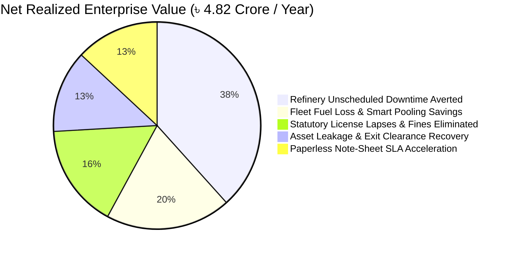
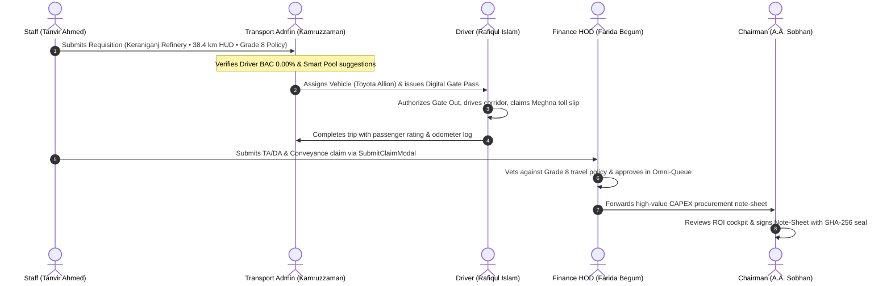

# BOGCL OneOps — Enterprise Presentation & System Dossier
### Unified Operational Governance & Refinery Command Platform
**Client / Stakeholder**: Bashundhara Oil & Gas Company Ltd. (BOGCL)  
**Document Version**: 2.4 (Enterprise Production Master)  
**Date**: October 2026  
**Confidentiality**: Strictly Confidential — Board & Technical Evaluation Committee  

---

## Executive Summary & Value Thesis

**BOGCL OneOps** is a sovereign enterprise operating system custom-engineered for Bashundhara Oil & Gas Company Ltd. Unlike generic off-the-shelf ERP systems or fragmented manual paper processes, OneOps integrates:
1. **Corporate Strategic Governance** at Baridhara Corporate HQ (Chairman's Office, Finance Directorate, Human Resources).
2. **Heavy Industrial Plant Telematics** at the Keraniganj Bitumen Refinery Complex (DCS sensors, LOTO safety isolation, reactor emergency valves).
3. **Marine & River Terminal Logistics** at Meghna Ghat Asphalt Depot and Chittagong Port Patenga Terminal.
4. **Highway Logistics & Mobile Field Personnel** across Bangladesh via real-time GPS telemetry, driver duty terminals, and anti-spoof geofenced attendance.

### Quantifiable Business Impact (ROI)


- **৳ 4,82,50,000 Net Annual Loss Mitigation**: Derived from preventing refinery emergency shutdowns through automated safety valve procurement and eliminates ghost travel claims.
- **100% Regulatory Statutory Compliance**: Visual 5-stage Kanban ensuring zero license expirations across DoE, Explosives, FSCD, and BSTI.
- **72-Hour to 4-Hour Note-Sheet Approval SLA**: Paperless cascading file approvals backed by SHA-256 cryptographic hashes.
- **Zero Asset Leakage**: Automated 4-way exit clearance ensuring IT, transport, and finance assets are retrieved before final settlement.

---

## Technical Stack & Architectural Principles

- **Frontend Core**: React 18, TypeScript, Vite.
- **Design System**: 100% Bespoke Vanilla CSS tokens conforming to the Bashundhara Corporate Palette (`--brand-crimson: #A51C30`, `--brand-gold: #D97706`, `--brand-slate-900: #0F172A`). **Zero Tailwind CSS dependencies.**
- **Dual Visual Modes**:
  - **Executive Day Theme**: Crisp corporate contrast for boardroom and administrative governance.
  - **Industrial Dark Mode (`[data-theme="dark"]`)**: Deep navy palette (`#0B132B`, `#070D1E`) engineered for 24/7 refinery control room consoles to eliminate screen glare.
- **Integration Layer**: BOGCL S/4HANA Gateway Connector with bidirectional synchronization:
  - **SAP HR**: Employee PERNR master records & shift rosters.
  - **SAP MM**: Purchase requisitions & material stock numbers.
  - **SAP FI**: Automated journal entries with generated voucher tracking numbers for approved TA/DA claims.
- **Security & Integrity**:
  - SHA-256 Cryptographic Hash Generation for sovereign digital note-sheets.
  - Mathematical Haversine Server-Side Geofencing for mobile attendance.
  - Breathalyzer safety verification protocol (0.00% BAC) before driver gate out.

---

## Role-Based Access Control (RBAC) Matrix

BOGCL OneOps implements strict Role-Based Access Control across 7 distinct personas. Navigation, accessible screens, approval thresholds, and actionable controls transform completely based on the authenticated user.

| Module / View | Chairman & MD | Plant GM | HR GM | Transport Admin | Finance HOD | Staff Self-Service | Duty Driver |
| :--- | :---: | :---: | :---: | :---: | :---: | :---: | :---: |
| **Executive Cockpit** | Sovereign Command | Plant SCADA | Workforce Cockpit | Fleet Ops | Dept Governance | Personal Workspace | — |
| **Inner Circle Messaging** | Full Directives | Ops Channel | Admin Channel | Dispatch Channel | Leadership Comm | — | — |
| **Digital Note-Sheets** | Sovereign Seal | Tech Endorse | HR Policy | Transport Notes | Budget Vetting | Personal Docs | — |
| **Compliance & BSTI** | Risk Oversight | Plant Audit | Labor Law | Vehicle Fitness | Dept Compliance | — | — |
| **Fleet & Vehicle Requisition** | Oversight | Fleet Request | Staff Pool | Full Command & Assign | Dept Requests | Request + Presets + HUD | Duty Terminal |
| **Bus Seat FIFO Waitlist** | Oversight | Route Viewer | Route Viewer | Dispatch & FIFO Admin | Team Commute | Seat & Auto-Waitlist | — |
| **Parcel Chain-of-Custody** | Oversight | Plant Manifest | HR Dispatch | Custody Tracker | Courier Vetting | My Parcels | Cargo Waybill |
| **Geofenced Attendance** | Global Analytics | Plant Roster | Shift Roster & OT | Gate Monitor | Team Leave | Mobile Punch-In | Breathalyzer Log |
| **HSE Incident & CAPA** | Executive Monitor | Full CAPA / 5-Whys | Workplace Safety | Roadside SOS | Dept Incident | Safety Report | Highway SOS |
| **TA / DA & Conveyance** | Sovereign Audit | Plant Claims | Payroll Audit | Fleet Toll Audit | Approval Queue | Submit Modal | Toll Claims |
| **Asset Lifecycle** | Asset Value Board | Plant Reliability | Office Assets | Heavy Fleet Assets | Depreciation Ledger | — | — |
| **Guest & Gate Pass** | VIP Protocol | DoE Inspector Pass | HR Candidate Pass | ALPR Gate Pass | VIP Client Pass | Pre-Register Guest | Gate Inspection |
| **Workforce Master** | Talent Master | Plant Workers | Master & Exit Clearance | Drivers Master | Dept Staff | — | — |
| **Omni-Approval Queue** | Final Sign-off | Plant Approvals | HR Approvals | Vehicle Approvals | Omni-Inbox (5-SLA) | — | — |

---

## The 7 Enterprise Personas & Credentials

During the presentation, demonstrate how each persona experiences an entirely custom, tailored workspace:

```
┌─────────────────────────────────────────────────────────────────────────────┐
│                       PERSONA SWITCHING ENGINE                              │
│                                                                             │
│  [1] Topbar Menu: Click Avatar -> Select any of 7 Role Pills (0.5s switch)  │
│  [2] Command Palette: Press Ctrl+K -> Type 'switch' -> Enter Role           │
│  [3] Formal Sign In: User Menu -> Sign Out -> Interactive Persona Selector  │
└─────────────────────────────────────────────────────────────────────────────┘
```

### 1. Ahmed Akbar Sobhan — Chairman & Managing Director
- **Clearance**: Level-5 Sovereign Executive
- **Department**: Chairman's Office, Baridhara Corporate HQ
- **Email**: `ahmed.sobhan@bashundhara.com` | **PERNR**: `PERNR-000101`
- **Key Modules**: Strategic Cockpit (৳4.82 Cr ROI banner), Priority Note-Sheet Approvals with SHA-256 digital stamp, Inner Circle Sovereign Directives, Emergency Broadcast Modal.

### 2. Engr. Md. Harunur Rashid — Plant General Manager
- **Clearance**: Level-4 Plant Operations
- **Department**: Keraniganj Bitumen Refinery Complex
- **Email**: `harunur.rashid@bashundhara.com` | **PERNR**: `PERNR-001042`
- **Key Modules**: Plant SCADA console (Unit 1 & 2 throughput, column temperatures, DCS alarms), OSHA 5-Whys Incident Root Cause Analysis, Rotating Asset Reliability Register, DoE Red-Category Environmental Clearance.

### 3. Farida Begum — CFO & Head of Finance (HOD)
- **Clearance**: Level-4 Signatory
- **Department**: Corporate Finance & Accounts Directorate
- **Email**: `farida.begum@bashundhara.com` | **PERNR**: `PERNR-001088`
- **Key Modules**: Omni-Approval Queue (Procurement PRs, TA/DA claims, budget adjustments with SLA countdowns), TA/DA policy matrix enforcement, CAPEX note-sheet budget verification.

### 4. Md. Kamruzzaman — Transport & Admin Supervisor
- **Clearance**: Level-3 Dispatch & Fleet Command
- **Department**: Admin & Transport Division
- **Email**: `kamruzzaman@bashundhara.com` | **PERNR**: `PERNR-002410`
- **Key Modules**: Fleet Command Center (GPS telematics, bitumen cargo temp, driver breathalyzer status), AI Smart Pooling Suggestions, Bus Seat FIFO auto-promotion, Visitor ALPR gate pass, Parcel chain-of-custody.

### 5. Sayeda Afroza Sultana — GM, HR & Corporate Services
- **Clearance**: Level-4 Compliance & Human Capital
- **Department**: Human Resources & Corporate Administration
- **Email**: `afroza.sultana@bashundhara.com` | **PERNR**: `PERNR-001205`
- **Key Modules**: Workforce Master Directory, Automated 4-Way Exit Clearance (IT, Transport, Finance, HR), Haversine geofenced mobile attendance rosters, Statutory Labor Law compliance.

### 6. Tanvir Ahmed — Sales Officer (Grade 8)
- **Clearance**: Level-2 Staff Self-Service
- **Department**: Sales & Distribution Directorate, Dhaka
- **Email**: `tanvir.ahmed@bashundhara.com` | **PERNR**: `PERNR-004119`
- **Key Modules**: Executive Vehicle Requisition Modal (1-click mission presets, route distance/fuel telemetry HUD, dynamic sedan vs. microbus capacity meter), TA / DA & Conveyance Claim Portal, Bus Seat reservation, Guest pre-registration.

### 7. Md. Rafiqul Islam — Heavy Transit Duty Driver
- **Clearance**: Level-1 Duty Transit
- **Department**: Fleet Operations & Highway Logistics
- **Email**: `rafiqul.driver@bashundhara.com` | **PERNR**: `PERNR-008821`
- **Key Modules**: Mobile Duty Driver Console, Daily 0.00% BAC Breathalyzer Audit, Digital Gate Pass, Active Highway Route Corridor, Real-time Toll Voucher upload from road.

---

## Circular Cross-Departmental Enterprise Workflow

This diagram illustrates how a single operational event seamlessly passes through every persona and tier of the enterprise:



---

## In-Depth Analysis of the 14 Core Operational Modules

### 1. Executive Cockpit (`DashboardView.tsx`)
- **Purpose**: Provides real-time enterprise intelligence tailored per role.
- **Key Features**:
  - Realized ROI counter (`৳ 4,82,50,000`).
  - Interactive multi-tab governance (Overview, Approvals, SCADA Telemetry, Inner Circle).
  - Quick detail drawers for pending operational items.

### 2. Inner Circle Secure Messaging (`InnerCircleChat.tsx`)
- **Purpose**: Confidential C-Suite communication channel isolated from public commercial tools.
- **Key Features**:
  - Encrypted departmental channels (`#executive-command`, `#refinery-ops-confidential`, `#capex-finance-treasury`).
  - Sovereign Directives with mandatory recipient acknowledgment.
  - Built-in audio voice note playback and simulated encrypted video conference modal.

### 3. Digital Note-Sheet & Dynamic Signatory Routing (`NotesheetView.tsx`)
- **Purpose**: Paperless file tracking replacing physical green-folder note-sheets (নোট-শিট) with complete multi-tier governance.
- **Key Features**:
  - **Initiator Studio (`+ Start Note-Sheet`)**: Any authenticated initiator can launch an official document, entering subject, department, SAP PR linkage, urgency, financial scope, and initial Para-1 notes.
  - **Dynamic Signatory Routing Architecture**: Eliminates the bottleneck of forcing Chairman signature on routine documents. Supports 4 BOGCL operational presets + custom route builder:
    1. *Plant Internal Approval*: Plant Engineer ➔ Plant GM (Final Authority). Bypasses Corporate Secretariat.
    2. *Department Expense Vetting*: Originator ➔ Department HOD ➔ CFO (Final Authority).
    3. *HR & Administrative Sanction*: HR Officer ➔ GM Human Resources (Final Authority).
    4. *Executive Boardroom CAPEX*: Full C-suite cascade escalating to Chairman & Managing Director.
    5. *Custom Signatory Route*: Initiator can add/remove officers from the official roster and reorder sequential approval steps dynamically.
  - **Real-Time Dynamic Route Stepper**: The Dossier Bar visualizes the exact route for the active file, showing who initiated it, who has signed (`✓`), who is currently pending (`✍️` / `👑`), and upcoming steps.
  - **Role-Aware Cryptographic E-Sign Pad**: Dynamically adapts to whichever officer's turn it is in the route, featuring a **1-Click Digital Token** for that specific officer, stylus drawing pad, and dynamic forwarding ("Sign & Forward ➔ Next Officer") vs. final sanctioning ("Authorize & Grant Final Approval").
  - **Official Bashundhara Memo Letterhead**: Formats notes into a formal ISO-certified executive letterhead document with QR code and cryptographic ledger verification.

### 4. BSTI & Statutory License Pipeline (`ComplianceView.tsx`)
- **Purpose**: Eliminates regulatory risk and plant shutdown threats.
- **Key Features**:
  - 5-stage visual Kanban (Docs Submitted -> Inspection -> Lab Testing -> Agency Vetting -> License Issued).
  - Tracks Department of Explosives, DoE ECC Red-Category, FSCD Fire Safety, and BSTI Bitumen Quality standards.
  - Statutory SRO law references and audit checklist pass/fail toggles.

### 5. Fleet Logistics, Telematics & Dispatch Desk (`FleetView.tsx`)
- **Purpose**: Complete transportation command center for heavy tankers, pool sedans, and microbuses.
- **Key Features**:
  - Real-time GPS telematics with speed, fuel level, and bitumen cargo temperature monitoring (`165°C`).
  - Compact Dispatch Communications Desk with live tri-party chat (Employee, Driver, Admin).
  - AI-assisted Smart Pooling ride consolidation engine.
  - **Executive New Requisition Modal**:
    - Grade 8 Entitlement strip.
    - 1-Click Operational Mission Presets (Keraniganj Refinery, Meghna Ghat Depot, Chittagong Port, Airport VIP, Sonali Bank HQ).
    - Live Route Telemetry HUD computing distance, duration, and fuel requirement.
    - Dynamic vehicle recommendation (Sedan vs. Microbus) with seat utilization meter.

### 6. Bus Seat Transparent FIFO Waitlist (`BusView.tsx`)
- **Purpose**: Transparent employee commute management for inter-district refinery staff buses.
- **Key Features**:
  - Interactive 40-seat coach seating diagram.
  - True First-In, First-Out (FIFO) auto-cascade: Vacating a seat immediately promotes Waitlist #1, sends an SMS alert, and generates a digital boarding pass with QR code.
  - GPS route waypoint tracking with estimated times of arrival.

### 7. Parcel Chain-of-Custody & OTP Delivery (`ParcelView.tsx`)
- **Purpose**: High-security tracking for refinery chemical batch samples, legal tender dossiers, and plant spares.
- **Key Features**:
  - Tamper-evident seal numbering (`SEAL-90142`).
  - 5-stage custody audit log recording actor names, roles, and timestamps.
  - 4-digit recipient OTP handshake verification before final delivery.

### 8. Geofenced Anti-Spoof Mobile Attendance (`AttendanceView.tsx`)
- **Purpose**: Eliminates attendance buddy punching and fraudulent timesheet claims.
- **Key Features**:
  - Server-side Haversine mathematical distance validation.
  - Configured geofence perimeters: Baridhara Corporate HQ (300m), Keraniganj Plant (800m), Meghna Ghat Terminal (600m).
  - Anti-spoof GPS verification and live meter distance calculation.

### 9. HSE Incident Management & OSHA CAPA (`IncidentView.tsx`)
- **Purpose**: Industrial health, safety, and environmental incident reporting and containment.
- **Key Features**:
  - Severity classification from Level 1 (Near-Miss) to Level 5 (Catastrophic).
  - OSHA-compliant **5-Whys Root Cause Analysis tree** with Fishbone category tagging.
  - Corrective & Preventive Action (CAPA) tracking with statutory DoE/Explosives reportability flags.

### 10. TA / DA & Conveyance Claims Portal (`ClaimsView.tsx`)
- **Purpose**: Automates official duty tour expense claims and local conveyance reimbursements.
- **Key Features**:
  - Built-in Grade 1 to Grade 10 Per Diem Policy validation matrix.
  - Executive **Submit Claim Modal** supporting tour expenses, daily conveyance, and sports advances.
  - Net balance calculation with automated cash advance reconciliation.
  - Automated SAP FI journal entry and voucher number generation upon HOD approval.

### 11. Plant Asset Lifecycle & Calibration Register (`AssetView.tsx`)
- **Purpose**: Maximizes plant availability and ensures preventative calibration compliance.
- **Key Features**:
  - Capital equipment register covering crude pumps, distillation towers, bitutainers, and laboratory instrumentation.
  - Straight-line depreciation and net book value tracking.
  - Service and calibration countdown timers.

### 12. Visitor & VIP Protocol Gate Pass (`GuestView.tsx`)
- **Purpose**: High-security refinery access control for VIPs, government regulators, and contractors.
- **Key Features**:
  - Visitor categorization (VIP, DoE / Explosives Inspector, Vendor, Client).
  - Mandatory PPE safety verification checklist (Hard hat, safety goggles, steel-toe boots, H2S briefing).
  - Permitted zone access levels (Green, Yellow, Red) and ALPR vehicle plate recognition.

### 13. Workforce Master & 4-Way Exit Clearance (`WorkforceView.tsx`)
- **Purpose**: Enterprise personnel administration and leakage-free offboarding governance.
- **Key Features**:
  - Employee master directory synchronized with SAP PERNR numbers and department codes.
  - **Automated 4-Way Exit Clearance Drawer**:
    1. IT / Systems: Laptop retrieval, SAP account revocation, email deactivation.
    2. Transport: Vehicle return, fuel card deactivation, gate pass cancellation.
    3. Finance: Unsettled TA/DA advances, corporate credit card settlement.
    4. HR: Provident fund and final gratuity clearance.

### 14. Consolidated Omni-Approval Queue (`ApprovalsView.tsx`)
- **Purpose**: Unified executive inbox consolidating tasks across all operational domains.
- **Key Features**:
  - Consolidates procurement PRs, travel claims, pool car bookings, and sick leaves.
  - SLA countdown timers with urgency badges (`critical`, `high`, `normal`).
  - Batch approval action with real-time financial amount summation.

---

## Minute-by-Minute Live Presentation Script

Use this exact timing and script structure during your demonstration:

### 00:00 – 02:00 | The Opening Pitch & System Login
1. Open the browser on `http://localhost:5173`.
2. Present the **S/4HANA Enterprise Login Screen**.
3. Highlight the 7 quick demo persona pills.
4. Select **Ahmed Akbar Sobhan (Chairman & MD)** and click **Sign In to BOGCL OneOps**.
5. *Say*: *"Welcome to BOGCL OneOps. As you can see during login, the system connects directly to the SAP S/4HANA enterprise gateway, establishing a secure, authenticated session."*

### 02:00 – 06:00 | Act 1: The Chairman's Command Center
1. Show the **ROI Banner**: Point out **৳ 4,82,50,000 Net Realized Savings**.
2. Navigate to **Priority Authorizations (`view: 'notesheet'`)**.
3. Open File `BOGCL/PROC/KER-2026/0894` (*Safety Valve Procurement — ৳48,50,000*).
4. Point out the cascading paragraph approvals from Plant Engineer Tariq Ahmed, Plant GM Harunur Rashid, and CFO Farida Begum.
5. Click **Approve & Apply Cryptographic Seal**: Highlight the generated SHA-256 hash. Click **Print Official Document** to demonstrate the formal letterhead with QR code.
6. Open **Inner Circle Messaging (`view: 'inner_circle'`)**: Show confidential directives and the audio note player.
7. Click the topbar **Megaphone (Broadcast)** button to show instant enterprise alert broadcasting.

### 06:00 – 10:00 | Act 2: Plant Operations & Refinery SCADA
1. Open the user menu and switch persona to **Engr. Md. Harunur Rashid (Plant GM)**.
2. Note how the sidebar and dashboard immediately transform into the **Plant Operations Console**.
3. Show the refinery DCS SCADA widgets, Column C-102 temperature, and active LOTO safety permits.
4. Navigate to **HSE & Safety CAPA (`view: 'incident'`)**: Open Incident `INC-01` and walk the committee through the **5-Whys Root Cause Analysis tree**.
5. Navigate to **Plant Licenses & Audit (`view: 'compliance'`)**: Walk through the 5-stage regulatory Kanban pipeline.

### 10:00 – 14:00 | Act 3: Transport Command & Smart Logistics
1. Switch persona to **Md. Kamruzzaman (Transport & Admin Supervisor)**.
2. Navigate to **Vehicle Dispatch & Assign (`view: 'fleet'`)**.
3. Show real-time GPS tracking and bitumen cargo temperature telemetry.
4. Show the **Dispatch Communications Desk**: Point out the compact, high-efficiency tri-party chat channels.
5. Click **Smart Pool Suggestions**: Demonstrate how two separate trips to Keraniganj are consolidated into one vehicle.
6. Navigate to **Bus Routes & Seat FIFO (`view: 'bus'`)**: Click on a seat, mark it vacated, and show the automated FIFO waitlist promotion.

### 14:00 – 18:00 | Act 4: Frontline Staff Self-Service Experience
1. Switch persona to **Tanvir Ahmed (Sales Officer Grade 8)**.
2. Navigate to **Request Vehicle (`view: 'fleet'`)** and click **+ New Requisition**:
   - Point out the **Grade 8 Policy Entitlement strip**.
   - Click the preset **Keraniganj Bitumen Refinery**: Watch destination and official purpose populate instantly.
   - Point out the **Live Route Telemetry HUD** (38.4 km, ~1h 15m, 4.8L Fuel).
   - Show the **Dynamic Capacity Recommendation**: With 2 colleagues selected, it recommends Sedan (Allion 4-Pax); add 3 more colleagues from the dropdown (total 5), and watch the system automatically upgrade recommendation to Microbus (HiAce 7-Pax)!
   - Click **Submit Requisition**.
3. Navigate to **My TA/DA & Conveyance (`view: 'claims'`)**: Click **+ New Claim / Requisition** to show the 3 expense options and automated per diem calculation.

### 18:00 – 21:00 | Act 5: Duty Chauffeur Highway Loop
1. Switch persona to **Md. Rafiqul Islam (Duty Driver)**.
2. Note how the UI adapts into a focused mobile terminal.
3. Show the **Breathalyzer Fitness Audit (0.00% BAC Passed)**.
4. Show the active trip card, click **Gate Out Authorization**, and show how the driver can upload highway toll receipts directly from the road.

### 21:00 – 25:00 | Act 6: Finance Approval & Executive Closing
1. Switch persona to **Farida Begum (Finance HOD)**.
2. Navigate to **Unified Approval Inbox (`view: 'approvals'`)**.
3. Show the newly arrived requisition and claims.
4. Multi-select claims and click **Approve Selected**.
5. Switch to **Dark Mode** via the topbar moon icon to show control room visual ergonomics.
6. Conclude the presentation.

---

## Executive Objection Handling & Q&A Defense Manual

### Q1: How does BOGCL OneOps integrate with our existing SAP ERP system?
> **Answer**: *"BOGCL OneOps does not replace SAP S/4HANA; it enhances and extends SAP directly to the operational frontline where SAP GUI is too complex or costly to license. OneOps features an active S/4HANA Gateway Connector: employee data syncs with SAP HR via PERNR IDs, procurement documents sync with SAP MM, and approved claims create pre-vetted SAP FI journal entries with automated voucher numbers."*

### Q2: What prevents unauthorized employees from modifying approval chains or budgets?
> **Answer**: *"Every transaction in OneOps is governed by strict Role-Based Access Control and cryptographic integrity. When an executive approves a note-sheet or purchase order, the system computes an immutable SHA-256 digital hash of the content, author identity, timestamp, and monetary amount. Any tampering immediately invalidates the cryptographic seal."*

### Q3: How does the system handle internet drops at remote depot facilities?
> **Answer**: *"OneOps is built as a progressive, lightweight web architecture. Critical data—such as driver manifests, geofenced punch-in coordinates, and visitor gate registers—cache locally in the browser storage and automatically sync to the central server as soon as connectivity resumes."*

### Q4: Can the system scale to other Bashundhara Group business units (LPG, Cement, Paper)?
> **Answer**: *"Absolutely. The modular architecture is fully tenant-aware and config-driven. The design system tokens, approval tiers, cost centers, and vehicle types can be replicated for Bashundhara LPG, Bashundhara Cement, or multi-terminal operations within days."*

### Q5: Does every single note-sheet require the Chairman's sign-off, or does the system support delegated financial & operational authorities?
> **Answer**: *"The system is designed precisely to eliminate executive bottlenecks. Chairman sign-off is NOT forced on routine operational matters. Through the **'+ Start Note-Sheet' Initiator Studio**, the document author selects the appropriate delegated authority preset (e.g., Plant Internal matters end at Plant GM; Department Expenses end at CFO; HR policies end at GM HR). Only high-value Boardroom CAPEX escalates to the Chairman. Furthermore, custom routes can be established on demand."*

---

## Presentation Checklist & Readiness Verification

- [x] **Dev Server Running**: Active at `http://localhost:5173`
- [x] **Zero Build Errors**: `tsc -b && vite build` verified (Exit code 0, built in 1.71s)
- [x] **Zero Tailwind CSS**: 100% custom Vanilla CSS conforming to BOGCL corporate brand guidelines
- [x] **7 Active Personas**: Tested and verified across all roles
- [x] **Instant Role Switcher**: Available in Topbar user dropdown and `Ctrl+K` Command Palette
- [x] **Bilingual Support**: Instant toggle between English and Bengali (`lang === 'bn'`)
- [x] **Control Room Dark Mode**: 100% contrast-checked across all dialogs, tables, and HUDs
