# 06 — Module Functional Specifications (MOD-01 … MOD-18)

**Document:** 06 of the Production Platform Specification Suite
**Status:** Baseline v1.0 — 1 November 2026
**Audience:** Backend, web, mobile engineers; QA; Product
**Depends on:** `00_PLATFORM_OVERVIEW_AND_ARCHITECTURE.md` (roles §5.3, scopes §5.4, engines §6, registry §7), `02_DATABASE_SCHEMA.md` (entities, enums, state values — used verbatim here)
**Functional reference:** `client/` prototype as described in `docs/00_PROJECT_CURRENT_STATE_COMPREHENSIVE_REPORT.md`. Where this document deviates from the prototype, the deviation is marked **(prototype gap)** and this document wins.

---

## 0. How to Read This Document

| Item | Convention |
| :-- | :-- |
| Rule IDs | `BR-<module>-<nn>` (e.g. `BR-14-03`). `CM-nn` = cross-module rule. Every rule is testable in isolation. |
| Setting keys | Dotted lower-camel, module-prefixed: `bus.offerWindowHours`. Stored in `Setting(key, value JSON)`. Full list: Appendix A. |
| Workflow templates | `WorkflowTemplate.key` in SCREAMING_SNAKE: `NOTE_SHEET`. Full list: Appendix B. |
| Notification types | `Notification.type` SCREAMING_SNAKE: `APPROVAL_PENDING`. Channels listed are defaults; user preferences may add/remove non-mandatory channels. |
| Permissions | `<module>:<action>` per doc 00 §5.2. Scope per grant: `SELF / TEAM / DEPARTMENT / SITE / COMPANY`. |
| Realtime events | Socket.IO event names `<module>.<entity>.<verb>` emitted on namespace `/notifications` to rooms `user:{id}`, `site:{id}`, `dept:{id}`, `role:{key}`, `object:{type}:{id}`. |
| State names | Exactly the enum values of doc 02. Transitions not listed are forbidden and return `INVALID_STATE_TRANSITION` (409). |
| Money | BDT, `NUMERIC(14,2)`. 1 lakh = 100,000; 1 crore = 10,000,000. |
| Time | Stored UTC; all business-day/working-hour logic evaluated in `Asia/Dhaka`. |

---

## 1. Cross-Module Rules

### 1.1 Audit, soft delete, immutability

| ID | Rule |
| :-- | :-- |
| CM-01 | Every create/update/delete on an audited model (doc 02 §1 list) writes one `AuditLog` row with `before`/`after` JSON diff, `actorUserId`, `ip`, `userAgent`, `requestId`. Domain actions (`APPROVE`, `REJECT`, `SIGN`, `OTP_VERIFY`, `LOGIN`, `LOGIN_FAILED`, `EXPORT`, `IMPERSONATE`) write explicit rows. `AuditLog` is append-only (DB grant revokes UPDATE/DELETE). |
| CM-02 | Business records with `deletedAt` are soft-deleted. `DELETE` endpoints set `deletedAt`; list/read queries exclude them by default; `?includeDeleted=true` is allowed only for `SUPER_ADMIN`. Hard delete exists only for `IdempotencyKey`, expired `UserSession`, `DeviceToken`. |
| CM-03 | Records in a terminal state (`APPROVED`, `REJECTED`, `DELIVERED`, `RETURNED`, `DISPOSED`, `CLOSED`, `SETTLED`, `CHECKED_OUT`, `COMPLETED`) are read-only except for: attachments of kind `NOTE`, comments, and `SUPER_ADMIN` correction with mandatory `reason` (audited as `CORRECTION`). |
| CM-04 | Hash-chained ledgers (`NoteParagraph`, `ParcelEvent`, `AssetEvent`) are insert-only. Hash = `SHA-256( prevHash ∥ canonicalJSON(payload) )` where payload excludes `id`, `eventHash`, `createdAt` and includes `createdAtIso` (server clock). First entry `prevHash = null` → hash over `"GENESIS:" + ownerId`. A `GET …/verify` endpoint recomputes the chain and returns `{ valid, brokenAtSeq }`. **(prototype gap: prototype used `Math.random()` / FNV-1a.)** |

### 1.2 Time, calendar, working hours

| ID | Rule |
| :-- | :-- |
| CM-05 | Business timezone `Asia/Dhaka` (UTC+6, no DST). Setting `calendar.timezone` = `"Asia/Dhaka"`. |
| CM-06 | Working days Sun–Thu; weekend Fri–Sat. Setting `calendar.weekendDays` = `[5,6]` (ISO weekday, Fri=5, Sat=6). |
| CM-07 | Working hours 09:00–17:00 local. Settings `calendar.workStart` = `"09:00"`, `calendar.workEnd` = `"17:00"`. Shift-based staff use `Shift` rows (MOD-10) instead. |
| CM-08 | Public holidays: Setting `calendar.publicHolidays` = JSON array `[{ date: "2026-12-16", name, nameBn, siteCodes?: [] }]`. A holiday with `siteCodes` applies only to those sites. Maintained by `HR_ADMIN` via MOD-18. |
| CM-09 | `businessDaysBetween(a, b)` excludes weekends and holidays. `addBusinessHours(t, h)` advances only through working hours on working days. |
| CM-10 | Workflow SLA clock: Setting `workflow.slaClock` = `"BUSINESS"` (business hours) or `"CALENDAR"`. Templates may override per step with `clock: CALENDAR` (used for HSE and parcels). Due-date reminders (`DueItem`) always use calendar days. |

### 1.3 Reference numbers

| ID | Rule |
| :-- | :-- |
| CM-11 | All reference numbers are generated server-side by the Sequence service (`nextRef(prefix, year)`), inside the same DB transaction as the insert, with `SELECT … FOR UPDATE` on `Sequence(prefix, year)`. |
| CM-12 | Counters reset every calendar year (`year` = Dhaka-local year of creation). Formats are zero-padded to the width given per module; when the counter exceeds the width it keeps growing (no wrap). Setting `sequence.minWidth` = `4`. **Inconsistency note:** doc 00 §5.2 lists 3-digit widths for `INC`, `LV`, `NOT`; this document specifies 4 digits for all to avoid overflow (see Appendix D). |
| CM-13 | Reference numbers are immutable once issued and are never reused, including for soft-deleted records. |

### 1.4 Bilingual fields

| ID | Rule |
| :-- | :-- |
| CM-14 | Every user-facing free-text master-data field has an optional `…Bn` twin (`name`/`nameBn`, `title`/`titleBn`, `body`/`bodyBn`). The EN field is mandatory; BN is optional. API returns both; clients display per `preferredLang` with EN fallback. |
| CM-15 | Server-generated text (notifications, PDFs, SMS) is rendered from i18n templates in the recipient's `User.preferredLang`; SMS always falls back to EN if BN would exceed 2 SMS segments (Setting `sms.maxSegments` = `2`). |

### 1.5 Attachments

| ID | Rule |
| :-- | :-- |
| CM-16 | Max file size Setting `files.maxSizeBytes` = `26214400` (25 MB). Allowed MIME Setting `files.allowedMime` = `["application/pdf","image/jpeg","image/png","image/webp","image/heic","application/vnd.openxmlformats-officedocument.wordprocessingml.document","application/vnd.openxmlformats-officedocument.spreadsheetml.sheet","audio/mp4","audio/mpeg","audio/webm","video/mp4"]`. Video only for `Incident`, `Visit`, `Parcel` owners; audio only for `VoiceBriefing`, `ChatMessage`, `FleetChatMessage`. |
| CM-17 | A `FileObject` becomes attachable only when `scanStatus = CLEAN`. `INFECTED` files are quarantined (bucket `quarantine`), the uploader is notified `FILE_REJECTED_MALWARE`, and `SUPER_ADMIN` is notified. Pending scans may be referenced but are served with `X-Scan-Status: PENDING` and cannot be included in rendered PDFs. |
| CM-18 | Max attachments per owner Setting `files.maxPerOwner` = `20`. Images > 2,000 px on the long edge are down-scaled server-side for thumbnails; originals kept. |
| CM-19 | Server verifies `sizeBytes` and `sha256` on `POST /files/{id}/complete`; mismatch → `VALIDATION_ERROR` and the object is deleted. |

### 1.6 Delegation semantics

| ID | Rule |
| :-- | :-- |
| CM-20 | A `Delegation(fromUserId, toUserId, modules[], maxAmount?, startsAt, endsAt)` is active when `isActive && startsAt ≤ now < endsAt`. At most one active delegation per `(fromUserId, module)`; creating an overlapping one → `CONFLICT`. |
| CM-21 | Resolution happens at **step activation**: if the resolved approver has an active delegation covering the step's module (empty `modules[]` = all) and (`maxAmount` is null or `instance.summary.amount ≤ maxAmount`), the step stores `delegatedToId`. The inbox shows the step to the delegate; the delegator still sees it (read-only, labelled "delegated"). Steps already ACTIVE when a delegation is created are re-resolved by the escalation tick (CM-24). |
| CM-22 | Decisions by a delegate record `decidedById = delegate`, `WorkflowAction.metadata.onBehalfOf = fromUserId`, audit action `APPROVE_DELEGATED`. The PDF/certificate prints "for <delegator>, by <delegate>". |
| CM-23 | Delegation chains do not cascade (A→B, B→C: A's items go to B only). A user cannot delegate to themself, to an inactive user, to a user lacking the permission required by the step, or to an `EMPLOYEE`-only user. Delegations are revocable (`isActive=false`) and audited. Setting `workflow.delegation.maxDays` = `60`. |

### 1.7 Escalation & reminder engine

| ID | Rule |
| :-- | :-- |
| CM-24 | The escalation worker runs every 15 min (BullMQ repeatable job `workflow:escalation-tick`, cron `*/15 * * * *`) and, for each ACTIVE step with `dueAt`: at ≥ 50 % of SLA elapsed and no reminder sent → `APPROVAL_REMINDER` to approver; at ≥ 100 % → step `status = ESCALATED`, `WorkflowAction(type=ESCALATE)`, notification `APPROVAL_ESCALATED` to `escalateTo` (template) else the approver's line manager, else `SUPER_ADMIN`; the original approver can still decide. Setting `workflow.escalation.reminderPct` = `50`. |
| CM-25 | Escalation never changes `approverUserId`; it adds the escalatee as an additional eligible decider (`WorkflowStep.metadata.escalatedToId`). A second escalation after another 100 % of SLA goes one level higher (max 2 hops, Setting `workflow.escalation.maxHops` = `2`). |
| CM-26 | Due-date worker (`due:nightly` at 00:30 Dhaka and per-item delayed jobs) fires reminders at each `reminderDays` value `d` where `dueAt − d days ≤ now` and `d ∉ remindersSent`; after `dueAt` passes with `status = OPEN` → `OVERDUE` and `DUE_ITEM_OVERDUE` notification daily until DONE/CANCELLED (max 30 daily repeats). |

### 1.8 Notifications, realtime, idempotency

| ID | Rule |
| :-- | :-- |
| CM-27 | `IN_APP` is always written. `PUSH` default on for every type unless stated. `SMS`/`EMAIL` only where stated per type or when `priority = CRITICAL`. `CRITICAL` sets `ackRequired = true`, bypasses quiet hours, and re-pushes every 10 min until `ackedAt` (max 6 times; Setting `notifications.criticalRepushMinutes` = `10`, `notifications.criticalMaxRepush` = `6`). |
| CM-28 | Every notification `data` contains `{ module, objectType, objectId, route }` where `route` is the web deep link (`/approvals/{instanceId}`, `/parcels/{id}` …); mobile maps the same route via Expo Router. |
| CM-29 | Realtime events carry `{ type, objectType, objectId, version, actorUserId, at }` only (no payload bodies); clients re-fetch via RTK Query tag invalidation. |
| CM-30 | Mutations marked offline-capable (attendance punch, incident report, parcel scan, visit scan, chat send) require `Idempotency-Key`; replay within 24 h returns the stored response with `Idempotency-Replayed: true`. |
| CM-31 | Scope enforcement: every list/read applies `scopeWhere(user, permission)`: `SELF` → records where the user is owner/claimant/host/custodian; `TEAM` → `Employee.lineManagerId = me`; `DEPARTMENT` → `departmentId = my department` (incl. child departments); `SITE` → `siteId ∈ my UserRole.siteId` (or employee site if null); `COMPANY` → all. Multiple roles → union. |
| CM-32 | OTP standard (parcels, e-sign, high-risk admin actions): 6 numeric digits from CSPRNG; stored as bcrypt (cost 10) hash; TTL 10 min; max 5 wrong attempts then OTP invalidated and a new one must be requested after a 2 min cool-down; max 3 OTP issues per object per hour. Delivered by SMS (and PUSH if the recipient is a user). OTP is never returned in any API response or log. **(prototype gap: 4-digit, revealed in error toast, master `1234`.)** Settings `otp.length=6`, `otp.ttlMinutes=10`, `otp.maxAttempts=5`, `otp.cooldownMinutes=2`, `otp.maxIssuesPerHour=3`. |

---

## 2. MOD-01 — Notices & Broadcasts

### 2.1 Purpose & actors
Company-wide and targeted notices with read/ack receipts; Chairman emergency broadcast banner.

| Role | Capability | Scope |
| :-- | :-- | :-- |
| `HR_ADMIN` | create/edit/publish/archive notices of all categories except `EXECUTIVE` | COMPANY |
| `HOD`, `PLANT_GM` | create/publish `OPERATIONS`, `SAFETY`, `ADMIN` notices | DEPARTMENT / SITE |
| `HSE_OFFICER` | create/publish `SAFETY` | SITE |
| `CHAIRMAN`, `DIRECTOR`, `EXECUTIVE_ASSISTANT` (on behalf) | `EXECUTIVE` notices; broadcast banner | COMPANY |
| All roles | read own audience notices; acknowledge | SELF |

### 2.2 Entities & references
`Notice`, `NoticeAudience`, `NoticeReceipt`, `Broadcast`. `Notice.refNo` = `NOT-{YYYY}-{NNNN}` (prefix `NOT`).

### 2.3 Lifecycle

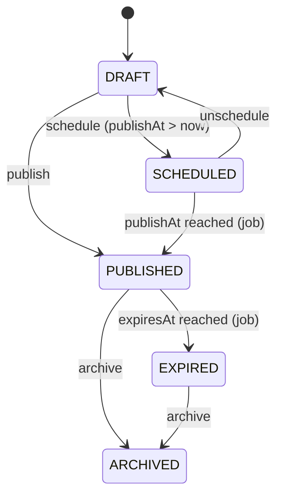

| From → To | Verb | Who | Guards | Side effects |
| :-- | :-- | :-- | :-- | :-- |
| DRAFT → SCHEDULED | `schedule` | `notices:publish` | `publishAt > now`; ≥1 audience; title+body EN present | DueItem not used; delayed job `notice:publish` at `publishAt` |
| DRAFT/SCHEDULED → PUBLISHED | `publish` | `notices:publish`; `EXECUTIVE` category requires role `CHAIRMAN`/`DIRECTOR`/`EXECUTIVE_ASSISTANT`; categories in Setting `notices.requireApprovalForCategories` require an APPROVED `NOTICE_PUBLISH` instance | — | Resolve audience → `recipientCount`; create `NoticeReceipt` rows (readAt null); notification `NOTICE_PUBLISHED`; realtime `notices.notice.published` to `user:{id}` of each recipient; audit |
| PUBLISHED → EXPIRED | job | system | `expiresAt ≤ now` | realtime `notices.notice.expired` |
| PUBLISHED/EXPIRED → ARCHIVED | `archive` | `notices:archive` | — | banner removed if broadcast; audit |

### 2.4 Business rules

| ID | Rule |
| :-- | :-- |
| BR-01-01 | Audience resolution: union of `NoticeAudience` rows (`ALL`, `SITE`, `DEPARTMENT` incl. children, `ROLE`, `GRADE`, `USER`) restricted to `User.isActive && Employee.status ∉ {OFFBOARDED}`. Resolution is snapshotted at publish time into `NoticeReceipt`; later joiners do not receive old notices unless `isPinned` (pinned notices are also shown to new employees for `notices.pinnedBackfillDays` = `30`). |
| BR-01-02 | `recipientCount = count(NoticeReceipt)`; `ackCount = count(NoticeReceipt.ackedAt not null)`. Both are denormalised counters updated transactionally. **(prototype gap: single integer counter, no per-user receipt.)** |
| BR-01-03 | `readAt` is set on first `GET /notices/{id}` by a recipient; `ackedAt` only via `POST /notices/{id}/ack`, allowed once, only when `requiresAck = true`, only for recipients. |
| BR-01-04 | `requiresAck` notices with `ackedAt = null` after Setting `notices.ackReminderHours` = `48` trigger `NOTICE_ACK_REMINDER` once; after `notices.ackEscalationHours` = `120` the recipient's line manager receives `NOTICE_ACK_OVERDUE_TEAM` with the list. |
| BR-01-05 | `priority = CRITICAL` notices send PUSH+SMS to all recipients regardless of preferences and show as the top banner on frontend/mobile until acknowledged or dismissed (`dismiss` is client-side only when `requiresAck = false`). |
| BR-01-06 | Max `isPinned` notices simultaneously = Setting `notices.maxPinned` = `5`; pinning a 6th → `CONFLICT`. |
| BR-01-07 | Editing a PUBLISHED notice is limited to typo fixes in `body/bodyBn` and `expiresAt`; title/category/audience changes require archive + new notice. Edits append `NOTICE_UPDATED` realtime event (no re-notification). |
| BR-01-08 | A `Broadcast` is a notice with `category = EXECUTIVE`, `isPinned = true`, `priority ≥ HIGH`, audience `ALL`, plus banner flags. Only `CHAIRMAN` (or `EXECUTIVE_ASSISTANT` with `notices:broadcast`) may create. `sendSms = true` enqueues SMS to every active employee with a phone; Setting `notices.broadcastSmsRateLimitPerDay` = `3`. |
| BR-01-09 | `activeUntil` of a Broadcast defaults to `publishAt + 24 h`; the banner hides after `activeUntil` even if the notice stays PUBLISHED. |
| BR-01-10 | `expiresAt` default = `publishAt + notices.defaultExpiryDays` (`90`). Maximum body length 20,000 characters; max 10 attachments. |

### 2.5 Approval workflow
Template `NOTICE_PUBLISH` (optional). Steps: `HR_REVIEW` (ROLE `HR_ADMIN`, SLA 8 h) → `EXEC_APPROVE` (ROLE `DIRECTOR`, condition `category ∈ {POLICY, EXECUTIVE}`, SLA 24 h, escalateTo `CHAIRMAN`). Active only for categories in `notices.requireApprovalForCategories` (default `["POLICY"]`).

### 2.6 Notifications & due items

| Type | Recipients | Channels | Deep link |
| :-- | :-- | :-- | :-- |
| `NOTICE_PUBLISHED` | resolved audience | IN_APP, PUSH (+SMS if CRITICAL or Broadcast.sendSms) | `/notices/{id}` |
| `NOTICE_ACK_REMINDER` | recipients not acked | IN_APP, PUSH | `/notices/{id}` |
| `NOTICE_ACK_OVERDUE_TEAM` | line managers | IN_APP, EMAIL | `/notices/{id}/receipts` |
No DueItems.

### 2.7 Permissions
`notices:read` (SELF), `notices:create`, `notices:publish`, `notices:archive`, `notices:broadcast`, `notices:receipts` (view per-user receipts; HR_ADMIN COMPANY, HOD DEPARTMENT).

### 2.8 Reports / KPIs
- `ackRate = ackCount / recipientCount` per notice (HR dashboard; Chairman suite for broadcasts).
- `readRate = count(readAt) / recipientCount`.
- `unackedCriticalCount` per department (HOD dashboard).

### 2.9 Edge cases
- Audience resolves to 0 users → publish rejected `VALIDATION_ERROR`.
- Recipient offboarded after publish → receipt remains; excluded from reminders.
- Scheduled job fires but notice already ARCHIVED → no-op.
- SMS gateway failure → `NotificationDelivery.status = FAILED`, retried 3× with backoff; IN_APP unaffected.

### 2.10 Acceptance criteria
1. Given a DRAFT notice with audience `DEPARTMENT=FIN` (12 active, 1 offboarded), when published, then 12 `NoticeReceipt` rows exist and `recipientCount = 12`.
2. Given a published `requiresAck` notice, when a non-recipient calls `/ack`, then 403 `FORBIDDEN`.
3. Given a recipient acks twice, then the second call returns 409 `CONFLICT` and `ackCount` is 1.
4. Given `publishAt = now+1h`, when scheduled, then status is SCHEDULED and becomes PUBLISHED within 60 s after `publishAt`.
5. Given 5 pinned notices, when a 6th is pinned, then 409.
6. Given a Broadcast with `sendSms=true`, then one SMS delivery row exists per active employee with phone, and the banner disappears after `activeUntil`.
7. Given a `POLICY` notice and `notices.requireApprovalForCategories=["POLICY"]`, when `publish` is called without an APPROVED instance, then 409 `INVALID_STATE_TRANSITION`.

---

## 3. MOD-02 — Chairman Command Suite (Dashboards, Voice Briefing, ROI)

### 3.1 Purpose & actors
Role dashboards (chairman, GM, HR, transport, HOD, employee, driver), Chairman voice briefings, executive KPI roll-ups. Read-mostly; computed from other modules.

| Role | Capability | Scope |
| :-- | :-- | :-- |
| `CHAIRMAN`, `DIRECTOR` | chairman suite; publish voice briefings | COMPANY |
| `EXECUTIVE_ASSISTANT` | publish voice briefings on behalf (recorded as author with `onBehalfOf`) | COMPANY |
| `PLANT_GM` | GM dashboard | SITE |
| `HR_ADMIN`, `TRANSPORT_ADMIN`, `HOD`, `EMPLOYEE`, `DRIVER` | their dashboard | role scope |

### 3.2 Entities & references
`VoiceBriefing` (`refNo` = `VB-{YYYY}-{NNNN}`), `VoiceBriefingListen`. Dashboards are read models (no tables) served from `/dashboards/{key}` with Redis cache TTL Setting `dashboards.cacheSeconds` = `60`.

### 3.3 Lifecycle
VoiceBriefing: `created (publishedAt null)` → `published` (`publishedAt` set) — two states, table only.

| From → To | Verb | Who | Guards | Side effects |
| :-- | :-- | :-- | :-- | :-- |
| draft → published | `publish` | `briefings:publish` | `audioFileId` CLEAN or transcript ≥ 20 chars; `durationSec ≤ briefings.maxDurationSec` (`180`) | notification `BRIEFING_PUBLISHED` to audience; realtime `briefings.briefing.published`; audit |

### 3.4 Business rules

| ID | Rule |
| :-- | :-- |
| BR-02-01 | Audience JSON uses the same shape as `NoticeAudience[]`; resolved at publish (BR-01-01). |
| BR-02-02 | `VoiceBriefingListen` is upserted on first playback ≥ 50 % of `durationSec` (client reports `POST /briefings/{id}/listened`); `listenRate = listens / audience`. |
| BR-02-03 | Audio is stored as `FileObject` (`audio/mp4` or `audio/webm`, ≤ 10 MB). If no audio, clients may TTS the transcript (as the prototype did) — the server never synthesises audio. |
| BR-02-04 | Dashboard KPIs are computed server-side from module tables (formulas §3.8) — never hard-coded. **(prototype gap: `ROLE_STATS` constants.)** |
| BR-02-05 | "Priority approvals" on the chairman suite = `v_approval_inbox` rows for the chairman ordered by `priority DESC, dueAt ASC`, max 10. The tab reuses the Approvals page card and the same directive / return-with-query flow (no separate dashboard-only list), sorted by time left on the SLA. |
| BR-02-06 | Leadership team ("inner circle") status = derived: `ON_LEAVE` if an APPROVED `LeaveRequest` covers today (`isInformed` true → "Informed leave"); `UNINFORMED_ABSENT` if no punch by `workStart + 2 h` and no leave/holiday/regularisation; `IN_MEETING`/`ONLINE`/`AWAY`/`OFFLINE` from chat presence; `SICK` if leave type `SL`. Membership = Setting `dashboards.innerCircleUserIds` (list of user ids), maintained by `EXECUTIVE_ASSISTANT`/`SUPER_ADMIN`. |
| BR-02-07 | ROI figures are inputs, not computations: Setting `dashboards.roi` = `{ fleetSavings, scadaSavings, vendorSavings, taxSavings, accidentFreeBaselineDate }` edited via MOD-18; the dashboard shows them with "declared" labelling. `accidentFreeDays = daysSince(max(occurredAt of Incident with type ∈ {LOST_TIME, FATALITY}) , baselineDate)`. |
| BR-02-08 | Dashboards respect scope: a `HOD` sees department aggregates only; `PLANT_GM` sees own site. A user with several roles gets the union with per-widget scope. |
| BR-02-09 | The dashboard Overview is one screen with no duplicated numbers: a greeting header (with the role's one primary action), a "Needs you today" list, and one row of KPI cards. The list holds plain sentences derived from live data and ordered danger → warning → info (e.g. "2 files need your signature; 1 due within 24 hours."), each with a button that opens the tab or module that resolves it; with nothing pending it shows "All clear". A KPI figure that is already in the needs-you list or a shortcut tile is not repeated elsewhere on the page. The hero strip, jump cards and decorative incident banner were removed for this reason. See `.cursor/rules/clarity-minimum-data.mdc`. |
| BR-02-10 | Plant GM "Safety Permits & Shifts" tab: two plain-language sections. *Work permits* lists each permit as machine, kind of work (power lock / welding or flame / inside a tank), status (Locked / Permit active / Restored), the one-line reason, worker and expiry; hazard, isolation point and the five safety checks (power off, padlock, warning tag, valves drained, gas test) are shown in the details dialog from the permit's recorded checklist, never as constants. Removing a lock is a single confirmed action that moves the permit to Restored. *Shift handover* lists each note with who hands to whom, what the next shift must know and the things to watch; a note stays "Waiting for signature" until the arriving engineer signs to accept it. All wording is bilingual and the tab carries no separate help banner. |
| BR-02-11 | Chairman "Company notices" tab: filter by All / Unread / Pinned / Safety / HR / Operations (each with a live count) plus search; each notice shows title, a plain category chip, date and author, a two-line preview, and the acknowledgement reach ("184 of 218 staff have acknowledged") only when the notice requires acknowledgement and recipients are known (no placeholder numbers). Unread notices carry a dot. Actions: read full notice, acknowledge / mark as read, pin. Notices load six at a time. All entries come from the notice store (no hard-coded pinned items). "Leadership team today" shows each leader's status, location and phone, filters by status, and offers "Ask HR to follow up" only for absent-uninformed members (BR-02-06). |

### 3.5 Approval workflow
None.

### 3.6 Notifications

| Type | Recipients | Channels | Deep link |
| :-- | :-- | :-- | :-- |
| `BRIEFING_PUBLISHED` | resolved audience | IN_APP, PUSH (SMS if `priority = CRITICAL`) | `/dashboard?briefing={id}` |

### 3.7 Permissions
`dashboards:read:chairman`, `dashboards:read:gm`, `dashboards:read:hr`, `dashboards:read:transport`, `dashboards:read:hod`, `dashboards:read:employee`, `dashboards:read:driver`, `briefings:publish`, `briefings:read`.

### 3.8 KPI catalogue (all dashboards)

| KPI | Dashboard | Formula |
| :-- | :-- | :-- |
| `pendingApprovals` | chairman, GM, HOD | count ACTIVE steps where approver/delegate = me |
| `pendingApprovalValue` | chairman, HOD | Σ `instance.summary.amount` of those steps |
| `approvalCycleHoursP50` | chairman | median(`completedAt − submittedAt`) over instances completed in last 30 days |
| `presentPct` | chairman, GM, HR | `count(AttendanceDay.status ∈ {PRESENT, LATE, FIELD_DUTY, HALF_DAY}) / count(Employee ACTIVE not on leave/holiday)` for today, per scope |
| `latePct` | HR, GM | `count(LATE) / count(PRESENT ∪ LATE)` today |
| `uninformedAbsent` | chairman, HR, GM | count employees with no punch, no leave, no regularisation by `workStart + 2 h` |
| `safeDays` | chairman, GM | BR-02-07 |
| `TRIR` | GM, chairman | `(recordable incidents × 200,000) / manHours` over trailing 12 months; recordable = type ∈ {MEDICAL_TREATMENT, LOST_TIME, FATALITY}; `manHours` = Σ `AttendanceDay.workedMinutes / 60` for the site |
| `openIncidents` | GM, HOD | count Incident `stage ≠ CLOSED` in scope |
| `capaOverdue` | GM | count CapaAction `status = OVERDUE` |
| `licencesAtRisk` | chairman, GM | count Licence with `daysToExpiry ≤ 30` and status ≠ RENEWED |
| `shutdownExposurePerDay` | chairman | Σ `Licence.shutdownRiskPerDay` where `daysToExpiry ≤ 30` |
| `fleetUtilisationPct` | transport | `count(Vehicle IN_TRANSIT ∪ LOADING) / count(Vehicle status ∉ {RETIRED, GROUNDED})` |
| `driversAvailable` | transport | count Driver `status = AVAILABLE` and licence valid |
| `requisitionsPending` | transport | count VehicleRequisition `status ∈ {PENDING_APPROVAL, APPROVED}` |
| `busWaitlistLength` | transport | count SeatWaitlist `WAITING` |
| `claimsSpendMTD` | HOD, chairman | Σ Claim `totalAmount` with `status ∈ {APPROVED, SETTLED}` and `paidAt`/`approvedAt` in current month, in scope |
| `nbvTotal` | chairman, GM | Σ `v_asset_financials.netBookValue` in scope |
| `assetAvailabilityPct` | GM | `count(Asset OPERATIONAL) / count(Asset stage ∉ {DISPOSED, DECOMMISSIONED, LOST, REQUESTED, PROCURED})` |
| `myLeaveBalance` | employee | `entitled − used` per leave type for current year |
| `myDutyHoursToday` | driver | `Driver.dutyHoursToday` |
| `myLicenceDaysLeft` | driver | `licenceExpiresAt − today` |

### 3.9 Edge cases
- No data for a KPI → return `null` with `reason`; UI shows "—", never 0.
- Cache stale after a decision: approval decisions invalidate the `dashboards:*` cache keys of the actor and the initiator.

### 3.10 Acceptance criteria
1. Given 3 ACTIVE steps for the chairman, when `/dashboards/chairman` is fetched, then `pendingApprovals = 3` and the list is ordered by priority then dueAt.
2. Given an LTI on 2026-09-01 and today 2026-11-01, then `safeDays = 61`.
3. Given a briefing with audience `ROLE=HOD` (6 users), when published, then 6 `BRIEFING_PUBLISHED` notifications exist.
4. Given a listener reports 40 % progress, then no `VoiceBriefingListen` row; at 50 % a row exists.
5. Given a HOD of FIN, when `/dashboards/hod` is fetched, then `claimsSpendMTD` only includes claims with `departmentId = FIN`.

---

## 4. MOD-03 — Note-Sheets & E-Sign (e-Nothi)

### 4.1 Purpose & actors
Numbered-paragraph note files routed through a signatory chain with OTP-verified e-signatures, vendor quotes, budget check, final signed PDF with real SHA-256 and verification code.

| Role | Capability | Scope |
| :-- | :-- | :-- |
| `EMPLOYEE`+ (any staff) | initiate, edit DRAFT, withdraw | SELF |
| `HOD` | sign as department head; return | DEPARTMENT |
| `FINANCE` | finance vetting step, budget check | COMPANY |
| `PLANT_GM`, `DIRECTOR` | GM step | SITE / COMPANY |
| `CHAIRMAN` | final sanction above threshold | COMPANY |
| `EXECUTIVE_ASSISTANT` | prepare on behalf; cannot sign | COMPANY |
| `SUPER_ADMIN` | verify hash chain, templates | COMPANY |

### 4.2 Entities & references
`NoteSheet` (`fileNo` = `BOGCL/{DEPT}/{YYYY}/{NNNN}`, prefix `NOTE:{DEPT}` sequence per department-year), `NoteParagraph`, `NoteSignatory`, `VendorQuote`, `Signature` (`stampCode` = `APPROVED-{YYYY}-{8 hex}` from CSPRNG), `WorkflowInstance` (`objectType = NoteSheet`). `verificationCode` = 10-char Crockford base32 from CSPRNG, printed with QR → `GET /public/verify/{code}`.

### 4.3 Lifecycle

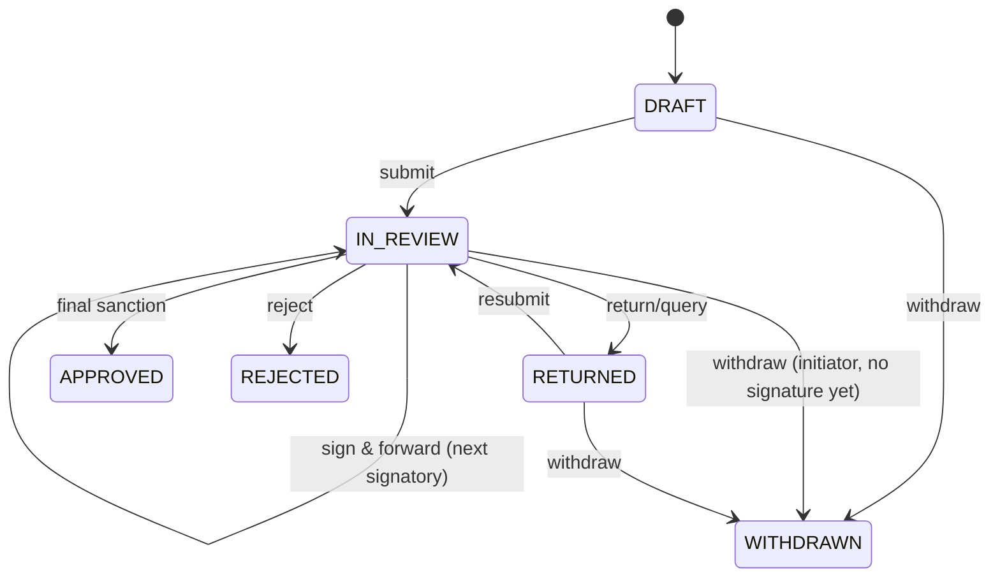

| From → To | Verb | Who | Guards | Side effects |
| :-- | :-- | :-- | :-- | :-- |
| DRAFT → IN_REVIEW | `submit` | initiator (`note-sheets:submit`) | ≥1 paragraph; `amount ≥ 0`; if `amount > 0` then `budgetHead` set; route resolved to ≥1 signatory | Workflow instance SUBMITTED→IN_REVIEW; `NoteSignatory` rows materialised (stepNo 1 PENDING, others UPCOMING); `APPROVAL_PENDING` to step-1 signatory; realtime `note-sheets.noteSheet.submitted`; audit |
| IN_REVIEW → IN_REVIEW | `sign` (intermediate) | current PENDING signatory or delegate | OTP verified (CM-32); signature captured; step not final | paragraph kind `APPROVAL` appended (hash chain); signatory SIGNED; next signatory PENDING; `APPROVAL_PENDING` to next; `NOTE_SHEET_PROGRESSED` to initiator. **(prototype gap: intermediate sign set file to approved.)** |
| IN_REVIEW → APPROVED | `sign` (final) | signatory with `isFinal = true` | all prior steps SIGNED or SKIPPED; OTP; signature | `approvedAt`; render final PDF (CM 6.4) → `finalPdfFileId`, `finalPdfSha256`, `verificationCode`; `NOTE_SHEET_APPROVED` to initiator + all signatories; realtime; audit `SIGN` |
| IN_REVIEW → RETURNED | `return` | current signatory | reason category + observation ≥ 20 chars | paragraph kind `RETURN`; signatory RETURNED; later signatories UPCOMING retained; instance RETURNED; `NOTE_SHEET_RETURNED` to initiator |
| RETURNED → IN_REVIEW | `resubmit` | initiator | new paragraph kind `NOTE` added answering the query | route restarts from the returning step (not step 1) unless Setting `noteSheets.restartRouteOnResubmit = true`; signatories after the returning step reset to UPCOMING |
| IN_REVIEW → REJECTED | `reject` | any signatory with `note-sheets:reject` | reason ≥ 20 chars | terminal; `NOTE_SHEET_REJECTED`; instance REJECTED |
| * → WITHDRAWN | `withdraw` | initiator | no SIGNED signatory yet | instance WITHDRAWN; notify current signatory `NOTE_SHEET_WITHDRAWN` |

### 4.4 Business rules

| ID | Rule |
| :-- | :-- |
| BR-03-01 | Paragraph chain: `contentHash = SHA-256(prevHash ∥ seqNo ∥ authorId ∥ kind ∥ body ∥ createdAtIso)`; `seqNo` strictly increasing per note-sheet; paragraphs are never edited or deleted (corrections are new paragraphs of kind `NOTE` referencing `seqNo`). |
| BR-03-02 | Route resolution at submit from the template conditions (§4.6). Resolved users are stored on `NoteSignatory` with `roleTitle` snapshot. A user may appear once per route; if HOD = initiator, the HOD step is `SKIPPED` with remark "initiator is HOD" and the route continues. |
| BR-03-03 | Signing requires: active session with MFA for roles in Setting `auth.mfaRequiredRoles` (default `["CHAIRMAN","DIRECTOR","PLANT_GM","FINANCE"]`); OTP sent to the signer's phone within the last 10 min and verified (CM-32); `Signature.method ∈ {DRAWN, TYPED, STAMP, UPLOADED}`; `documentHash = SHA-256 of canonical note-sheet JSON (paragraphs + quotes + amount)` at signing time, stored on `Signature.documentHash`. |
| BR-03-04 | `Signature.imageFileId` mandatory for `DRAWN`/`UPLOADED` (PNG ≤ 500 KB); `TYPED`/`STAMP` render server-side from name + stampCode. A user's saved signature image may be reused (`users/{id}/signature`). |
| BR-03-05 | Budget check at submit and at Finance step: if `amount > budgetAvailable` → policy flag `BUDGET_EXCEEDED` added to the note-sheet (not a hard block); Finance cannot approve with the flag unless `budgetHead` is changed or `budgetAvailable` updated with remark. `budgetAllocated`/`budgetAvailable` are entered by Finance (SAP adapter later). |
| BR-03-06 | Vendor quotes: when `amount ≥ noteSheets.quotesRequiredAbove` (`200000`) at least `noteSheets.minQuotes` (`3`) `VendorQuote` rows are required with exactly one `isRecommended = true`; if the recommended quote is not the lowest, a paragraph of kind `NOTE` justifying it is required (checked by presence of text ≥ 30 chars in `notes`). |
| BR-03-07 | Urgency SLA: step `slaHours` from template; `urgency = CRITICAL` halves SLA (min 2 h); `HIGH` ×0.75. Setting `noteSheets.criticalAmount` = `500000` auto-sets `urgency = HIGH` at submit if amount ≥ value and urgency was NORMAL. |
| BR-03-08 | Final PDF: rendered server-side (letterhead, paragraphs, quotes, signatory block with stamp codes, QR to `/public/verify/{code}`); `finalPdfSha256` stored and printed in the footer; `/public/verify/{code}` returns `{ fileNo, title, approvedAt, sha256, signatories[] }` without authentication but rate-limited (Setting `public.verifyRateLimitPerMin` = `20`). |
| BR-03-09 | `confidentiality ∈ {INTERNAL, CONFIDENTIAL, SECRET}`; `CONFIDENTIAL`+ hides `amount` and attachments from users not on the route; `SECRET` also hides title from inbox summaries (shows fileNo only). |
| BR-03-10 | Delegation applies (CM-21) except for steps with `isFinal = true` when Setting `noteSheets.allowDelegatedFinalSign` = `false` (default); in that case the step escalates (CM-24) instead. |
| BR-03-11 | SAP PR/PO references (`sapPrRef`, `poNumber`) are optional free text until the SAP adapter exists; format validated `^SAP-PR-\d{4}-\d{5}$` when provided. |
| BR-03-12 | Approvals Center summary for a note-sheet = `{ fileNo, title, amount, department, urgency, currentStep }`; mirrored automatically by the workflow engine (no separate "add approval" call). |
| BR-03-13 | Note-sheet workspace (web): a searchable, filterable file list (All / My turn / In progress / Returned / Approved, with counts) sits beside the selected file; the user lands on the first file awaiting their signature. Urgency is shown only while a file is open. Status wording is derived from the file state and signatory route, never a constant. |
| BR-03-14 | The file page is one linear story with no tabs: an "in short" card (status, title, file number, amount, who asked and why, the route stepper starting with the initiator, and one plain sentence saying what happens next), then price comparison (only when quotations exist), budget check, and what each officer said. The signing card appears beside it only for the signatory whose turn it is. Signing requires a captured signature (drawn or stamp); remarks are optional. Final approval asks for explicit confirmation before closing the file. The certificate action appears only once the file is approved. |
| BR-03-15 | Show a verdict before raw data: the price section states in one sentence how many suppliers quoted, which is recommended, and how it compares with the cheapest; each quote shows the extra cost over the lowest ("+৳…"). The budget section answers "is there budget?" with available, this request and left after / short by. Verification codes sit behind a "Signed and verified" disclosure on each paragraph. See `.cursor/rules/clarity-minimum-data.mdc`. |
| BR-03-16 | Starting a note-sheet: choose a route template (pre-fills subject, amount, department and route), then adjust the signing order (reorder, add, remove; at least one approver, the last is the final approver), details, and the Para-1 justification. Subject, amount, department and Para 1 are mandatory with inline errors; the purchase-request reference is auto-assigned when left blank. The form starts clean on every open. |
| BR-03-17 | Print preview: only approved files carry the approval stamp; open or returned files show "Not yet approved" / "Returned for correction" and label the amount as proposed. Printing and "Save as PDF" both use the browser print dialog and print only the document sheet. |

### 4.5 Calculations
`daysInReview = businessDaysBetween(submittedAt, approvedAt ?? now)`. `stepElapsedPct = (now − activatedAt) / (dueAt − activatedAt) × 100`.

### 4.6 Approval workflow template
Key `NOTE_SHEET` (objectType `NoteSheet`). Thresholds: Settings `workflow.noteSheet.financeAbove` = `0`, `workflow.noteSheet.gmAbove` = `500000` (5 lakh), `workflow.noteSheet.chairmanAbove` = `2500000` (25 lakh).

| # | key | approverRule | condition | SLA h | escalateTo | isFinal |
| :-- | :-- | :-- | :-- | :-- | :-- | :-- |
| 1 | `HOD` | DEPARTMENT_HEAD (of `departmentId`) | always | 18 | ROLE PLANT_GM (site) | if no later step |
| 2 | `FINANCE` | ROLE `FINANCE` | `amount > financeAbove` | 18 | ROLE DIRECTOR | if no later step |
| 3 | `GM` | ROLE `PLANT_GM` for site assets; ROLE `DIRECTOR` for HQ | `amount > gmAbove` | 24 | ROLE DIRECTOR | if no later step |
| 4 | `CHAIRMAN` | ROLE `CHAIRMAN` | `amount > chairmanAbove` | 48 | — (reminder only) | true |

Named variants (seeded, same structure, different fixed routes): `NOTE_SHEET_HR_POLICY` (HOD → HR_ADMIN → DIRECTOR → CHAIRMAN, no amount conditions), `NOTE_SHEET_CAPEX` (HOD → FINANCE → PLANT_GM → CHAIRMAN, all unconditional). The initiator picks a template; the amount-conditioned `NOTE_SHEET` is default.

### 4.7 Notifications & due items

| Type | Recipients | Channels | Deep link |
| :-- | :-- | :-- | :-- |
| `APPROVAL_PENDING` | current signatory/delegate | IN_APP, PUSH, EMAIL | `/approvals/{instanceId}` |
| `NOTE_SHEET_PROGRESSED` | initiator | IN_APP | `/note-sheets/{id}` |
| `NOTE_SHEET_RETURNED` | initiator | IN_APP, PUSH, EMAIL | `/note-sheets/{id}` |
| `NOTE_SHEET_APPROVED` | initiator, all signatories | IN_APP, PUSH, EMAIL (PDF link) | `/note-sheets/{id}` |
| `NOTE_SHEET_REJECTED` | initiator | IN_APP, PUSH, EMAIL | `/note-sheets/{id}` |
| `NOTE_SHEET_WITHDRAWN` | current signatory | IN_APP | `/note-sheets/{id}` |
| `ESIGN_OTP` | signer | SMS (+PUSH) | — |
No DueItems; SLA handled by escalation engine.

### 4.8 Permissions & scope

| Permission | EMPLOYEE | HOD | FINANCE | PLANT_GM | DIRECTOR | CHAIRMAN | EXEC_ASSISTANT | SUPER_ADMIN |
| :-- | :-- | :-- | :-- | :-- | :-- | :-- | :-- | :-- |
| `note-sheets:read` | SELF | DEPARTMENT | COMPANY | SITE | COMPANY | COMPANY | COMPANY | COMPANY |
| `note-sheets:create/submit/withdraw` | SELF | SELF | SELF | SELF | SELF | SELF | SELF (on behalf) | — |
| `note-sheets:sign` | — | DEPARTMENT | COMPANY | SITE | COMPANY | COMPANY | — | — |
| `note-sheets:return/reject` | — | DEPARTMENT | COMPANY | SITE | COMPANY | COMPANY | — | — |
| `note-sheets:verify-chain` | — | — | — | — | — | — | — | COMPANY |

### 4.9 Reports / KPIs
- `avgApprovalHours` per template & department (business hours).
- `returnRate = RETURNED transitions / submitted`.
- `pendingByStep` (how many files wait at HOD / FINANCE / GM / CHAIRMAN).
- `valueApprovedMTD` = Σ amount APPROVED this month.

### 4.10 Edge cases
- Signatory leaves the company mid-route (`Employee.status = OFFBOARDED`): step re-resolved by rule at next escalation tick; if `USER` rule, escalate to line manager and notify `SUPER_ADMIN`.
- Two signatories act concurrently on the same step → optimistic lock on `NoteSignatory.status` (`WHERE status = 'PENDING'`); loser gets 409.
- OTP SMS not deliverable (no phone) → fallback EMAIL OTP if Setting `otp.allowEmailFallback = true` (default true for e-sign only).
- PDF render failure → note-sheet stays APPROVED, `finalPdfFileId` null, job retried 5×, `SUPER_ADMIN` alerted `PDF_RENDER_FAILED`.

### 4.11 Acceptance criteria
1. Given a note-sheet with amount 48,50,000, when submitted with template `NOTE_SHEET`, then steps HOD, FINANCE, GM, CHAIRMAN are materialised and only HOD is PENDING.
2. Given amount 85,000, then steps HOD and FINANCE only; FINANCE is `isFinal`.
3. Given the HOD signs with a valid OTP, then file status stays IN_REVIEW, HOD = SIGNED, FINANCE = PENDING, and a paragraph of kind APPROVAL with a valid chain hash exists.
4. Given a wrong OTP 5 times, then the 6th attempt returns 429/409 and a new OTP must be requested after 2 min.
5. Given the final signatory signs, then `finalPdfSha256` equals the SHA-256 of the stored PDF bytes and `/public/verify/{code}` returns 200 with that hash.
6. Given a RETURNED file is resubmitted, then the route restarts at the returning step and later steps are UPCOMING.
7. Given 3 quotes where the recommended is not the lowest and no justification, when submitting with amount 3,00,000, then 422.
8. Given a tampered paragraph body in DB, when `/verify-chain` runs, then `valid = false` and `brokenAtSeq` is the tampered seq.

---

## 5. MOD-04 — Parcel Chain-of-Custody

### 5.1 Purpose & actors
Inter-site consignment tracking with hash-chained custody events, tamper flags, OTP-verified delivery and return-to-origin flow.

| Role | Capability | Scope |
| :-- | :-- | :-- |
| `EMPLOYEE`+ | create parcel (sender), view own sent/received, verify OTP as recipient | SELF |
| `MAILROOM` | dispatch, checkpoint, out-for-delivery, initiate return, resolve exceptions | SITE |
| `SECURITY_GATE` | gate-in scan, tamper inspection | SITE |
| `DRIVER` | handover accept, checkpoint scans while courier | SELF (parcels assigned) |
| `TRANSPORT_ADMIN`, `PLANT_GM` | master manifest, reassign courier | SITE / COMPANY |
| `SUPER_ADMIN` | verify chain | COMPANY |

### 5.2 Entities & references
`Parcel` (`trackingNo` = `PKG-{YYYY}-{NNNN}`), `ParcelEvent`, `ParcelReturn` (`returnNo` = `RTO-{YYYY}-{NNNN}`). `waybillNo` optional external courier number. `sealNo` free text (prototype `TAMPER-SEAL #BG-#####`).

### 5.3 Lifecycle

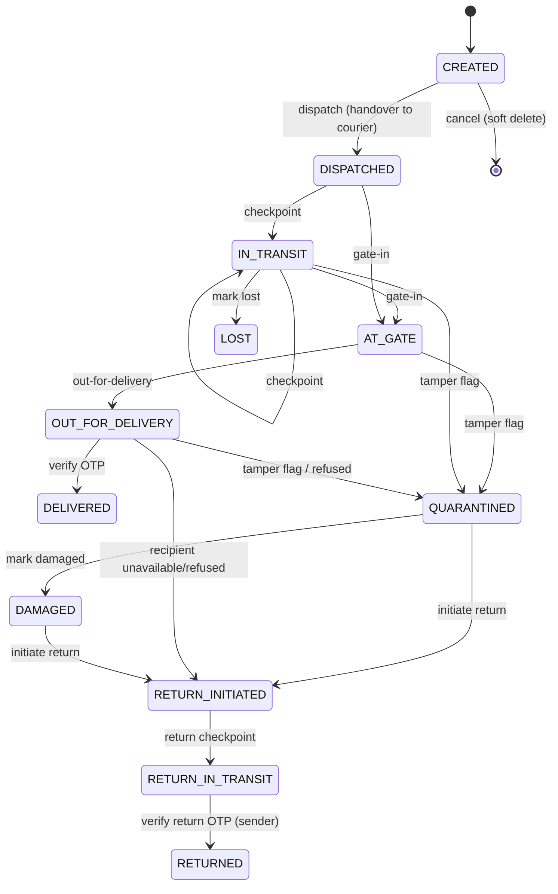

| From → To | Verb | Who | Guards | Side effects |
| :-- | :-- | :-- | :-- | :-- |
| CREATED → DISPATCHED | `dispatch` | MAILROOM at origin, or sender if Setting `parcels.senderMayDispatch` (`false`) | `courierUserId` or `tripId` set; `sealNo` set if `isConfidential` or `declaredValue ≥ parcels.sealRequiredAbove` (`100000`) | event `HANDOVER`; OTP generated & sent to recipient phone (CM-32, TTL overridden by BR-04-04); `PARCEL_DISPATCHED` to recipient; DueItem dwell (BR-04-07); realtime |
| → IN_TRANSIT | `checkpoint` | courier/driver, MAILROOM | lat/lng optional | event `CHECKPOINT`; dwell DueItem reset |
| → AT_GATE | `gate-in` | SECURITY_GATE at `destSiteId` | scan `trackingNo` QR; tamper inspection result recorded (`SECURE`/`INSPECTED`/`FLAGGED`) | event `GATE_IN`; if FLAGGED → QUARANTINED instead; `PARCEL_AT_GATE` to recipient + dest MAILROOM |
| AT_GATE → OUT_FOR_DELIVERY | `out-for-delivery` | dest MAILROOM | — | event `OUT_FOR_DELIVERY`; OTP re-issued if expired; `PARCEL_OUT_FOR_DELIVERY` (+OTP SMS) to recipient |
| OUT_FOR_DELIVERY → DELIVERED | `verify-otp` | courier device (OTP typed by recipient) or recipient themself via app | OTP valid; `otpAttempts < 5` | events `OTP_VERIFIED`, `DELIVERED`; `deliveredAt`; `PARCEL_DELIVERED` to sender; dwell DueItem DONE; photo optional |
| → QUARANTINED | `flag-tamper` | SECURITY_GATE, MAILROOM, courier | note ≥ 10 chars; photo required | `tamperStatus = FLAGGED`; event `TAMPER_FLAGGED`; `PARCEL_TAMPER_FLAGGED` (HIGH) to sender, recipient, dest MAILROOM, SECURITY lead; if `isConfidential` → also `COMPLIANCE_OFFICER` |
| → RETURN_INITIATED | `initiate-return` | dest MAILROOM, or courier for `RECIPIENT_UNAVAILABLE`/`RECIPIENT_REFUSED` | `ReturnReason` | `ParcelReturn` created with `returnNo`; return OTP generated for **sender**; event `RETURN_INITIATED`; `PARCEL_RETURN_INITIATED` to sender |
| RETURN_IN_TRANSIT → RETURNED | `verify-return-otp` | courier/sender | return OTP valid | event `RETURNED`; `returnedAt`; terminal |
| → LOST / DAMAGED | `mark-lost`/`mark-damaged` | MAILROOM lead (`parcels:exception`) | note; for LOST ≥ 72 h since last event | event `EXCEPTION`; `PARCEL_EXCEPTION` CRITICAL to sender, recipient, TRANSPORT_ADMIN; if `declaredValue ≥ parcels.exceptionEscalateAbove` (`500000`) → PLANT_GM/DIRECTOR |

### 5.4 Business rules

| ID | Rule |
| :-- | :-- |
| BR-04-01 | Event chain per CM-04: `eventHash = SHA-256(prevHash ∥ type ∥ actorUserId ∥ location ∥ lat ∥ lng ∥ note ∥ photoSha256 ∥ createdAtIso)`. `GET /parcels/{id}/verify` recomputes. |
| BR-04-02 | Categories = `ParcelCategory` enum. `CONFIDENTIAL` or `LEGAL_DOCS`/`TENDER_BID` set `isConfidential = true` by default; confidential parcels hide `description` and `declaredValue` from everyone except sender, recipient, MAILROOM leads and COMPLIANCE_OFFICER. |
| BR-04-03 | Delivery OTP: 6 digits, bcrypt, sent to `recipientPhone` (or recipient user's phone) by SMS and PUSH. If the recipient is a system user they may instead approve delivery in-app (`POST /parcels/{id}/accept`) which counts as `OTP_VERIFIED` with `metadata.method = IN_APP`. |
| BR-04-04 | Delivery OTP TTL = Setting `parcels.otpTtlHours` = `72` (overrides CM-32's 10 min because delivery takes days); attempts/cool-down per CM-32. OTP regenerated on `out-for-delivery` if expired. Master/bypass codes do not exist. **(prototype gap)** |
| BR-04-05 | Recipient mismatch: a parcel can only be verified by the OTP sent to the current `recipientPhone`; changing the recipient after dispatch requires `parcels:reassign` (MAILROOM lead) with reason, invalidates the OTP and emits `NOTE` event. |
| BR-04-06 | Tamper status: `SECURE` default; `INSPECTED` when gate opened for inspection and resealed (new `sealNo` recorded in event note); `FLAGGED` forces QUARANTINED. A FLAGGED parcel cannot be delivered; only return or damaged/lost paths. |
| BR-04-07 | Dwell-time monitoring: a `DueItem(module=parcels, objectType=Parcel, dueAt = lastEventAt + parcels.dwellAlertHours)` (`24`) is created/reset on each non-terminal event; when it fires, `PARCEL_DWELL_EXCEEDED` goes to the current custodian's MAILROOM and the sender; the parcel is listed under "stuck" on the manifest. Setting `parcels.dwellAlertHours` = `24`. |
| BR-04-08 | Urgency `CRITICAL` parcels (e.g. tender bids) halve the dwell threshold and notify `TRANSPORT_ADMIN` on dispatch. |
| BR-04-09 | Custodian = `actorUserId` of the latest `HANDOVER`/`CHECKPOINT`/`GATE_IN`/`OUT_FOR_DELIVERY` event; the manifest shows the custodian per parcel. A courier may only scan parcels where they are the current custodian or the parcel is `AT_GATE` at their site. |
| BR-04-10 | Linking to a fleet `Trip` (`tripId`) auto-adds `CHECKPOINT` events from `TripEvent` (`GATE_OUT`, `CHECKPOINT`, `GATE_IN`) with `actorUserId = driver`. |
| BR-04-11 | Photo evidence (`photoFileId`) is mandatory for `TAMPER_FLAGGED`, `EXCEPTION`, and `DELIVERED` when `declaredValue ≥ parcels.photoRequiredAbove` (`50000`). |
| BR-04-12 | `cancel` is only allowed in CREATED (soft delete, `trackingNo` retained). |

### 5.5 Calculations
`transitHours = deliveredAt − dispatchedAt` (calendar). `onTimePct = delivered within parcels.targetTransitHours (48) / delivered`.

### 5.6 Approval workflow
None (operational module).

### 5.7 Notifications & due items

| Type | Recipients | Channels | Deep link |
| :-- | :-- | :-- | :-- |
| `PARCEL_DISPATCHED` | recipient | IN_APP, PUSH | `/parcels/{id}` |
| `PARCEL_AT_GATE` | recipient, dest MAILROOM | IN_APP, PUSH | `/parcels/{id}` |
| `PARCEL_OUT_FOR_DELIVERY` | recipient | IN_APP, PUSH, SMS (with OTP) | `/parcels/{id}` |
| `PARCEL_DELIVERED` | sender | IN_APP, PUSH | `/parcels/{id}` |
| `PARCEL_TAMPER_FLAGGED` | sender, recipient, dest MAILROOM, SECURITY lead (+COMPLIANCE if confidential) | IN_APP, PUSH, SMS | `/parcels/{id}` |
| `PARCEL_RETURN_INITIATED` | sender | IN_APP, PUSH, SMS (return OTP) | `/parcels/{id}` |
| `PARCEL_EXCEPTION` | sender, recipient, TRANSPORT_ADMIN (+GM above threshold) | IN_APP, PUSH, SMS, EMAIL (CRITICAL) | `/parcels/{id}` |
| `PARCEL_DWELL_EXCEEDED` | custodian's MAILROOM, sender | IN_APP, PUSH | `/parcels/{id}` |
DueItem: dwell per BR-04-07 (`reminderDays = [0]`, `autoAction = null`).

### 5.8 Permissions & scope

| Permission | EMPLOYEE | MAILROOM | SECURITY_GATE | DRIVER | TRANSPORT_ADMIN | PLANT_GM | SUPER_ADMIN |
| :-- | :-- | :-- | :-- | :-- | :-- | :-- | :-- |
| `parcels:read` | SELF | SITE | SITE | SELF | COMPANY | SITE | COMPANY |
| `parcels:create` | SELF | SITE | — | — | COMPANY | — | — |
| `parcels:scan` (dispatch/checkpoint/gate/ofd) | — | SITE | SITE (gate-in) | SELF | COMPANY | — | — |
| `parcels:verify-otp` | SELF (recipient) | SITE | — | SELF | — | — | — |
| `parcels:flag-tamper` | — | SITE | SITE | SELF | COMPANY | — | — |
| `parcels:return`, `parcels:exception`, `parcels:reassign` | — | SITE (lead) | — | — | COMPANY | — | — |
| `parcels:manifest` | — | SITE | SITE | — | COMPANY | SITE | COMPANY |
| `parcels:verify-chain` | — | — | — | — | — | — | COMPANY |

### 5.9 Reports / KPIs
`inTransitCount`, `stuckCount` (dwell exceeded), `tamperRate = FLAGGED / dispatched (30 d)`, `onTimePct`, `avgTransitHours` by origin→dest pair, `returnRate`.

### 5.10 Edge cases
- Recipient phone changes mid-transit → BR-04-05.
- OTP verified offline on courier device: the device queues the verification with the OTP hash attempt; server validates on replay; if expired by then → `PENDING` exception list for MAILROOM.
- Gate-in at the wrong site → 409 `INVALID_STATE_TRANSITION` with `details.expectedSite`.
- Duplicate scan (same event type within 60 s by same actor) → idempotent no-op.

### 5.11 Acceptance criteria
1. Given a parcel in CREATED, when dispatched with a courier, then status DISPATCHED, a `HANDOVER` event with `prevHash` = CREATED event hash exists, and the recipient receives `PARCEL_DISPATCHED`.
2. Given OUT_FOR_DELIVERY, when the correct 6-digit OTP is submitted, then DELIVERED, `deliveredAt` set, `OTP_VERIFIED` and `DELIVERED` events appended in order.
3. Given 5 wrong OTPs, then the 6th returns 429 and `otpHash` is null until re-issue after 2 min.
4. Given a gate-in with tamper `FLAGGED`, then status QUARANTINED and `PARCEL_TAMPER_FLAGGED` sent to 4 recipient groups.
5. Given no event for 24 h on an IN_TRANSIT parcel, then `PARCEL_DWELL_EXCEEDED` is emitted exactly once and the parcel appears in `/parcels?stuck=true`.
6. Given RETURN_IN_TRANSIT, when the sender's return OTP is verified, then RETURNED and `ParcelReturn.returnedAt` set.
7. Given an event row altered in DB, then `/verify` returns `valid=false`.
8. Given the response of any endpoint, then no 6-digit OTP string appears in the body or logs (contract test with regex).

---

## 6. MOD-05 — Asset Lifecycle & EAM

### 6.1 Purpose & actors
Register, custody, maintenance (PM/CM/CBM/CAL), calibration due, LOTO quarantine, transfers, requisition→commissioning, depreciation (SLM/WDV/UOP), decommission & disposal.

| Role | Capability | Scope |
| :-- | :-- | :-- |
| `PLANT_GM` | full except write-off authorisation & depreciation policy | SITE |
| `HOD` | requisition approval (step 1), write-off initiation, depreciation policy (Finance HOD) | DEPARTMENT / COMPANY (FINANCE) |
| `FINANCE` | capitalisation, depreciation runs, disposal vetting, voucher | COMPANY |
| `HR_ADMIN` | custody reports, reclaim on exit | COMPANY |
| `TRANSPORT_ADMIN` | VEHICLE class assets, their WOs | COMPANY (class VEHICLE) |
| `HSE_OFFICER` | LOTO apply/release, SAFETY class certification | SITE |
| maintenance engineer (`EMPLOYEE` with `assets:work-orders`) | execute WOs | SITE |
| `EMPLOYEE`, `DRIVER` | view own custody, acknowledge custody, report defect | SELF |
| `CHAIRMAN`, `DIRECTOR` | write-off authorisation above threshold | COMPANY |

### 6.2 Entities & references
`AssetCategory`, `Asset` (`tag` = `BOGCL-{SITEABBR}-{CATCODE}-{NNN}`; site abbr `HQ`/`KER`/`CTG`; sequence prefix `AST:{SITE}:{CAT}`, no yearly reset), `AssetEvent`, `AssetCustody`, `AssetSpare`, `WorkOrder` (`woNo` = `WO-{YYYY}-{NNNN}`), `AssetRequisition` (`reqNo` = `ARQ-{YYYY}-{NNNN}`), `AssetTransfer` (`transferNo` = `TRF-{YYYY}-{NNNN}`, `gatePassNo` = `GP-{YYYY}-{NNNN}`), `AssetDisposal` (`voucherNo` = `VCH-RET-{YYYY}-{NNNNN}`), `DepreciationSnapshot`. Certificates `CERT-{WOTYPE}-{YYYY}-{NNNN}`.

### 6.3 Lifecycle (Asset.stage)

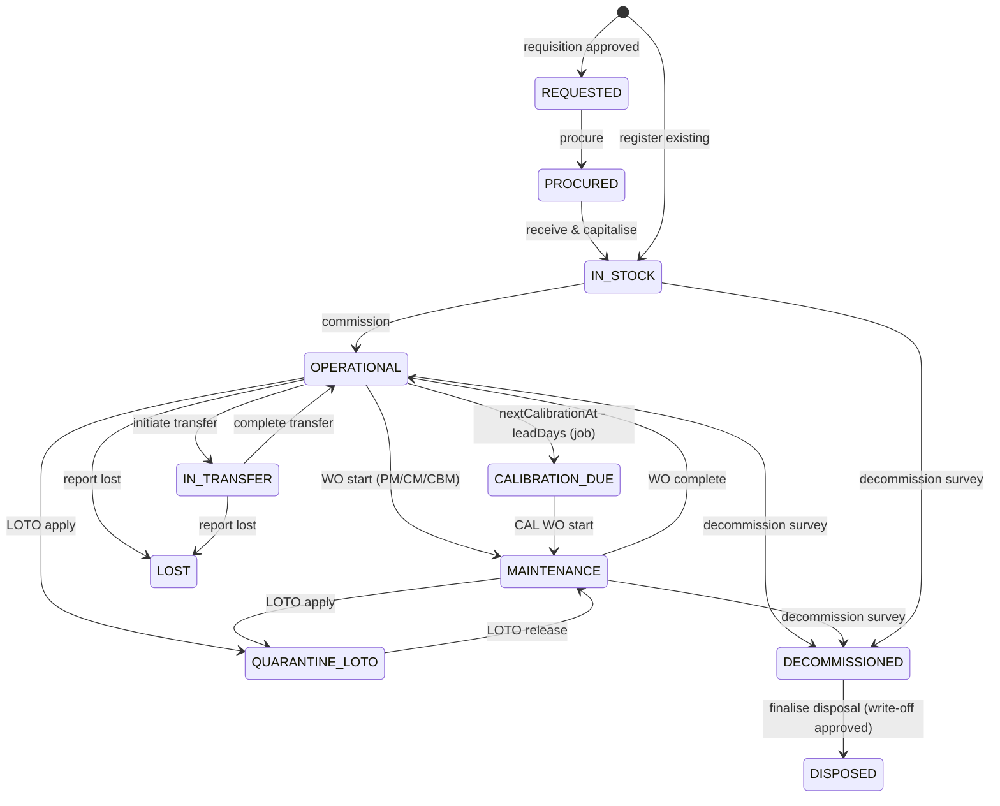

| From → To | Verb | Who | Guards | Side effects |
| :-- | :-- | :-- | :-- | :-- |
| REQUESTED → PROCURED | `procure` | `assets:procure` (procurement/FINANCE) | PO ref | event `PROCURED` |
| PROCURED/∅ → IN_STOCK | `capitalise` / `register` | FINANCE / `assets:register` | `purchaseCost > 0`, `usefulLifeYears ≥ 1`, category set | `salvageValue` default = `purchaseCost × category.defaultSalvagePct` (8 %); `depreciationMethod` = category default (`WDV` for VEHICLE, `UOP` for PLANT with `ratedLifeHours`, else `SLM`); `ratedLifeHours` default `usefulLifeYears × 4000`; `qrPayload`; event `CAPITALIZED`; DueItems for warranty/AMC/insurance/calibration |
| IN_STOCK → OPERATIONAL | `commission` | PLANT_GM / `assets:commission` | location set; custodian optional | `commissionedAt`; event `COMMISSIONED`; if custodian → `AssetCustody` + `ASSET_CUSTODY_ASSIGNED` |
| OPERATIONAL → IN_TRANSFER | `transfer` | `assets:transfer` | not LOTO (BR-05-10); custody acknowledged or none | `AssetTransfer INITIATED`, gate pass PDF; event `TRANSFER_INITIATED`; `ASSET_TRANSFER_INITIATED` to receiving site GM/custodian |
| IN_TRANSFER → OPERATIONAL | `complete-transfer` | receiving site `assets:transfer` | gate pass scanned at dest | `siteId`, `location`, custody re-assigned; event `TRANSFER_COMPLETED` |
| → MAINTENANCE | `wo:start` | WO assignee | WO `SCHEDULED`; LOTO permit if category requires (BR-05-09) | WO IN_PROGRESS; `startedAt`; event `DEFECT_FLAGGED` if CM |
| MAINTENANCE → OPERATIONAL | `wo:complete` | WO assignee | `actualCost` set; CAL WO requires `certificateNo` | WO COMPLETED; health/cost effects BR-05-07; `nextCalibrationAt`/`nextServiceAt` roll; events `PM_CERTIFIED`/`CAPEX_OVERHAUL`; DueItem recreated |
| OPERATIONAL → CALIBRATION_DUE | job | system | `nextCalibrationAt − today ≤ assets.calLeadDays` (`30`) | auto CAL WorkOrder (BR-05-08); `ASSET_CALIBRATION_DUE` to custodian + site maintenance lead |
| → QUARANTINE_LOTO | `loto:apply` | HSE_OFFICER / `assets:loto` | `lotoPermitNo` format `LOTO-{YYYY}-{NNNN}` | event `LOTO_APPLIED`; `ASSET_LOTO_APPLIED` to custodian, GM; realtime |
| QUARANTINE_LOTO → MAINTENANCE | `loto:release` | same HSE_OFFICER role (not the applier if Setting `assets.lotoFourEyes = true`) | open CM/PM WO exists or is created | event `LOTO_RELEASED` |
| → DECOMMISSIONED | `decommission` | `assets:decommission` | `AssetDisposal.reason` set; survey notes | event `DECOMMISSION_SURVEY`; custody released; `ASSET_WRITE_OFF` workflow instance created (§6.6) |
| DECOMMISSIONED → DISPOSED | `dispose` | FINANCE | workflow APPROVED; checklist all true; `method`, `proceeds` | `nbvAtDisposal`, `gainLoss`, `voucherNo`; event `DISPOSED`; stage DISPOSED; NBV = 0 |
| → LOST | `report-lost` | custodian/GM | note; police GD no. optional | event `STOCK_ADJUSTED`; `ASSET_LOST` CRITICAL to FINANCE, GM; write-off workflow with reason `LOST_STOLEN` |

### 6.4 Business rules

| ID | Rule |
| :-- | :-- |
| BR-05-01 | Every stage change appends an `AssetEvent` with `fromStage`/`toStage` and chain hash per CM-04. |
| BR-05-02 | Custody: assigning sets `AssetCustody.assignedAt`; the employee must acknowledge within Setting `assets.custodyAckDays` (`3`) or `ASSET_CUSTODY_ACK_OVERDUE` goes to the employee and their line manager; unacknowledged custody blocks transfer and exit clearance. Only one open custody (`releasedAt null`) per asset. |
| BR-05-03 | `grossCost = purchaseCost + capexAdditions`; `salvage = min(salvageValue, 0.5 × grossCost)`; `depreciableBase = grossCost − salvage`. |
| BR-05-04 | Depreciation is computed monthly pro-rata from the first day of the month following `commissionedAt` (or `purchaseDate` if never commissioned and `IN_STOCK` for > 12 months). Fiscal year = July–June (Setting `assets.fiscalYearStartMonth` = `7`). `DepreciationSnapshot` is written by job `assets:depreciation-run` on the 1st of each month and finalised per fiscal year. Formulas §6.5. **(prototype gap: whole-year `ageYears`.)** |
| BR-05-05 | NBV never falls below `salvage`; on DISPOSED NBV = 0 and depreciation stops. Changing `depreciationMethod` requires `assets:policy` (Finance HOD) and takes effect prospectively from the next fiscal year (audited). |
| BR-05-06 | Economic end-of-life flag `isEolCandidate = repairRatioPct ≥ 50 OR (remainingLifeYears ≤ 0.5 AND healthScore < 55) OR stage = DECOMMISSIONED`, where `repairRatioPct = opexToDate / grossCost × 100`. Settings `assets.eolRepairRatioPct = 50`, `assets.eolHealthBelow = 55`. |
| BR-05-07 | WO completion effects: `isCapex = true` → `capexAdditions += actualCost`, `usefulLifeYears += assets.capexLifeExtensionYears` (`2`), `healthScore = min(100, +15)`; opex → `opexToDate += actualCost`, `healthScore = min(100, +7)`; CM under warranty (`warrantyExpiresAt ≥ today`) forces `actualCost = 0` for parts/labour and records vendor claim ref. Defect flag → `healthScore = max(25, −10)` and auto-creates a CM WO with `estimatedCost = assets.defaultCmEstimate` (`25000`, 0 under warranty). |
| BR-05-08 | Calibration: categories with `calibrationCycleDays` create a `DueItem(autoAction = CREATE_CAL_WO, dueAt = nextCalibrationAt, reminderDays [90,60,30,15,7,1,0])`. At `dueAt − assets.calLeadDays` (30) the engine creates `WorkOrder(type=CAL, priority=HIGH, dueAt=nextCalibrationAt, regulator=category.regulator)` and sets stage CALIBRATION_DUE. If `nextCalibrationAt` passes without a COMPLETED CAL WO the asset is flagged `calibrationExpired` and cannot be the subject of `commission`/`transfer`; `ASSET_CALIBRATION_EXPIRED` CRITICAL to GM + HSE. CAL completion sets `nextCalibrationAt = completedAt + calibrationCycleDays`. |
| BR-05-09 | LOTO permit is mandatory to start a WO on assets with `criticality = CRITICAL_A` or category class `PLANT` when `assets.lotoRequiredForPlant` (`true`). |
| BR-05-10 | **LOTO blocks custody transfer:** while `stage = QUARANTINE_LOTO` or `lotoPermitNo` is set and not released, `transfer`, `assign-custody`, `commission`, `dispose` return 409 `INVALID_STATE_TRANSITION` with code `LOTO_ACTIVE`. |
| BR-05-11 | Spares: `qtyOnHand < reorderLevel` after consumption → `ASSET_SPARE_LOW_STOCK` to stores lead and GM; consumption requires an open WO on the asset. |
| BR-05-12 | Requisition: `AssetRequisition.stage` follows `PENDING_HOD → PENDING_EXECUTIVE → APPROVED_PROCURING → COMMISSIONED | REJECTED` driven by template `ASSET_REQUISITION`; commissioning from a requisition pre-fills `purchaseCost = actual invoice`, links `commissionedAssetId`. |
| BR-05-13 | Disposal checklist keys `{technicalSurveySigned, decontaminationCertified, sparesHarvested, financeVetted}` must all be `true` before `dispose`. `gainLoss = proceeds − nbvAtDisposal`. `DONATION`/`SCRAP_RECYCLING` with `proceeds = 0` allowed. Hazardous categories (regulator DOENV/DOEXP) require `decontaminationCertified` with certificate attachment. |
| BR-05-14 | Documents due: `warrantyExpiresAt`, `amcExpiresAt`, `insuranceExpiresAt` each create a DueItem with `reminderDays [60,30,7,0]` to the custodian/site maintenance lead. |
| BR-05-15 | Vehicles registered in MOD-09 auto-create a linked `Asset` (class VEHICLE, method WDV) via `Vehicle.assetId`; both records stay in sync for `siteId` and `status ↔ stage` (`RETIRED` ↔ `DECOMMISSIONED`). |
| BR-05-16 | Exit interlock: `reclaimEmployeeAssets(employeeId)` (called by MOD-16) releases all open custodies with `releaseReason = EXIT`, sets assets to `IN_STOCK` at their site, and appends `CUSTODY_RECLAIMED` events; the `ASSETS_RETURNED` clearance item auto-clears only when zero open custodies remain. |
| BR-05-17 | `healthScore` is 0–100; `< 40` sets WO priority default HIGH; `< 25` auto-creates a CBM WO if none open. |

### 6.5 Calculations (worked examples)

Definitions: `G` grossCost, `S` salvage (capped), `B = G − S`, `L` usefulLifeYears, `m` months in service.

| Method | Formula | Example |
| :-- | :-- | :-- |
| SLM | `annual = B / L`; `monthly = annual / 12`; `accum = min(B, monthly × m)`; `NBV = G − accum` | Generator: G 2,40,00,000; S 25,00,000; L 15 → B 2,15,00,000; annual 14,33,333.33; after 40 months accum 47,77,777.78; NBV 1,92,22,222.22 |
| WDV | `rate = clamp(1 − (S/G)^(1/L), 0.12, 0.35)`; year charge `= opening × rate` (last year: `opening − S`); monthly = year charge / 12 within fiscal year; `NBV = max(S, G × (1 − rate)^(m/12))` | Generator WDV: `(25/240)^(1/15) = 0.86004` → rate 0.13996 (14.0 %); Y1 charge 33,59,040 → closing 2,06,40,960; Y2 charge 28,88,909 → closing 1,77,52,051 |
| UOP | `accum = B × min(1, runtimeHours / ratedLifeHours)`; `periodCharge = B × (hoursThisPeriod / ratedLifeHours)`; `NBV = G − accum` | Tanker: G 1,18,00,000; S 18,00,000; B 1,00,00,000; rated 20,000 h; runtime 6,500 h → accum 32,50,000; NBV 85,50,000 |
| Gain/loss | `gainLoss = proceeds − nbvAtDisposal` | Photocopier NBV 45,000 sold 58,000 → gain 13,000 |
| TCO | `G + opexToDate − (proceeds ?? S)` | — |
| Rounding | all money to 2 dp (half-up) per step; snapshots store exact decimals | — |

### 6.6 Approval workflow templates

`ASSET_REQUISITION` (objectType `AssetRequisition`): thresholds Settings `workflow.assetReq.directorAbove` = `1000000` (10 lakh), `workflow.assetReq.chairmanAbove` = `5000000`.

| # | key | approverRule | condition | SLA h | escalateTo |
| :-- | :-- | :-- | :-- | :-- | :-- |
| 1 | `HOD` | DEPARTMENT_HEAD | always | 24 | ROLE PLANT_GM |
| 2 | `EXECUTIVE` | ROLE PLANT_GM (site) | `estimatedCost ≤ directorAbove` | 48 | ROLE DIRECTOR |
| 2′ | `EXECUTIVE` | ROLE DIRECTOR | `estimatedCost > directorAbove` | 48 | ROLE CHAIRMAN |
| 3 | `CHAIRMAN` | ROLE CHAIRMAN | `estimatedCost > chairmanAbove` | 72 | — |

Stage mapping: step1 ACTIVE ⇒ `PENDING_HOD`; step2/3 ACTIVE ⇒ `PENDING_EXECUTIVE`; APPROVED ⇒ `APPROVED_PROCURING`; REJECTED ⇒ `REJECTED`.

`ASSET_WRITE_OFF` (objectType `AssetDisposal`): Settings `workflow.writeOff.gmAbove` = `0`, `workflow.writeOff.directorAbove` = `500000`, `workflow.writeOff.chairmanAbove` = `2500000` (on `nbvAtDisposal`).

| # | key | approverRule | condition | SLA h |
| :-- | :-- | :-- | :-- | :-- |
| 1 | `HOD` | DEPARTMENT_HEAD of custodian dept (or site GM if none) | always | 24 |
| 2 | `FINANCE` | ROLE FINANCE | always | 48 |
| 3 | `GM` | ROLE PLANT_GM | `nbv > gmAbove` | 48 |
| 4 | `DIRECTOR` | ROLE DIRECTOR | `nbv > directorAbove` | 72 |
| 5 | `CHAIRMAN` | ROLE CHAIRMAN | `nbv > chairmanAbove` | 96 |

### 6.7 Notifications & due items

| Type | Recipients | Channels | Deep link |
| :-- | :-- | :-- | :-- |
| `ASSET_CUSTODY_ASSIGNED` | custodian | IN_APP, PUSH | `/assets/{id}` |
| `ASSET_CUSTODY_ACK_OVERDUE` | custodian, line manager | IN_APP, PUSH | `/assets/{id}` |
| `ASSET_TRANSFER_INITIATED` | dest site GM, new custodian | IN_APP, PUSH | `/assets/transfers/{id}` |
| `ASSET_WO_ASSIGNED` | assignee | IN_APP, PUSH | `/assets/work-orders/{id}` |
| `ASSET_WO_DUE` / `ASSET_WO_OVERDUE` | assignee, maintenance lead | IN_APP, PUSH | `/assets/work-orders/{id}` |
| `ASSET_CALIBRATION_DUE` | custodian, maintenance lead | IN_APP, PUSH, EMAIL | `/assets/{id}` |
| `ASSET_CALIBRATION_EXPIRED` | GM, HSE_OFFICER | IN_APP, PUSH, SMS (CRITICAL) | `/assets/{id}` |
| `ASSET_LOTO_APPLIED` / `ASSET_LOTO_RELEASED` | custodian, GM | IN_APP, PUSH | `/assets/{id}` |
| `ASSET_SPARE_LOW_STOCK` | stores lead, GM | IN_APP, EMAIL | `/assets/{id}/spares` |
| `ASSET_DOC_EXPIRING` | custodian, maintenance lead | IN_APP, EMAIL | `/assets/{id}` |
| `ASSET_LOST` | FINANCE, GM | IN_APP, PUSH, EMAIL (CRITICAL) | `/assets/{id}` |
| `APPROVAL_PENDING` | step approver | IN_APP, PUSH, EMAIL | `/approvals/{instanceId}` |
DueItems: calibration (`CREATE_CAL_WO`), warranty/AMC/insurance (`null`), WO `dueAt` (`[7,1,0]`), next service.

### 6.8 Permissions & scope

| Permission | EMPLOYEE/DRIVER | HOD | FINANCE | PLANT_GM | HR_ADMIN | TRANSPORT_ADMIN | HSE_OFFICER | CHAIRMAN/DIRECTOR |
| :-- | :-- | :-- | :-- | :-- | :-- | :-- | :-- | :-- |
| `assets:read` | SELF (custody) | DEPARTMENT | COMPANY | SITE | COMPANY | COMPANY (VEHICLE) | SITE | COMPANY |
| `assets:register`, `assets:commission` | — | — | COMPANY | SITE | — | COMPANY (VEHICLE) | — | — |
| `assets:custody` (assign/ack) | SELF (ack) | DEPARTMENT | — | SITE | COMPANY | COMPANY (VEHICLE) | — | — |
| `assets:transfer` | — | — | — | SITE | — | COMPANY (VEHICLE) | — | — |
| `assets:work-orders` | SELF (report defect) | — | — | SITE | — | COMPANY (VEHICLE) | SITE (SAFETY) | — |
| `assets:loto` | — | — | — | — | — | — | SITE | — |
| `assets:policy` (depreciation) | — | COMPANY (FIN HOD) | COMPANY | — | — | — | — | — |
| `assets:decommission` | — | DEPARTMENT | — | SITE | — | COMPANY (VEHICLE) | — | — |
| `assets:write-off` (approve) | — | DEPARTMENT | COMPANY | SITE | — | — | — | COMPANY |
| `assets:dispose` | — | — | COMPANY | — | — | — | — | — |
| `assets:export` | — | DEPARTMENT | COMPANY | SITE | COMPANY | COMPANY | — | COMPANY |

### 6.9 Reports / KPIs
`nbvTotal`, `accumulatedDepreciationFY`, `assetAvailabilityPct`, `maintenanceDue30d` = count WO `dueAt ≤ today+30` not COMPLETED, `calibrationOverdue`, `custodyUnacknowledged`, `eolCandidates`, `repairRatioTop10`, `sparesBelowReorder`, FI-AA ledger CSV export (tag, category, G, accum, NBV, method, FY).

### 6.10 Edge cases
- Commission without custodian → asset OPERATIONAL, custody empty; allowed for fixed plant.
- Transfer to same site → 422.
- Disposal with `proceeds > 0` but `method = DONATION` → 422.
- Depreciation run while asset DECOMMISSIONED → continues until DISPOSED (IAS 16 held-for-sale is out of scope; flag in Appendix D).
- Snapshot for a fiscal year already finalised cannot be recomputed except by `SUPER_ADMIN` with reason.

### 6.11 Acceptance criteria
1. Given an asset G 2,40,00,000 / S 25,00,000 / L 15 / SLM commissioned 2023-06-15, when the depreciation run executes on 2026-11-01, then `accum = 47,77,777.78` (40 months) ± 0.01.
2. Given the same asset with WDV, then rate = 0.1400 (4 dp) and Y1 charge 33,59,040.
3. Given UOP with B 1,00,00,000, rated 20,000 h, runtime 6,500 h, then NBV = 85,50,000.
4. Given an asset in QUARANTINE_LOTO, when `transfer` is called, then 409 with code `LOTO_ACTIVE`.
5. Given `nextCalibrationAt = today + 30`, when the due job runs, then a CAL WO exists with `dueAt = nextCalibrationAt` and stage = CALIBRATION_DUE.
6. Given a disposal checklist with `financeVetted=false`, when `dispose` is called, then 409.
7. Given a CM WO completed with `actualCost 1,20,000`, `isCapex=false`, then `opexToDate += 1,20,000`, `healthScore += 7` (cap 100).
8. Given a requisition `estimatedCost 42,00,000`, when submitted, then steps HOD → DIRECTOR (not PLANT_GM) are materialised.
9. Given an employee with 2 open custodies, when `reclaimEmployeeAssets` runs, then both custodies have `releasedAt` and the assets are IN_STOCK.

---

## 7. MOD-06 — Licence & Compliance

### 7.1 Purpose & actors
Regulatory licence register (EMRD/BPC quota, Dept. of Explosives, Boilers, DoE, FSCD, BSTI, BRTA, BIWTA), expiry monitoring, renewal pipeline (Fund → Apply → Inspection → Vetting → Renewed), checklists, documents, DO letters.

| Role | Capability | Scope |
| :-- | :-- | :-- |
| `COMPLIANCE_OFFICER` | CRUD licences, run renewals, checklist, documents | COMPANY |
| `PLANT_GM` | view site licences, act as focal person, approve inspection readiness | SITE |
| `HOD` (focal) | owner of specific licences | SELF (owner) |
| `FINANCE` | fund approval step, fee payment record | COMPANY |
| `CHAIRMAN`, `DIRECTOR` | dashboard, fund approval above threshold | COMPANY |
| `HSE_OFFICER` | read; link incidents to licences | SITE |

### 7.2 Entities & references
`RegulatoryBody` (codes `BSTI, DOEXP, DOENV, FSCD, BIWTA, BRTA, BOILER, EMRD` + **`DIFE`** added for MOD-07 statutory reporting — see Appendix D), `LicenceType`, `Licence` (`licenceNo` external; internal ref `LIC-{YYYY}-{NNNN}`), `LicenceRenewal` (`cycleNo` sequential per licence), `LicenceChecklistItem`, `LicenceDocument`. DO letter memo number `BOGCL/CMD-DO/{BODYCODE}/{YYYY}/{NNNN}`.

### 7.3 Lifecycle

Licence.status: `ACTIVE → RENEWAL_IN_PROGRESS → ACTIVE` (renewed) | `EXPIRED` | `SUSPENDED` | `REVOKED`.
LicenceRenewal.stage:

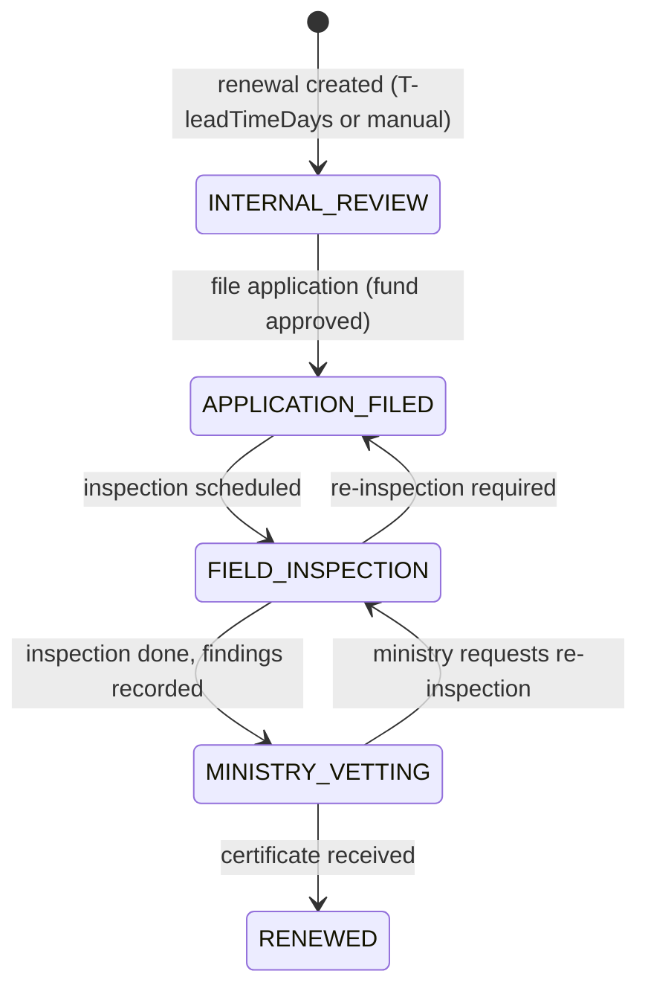

| From → To | Verb | Who | Guards | Side effects |
| :-- | :-- | :-- | :-- | :-- |
| (create) → INTERNAL_REVIEW | auto at `expiresAt − leadTimeDays` or `renew` | system / `compliance:renew` | no open renewal for licence | `Licence.status = RENEWAL_IN_PROGRESS`; checklist items created from `LicenceType.checklistTemplate`; if `feeAmount > 0` → `LICENCE_FUND_APPROVAL` instance; `LICENCE_RENEWAL_STARTED` to owner, COMPLIANCE |
| INTERNAL_REVIEW → APPLICATION_FILED | `file` | COMPLIANCE_OFFICER | fund approval APPROVED (if fee); checklist items with `status = PENDING` = 0 (PASSED/FAILED/NA allowed, FAILED requires note); application document attached | `appliedAt`; `LICENCE_APPLIED` |
| APPLICATION_FILED → FIELD_INSPECTION | `schedule-inspection` | COMPLIANCE_OFFICER | `inspectionAt`, `inspectorName` | DueItem for inspection date `[7,1,0]`; `LICENCE_INSPECTION_SCHEDULED` to owner, site GM, HSE |
| FIELD_INSPECTION → MINISTRY_VETTING | `record-inspection` | COMPLIANCE_OFFICER / site GM | `auditFindings` ≥ 10 chars; inspection report attached | `LICENCE_INSPECTION_DONE` |
| MINISTRY_VETTING → RENEWED | `complete` | COMPLIANCE_OFFICER | certificate document attached; `newExpiresAt > today`; `feePaidAt` + `chalanNo` if fee | `Licence.expiresAt = newExpiresAt`, `issuedAt = renewedAt`, `status = ACTIVE`; old DueItem DONE, new DueItem created; `LICENCE_RENEWED` to owner, GM, Chairman suite |
| back-transitions | `revert` | COMPLIANCE_OFFICER | reason | audit |

Licence status side rules: `expiresAt < today` and no RENEWED cycle → `EXPIRED` (job) with `LICENCE_EXPIRED` CRITICAL; `SUSPENDED`/`REVOKED` set manually with regulator letter attached.

### 7.4 Business rules

| ID | Rule |
| :-- | :-- |
| BR-06-01 | `daysToExpiry = expiresAt − today` (Dhaka date). Urgency band: `CRITICAL ≤ 30`, `WARNING 31–90`, `OK > 90`, `EXPIRED < 0`. Settings `compliance.criticalDays = 30`, `compliance.warningDays = 90`. |
| BR-06-02 | Each ACTIVE licence has exactly one `DueItem(objectType=Licence, dueAt=expiresAt, reminderDays=[90,60,30,15,7,1,0], autoAction=CREATE_LICENCE_RENEWAL, ownerUserId=ownerUserId)`. Reminders go to owner + COMPLIANCE_OFFICER; from 30 days also site GM; from 7 days also DIRECTOR/CHAIRMAN (CRITICAL). |
| BR-06-03 | Auto renewal cycle: at `expiresAt − LicenceType.leadTimeDays` (default 90) the engine creates `LicenceRenewal(cycleNo = max+1, stage = INTERNAL_REVIEW)` if none open. Setting `compliance.autoCreateRenewal = true`. |
| BR-06-04 | Fund approval: if `Licence.feeAmount > 0`, a `LICENCE_FUND_APPROVAL` workflow instance is created with `summary.amount = feeAmount`; `file` is blocked until APPROVED. |
| BR-06-05 | A renewal cannot be completed with `newExpiresAt − renewedAt > validityMonths + 1 month` (sanity) or `< 1 month`. |
| BR-06-06 | Checklist: `FAILED` item requires `note`; `file` requires zero `PENDING`; `complete` requires zero `FAILED` unless `compliance.allowFailedOnComplete = false` (default false → must be PASSED/NA). |
| BR-06-07 | Documents: `kind ∈ {CERTIFICATE, CHALAN, APPLICATION, INSPECTION_REPORT, DO_LETTER, OTHER}`; `CERTIFICATE` required to complete; files are PDF/images per CM-16. |
| BR-06-08 | DO letter: generated PDF on letterhead with memo number (sequence `DO:{BODY}`), addressed to `RegulatoryBody.contact`; dispatch channel recorded (`EMAIL`, `COURIER` → creates a MOD-04 parcel of category `LEGAL_DOCS` with recipient = regulator, `HAND`). Available when `daysToExpiry ≤ compliance.doLetterDays` (`30`) or stage ≥ MINISTRY_VETTING. **(prototype gap: ministry e-Nothi sync is out of scope; adapter interface only.)** |
| BR-06-09 | `shutdownRiskPerDay` is entered per licence; `exposure = Σ shutdownRiskPerDay for licences with daysToExpiry ≤ 30`. |
| BR-06-10 | `criticality = CRITICAL_A` licences escalate reminder channels to SMS from 15 days. |
| BR-06-11 | Prototype's "move to stage 5 with < 60 days auto-renews for 365 days" is replaced by BR-06-05/BR-06-07: renewal requires the actual certificate and `newExpiresAt`. **(prototype gap)** |
| BR-06-12 | Vehicle documents (MOD-09 `VehicleDocument`) and driver licences are **not** `Licence` rows; they use the same DueItem engine with `reminderDays [60,30,15,7,1,0]`. |

### 7.5 Calculations
`auditReadinessPct = PASSED / (PASSED + FAILED + PENDING)` over open renewals (NA excluded). `renewalLeadAchievedDays = expiresAt − renewedAt` (positive = renewed before expiry).

### 7.6 Approval workflow template
`LICENCE_FUND_APPROVAL` (objectType `LicenceRenewal`): reuses note-sheet thresholds.

| # | key | approverRule | condition | SLA h | escalateTo |
| :-- | :-- | :-- | :-- | :-- | :-- |
| 1 | `FINANCE` | ROLE FINANCE | always | 24 | ROLE DIRECTOR |
| 2 | `GM` | ROLE PLANT_GM (site) | `feeAmount > workflow.noteSheet.gmAbove` | 24 | ROLE DIRECTOR |
| 3 | `CHAIRMAN` | ROLE CHAIRMAN | `feeAmount > workflow.noteSheet.chairmanAbove` | 48 | — |

### 7.7 Notifications & due items

| Type | Recipients | Channels | Deep link |
| :-- | :-- | :-- | :-- |
| `LICENCE_EXPIRY_REMINDER` | owner, COMPLIANCE (+GM ≤30 d, +DIRECTOR/CHAIRMAN ≤7 d) | IN_APP, EMAIL (+PUSH ≤30, +SMS ≤7 or CRITICAL_A ≤15) | `/compliance/licences/{id}` |
| `LICENCE_RENEWAL_STARTED`, `LICENCE_APPLIED`, `LICENCE_INSPECTION_SCHEDULED`, `LICENCE_INSPECTION_DONE`, `LICENCE_RENEWED` | owner, COMPLIANCE, site GM | IN_APP (+EMAIL for RENEWED) | `/compliance/renewals/{id}` |
| `LICENCE_EXPIRED` | owner, COMPLIANCE, GM, DIRECTOR, CHAIRMAN | IN_APP, PUSH, SMS, EMAIL (CRITICAL) | `/compliance/licences/{id}` |
| `APPROVAL_PENDING` | fund approver | IN_APP, PUSH, EMAIL | `/approvals/{instanceId}` |
DueItems: licence expiry (BR-06-02), inspection date, chalan payment due (if `feePaidAt` null 7 days before `inspectionAt`).

### 7.8 Permissions & scope

| Permission | COMPLIANCE_OFFICER | PLANT_GM | HOD (owner) | FINANCE | HSE_OFFICER | CHAIRMAN/DIRECTOR |
| :-- | :-- | :-- | :-- | :-- | :-- | :-- |
| `compliance:read` | COMPANY | SITE | SELF | COMPANY | SITE | COMPANY |
| `compliance:write` (licence CRUD) | COMPANY | — | — | — | — | — |
| `compliance:renew` (stage moves) | COMPANY | SITE (inspection record) | SELF (checklist) | — | — | — |
| `compliance:documents` | COMPANY | SITE | SELF | COMPANY (chalan) | — | — |
| `compliance:do-letter` | COMPANY | — | — | — | — | COMPANY (sign) |
| `compliance:approve-fund` | — | SITE | — | COMPANY | — | COMPANY |

### 7.9 Reports / KPIs
`licencesAtRisk`, `shutdownExposurePerDay`, `auditReadinessPct`, `renewalsByStage`, `avgRenewalLeadAchievedDays`, `expiredCount`, regulator calendar (next 12 months).

### 7.10 Edge cases
- Licence created already within lead time → renewal created immediately.
- Regulator extends validity without new certificate (official letter) → `extend` action requires document kind `OTHER` and reason; audited.
- Two renewals for one licence → 409.
- Site GM changes → owner reassigned via MOD-18; open DueItems re-owned.

### 7.11 Acceptance criteria
1. Given a licence expiring in 90 days with `leadTimeDays=90`, when the nightly job runs, then a `LicenceRenewal` cycle 1 in INTERNAL_REVIEW exists and status is RENEWAL_IN_PROGRESS.
2. Given reminders [90,60,30,15,7,1,0], when the job runs at T-30, then exactly one `LICENCE_EXPIRY_REMINDER` per recipient for day 30 and `remindersSent` contains 30.
3. Given `feeAmount 2,50,000`, when the renewal is created, then a `LICENCE_FUND_APPROVAL` instance exists with only step FINANCE.
4. Given `feeAmount 15,00,000`, then steps FINANCE, GM, CHAIRMAN.
5. Given a checklist item PENDING, when `file` is called, then 409.
6. Given MINISTRY_VETTING without a CERTIFICATE document, when `complete` is called, then 422.
7. Given `complete` with `newExpiresAt = +12 months`, then `Licence.expiresAt` updated, status ACTIVE, old DueItem DONE, new DueItem OPEN with the new date.
8. Given `expiresAt` yesterday and no RENEWED cycle, then status EXPIRED and a CRITICAL notification to 5 recipient groups.

---

## 8. MOD-07 — HSE Incidents & CAPA

### 8.1 Purpose & actors
Incident reporting (incl. anonymous), 5×5 risk scoring, triage, investigation (5-Whys/Ishikawa), CAPA tracking, statutory reporting SLA, two-signature closure.

| Role | Capability | Scope |
| :-- | :-- | :-- |
| any staff (`EMPLOYEE`+, `DRIVER`, `SECURITY_GATE`) | report incident / hazard (also anonymous) | SELF |
| `HSE_OFFICER` | triage, assign investigator, RCA, CAPA, statutory filing, safety sign-off | SITE |
| investigator (`EMPLOYEE` with `incidents:investigate`) | RCA, CAPA proposals | assigned |
| CAPA owner | update own CAPA | SELF |
| `PLANT_GM` | management review, closure sign-off, CAPA verification | SITE |
| `CHAIRMAN`, `DIRECTOR`, `COMPLIANCE_OFFICER` | read all, statutory oversight | COMPANY |

### 8.2 Entities & references
`Incident` (`incidentNo` = `INC-{YYYY}-{NNNN}`), `IncidentPerson`, `IncidentRca`, `CapaAction` (`capaNo` = `CAPA-{YYYY}-{NNNN}`), `IncidentClosure`, `WorkflowInstance` for closure.

### 8.3 Lifecycle

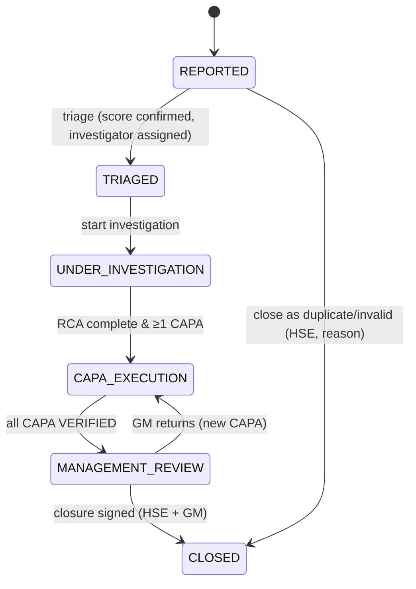

| From → To | Verb | Who | Guards | Side effects |
| :-- | :-- | :-- | :-- | :-- |
| (create) → REPORTED | `report` | any staff; anonymous allowed if Setting `hse.allowAnonymous` (`true`) | type, title, description ≥ 20, site, occurredAt ≤ now, severity & likelihood 1–5 | riskScore/category computed (BR-07-01); statutory check (BR-07-03); `INCIDENT_REPORTED` to site HSE_OFFICER(s) + GM (CRITICAL if HIGH/EXTREME); realtime `incidents.incident.reported` to `site:{id}`; DueItem triage SLA |
| REPORTED → TRIAGED | `triage` | HSE_OFFICER | may adjust severity/likelihood (audited); `investigatorId` set for `riskCategory ≥ MEDIUM` | `INCIDENT_ASSIGNED` to investigator |
| TRIAGED → UNDER_INVESTIGATION | `start-investigation` | investigator / HSE | — | DueItem RCA due (`hse.rcaDueDays` by category) |
| UNDER_INVESTIGATION → CAPA_EXECUTION | `complete-rca` | investigator / HSE | `IncidentRca.rootCause` set; ≥ `why3`; ≥1 `CapaAction` for MEDIUM+; at least one `IMMEDIATE_CONTAINMENT` for HIGH/EXTREME | `INCIDENT_CAPA_ASSIGNED` to each CAPA owner; CAPA DueItems |
| CAPA_EXECUTION → MANAGEMENT_REVIEW | auto when last CAPA → VERIFIED | system | all CAPAs `VERIFIED` | `INCIDENT_CLOSURE` workflow instance created; `INCIDENT_READY_FOR_CLOSURE` |
| MANAGEMENT_REVIEW → CLOSED | closure workflow APPROVED | HSE_OFFICER then PLANT_GM | both signatures (OTP per CM-32 for GM step when `hse.closureOtp = true`) | `IncidentClosure` timestamps; `INCIDENT_CLOSED` to reporter (if not anonymous), investigator, owners; realtime |
| MANAGEMENT_REVIEW → CAPA_EXECUTION | closure RETURNED | PLANT_GM | reason; new CAPA created | — |
| REPORTED → CLOSED | `close-invalid` | HSE_OFFICER | reason ∈ {DUPLICATE, INVALID, TEST}; `riskCategory = LOW` | audit; reporter notified |

### 8.4 Business rules

| ID | Rule |
| :-- | :-- |
| BR-07-01 | `riskScore = severity × likelihood` (1–25). `riskCategory`: `LOW 1–4`, `MEDIUM 5–9`, `HIGH 10–15`, `EXTREME 16–25`. Stored on create and on every triage adjustment (both values audited). **(prototype gap: prototype used EXTREME ≥ 15.)** |
| BR-07-02 | Severity scale (guidance, Setting `hse.severityScale` text): 1 negligible/first-aid, 2 minor/medical treatment, 3 moderate/LTI or reportable spill, 4 major/permanent disability or major LOPC, 5 catastrophic/fatality. Likelihood 1 rare … 5 almost certain. |
| BR-07-03 | **Statutory reporting matrix** Setting `hse.statutoryMatrix` (default): `FATALITY → DIFE 24 h` (also DOEXP 24 h if in licensed explosives premises), `LOST_TIME → DIFE 24 h`, `MEDICAL_TREATMENT with ≥3 injured → DIFE 24 h`, `SPILL_LEAK or ENVIRONMENTAL → DOENV 48 h`, `FIRE_THERMAL → FSCD 24 h`, `PRESSURE_PIPING with severity ≥ 3 → DOEXP 24 h (and BOILER if asset category boiler)`, `VEHICLE_ACCIDENT with injury → BRTA 72 h`. On report, if a row matches: `statutoryReportable = true`, `statutoryBodyCode`, `statutoryDueAt = occurredAt + hours` (calendar), DueItem `reminderDays [0]` plus hourly reminders in the last 6 h (`hse.statutoryHourlyReminderFrom = 6`), notification `INCIDENT_STATUTORY_DUE` CRITICAL to HSE_OFFICER, GM, COMPLIANCE_OFFICER. HSE may additionally mark any incident reportable manually. **(prototype gap: severity ≥ 3 → Dept. of Explosives only.)** |
| BR-07-04 | Statutory filing is recorded with `statutoryReceiptNo` + attachment kind `STATUTORY_FORM`; missing filing at `statutoryDueAt` → `INCIDENT_STATUTORY_OVERDUE` CRITICAL to DIRECTOR + CHAIRMAN. |
| BR-07-05 | Triage SLA: `hse.triageSlaHours` = `{ EXTREME: 1, HIGH: 4, MEDIUM: 24, LOW: 72 }` (calendar); breach notifies site GM. |
| BR-07-06 | RCA due: `hse.rcaDueDays` = `{ EXTREME: 3, HIGH: 7, MEDIUM: 14, LOW: 30 }`. 5-Whys requires at least `why1..why3`; fishbone categories `Equipment, Procedure, Material, Staffing, Inspection, Environment` optional. |
| BR-07-07 | CAPA: `status` `PENDING → IN_PROGRESS → COMPLETED → VERIFIED`; `OVERDUE` set by job when `dueAt < today` and status ∈ {PENDING, IN_PROGRESS} (restored to the previous status when updated). `COMPLETED` requires `evidence` text or attachment; `VERIFIED` only by HSE_OFFICER or PLANT_GM who is not the owner (`verifiedById ≠ ownerUserId`). Due date default `hse.capaDefaultDays` = `{ IMMEDIATE_CONTAINMENT: 1, CORRECTIVE: 30, PREVENTIVE: 60 }`. |
| BR-07-08 | Anonymous reports: `reporterId = null`, `isAnonymous = true`; the creating user id is stored only in `AuditLog` with `action = REPORT_ANONYMOUS` visible to `SUPER_ADMIN` only; notifications to the reporter are suppressed. |
| BR-07-09 | Injured persons (`IncidentPerson role=INJURED`) referencing employees automatically create an `AttendanceDay` override `status = ON_LEAVE`? — **No.** HR is notified `INCIDENT_EMPLOYEE_INJURED` and handles leave manually (keeps modules decoupled). |
| BR-07-10 | Incidents at `zone` referencing an `Asset` (optional `assetId` in `description` link or future column) with type `EQUIPMENT_DAMAGE` create a CM WorkOrder (MOD-05) with `priority = HIGH` when `riskCategory ≥ HIGH`. |
| BR-07-11 | Closure requires `IncidentClosure.safetySignedAt` before `managerSignedAt`; the HSE signatory cannot be the investigator (`safetyOfficerId ≠ investigatorId`) unless the site has one HSE officer (Setting `hse.allowSameInvestigatorClosure = false`). |
| BR-07-12 | Severity 5 or `FATALITY` incidents auto-notify CHAIRMAN and DIRECTOR by SMS and require acknowledgement (CM-27). |
| BR-07-13 | Zones are site master data (MOD-18 `hse.zones[siteId]`) seeded from the prototype's 10 Keraniganj zones. |

### 8.5 Calculations
`TRIR` and `safeDays` per §3.8. `LTIFR = LTI × 1,000,000 / manHours`. `capaCompletionPct = (COMPLETED + VERIFIED) / total`. `avgDaysToClose = mean(closedAt − reportedAt)`.

### 8.6 Approval workflow template
`INCIDENT_CLOSURE` (objectType `Incident`): step 1 `HSE_SIGN` (ROLE HSE_OFFICER, site, SLA 48 h, clock CALENDAR) → step 2 `GM_SIGN` (ROLE PLANT_GM, SLA 72 h, escalateTo DIRECTOR). RETURN from step 2 reopens CAPA_EXECUTION.

### 8.7 Notifications & due items

| Type | Recipients | Channels | Deep link |
| :-- | :-- | :-- | :-- |
| `INCIDENT_REPORTED` | site HSE officers, GM | IN_APP, PUSH (+SMS CRITICAL for HIGH/EXTREME) | `/incidents/{id}` |
| `INCIDENT_ASSIGNED` | investigator | IN_APP, PUSH | `/incidents/{id}` |
| `INCIDENT_CAPA_ASSIGNED` / `CAPA_DUE` / `CAPA_OVERDUE` | CAPA owner (+HSE on overdue) | IN_APP, PUSH | `/incidents/{id}/capa/{capaId}` |
| `INCIDENT_STATUTORY_DUE` / `INCIDENT_STATUTORY_OVERDUE` | HSE, GM, COMPLIANCE (+DIRECTOR, CHAIRMAN overdue) | IN_APP, PUSH, SMS, EMAIL (CRITICAL) | `/incidents/{id}` |
| `INCIDENT_TRIAGE_SLA_BREACH` | site GM | IN_APP, PUSH | `/incidents/{id}` |
| `INCIDENT_READY_FOR_CLOSURE` | HSE officer | IN_APP | `/approvals/{instanceId}` |
| `INCIDENT_CLOSED` | reporter, investigator, CAPA owners | IN_APP | `/incidents/{id}` |
| `INCIDENT_EMPLOYEE_INJURED` | HR_ADMIN | IN_APP, EMAIL | `/incidents/{id}` |
DueItems: triage SLA, RCA due, each CAPA `dueAt` (`[7,1,0]`), statutory due.

### 8.8 Permissions & scope

| Permission | EMPLOYEE/DRIVER | HSE_OFFICER | PLANT_GM | HOD | COMPLIANCE | CHAIRMAN/DIRECTOR |
| :-- | :-- | :-- | :-- | :-- | :-- | :-- |
| `incidents:report` | SELF | SITE | SITE | DEPARTMENT | — | — |
| `incidents:read` | SELF (own reports) | SITE | SITE | DEPARTMENT | COMPANY | COMPANY |
| `incidents:triage`, `incidents:investigate`, `incidents:capa` | — (owner may update own CAPA) | SITE | SITE | — | — | — |
| `incidents:statutory` | — | SITE | — | — | COMPANY | — |
| `incidents:close` | — | SITE (step 1) | SITE (step 2) | — | — | COMPANY (escalation) |
| `incidents:export` | — | SITE | SITE | — | COMPANY | COMPANY |

### 8.9 Reports / KPIs
`openIncidents`, `byRiskCategory`, `TRIR`, `LTIFR`, `safeDays`, `capaCompletionPct`, `capaOverdue`, `statutoryOnTimePct`, heat-map severity×likelihood counts (90 d), `avgDaysToClose`, Form B-12-style statutory dossier PDF per incident.

### 8.10 Edge cases
- Report with `occurredAt` > 30 days ago → allowed with flag `lateReport` and HSE notified.
- Severity downgraded at triage from 4 to 2 → statutory flag recomputed; if already filed, flag stays with note.
- Investigator leaves → HSE reassigns; DueItems re-owned.
- Offline mobile report with photos → queued; server assigns `incidentNo` at replay; client shows temporary id.

### 8.11 Acceptance criteria
1. Given severity 4, likelihood 4, then `riskScore = 16`, `riskCategory = EXTREME`; severity 3 × 3 → 9 MEDIUM; 2 × 5 → 10 HIGH.
2. Given type `LOST_TIME` at 10:00, then `statutoryReportable = true`, body `DIFE`, `statutoryDueAt = next day 10:00`.
3. Given type `SPILL_LEAK`, then body `DOENV`, due +48 h.
4. Given an EXTREME incident reported at T, when no triage by T+1 h, then `INCIDENT_TRIAGE_SLA_BREACH` to site GM.
5. Given RCA with only `why1`, `why2`, when `complete-rca` is called, then 422.
6. Given 2 CAPAs, when the last becomes VERIFIED, then stage MANAGEMENT_REVIEW and an `INCIDENT_CLOSURE` instance exists with step HSE_SIGN active.
7. Given the investigator is the only candidate HSE signer and the setting forbids it, then `HSE_SIGN` escalates to the site GM.
8. Given an anonymous report, then `reporterId` is null in the API and the audit row with the creator is readable only by SUPER_ADMIN.

---

## 9. MOD-08 — Guest & VIP Passes

### 9.1 Purpose & actors
Visitor pre-registration, VIP/Govt protocol approval, watchlist/blacklist screening, QR gate check-in/out, PPE and zone clearance, overstay alerts, evacuation muster.

| Role | Capability | Scope |
| :-- | :-- | :-- |
| any staff (host) | pre-register, view own guests, extend, cancel | SELF |
| `RECEPTION` | register walk-ins, badge issue, manage expected list | SITE |
| `SECURITY_GATE` | check-in/out scan, PPE clearance, inspection findings, barrier, muster | SITE |
| `HSE_OFFICER` | PPE clearance for RED zones, H₂S briefing | SITE |
| `PLANT_GM` | approve VIP/GOVT visits at site, assign escorts | SITE |
| `EXECUTIVE_ASSISTANT`, `CHAIRMAN` | VVIP approvals, protocol | COMPANY |
| `COMPLIANCE_OFFICER` / security lead | watchlist management | COMPANY |

### 9.2 Entities & references
`Visitor`, `Visit` (`visitNo` = `VIS-{YYYY}-{NNNN}`; `badgeNo` = `BDG-{SITEABBR}-{NNN}` per day, or `VIP-{NN}`/`GOVT-{NN}` pools), `VisitPpe`, `VisitZone`, `VisitInspectionFinding`, `Watchlist`. `qrToken` = 32-byte random, base64url, single-use per check-in.

### 9.3 Lifecycle

```mermaid
stateDiagram-v2
  [*] --> PRE_REGISTERED: register
  PRE_REGISTERED --> APPROVED: approve (auto for REGULAR/VENDOR/CLIENT/CONTRACTOR; workflow for VIP/GOVT)
  PRE_REGISTERED --> DENIED: deny / watchlist hit confirmed
  APPROVED --> CHECKED_IN: gate check-in (QR / ID)
  APPROVED --> CANCELLED: cancel / no-show (expectedAt + 24h)
  CHECKED_IN --> CHECKED_OUT: gate check-out
  CHECKED_IN --> OVERDUE: expectedEndAt + 30 min (job)
  OVERDUE --> CHECKED_OUT: gate check-out
  OVERDUE --> CHECKED_IN: host extends expectedEndAt
  PRE_REGISTERED --> CANCELLED: cancel
```

| From → To | Verb | Who | Guards | Side effects |
| :-- | :-- | :-- | :-- | :-- |
| (create) → PRE_REGISTERED | `register` | host / RECEPTION | visitor name + phone or ID; purpose; `expectedAt ≥ now − 1 h`; zones selected | watchlist screening (BR-08-03); `expectedEndAt` default `expectedAt + visitors.defaultDurationHours` (`4`); `qrToken` issued; `VISIT_PASS_ISSUED` SMS to visitor with pass link; `VISIT_REGISTERED` to site RECEPTION/SECURITY |
| PRE_REGISTERED → APPROVED | auto / workflow | system / approvers | no unresolved watchlist hit; VIP/GOVT → `VISIT_VIP_APPROVAL` APPROVED | `VISIT_APPROVED` to host; VIP → protocol checklist (parking, escort, hospitality) tasks to RECEPTION |
| PRE_REGISTERED → DENIED | `deny` | approver / security lead | reason | `VISIT_DENIED` to host |
| APPROVED → CHECKED_IN | `check-in` | SECURITY_GATE / RECEPTION | `qrToken` valid (single use) or manual ID match; photo captured if `visitors.photoRequired` (`true`); PPE cleared if any zone YELLOW/RED (BR-08-05); escort assigned if any RED zone (BR-08-06); not blacklisted | `checkedInAt`, `badgeNo`; `VISIT_CHECKED_IN` to host (PUSH) with ETA; realtime `visitors.visit.checkedIn` to `site:{id}`; DueItem overstay at `expectedEndAt + 30 min` |
| CHECKED_IN → OVERDUE | job | system | `now > expectedEndAt + visitors.overstayGraceMinutes` (`30`) | `VISIT_OVERSTAY` to host + site SECURITY (PUSH, SMS); repeat every 30 min max 4 |
| CHECKED_IN/OVERDUE → CHECKED_OUT | `check-out` | SECURITY_GATE | badge returned flag | `checkedOutAt`; DueItem DONE; `VISIT_CHECKED_OUT` to host |
| OVERDUE → CHECKED_IN | `extend` | host / RECEPTION | new `expectedEndAt > now`; max 2 extensions/day | DueItem rescheduled |
| APPROVED → CANCELLED | `cancel` / job no-show | host / system | `now > expectedAt + visitors.noShowHours` (`24`) | — |

### 9.4 Business rules

| ID | Rule |
| :-- | :-- |
| BR-08-01 | Categories `VIP, GOVT, VENDOR, CLIENT, CONTRACTOR, REGULAR`. `VIP` requires `vipTier`. VIP/GOVT visits require the `VISIT_VIP_APPROVAL` workflow; others auto-approve unless the site Setting `visitors.manualApprovalCategories[siteId]` lists them. |
| BR-08-02 | Repeat visitors are matched by `phone` (E.164) or hashed ID number; `Visitor` is reused, never duplicated; `isBlacklisted` visitors cannot be registered (422 `VISITOR_BLACKLISTED`). |
| BR-08-03 | **Watchlist screening** at register and again at check-in: match on normalised `fullName` (case/whitespace-insensitive, Levenshtein ≤ 2 when phone also matches partially), exact `phone`, or `idProofNoHash`. A hit sets `Visit.notes += WATCHLIST_HIT:{id}` and blocks `approve`/`check-in` until a security lead (`visitors:watchlist`) records `clear` or `deny` (audited). **(prototype gap: no watchlist.)** |
| BR-08-04 | Blacklist = `Visitor.isBlacklisted` (set by security lead with reason); Watchlist = external persons of interest. Blacklisted → always DENIED. |
| BR-08-05 | PPE: zones `YELLOW` require `hardHat, shoes, hiVisVest`; `RED` additionally `goggles, h2sBriefing`; `clearedById` must be SECURITY_GATE or HSE_OFFICER and `clearedAt` within the last 12 h. Without clearance `check-in` → 409 `PPE_NOT_CLEARED`. PPE requirements per level are Setting `visitors.ppeByZoneLevel`. |
| BR-08-06 | **RED zone requires escort + PPE:** any `VisitZone.level = RED` sets `escortRequired = true`; `check-in` requires `escortUserId` (active employee at the site). The escort receives `VISIT_ESCORT_ASSIGNED`. GREEN zones only → no PPE, no escort. |
| BR-08-07 | Badge numbering per site per day: `BDG-{SITE}-{NNN}` resets daily; VIP/GOVT use dedicated pools `VIP-{NN}`, `GOVT-{NN}`. A badge in use cannot be reissued until check-out. |
| BR-08-08 | Overstay: `OVERDUE` after `expectedEndAt + 30 min`; host and gate notified; repeated every 30 min up to 4 times then security lead notified. **(prototype gap: `overdue` never set.)** |
| BR-08-09 | Evacuation muster: `POST /visits/muster/start` (SECURITY_GATE/HSE) opens a muster for a site; each CHECKED_IN/OVERDUE visit must be marked `musterSafeAt`; `/muster/status` returns `{ inside, safe, missing[] }`; missing after `visitors.musterAlertMinutes` (`10`) → `VISIT_MUSTER_MISSING` CRITICAL to HSE + security lead with escort/host names. |
| BR-08-10 | Vehicle: `vehiclePlate` optional; `parkingSlot` assigned by RECEPTION for VIP/GOVT; ANPR/barrier integration is an adapter interface only (events `GATE_BARRIER_OPEN` logged if provided). |
| BR-08-11 | Inspection findings (`VisitInspectionFinding`) by government inspectors with `status = CRITICAL` auto-create a MOD-07 incident of type `HAZARD_OBSERVATION` (severity 3, likelihood 3) and notify HSE. |
| BR-08-12 | Pass link `/public/pass/{qrToken}` shows visitor name, host, site, date, QR; no PII beyond that; token expires at `expectedEndAt + 24 h`. |
| BR-08-13 | Maximum concurrent visitors per site Setting `visitors.maxInsidePerSite` (`{ PLANT_KERANIGANJ: 150, HQ_BARIDHARA: 200, TERMINAL_CTG: 80 }`); check-in beyond limit requires security lead override (audited). |

### 9.5 Calculations
`ppeCompliancePct = visits with PPE cleared / visits with YELLOW/RED zones (30 d)`. `avgVisitMinutes = mean(checkedOutAt − checkedInAt)`. `overstayRate = OVERDUE occurrences / check-ins`.

### 9.6 Approval workflow template
`VISIT_VIP_APPROVAL` (objectType `Visit`): step 1 `SECURITY_SCREEN` (ROLE COMPLIANCE_OFFICER or security lead role grant, SLA 4 h, clock CALENDAR) **parallel with** step 1′ `HOST_HOD` (DEPARTMENT_HEAD of host, SLA 4 h) → step 2 `SITE_HEAD` (ROLE PLANT_GM for plant/terminal sites, ROLE DIRECTOR for HQ, SLA 8 h) → step 3 `CHAIRMAN_OFFICE` (ROLE EXECUTIVE_ASSISTANT, condition `vipTier = VVIP_L1`, SLA 8 h, escalateTo CHAIRMAN).

### 9.7 Notifications & due items

| Type | Recipients | Channels | Deep link |
| :-- | :-- | :-- | :-- |
| `VISIT_PASS_ISSUED` | visitor (SMS/EMAIL external) | SMS, EMAIL | `/public/pass/{token}` |
| `VISIT_REGISTERED` | site RECEPTION, SECURITY | IN_APP | `/visitors/{id}` |
| `VISIT_APPROVED` / `VISIT_DENIED` | host | IN_APP, PUSH | `/visitors/{id}` |
| `VISIT_CHECKED_IN` / `VISIT_CHECKED_OUT` | host | IN_APP, PUSH | `/visitors/{id}` |
| `VISIT_ESCORT_ASSIGNED` | escort | IN_APP, PUSH | `/visitors/{id}` |
| `VISIT_OVERSTAY` | host, site SECURITY | IN_APP, PUSH, SMS | `/visitors/{id}` |
| `VISIT_WATCHLIST_HIT` | security lead, COMPLIANCE | IN_APP, PUSH (HIGH) | `/visitors/{id}` |
| `VISIT_MUSTER_MISSING` | HSE, security lead | IN_APP, PUSH, SMS (CRITICAL) | `/visitors/muster` |
| `APPROVAL_PENDING` | approvers | IN_APP, PUSH | `/approvals/{instanceId}` |
DueItems: overstay (`expectedEndAt + 30 min`), VIP arrival reminder to host/RECEPTION at `expectedAt − 60 min`, pass expiry.

### 9.8 Permissions & scope

| Permission | EMPLOYEE (host) | RECEPTION | SECURITY_GATE | HSE_OFFICER | PLANT_GM | EXEC_ASSISTANT | COMPLIANCE |
| :-- | :-- | :-- | :-- | :-- | :-- | :-- | :-- |
| `visitors:register` | SELF | SITE | SITE | — | SITE | COMPANY | — |
| `visitors:read` | SELF | SITE | SITE | SITE | SITE | COMPANY | COMPANY |
| `visitors:approve` | — | — | — | — | SITE | COMPANY | COMPANY (screen) |
| `visitors:gate` (check-in/out, badge) | — | SITE | SITE | — | — | — | — |
| `visitors:ppe` | — | — | SITE | SITE | — | — | — |
| `visitors:muster` | — | — | SITE | SITE | SITE | — | — |
| `visitors:watchlist` | — | — | — | — | — | — | COMPANY |
| `visitors:findings` | — | — | SITE | SITE | SITE | — | — |

### 9.9 Reports / KPIs
`insideNow` per site, `expectedToday`, `vipToday`, `overstayCount`, `ppeCompliancePct`, `avgVisitMinutes`, `watchlistHits30d`, muster status, daily gate register PDF.

### 9.10 Edge cases
- Visitor arrives early (> 1 h before `expectedAt`) → check-in allowed with flag `earlyArrival` and host PUSH.
- QR scanned twice → second returns 409 `TOKEN_USED`.
- Host offboarded before visit → visit CANCELLED, RECEPTION notified.
- Network down at gate → offline check-in queued with device timestamp; watchlist re-screened at replay; a late hit raises `VISIT_WATCHLIST_HIT` CRITICAL for a visitor already inside.

### 9.11 Acceptance criteria
1. Given a REGULAR visit with GREEN zones, when registered, then status APPROVED immediately and an SMS pass is queued.
2. Given a VIP `VVIP_L1` visit, then a `VISIT_VIP_APPROVAL` instance with parallel SECURITY_SCREEN + HOST_HOD, then SITE_HEAD, then CHAIRMAN_OFFICE.
3. Given a RED zone and no `escortUserId`, when `check-in` is called, then 409 `ESCORT_REQUIRED`.
4. Given a RED zone with escort but `h2sBriefing=false`, then 409 `PPE_NOT_CLEARED`.
5. Given `expectedEndAt = 15:00`, when 15:30 passes without check-out, then status OVERDUE and host + gate receive `VISIT_OVERSTAY`.
6. Given a watchlist entry matching the visitor's phone, when registering, then status stays PRE_REGISTERED, `VISIT_WATCHLIST_HIT` sent, and `approve` returns 409 until cleared.
7. Given a blacklisted visitor, when registering, then 422 `VISITOR_BLACKLISTED`.
8. Given a muster started with 3 inside and 2 marked safe after 10 min, then `VISIT_MUSTER_MISSING` lists 1 visitor.

---

## 10. MOD-09 — Fleet & Dispatch

### 10.1 Purpose & actors
Vehicle requisitions with HOD endorsement, dispatch (vehicle + driver), trip pass, gate out/in, driver console, tolls, fuel vouchers, vehicle document due dates, driver duty-hour and licence checks, fleet chat/SOS.

| Role | Capability | Scope |
| :-- | :-- | :-- |
| `EMPLOYEE`+ | create requisition, track own trips, rate | SELF |
| `HOD` | endorse department requisitions | DEPARTMENT |
| `TRANSPORT_ADMIN` | dispatch, pool, vehicles, drivers, fuel, toll approval | COMPANY (or SITE) |
| `DRIVER` | own trips: gate-out, checkpoints, SOS, toll claims, complete | SELF |
| `SECURITY_GATE` | record gate-out/in odometer | SITE |
| `FINANCE` | toll/fuel payment | COMPANY |
| `PLANT_GM`, `CHAIRMAN` | read; priority override | SITE / COMPANY |

### 10.2 Entities & references
`Driver` (`driverCode` = `DRV-{NN}`), `Vehicle`, `VehicleDocument`, `VehicleRequisition` (`reqNo` = `REQ-{YYYY}-{NNNN}`), `Trip` (`passNo` = `PASS-{YYYY}-{NNNN}`), `TripEvent`, `FuelVoucher` (`voucherNo` = `FUEL-{YYYY}-{NNNN}`), `TollClaim` (`receiptNo` = `TOL-{YYYY}-{NNNN}`), `FleetChatMessage`.

### 10.3 Lifecycle (VehicleRequisition.status)

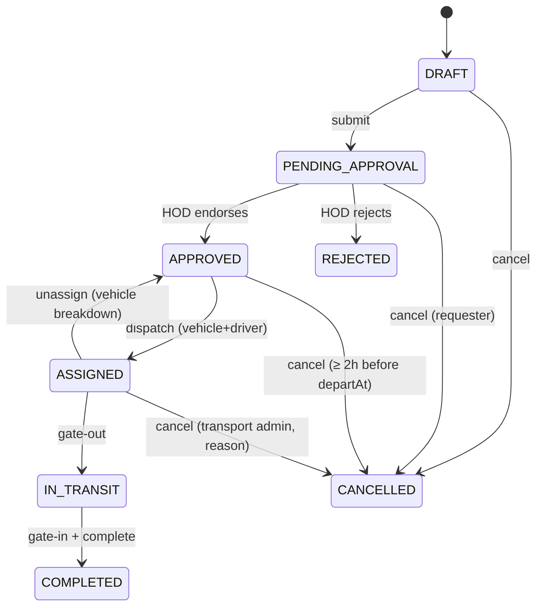

| From → To | Verb | Who | Guards | Side effects |
| :-- | :-- | :-- | :-- | :-- |
| DRAFT → PENDING_APPROVAL | `submit` | requester | `departAt ≥ now + fleet.minLeadMinutes` (`60`) unless `priority = CRITICAL`; `passengerCount ≤ capacity(capacityClass)`; origin/destination | estimates (BR-09-02); `VEHICLE_REQUISITION` instance; `APPROVAL_PENDING` to HOD; realtime |
| PENDING_APPROVAL → APPROVED | workflow APPROVE | HOD / delegate | — | `REQUISITION_APPROVED` to requester + TRANSPORT_ADMIN; appears in dispatch queue |
| PENDING_APPROVAL → REJECTED | workflow REJECT | HOD | `rejectionReason` | `REQUISITION_REJECTED` |
| APPROVED → ASSIGNED | `assign` | TRANSPORT_ADMIN | vehicle `AVAILABLE`, type matches class, documents valid (BR-09-05), hazmat rules (BR-09-07); driver `AVAILABLE`, licence valid & class ok (BR-09-06), duty hours (BR-09-04), breathalyser (BR-09-08) | `Trip` created, `passNo`, pass PDF; vehicle `IN_TRANSIT`? — **No:** vehicle stays `AVAILABLE` until gate-out but is reserved (`reservedTripId` in Redis); driver `ON_TRIP` only at gate-out; `TRIP_ASSIGNED` to requester, driver; `TripEvent ASSIGNED`; chat channel `REQ:{id}` opened |
| ASSIGNED → IN_TRANSIT | `gate-out` | DRIVER / SECURITY_GATE | `startKm ≥ vehicle.odometerKm`; within `departAt ± fleet.gateWindowMinutes` (`120`) | `gateOutAt`; vehicle `IN_TRANSIT`; driver `ON_TRIP`; event `GATE_OUT`; `TRIP_STARTED` to requester; DueItem expected return (`returnAt + 60 min`) |
| IN_TRANSIT → COMPLETED | `complete` | DRIVER (gate-in) + requester rating (optional) | `endKm ≥ startKm`; `gateInAt` | `distanceKm = endKm − startKm`; vehicle `AVAILABLE`, `odometerKm = endKm`; driver `AVAILABLE`, `totalTrips += 1`, `dutyHoursToday += (gateInAt − gateOutAt)` (BR-09-04); `totalCost` (BR-09-03); `TRIP_COMPLETED` to requester with rating prompt; event `GATE_IN`, `COMPLETED` |
| any → CANCELLED | `cancel` | per table | reason | vehicle/driver released; notifications |

Driver status machine: `AVAILABLE ↔ ON_TRIP`; `AVAILABLE → REST_REQUIRED` (job, BR-09-04) `→ AVAILABLE` (job at 00:00 or after 8 h rest); `AVAILABLE → OFF_DUTY/SICK_LEAVE/ON_LEAVE/SUSPENDED` (TRANSPORT_ADMIN or leave approval) `→ AVAILABLE`.
Vehicle status machine: `AVAILABLE → IN_TRANSIT → AVAILABLE`; `AVAILABLE → LOADING → IN_TRANSIT` (tankers); `AVAILABLE → MAINTENANCE → AVAILABLE` (linked MOD-05 WO); `* → GROUNDED` (document expired, BR-09-05) `→ AVAILABLE`; `* → RETIRED` (terminal, links MOD-05 DECOMMISSIONED).

### 10.4 Business rules

| ID | Rule |
| :-- | :-- |
| BR-09-01 | `capacityClass` capacities: `SEDAN_4 = 4`, `MICROBUS_7 = 7`, `PICKUP_4X4 = 4`, `TANKER_HEAVY = 2` (crew). `passengerCount > 4` auto-upgrades `SEDAN_4 → MICROBUS_7`; `> 7` → 422 (split requisition). Setting `fleet.capacityByClass`. |
| BR-09-02 | Estimates at submit: `estimatedKm = baseKm × (1 + stops × fleet.stopDistanceFactor (0.15)) × (tripType = ROUND_TRIP ? 2 : 1)`; `estimatedMinutes = baseMinutes × multiplier + stops × 20`; `estimatedCost = fleet.baseFare (1400) + stops × fleet.perStopFare (350) + (ROUND_TRIP ? fleet.roundTripSurcharge (950) : 0)`. `baseKm`/`baseMinutes` from Setting `fleet.destinationPresets` (seeded: Keraniganj 38.4 km/75 min, Chattogram 248 km/330 min, etc.) or driving-distance adapter; unknown destination → requester enters km. |
| BR-09-03 | Actual `Trip.totalCost = distanceKm × fleet.costPerKm (18) + Σ approved TollClaim.amount + Σ FuelVoucher.amount (trip-linked)`; `costPerKm` per `VehicleType` Setting `fleet.costPerKmByType` default `{ EXECUTIVE: 32, SEDAN: 18, MICROBUS: 22, PICKUP: 24, TANKER: 55, BUS: 45 }`. |
| BR-09-04 | **Driver duty hours cap:** `Driver.dutyHoursToday` accumulates actual `gateInAt − gateOutAt` (prototype: flat +2 h — **prototype gap**). Assignment is blocked when `dutyHoursToday + estimatedHours > fleet.maxDutyHours` (`10`); when `dutyHoursToday ≥ maxDutyHours` the driver becomes `REST_REQUIRED` with `statusUntil = max(now + fleet.minRestHours (8), next 00:00 Dhaka)`; job resets `dutyHoursToday = 0` at 00:00 and restores AVAILABLE when `statusUntil` passes. Continuous driving > `fleet.maxContinuousHours` (`4.5`) raises `DRIVER_BREAK_DUE` to the driver. |
| BR-09-05 | Vehicle documents (`FITNESS, TAX_TOKEN, ROUTE_PERMIT, INSURANCE, HAZMAT_PERMIT`) each create a DueItem `[60,30,15,7,1,0]` to TRANSPORT_ADMIN. An expired `FITNESS`, `TAX_TOKEN`, `ROUTE_PERMIT` or `INSURANCE` sets vehicle `GROUNDED` (job) and blocks `assign`; `HAZMAT_PERMIT` expiry blocks hazmat trips only. |
| BR-09-06 | **Driver licence:** `assign` requires `licenceExpiresAt ≥ returnAt ?? departAt` (else 409 `DRIVER_LICENCE_EXPIRED`); DueItem `[60,30,15,7,1,0]` to driver + TRANSPORT_ADMIN. Class rules Setting `fleet.licenceClassByVehicleType`: `TANKER → HEAVY_HAZMAT`; `BUS → PSV or HEAVY`; `PICKUP → HEAVY or LIGHT`; `SEDAN/EXECUTIVE/MICROBUS → LIGHT+` (any class). |
| BR-09-07 | **Hazmat:** vehicles with `isHazmat = true` (tankers) require driver `licenceClass = HEAVY_HAZMAT`, a valid `HAZMAT_PERMIT` document, and `lastBreathalyzerAt` within 12 h with result `PASS`; passenger requisitions can never be assigned a hazmat vehicle. |
| BR-09-08 | Breathalyser: `recordBreathalyzer(driverId, result ∈ {PASS, FAIL}, value?)` by TRANSPORT_ADMIN/SECURITY_GATE; `FAIL` sets `SUSPENDED` with `statusUntil = +24 h`, notifies TRANSPORT_ADMIN + HR_ADMIN (`DRIVER_BREATHALYZER_FAILED` HIGH) and un-assigns any ASSIGNED trip. Setting `fleet.breathalyzerRequired = true` requires a PASS within 12 h for any assignment. |
| BR-09-09 | Pooling: TRANSPORT_ADMIN may pool requisition B into A (`pooledWithId = A`) when `|B.departAt − A.departAt| ≤ fleet.poolWindowMinutes (45)`, same destination (string match or ≤ 5 km), combined passengers ≤ capacity; B inherits A's trip; both requesters notified `TRIP_POOLED`. Suggestion list is computed by these rules (no "AI"). **(prototype gap: hard-coded merge.)** |
| BR-09-10 | Gate-out window: outside `departAt ± 120 min` requires TRANSPORT_ADMIN override. Odometer: `startKm < vehicle.odometerKm − 5` → 422; `endKm − startKm > estimatedKm × 2` → trip flagged `kmVariance` for admin review. |
| BR-09-11 | Trip pass PDF (letterhead, barcode `*BOGCL-TRIP-{passNo}*`, passengers, route, driver, vehicle, validity `departAt − 2 h` to `returnAt + 2 h`) rendered at assign; gate verifies barcode. |
| BR-09-12 | Toll claims: driver submits `plaza`, `amount`, receipt photo (mandatory when `amount > fleet.tollPhotoAbove` (`100`)); plaza list and tariffs Setting `fleet.tollPlazas` (seeded: Babubazar 2nd Buriganga 150, Mayor Hanif Flyover 260, Dhaka Elevated Expressway 80, Padma Bridge 800, Kanchpur 2nd Meghna 120); `amount > tariff × 1.5` flags for review; `FLEET_TOLL_CLAIM` workflow (TRANSPORT_ADMIN approve) → `PAID` by FINANCE with voucher. Approved tolls post a `SYSTEM` message to `REQ:{id}` chat and add to `totalCost`. |
| BR-09-13 | Fuel vouchers: `liters ≤ Vehicle.tankLiters` (tanker 250 / others 75 default when null); `qrToken` single-use redeemed by station via `/fuel/redeem` (station role grant) or by TRANSPORT_ADMIN; monthly fuel per vehicle vs `fleet.fuelMonthlyCapLiters[type]` flags over-consumption; `km/L` computed from odometer deltas between vouchers. **(prototype gap: confirm never called store.)** |
| BR-09-14 | SOS: `TripEvent SOS` from driver app (lat/lng mandatory) → `TRIP_SOS` CRITICAL to TRANSPORT_ADMIN, requester, security lead, PLANT_GM; `SOS` chat channel message; acknowledgement required. Route deviation events come from the GPS adapter (interface only in v1). |
| BR-09-15 | Fleet chat channels `REQ:{id}` (requester, driver, dispatch), `DESK` (all dispatch staff), `BROADCAST` (admin → all drivers), `SOS`. Messages retained `fleet.chatRetentionDays` (`180`). No scripted auto-replies. **(prototype gap)** |
| BR-09-16 | Rating 1–5 by requester within 72 h of completion; `Driver.rating = mean(last 50 ratings)`. |
| BR-09-17 | Vehicle registration auto-creates the MOD-05 asset (BR-05-15); `RETIRED` requires MOD-05 write-off approval. |
| BR-09-18 | Driver enrolment requires `Employee` with role `DRIVER`, licence no. (`^[A-Z]{2}-BRTA-\d{4}-\d{4,6}$` or free with flag), class, expiry ≥ today + 30 days. |

### 10.5 Calculations
Examples: 2 stops, round trip → `estimatedCost = 1400 + 700 + 950 = 3050`; `estimatedKm = 38.4 × 1.3 × 2 = 99.84`. Duty: gate-out 08:00, gate-in 13:30 → +5.5 h; driver at 5.2 h before → 10.7 h ≥ 10 → `REST_REQUIRED`.

### 10.6 Approval workflow templates
- `VEHICLE_REQUISITION` (objectType `VehicleRequisition`): step 1 `HOD_ENDORSE` (DEPARTMENT_HEAD, SLA 12 h, escalateTo ROLE PLANT_GM); condition: skipped (auto-approve) if `priority = CRITICAL` and requester is HOD+ (Setting `fleet.autoApproveForHod = true`). Dispatch is operational (not a step).
- `FLEET_TOLL_CLAIM` (objectType `TollClaim`): step 1 `TRANSPORT_APPROVE` (ROLE TRANSPORT_ADMIN, SLA 24 h) → `TollStatus APPROVED`; payment by FINANCE sets `PAID` (not a step).

### 10.7 Notifications & due items

| Type | Recipients | Channels | Deep link |
| :-- | :-- | :-- | :-- |
| `APPROVAL_PENDING` | HOD | IN_APP, PUSH | `/approvals/{instanceId}` |
| `REQUISITION_APPROVED` / `REQUISITION_REJECTED` | requester (+TRANSPORT_ADMIN on approve) | IN_APP, PUSH | `/fleet/requisitions/{id}` |
| `TRIP_ASSIGNED` | requester, driver | IN_APP, PUSH, SMS (driver) | `/fleet/trips/{id}` |
| `TRIP_STARTED` / `TRIP_COMPLETED` | requester | IN_APP, PUSH | `/fleet/trips/{id}` |
| `TRIP_RETURN_OVERDUE` | TRANSPORT_ADMIN, requester | IN_APP, PUSH | `/fleet/trips/{id}` |
| `TRIP_SOS` | TRANSPORT_ADMIN, requester, security lead, GM | IN_APP, PUSH, SMS (CRITICAL) | `/fleet/trips/{id}` |
| `TRIP_POOLED` | both requesters | IN_APP, PUSH | `/fleet/trips/{id}` |
| `DRIVER_REST_REQUIRED` / `DRIVER_BREAK_DUE` | driver, TRANSPORT_ADMIN | IN_APP, PUSH | `/fleet/drivers/{id}` |
| `DRIVER_LICENCE_EXPIRING` | driver, TRANSPORT_ADMIN | IN_APP, PUSH, SMS (≤7 d) | `/fleet/drivers/{id}` |
| `DRIVER_BREATHALYZER_FAILED` | TRANSPORT_ADMIN, HR_ADMIN | IN_APP, PUSH, EMAIL | `/fleet/drivers/{id}` |
| `VEHICLE_DOC_EXPIRING` / `VEHICLE_GROUNDED` | TRANSPORT_ADMIN | IN_APP, EMAIL (+PUSH grounded) | `/fleet/vehicles/{id}` |
| `TOLL_CLAIM_SUBMITTED` / `TOLL_CLAIM_APPROVED` / `TOLL_CLAIM_PAID` | TRANSPORT_ADMIN / driver | IN_APP, PUSH | `/fleet/tolls/{id}` |
| `FUEL_VOUCHER_ISSUED` | driver | IN_APP, PUSH | `/fleet/fuel/{id}` |
DueItems: vehicle documents, driver licence, expected return (`returnAt + 60 min`), vehicle `nextServiceKm` (when `odometerKm ≥ nextServiceKm − 500`).

### 10.8 Permissions & scope

| Permission | EMPLOYEE | HOD | TRANSPORT_ADMIN | DRIVER | SECURITY_GATE | FINANCE | PLANT_GM |
| :-- | :-- | :-- | :-- | :-- | :-- | :-- | :-- |
| `fleet:requisitions:create/cancel` | SELF | SELF | COMPANY | — | — | — | SELF |
| `fleet:requisitions:read` | SELF | DEPARTMENT | COMPANY | SELF (assigned) | SITE | — | SITE |
| `fleet:requisitions:endorse` | — | DEPARTMENT | — | — | — | — | SITE (escalation) |
| `fleet:dispatch` (assign/pool/cancel) | — | — | COMPANY | — | — | — | — |
| `fleet:trips:gate` | — | — | COMPANY | SELF | SITE | — | — |
| `fleet:trips:complete`, `fleet:sos` | — | — | COMPANY | SELF | — | — | — |
| `fleet:vehicles:*`, `fleet:drivers:*` | — | — | COMPANY | SELF (read) | SITE (breathalyser) | — | SITE (read) |
| `fleet:tolls:submit` / `approve` / `pay` | — | — | — / COMPANY / — | SELF / — / — | — | — / — / COMPANY | — |
| `fleet:fuel:issue` / `redeem` | — | — | COMPANY | — | — | COMPANY (report) | — |
| `fleet:chat` | SELF (REQ) | — | COMPANY | SELF (REQ, BROADCAST read, SOS) | — | — | — |

### 10.9 Reports / KPIs
`fleetUtilisationPct`, `requisitionsPending`, `avgDispatchMinutes = assignedAt − approvedAt`, `onTimeDepartPct` (gate-out within window), `costPerKm` actual, `fuelEfficiencyKmPerL` per vehicle, `tollSpendMTD`, `driversRestRequired`, `docsExpiring30d`, `sosCount`, gate manifest PDF per day/site.

### 10.10 Edge cases
- Vehicle breaks down mid-trip → driver `TripEvent NOTE` + admin `reassign-vehicle`: new vehicle, same trip, `startKm` for the new vehicle recorded in event; cost pro-rated by vehicle km.
- Requester cancels after ASSIGNED < 2 h before departure → allowed by TRANSPORT_ADMIN only; `cancellationLate` flag reported per department.
- Driver forgets gate-in → DueItem `TRIP_RETURN_OVERDUE`; admin may `force-complete` with estimated `endKm` (flag).
- Midnight crossing trips → duty hours split by Dhaka day boundary.

### 10.11 Acceptance criteria
1. Given 6 passengers and class SEDAN_4, when submitted, then class becomes MICROBUS_7; given 8 → 422.
2. Given 2 stops round trip to Keraniganj preset, then `estimatedCost = 3050` and `estimatedKm = 99.84`.
3. Given a driver with `dutyHoursToday = 7` and estimated 4 h, when `assign`, then 409 `DRIVER_DUTY_CAP`.
4. Given a trip gate-out 08:00 / gate-in 13:30 for a driver at 5.2 h, then `dutyHoursToday = 10.7` and status `REST_REQUIRED`.
5. Given a driver whose licence expires before `returnAt`, when `assign`, then 409 `DRIVER_LICENCE_EXPIRED`.
6. Given a tanker (`isHazmat`) and a driver with class HEAVY, then 409 `HAZMAT_CLASS_REQUIRED`; with HEAVY_HAZMAT but no PASS breathalyser in 12 h → 409 `BREATHALYZER_REQUIRED`.
7. Given a vehicle whose FITNESS expired yesterday, when the nightly job runs, then status GROUNDED and `assign` is blocked.
8. Given a toll claim 400 at Babubazar (tariff 150), then the claim is flagged `tariffVariance` and still routed to TRANSPORT_ADMIN.
9. Given two requisitions to the same destination 30 min apart with 3 + 3 passengers, when pooled, then B.`pooledWithId = A`, class MICROBUS_7, both requesters notified.
10. Given an SOS event, then a CRITICAL notification with `ackRequired=true` reaches TRANSPORT_ADMIN within 5 s (realtime) and repeats every 10 min until acknowledged.

---

## 11. MOD-10 — Attendance & Leave

### 11.1 Purpose & actors
Geofenced mobile punch in/out with anti-spoofing, daily attendance computation, regularisation, shifts, leave types/balances/requests with manager approval.

| Role | Capability | Scope |
| :-- | :-- | :-- |
| `EMPLOYEE`, `DRIVER`, all staff | punch, view own days, request regularisation & leave | SELF |
| `LINE_MANAGER` / `HOD` | approve leave & regularisation, team view | TEAM / DEPARTMENT |
| `HR_ADMIN` | shifts, assignments, leave types/balances, overrides, muster export, HR review step | COMPANY |
| `PLANT_GM` | site live view | SITE |
| `SUPER_ADMIN` | geofences (MOD-18) | COMPANY |

### 11.2 Entities & references
`Shift`, `ShiftAssignment`, `AttendancePunch`, `AttendanceDay`, `Regularisation` (`refNo` not stored; use id), `LeaveType`, `LeaveBalance`, `LeaveRequest` (`refNo` = `LV-{YYYY}-{NNNN}`), `Geofence` (platform). Workflow objectTypes `LeaveRequest`, `Regularisation`.

### 11.3 Lifecycle

LeaveRequest / Regularisation (`LeaveStatus`): `PENDING → APPROVED | REJECTED`; `PENDING → CANCELLED` (requester); `APPROVED → CANCELLED` (requester before `startDate`, or HR any time with reason).

| From → To | Verb | Who | Guards | Side effects |
| :-- | :-- | :-- | :-- | :-- |
| (create) → PENDING | `apply` | employee | balance check (BR-10-10); no overlap with existing PENDING/APPROVED; `requiresDoc` types need attachment when `days > leave.docRequiredAboveDays` (`2`) | `LEAVE_REQUEST` instance; `APPROVAL_PENDING` to line manager |
| PENDING → APPROVED | workflow APPROVE | line manager (+HR step) | — | `LeaveBalance.used += days`; `AttendanceDay` rows for the range set `ON_LEAVE` (job); `LEAVE_APPROVED`; MOD-14 seat auto-vacate for `days ≥ bus.autoVacateLeaveDays` (BR-14-12); MOD-09 driver status `ON_LEAVE` if driver |
| PENDING → REJECTED | workflow REJECT | line manager | reason | `LEAVE_REJECTED` |
| APPROVED → CANCELLED | `cancel` | employee (before start) / HR | reason | `used −= remaining days`; AttendanceDay recomputed |
| Regularisation (create) → PENDING | `regularise` | employee | date within `attendance.regularisationWindowDays` (`7`); type; reason ≥ 10 | `ATTENDANCE_REGULARISATION` instance |
| Regularisation PENDING → APPROVED | workflow APPROVE | line manager | — | `AttendanceDay` recomputed with requested in/out or `FIELD_DUTY`; punches with `PENDING_REGULARISATION` → linked |

Punch has no state machine; `result` is final at acceptance.

### 11.4 Business rules

| ID | Rule |
| :-- | :-- |
| BR-10-01 | **Geofence check (server-side):** for each punch the server computes `distanceM = haversine(lat,lng, fence.center)` for every active `CIRCLE` fence of the employee's site (or point-in-polygon for `POLYGON`); inside if `distanceM ≤ radiusMeters + accuracyM × attendance.accuracyToleranceFactor (0)` — default tolerance 0, i.e. strict. Seeded radii: HQ 300 m, Plant 500 m, CTG 400 m. **(prototype gap: no geolocation or math.)** |
| BR-10-02 | Rejection order: `isMockLocation = true` → `REJECTED_MOCK`; `accuracyM > attendance.maxAccuracyM (50)` → `REJECTED_ACCURACY`; outside all fences → `REJECTED_OUTSIDE_FENCE` unless an APPROVED `Regularisation(type=FIELD_DUTY)` or `LeaveRequest`-independent field-duty flag covers the date → `ACCEPTED` with `AttendanceDay.status = FIELD_DUTY`; otherwise `ACCEPTED`. Rejected punches are stored (evidence) and the app offers "request regularisation". |
| BR-10-03 | Anti-spoof: `deviceId` must match one of the user's registered devices (`UserSession.deviceId`); more than `attendance.maxDevicesPerUser (2)` distinct devices in 30 days → flag `deviceAnomaly` to HR. Punch `punchedAt` (device time) may differ from `receivedAt` by ≤ 10 min online; offline replays accepted up to 24 h with `receivedAt` recorded. Duplicate punch of same `type` within 5 min → idempotent no-op. |
| BR-10-04 | Mock-location detection relies on OS flags (`Location.isMock` Android; iOS jailbreak heuristic) sent by the app and on server plausibility (speed between consecutive punches > 150 km/h → flag `teleport`). |
| BR-10-05 | Day computation (job at 00:15 for previous day, and on each accepted punch): `firstInAt = min(IN)`, `lastOutAt = max(OUT)`; shift from `ShiftAssignment` else general (`09:00–17:00`, grace `calendar.graceMinutes = 15`). `LATE` if `firstInAt > shiftStart + grace`; `lateMinutes` accordingly; `EARLY_LEAVE` if `lastOutAt < shiftEnd − 30 min` (and not LATE; if both → `LATE` with `earlyLeave` flag); `HALF_DAY` if `workedMinutes < 0.5 × shiftMinutes`; `ABSENT` if no IN and not leave/holiday/weekend/regularised; `HOLIDAY`/`WEEKEND` from calendar; `ON_LEAVE` from approved leave; `PRESENT` otherwise. Missing OUT → `workedMinutes` = until `shiftEnd`, flag `missingOut` (regularisation prompt). |
| BR-10-06 | `overtimeMinutes = max(0, workedMinutes − shiftMinutes − 30)` only for grades in Setting `attendance.otEligibleGrades` (`["G7","G8","G9","G10"]`) and only after HR approval of the monthly OT sheet (payroll out of scope). |
| BR-10-07 | Uninformed absence: by `shiftStart + 2 h` with no IN, no leave, no regularisation, no holiday → `ATTENDANCE_UNINFORMED_ABSENT` to the line manager; the employee receives `ATTENDANCE_MISSING_PUNCH` at `shiftStart + 30 min`. Feeds the Chairman inner-circle status (BR-02-06). |
| BR-10-08 | Night shifts (`isNight`) attribute the day to the shift start date. Shift roster changes apply from `startsOn`; overlapping assignments → 409. |
| BR-10-09 | Leave types seeded: `CL 10`, `SL 14`, `EL 20`, `ML 112` (maternity, `requiresDoc`), `PL 7` (paternity), `LWP 0` (unpaid, no balance check). `LeaveBalance` created per employee per year on 1 Jan (pro-rata by `joinDate` months for CL/EL; Setting `leave.prorateOnJoin = true`); `EL` carry-forward max `leave.elCarryForwardMax` (`60`). |
| BR-10-10 | `days` = business days in range (weekends/holidays excluded) unless `leave.countWeekendsForSL = true` (false); half-day leave allowed (`days` 0.5) for CL/SL. `days > entitled − used` → 422 `INSUFFICIENT_BALANCE` unless type LWP. Max consecutive CL `leave.maxConsecutiveCl` (`3`). |
| BR-10-11 | `isInformed`: true when applied ≥ 1 business day before `startDate` or type SL applied on the day before `shiftStart + 2 h`; false otherwise (shown as "uninformed" on dashboards). |
| BR-10-12 | Approver cannot approve own leave; HOD's leave goes to PLANT_GM/DIRECTOR (line manager chain); CHAIRMAN leave is informational (auto-approved, `isInformed`). |
| BR-10-13 | Face biometric is **not** part of v1 (device adapter later); punch identity = authenticated session + device + geofence. **(prototype gap: fake face match.)** |
| BR-10-14 | Monthly muster export (CSV/XLSX) per site/department with statuses and minutes; HR only; audited `EXPORT`. |

### 11.5 Calculations
Haversine: `a = sin²(Δφ/2) + cosφ₁·cosφ₂·sin²(Δλ/2)`, `d = 2R·atan2(√a, √(1−a))`, `R = 6,371,000 m`. Example: fence centre 23.7000, 90.3500 r 500; punch 23.7030, 90.3520 → Δφ 0.003° (333.6 m), Δλ 0.002° (≈ 203.5 m at that latitude) → d ≈ 390.8 m → inside. Late: shift 09:00, grace 15, IN 09:22 → LATE, `lateMinutes = 22`.

### 11.6 Approval workflow templates
- `LEAVE_REQUEST` (objectType `LeaveRequest`): step 1 `LINE_MANAGER` (LINE_MANAGER, SLA 24 h, escalateTo DEPARTMENT_HEAD) → step 2 `HR_REVIEW` (ROLE HR_ADMIN, condition `days > leave.hrReviewAboveDays (5) OR type ∈ {ML, LWP}`, SLA 24 h).
- `ATTENDANCE_REGULARISATION` (objectType `Regularisation`): step 1 `LINE_MANAGER` (LINE_MANAGER, SLA 48 h, escalateTo DEPARTMENT_HEAD). Setting `attendance.maxRegularisationsPerMonth` (`4`) → beyond adds step `HR_REVIEW`.

### 11.7 Notifications & due items

| Type | Recipients | Channels | Deep link |
| :-- | :-- | :-- | :-- |
| `ATTENDANCE_PUNCH_REJECTED` | employee | IN_APP, PUSH | `/attendance/today` |
| `ATTENDANCE_MISSING_PUNCH` | employee | PUSH | `/attendance/today` |
| `ATTENDANCE_UNINFORMED_ABSENT` | line manager | IN_APP, PUSH | `/attendance/team` |
| `ATTENDANCE_DEVICE_ANOMALY` | HR_ADMIN | IN_APP, EMAIL | `/attendance/anomalies` |
| `APPROVAL_PENDING` | approver | IN_APP, PUSH | `/approvals/{instanceId}` |
| `LEAVE_APPROVED` / `LEAVE_REJECTED` / `REGULARISATION_DECIDED` | employee | IN_APP, PUSH | `/attendance/leave/{id}` |
| `LEAVE_BALANCE_LOW` | employee | IN_APP | `/attendance/leave` (when CL/EL balance ≤ 2 after approval) |
No DueItems (SLA via escalation).

### 11.8 Permissions & scope

| Permission | EMPLOYEE/DRIVER | LINE_MANAGER/HOD | HR_ADMIN | PLANT_GM |
| :-- | :-- | :-- | :-- | :-- |
| `attendance:punch` | SELF | SELF | SELF | SELF |
| `attendance:read` | SELF | TEAM / DEPARTMENT | COMPANY | SITE |
| `attendance:regularise` | SELF | SELF | — | — |
| `attendance:approve-regularisation` | — | TEAM / DEPARTMENT | COMPANY | — |
| `attendance:shifts`, `attendance:override`, `attendance:export` | — | — | COMPANY | SITE (read/export) |
| `leave:apply`, `leave:cancel` | SELF | SELF | SELF | SELF |
| `leave:read` | SELF | TEAM / DEPARTMENT | COMPANY | SITE |
| `leave:approve` | — | TEAM / DEPARTMENT | COMPANY (step 2) | SITE (escalation) |
| `leave:types`, `leave:balances` | — | — | COMPANY | — |

### 11.9 Reports / KPIs
`presentPct`, `latePct`, `uninformedAbsent`, `avgLateMinutes`, `rejectedPunchPct` by reason, `leavePending`, `leaveUtilisationPct = used / entitled`, `otMinutesMTD`, live map of accepted punches per site (today), muster export.

### 11.10 Edge cases
- Employee assigned to HQ punching at Plant on official visit → outside own-site fences → rejected unless `FIELD_DUTY` regularisation; Setting `attendance.allowAnySiteFence = true` (default **true**: any company site fence counts, `AttendanceDay` notes the site).
- GPS unavailable (accuracy null) → `REJECTED_ACCURACY`.
- Leave spanning year end → split balances per year.
- Holiday declared after leave approved → `used` recomputed (job) and employee notified.

### 11.11 Acceptance criteria
1. Given fence (23.7000, 90.3500, r 500) and punch (23.7030, 90.3520, accuracy 12), then `ACCEPTED`, `distanceM ≈ 391`.
2. Given the same punch with `accuracyM = 65`, then `REJECTED_ACCURACY`; with `isMockLocation = true`, then `REJECTED_MOCK` (mock takes precedence).
3. Given a punch 900 m away and an APPROVED FIELD_DUTY regularisation for the date, then `ACCEPTED` and day status `FIELD_DUTY`.
4. Given IN 09:22 OUT 17:05 general shift, then `LATE`, `lateMinutes 22`, `workedMinutes 463`.
5. Given CL balance 2 and a 3-day request, then 422 `INSUFFICIENT_BALANCE`; LWP 3 days → PENDING.
6. Given a 6-day EL request, then steps LINE_MANAGER and HR_REVIEW; a 2-day CL → LINE_MANAGER only.
7. Given an approved leave Mon–Wed, then `AttendanceDay` rows for those dates are `ON_LEAVE` and `used += 3`.
8. Given no IN by 11:00 and no leave/holiday, then the line manager receives `ATTENDANCE_UNINFORMED_ABSENT` once.

---

## 12. MOD-11 / 12 / 13 — Claims (TA/DA, Conveyance, Tour & Event)

### 12.1 Purpose & actors
One claim engine, three types: `TADA` (outstation travel + daily allowance), `CONVEYANCE` (local travel, monthly cap), `TOUR_EVENT` (tour/event with advance and settlement). Policy by grade.

| Role | Capability | Scope |
| :-- | :-- | :-- |
| any staff | create/submit/cancel claims, request advance, view own | SELF |
| `LINE_MANAGER` / `HOD` | approve step 1 | TEAM / DEPARTMENT |
| `FINANCE` | policy check, approve step 2, settle/pay, advances disbursement, policy tables | COMPANY |
| `PLANT_GM` / `DIRECTOR` | high-value step | SITE / COMPANY |
| `HR_ADMIN` | grade → policy maintenance (with FINANCE) | COMPANY |

### 12.2 Entities & references
`ExpensePolicy` (per grade, effective-dated), `Claim` (`claimNo` = `TADA-{YYYY}-{NNNN}` / `CNV-{YYYY}-{NNNN}` / `TOUR-{YYYY}-{NNNN}`), `ClaimLine`, `Advance` (`advanceNo` = `ADV-{YYYY}-{NNNN}`), payment `voucherNo` = `VCH-{YYYY}-{NNNNN}`.

### 12.3 Lifecycle

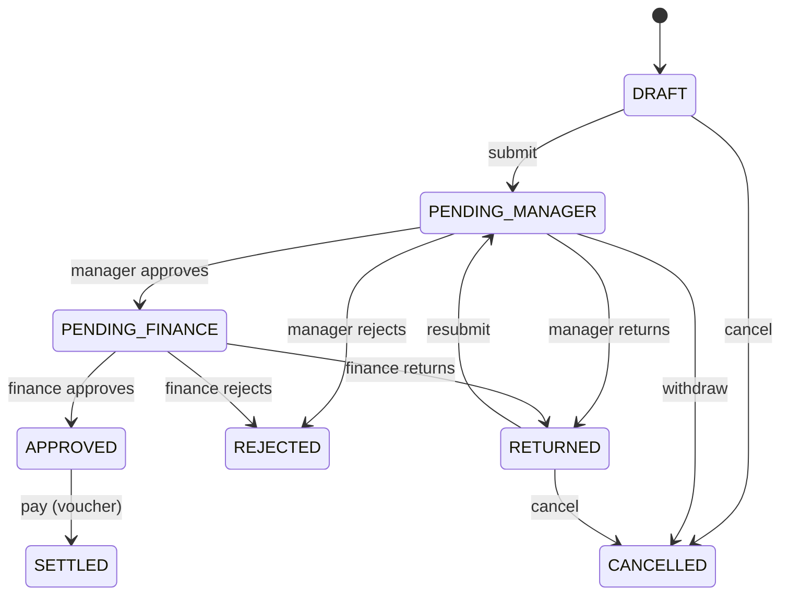

| From → To | Verb | Who | Guards | Side effects |
| :-- | :-- | :-- | :-- | :-- |
| DRAFT → PENDING_MANAGER | `submit` | claimant | ≥1 line; receipts per BR-11-06; policy evaluation (BR-11-03..) produces `policyFlags`; `HARD` flags block | `policyAmount`, `netSettlement` computed; `CLAIM` instance; `APPROVAL_PENDING` |
| PENDING_MANAGER → PENDING_FINANCE | APPROVE step 1 | line manager | — | notify FINANCE queue |
| PENDING_FINANCE → APPROVED | APPROVE final step | FINANCE (+GM/DIRECTOR if threshold) | `SOFT` flags acknowledged with comment | `CLAIM_APPROVED`; payable queue |
| APPROVED → SETTLED | `pay` | FINANCE (`claims:pay`) | `voucherNo` | `paidAt`; `Advance.settledAt` if linked; `CLAIM_SETTLED`; realtime |
| → RETURNED | RETURN | approver | reason ≥ 20 | `CLAIM_RETURNED`; claimant may edit lines |
| RETURNED → PENDING_MANAGER | `resubmit` | claimant | changes made (line hash differs) | route restarts at step 1; max `claims.maxResubmits` (`3`) |
| → REJECTED | REJECT | approver | reason | terminal; `CLAIM_REJECTED` |
| DRAFT/PENDING_MANAGER/RETURNED → CANCELLED | `cancel` | claimant | — | — |

Advance: `PENDING_MANAGER → PENDING_FINANCE → APPROVED → (disbursedAt set) → SETTLED` on linked claim settlement or refund; `REJECTED`/`CANCELLED`.

### 12.4 Business rules

| ID | Rule |
| :-- | :-- |
| BR-11-01 | Policy resolution: `ExpensePolicy` for the claimant's `gradeId` effective on `periodStart ?? createdAt` (`effectiveFrom ≤ d < effectiveTo`). No policy → 422 `NO_POLICY`. Seed defaults from prototype `GRADE_POLICY` (table below). |
| BR-11-02 | Seed policy table (per grade band; Settings-managed via MOD-18 `ExpensePolicy` rows): |

| Band | `daDhaka` | `daDistrict` | `hotelCapPerNight` | `conveyanceMonthlyCap` | `mileageRatePerKm` | `allowedTravelModes` | `receiptRequiredAbove` |
| :-- | :-- | :-- | :-- | :-- | :-- | :-- | :-- |
| G1–G2 | 5,000 (actuals allowed) | 6,000 (actuals allowed) | null (actuals) | 50,000 *(proposed)* | 18 | EXECUTIVE_CAR, DOMESTIC_AIR, any | 500 |
| G3–G4 | 3,500 | 4,500 | 8,000 | 25,000 *(proposed)* | 18 | COMPANY_CAR, DOMESTIC_AIR, AC_TRAIN | 500 |
| G5–G6 | 2,500 | 3,200 | 5,500 | 15,000 *(proposed)* | 18 | POOL_CAR, AC_TRAIN, AC_BUS | 500 |
| G7–G8 | 1,500 | 2,000 | 3,000 | 8,000 | 18 | AC_BUS, FIRST_CLASS_TRAIN, CNG, RIDE_SHARE | 500 |
| G9–G10 | 800 | 1,200 | 1,800 | 5,000 *(proposed)* | 18 | BUS, TRAIN, CNG, RICKSHAW | 500 |

| ID | Rule |
| :-- | :-- |
| BR-11-03 | **DA full/half day (TADA, TOUR_EVENT):** for each calendar day `d` in `[periodStart, periodEnd]`: `hoursAway(d)` = hours of the day within `[departAt, returnAt]`; `≥ claims.da.fullDayHours (8)` → 100 % DA; `≥ claims.da.halfDayHours (4)` → `daHalfDayPct` (50 %); else 0. Rate = `daDhaka` if the destination district is in Setting `claims.dhakaMetroDistricts` (`["Dhaka"]`, Keraniganj is in Dhaka district) else `daDistrict`. DA lines are **system-generated** (`category = DA`, `isDeclaration = true`) and cannot be edited, only the departure/return timestamps. Grades G1–G2 may claim actuals above the rate with receipts (flag `DA_ACTUALS`). **(prototype gap: flat ৳1,500 × days.)** |
| BR-11-04 | **Hotel:** `HOTEL` line `amount / nights > hotelCapPerNight` → `HARD` flag `HOTEL_CAP_EXCEEDED` (blocks) unless G1–G2 (null cap) or FINANCE override at step 2 with comment (converts to `SOFT`, audited). Hotel requires receipt regardless of amount. |
| BR-11-05 | **Conveyance monthly cap:** Σ `totalAmount` of CONVEYANCE claims with `status ∉ {REJECTED, CANCELLED}` for the claimant in the calendar month of `periodStart` (incl. the current claim) `> conveyanceMonthlyCap` → `HARD` flag `CONVEYANCE_CAP_EXCEEDED`; the excess amount is shown; claimant may reduce lines. Cap check re-runs at Finance approval (race). |
| BR-11-06 | **Receipts:** every line with `amount > receiptRequiredAbove (500)` needs `receiptFileId` unless `isDeclaration = true` and `category ∈ claims.declarationCategories` (`["RICKSHAW","CNG","MEALS"]`) and `amount ≤ claims.declarationMaxAmount` (`1000`). Missing → `HARD` flag `RECEIPT_REQUIRED`. |
| BR-11-07 | **Mileage:** `MILEAGE` line `amount = distanceKm × mileageRatePerKm` (system-computed, 2 dp); `distanceKm > claims.mileageMaxKmPerLine (300)` → SOFT flag; requires `fromPlace`, `toPlace`. |
| BR-11-08 | **Travel mode:** `Claim.travelMode ∉ allowedTravelModes` → SOFT flag `MODE_ABOVE_ENTITLEMENT` (Finance decides). |
| BR-11-09 | **Duplicates:** another claim by the same claimant with overlapping `[periodStart, periodEnd]` and same type → HARD `OVERLAPPING_PERIOD`; same `receiptFileId` sha256 used in another claim → HARD `DUPLICATE_RECEIPT`. |
| BR-11-10 | **Advance & settlement (TOUR_EVENT):** `netSettlement = totalAmount − advance.amount`; `> 0` payable to staff; `< 0` refund due (Finance records refund `chalan`/deduction before SETTLED). An advance can be linked to one claim; claim must be submitted within `claims.advanceSettlementDays (30)` of tour end or `ADVANCE_SETTLEMENT_OVERDUE` to claimant + line manager + FINANCE, and new advances are blocked for the employee. |
| BR-11-11 | **Submission window:** `periodEnd` older than `claims.submitWithinDays (60)` → HARD `LATE_SUBMISSION` (HR/Finance override). |
| BR-11-12 | `policyAmount` = Σ system entitlement (DA + capped hotel + mileage + other lines ≤ caps); `totalAmount` = Σ lines; both stored. Dashboard shows `excessOverPolicy = max(0, totalAmount − policyAmount)`. |
| BR-11-13 | Cost centre defaults to department `costCenter`; Finance may change at step 2 (audited). |
| BR-11-14 | Approver ≠ claimant; a HOD's claim goes to PLANT_GM/DIRECTOR; FINANCE staff claims go to Finance HOD then DIRECTOR. |
| BR-11-15 | Payment: `voucherNo` from sequence `VCH`; BEFTN batch export (CSV) per day for the bank; `SETTLED` is terminal. **(prototype gap: `settled` unreachable.)** |
| BR-11-16 | CSV export of claims (own / department / company by scope) with lines, flags, voucher; audited. |

### 12.5 Calculations (examples)
- TADA G7–G8, Chattogram: depart Mon 06:00, return Wed 14:00 → Mon 18 h (100 %), Tue 24 h (100 %), Wed 14 h (100 %) → DA = 3 × 2,000 = 6,000. If return Wed 09:00 → Wed 9 h → still 100 %; return Wed 03:00 → 3 h → 0; return Wed 07:00 → 7 h → 50 % = 1,000.
- Hotel 2 nights 7,200 for G7–G8: 3,600/night > 3,000 → HARD flag; entitlement 6,000.
- Conveyance G7–G8: month-to-date 6,800 + new claim 1,650 = 8,450 > 8,000 → HARD flag, excess 450.
- Mileage 42.5 km × 18 = 765.00.
- Tour: total 40,500, advance 45,000 → `netSettlement = −4,500` (refund).

### 12.6 Approval workflow templates
`CLAIM` (objectType `Claim`; used for all three types) and `TOUR_ADVANCE` (objectType `Advance`). Thresholds Settings `workflow.claim.hodAbove` = `50000`, `workflow.claim.gmAbove` = `500000`.

| # | key | approverRule | condition | SLA h | escalateTo | maps to status |
| :-- | :-- | :-- | :-- | :-- | :-- | :-- |
| 1 | `MANAGER` | LINE_MANAGER | always | 24 | DEPARTMENT_HEAD | PENDING_MANAGER |
| 2 | `HOD` | DEPARTMENT_HEAD | `totalAmount > hodAbove AND line manager ≠ HOD` | 24 | ROLE PLANT_GM | PENDING_MANAGER |
| 3 | `FINANCE` | ROLE FINANCE | always | 48 | ROLE DIRECTOR | PENDING_FINANCE |
| 4 | `GM` | ROLE PLANT_GM (site) / DIRECTOR (HQ) | `totalAmount > gmAbove` | 48 | ROLE CHAIRMAN | PENDING_FINANCE |

`TOUR_ADVANCE`: step 1 `MANAGER` (LINE_MANAGER, 24 h) → step 2 `FINANCE` (ROLE FINANCE, 24 h). Urgency: `totalAmount > claims.criticalAmount (50000)` → `HIGH`. 

### 12.7 Notifications & due items

| Type | Recipients | Channels | Deep link |
| :-- | :-- | :-- | :-- |
| `APPROVAL_PENDING` | approver | IN_APP, PUSH | `/approvals/{instanceId}` |
| `CLAIM_APPROVED` / `CLAIM_RETURNED` / `CLAIM_REJECTED` / `CLAIM_SETTLED` | claimant | IN_APP, PUSH (+EMAIL settled) | `/claims/{id}` |
| `ADVANCE_DISBURSED` | employee | IN_APP, PUSH | `/claims/advances/{id}` |
| `ADVANCE_SETTLEMENT_OVERDUE` | employee, line manager, FINANCE | IN_APP, PUSH, EMAIL | `/claims/advances/{id}` |
| `CONVEYANCE_CAP_WARNING` | claimant (at 80 % of cap) | IN_APP | `/claims` |
DueItem: advance settlement due (`tourEnd + 30 d`, `[7,1,0]`).

### 12.8 Permissions & scope

| Permission | EMPLOYEE/DRIVER | LINE_MANAGER/HOD | FINANCE | PLANT_GM/DIRECTOR | HR_ADMIN |
| :-- | :-- | :-- | :-- | :-- | :-- |
| `claims:create/submit/cancel` | SELF | SELF | SELF | SELF | SELF |
| `claims:read` | SELF | TEAM / DEPARTMENT | COMPANY | SITE / COMPANY | COMPANY (read) |
| `claims:approve` | — | TEAM / DEPARTMENT | COMPANY | SITE / COMPANY | — |
| `claims:override-policy` | — | — | COMPANY | — | — |
| `claims:pay` | — | — | COMPANY | — | — |
| `claims:policy` (ExpensePolicy CRUD) | — | — | COMPANY | — | COMPANY |
| `claims:export` | SELF | DEPARTMENT | COMPANY | SITE | COMPANY |

### 12.9 Reports / KPIs
`claimsPending` (count, value), `avgSettlementDays = paidAt − submittedAt`, `claimsSpendMTD` by type/department, `policyExceptionRate = claims with ≥1 flag / total`, `conveyanceCapUtilisationPct` per employee, `advancesOutstanding`, BEFTN export.

### 12.10 Edge cases
- Grade changes mid-period → policy at `periodStart` applies.
- Claimant edits lines after RETURNED but before resubmit → allowed; flags recomputed.
- Receipt image unreadable → Finance RETURN with reason `RECEIPT_ILLEGIBLE`.
- Advance disbursed but tour cancelled → `refund` path: claim with 0 lines, `netSettlement = −advance`.

### 12.11 Acceptance criteria
1. Given G7–G8, depart Mon 06:00 return Wed 14:00 to Chattogram, then 3 DA lines of 2,000.
2. Given return Wed 07:00, then Wed DA = 1,000.
3. Given a hotel line 7,200 for 2 nights (G7–G8), then HARD flag `HOTEL_CAP_EXCEEDED` and submit returns 422 listing the flag.
4. Given MTD conveyance 6,800 and a new 1,650 claim, then HARD `CONVEYANCE_CAP_EXCEEDED` with excess 450.
5. Given a 750 CNG line without receipt (`isDeclaration=true`), then no flag; a 1,200 CNG declaration → `RECEIPT_REQUIRED`.
6. Given a 62,000 claim where line manager ≠ HOD, then steps MANAGER, HOD, FINANCE.
7. Given approval by FINANCE, then status APPROVED; after `pay` with voucher, SETTLED and `paidAt` set; `Advance.settledAt` set when linked.
8. Given the same receipt file sha256 on two claims, then the second gets HARD `DUPLICATE_RECEIPT`.
9. Given an advance with tour end 35 days ago and no claim, then `ADVANCE_SETTLEMENT_OVERDUE` sent and new advance request → 409.

---

## 13. MOD-14 — Commuter Bus & FIFO Seat Waitlist

### 13.1 Purpose & actors
Routes/stops/buses, seat map, permanent allocations, FIFO waitlist with 48 h offers, admin priority override, shift passes, guest bookings, delay broadcasts, conductor boarding.

| Role | Capability | Scope |
| :-- | :-- | :-- |
| any staff | view routes, my seat, join/cancel waitlist, accept/decline offer, release/reclaim seat | SELF |
| `TRANSPORT_ADMIN` | routes, stops, buses, seats, allocations, priority override, broadcasts, manifests | COMPANY |
| conductor (`DRIVER` or `EMPLOYEE` with `bus:board`) | boarding scan | assigned bus |
| `HR_ADMIN` | read, exit interlock | COMPANY |
| `PLANT_GM` | read site routes | SITE |

### 13.2 Entities & references
`Bus`, `BusRoute` (`code` R1…R10), `BusStop`, `BusSeat`, `SeatAllocation`, `SeatWaitlist`, `SeatOffer`, `BusBroadcast`. Seeded routes (prototype): R1 Mirpur-10→Plant 22.8 km (52), R2 Uttara→Plant 28.4 km (52), R3 Narayanganj→Plant 24.0 km (52), R4 Dhanmondi→Plant 16.5 km (52), R5 Gazipur→Plant 41.5 km (52), R6 Savar→Plant 29.0 km (52), R7 Bashundhara HQ→Plant 25.2 km (52), R8 Kanchpur→Plant 23.4 km (52), R9 Rohitpur feeder 15.0 km (40), R10 Executive shuttle Gulshan-2→Plant 22.0 km (32). Stops with `INBOUND`/`OUTBOUND` directions and scheduled times from `busData.ts`.

### 13.3 Lifecycle (SeatWaitlist.status)

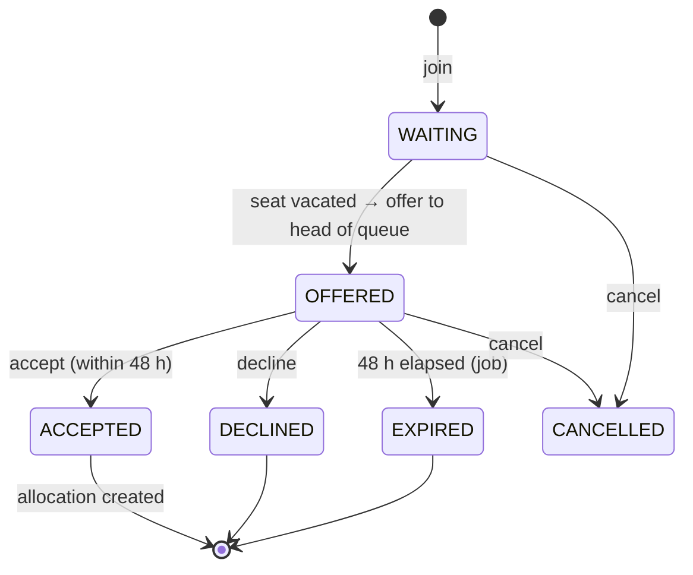

| From → To | Verb | Who | Guards | Side effects |
| :-- | :-- | :-- | :-- | :-- |
| (create) → WAITING | `join` | employee | no active allocation on the route; no WAITING/OFFERED entry on the route; `priority = 0` | position computed (BR-14-02); `BUS_WAITLIST_JOINED` with position |
| WAITING → OFFERED | system | job/trigger | a seat became `VACATED`/`EMPTY` and this entry is head of queue | `SeatOffer(expiresAt = offeredAt + 48 h)`; seat `BLOCKED`; `BUS_SEAT_OFFERED` (PUSH, SMS); DueItem at `expiresAt` |
| OFFERED → ACCEPTED | `accept` | employee | `now < expiresAt`; pickup stop chosen | `SeatAllocation(PERMANENT, startsOn = next working day)`; seat `OCCUPIED`; optional `BUS_SEAT_CONFIRM` step (BR-14-09); `BUS_SEAT_ALLOCATED`; queue positions recomputed |
| OFFERED → DECLINED | `decline` | employee | — | seat offered to next (BR-14-03); entry terminal; employee may re-join (new `appliedAt`) |
| OFFERED → EXPIRED | job | system | `now ≥ expiresAt` | same as decline; `BUS_OFFER_EXPIRED` to employee |
| WAITING/OFFERED → CANCELLED | `cancel` | employee / admin | — | if OFFERED → next in queue |

Seat: `EMPTY → OCCUPIED` (allocate) `→ VACATED` (release, temporary) `→ OCCUPIED` (reclaim) ; `OCCUPIED/VACATED → EMPTY` (allocation ended); `* → BLOCKED` (offer pending / admin hold) `→ EMPTY`.

### 13.4 Business rules

| ID | Rule |
| :-- | :-- |
| BR-14-01 | One active `SeatAllocation` (`releasedAt null`, `endsOn null or ≥ today`) per employee across all routes (Setting `bus.maxActiveAllocationsPerEmployee = 1`). Shift passes (`SHIFT_PASS`, `endsOn` set) and `GUEST` bookings are exempt but limited to `bus.maxShiftPassDays (30)` and `bus.maxGuestBookingsPerMonth (2)`. |
| BR-14-02 | **FIFO order** per route: `ORDER BY priority DESC, appliedAt ASC, id ASC`. Position = 1-based index among `WAITING` entries. **(prototype gap: immediate promotion, no offer window.)** |
| BR-14-03 | **Seat offer:** when a seat becomes available (`EMPTY` after allocation end, or `VACATED` for ≥ `bus.vacatedReofferDays (14)` consecutive days), the engine offers it to the first `WAITING` entry. Offer expires `bus.offerWindowHours (48)` after `offeredAt` (calendar hours). On EXPIRED/DECLINED/CANCELLED the seat is offered to the next `WAITING` entry (same ordering) within 1 min. One open offer per seat and per entry. |
| BR-14-04 | **Admin priority override:** TRANSPORT_ADMIN may set `priority` 1–9 with mandatory `priorityReason` (≥ 10 chars; e.g. medical, lady priority, shift-critical). Audited `WAITLIST_PRIORITY_OVERRIDE`; the employee and the previous head of queue are notified `BUS_WAITLIST_REORDERED`. Priority cannot be set by the employee. |
| BR-14-05 | Seat categories: `LADY_PRIORITY` seats are offered first to employees with `gender = F` (from Employee profile; attribute added in MOD-18) in queue order, then to anyone after `bus.ladySeatHoldHours (24)`; `EXECUTIVE` seats only to grades ≤ G4; `SENIOR_STAFF` to grades ≤ G6; `REGULAR` to all. A WAITING entry skipped for category reasons keeps its position. |
| BR-14-06 | Release/reclaim: an occupant may `release` a seat (reason, date range) → `VACATED`; others may use it as a day pass (`SHIFT_PASS` allocation for the vacated days, FIFO from the waitlist with 2 h acceptance window, Setting `bus.dayPassOfferHours = 2`); the occupant `reclaim`s at range end. Seats VACATED > `bus.autoReleaseAfterDays (60)` are converted to `EMPTY` (allocation ended) after a warning at day 45. |
| BR-14-07 | No-show tracking: conductor boarding scans produce `boarded` per allocation per day; `bus.noShowThreshold (10)` unexcused no-shows in 30 days → `BUS_NO_SHOW_WARNING`; at 15 the seat is released to the queue (allocation ended, audited) unless on approved leave/field duty. |
| BR-14-08 | Capacity: `BusRoute.capacity` = assigned `Bus.capacity`; reassigning a smaller bus requires that occupied seats ≤ new capacity or admin selects seats to release (audited). |
| BR-14-09 | Optional admin confirmation: Setting `bus.requireAdminConfirm` (`false`) → ACCEPTED offers create a `BUS_SEAT_CONFIRM` instance (TRANSPORT_ADMIN, SLA 24 h); until approved the allocation is provisional (`startsOn` deferred). |
| BR-14-10 | Broadcasts: `BusBroadcast` to a route (all active allocations + today's passes) or all routes; `sendSms` limited to `bus.broadcastSmsPerDay (5)`; message EN mandatory, BN optional. |
| BR-14-11 | Bus fitness: `Bus.fitnessExpiresAt` DueItem `[60,30,15,7,1,0]` to TRANSPORT_ADMIN; expired → bus `GROUNDED` and route flagged `noBusAssigned` (broadcast prompt). |
| BR-14-12 | Interlocks: approved leave ≥ `bus.autoVacateLeaveDays (5)` auto-`release`s the seat for the leave range (BR-10 side effect); exit clearance (MOD-16) ends the allocation (`BUS_SEAT` item). |
| BR-14-13 | Route stop lists need ≥ 2 stops per direction; stop times strictly increasing; the last INBOUND stop and first OUTBOUND stop must be a site gate. |
| BR-14-14 | Waitlist transparency: an employee sees own position and `estimatedWaitDays = position × avgDaysPerVacancy(route, 90 d)`; admin sees full queue. |

### 13.5 Calculations
`occupancyPct = OCCUPIED / capacity`; `vacancyRate = seats freed per month`; `offerAcceptanceRate = ACCEPTED / offers`. Example: R1 capacity 52, 47 OCCUPIED, 3 VACATED, 2 EMPTY → 90.4 %. Queue: A applied 10:00 (p0), B 09:00 (p0), C 12:00 (p3) → order C, B, A.

### 13.6 Approval workflow template
`BUS_SEAT_CONFIRM` (objectType `SeatAllocation`, optional): step 1 `TRANSPORT_CONFIRM` (ROLE TRANSPORT_ADMIN, SLA 24 h).

### 13.7 Notifications & due items

| Type | Recipients | Channels | Deep link |
| :-- | :-- | :-- | :-- |
| `BUS_WAITLIST_JOINED` / `BUS_WAITLIST_REORDERED` | employee | IN_APP | `/bus/my-seat` |
| `BUS_SEAT_OFFERED` | employee | IN_APP, PUSH, SMS | `/bus/offers/{id}` |
| `BUS_OFFER_EXPIRING` (at 42 h) | employee | PUSH | `/bus/offers/{id}` |
| `BUS_OFFER_EXPIRED` | employee | IN_APP | `/bus/my-seat` |
| `BUS_SEAT_ALLOCATED` | employee (+TRANSPORT_ADMIN) | IN_APP, PUSH | `/bus/my-seat` |
| `BUS_SEAT_RELEASED` / `BUS_SEAT_RECLAIMED` | TRANSPORT_ADMIN | IN_APP | `/bus/routes/{id}` |
| `BUS_DAY_PASS_OFFERED` | employee | PUSH | `/bus/offers/{id}` |
| `BUS_NO_SHOW_WARNING` | employee | IN_APP, PUSH | `/bus/my-seat` |
| `BUS_BROADCAST` | route riders | IN_APP, PUSH (+SMS) | `/bus/routes/{id}` |
| `BUS_FITNESS_EXPIRING` | TRANSPORT_ADMIN | IN_APP, EMAIL | `/bus/fleet/{id}` |
DueItems: offer expiry (`[0]` at expiresAt, plus 42 h push), bus fitness, vacated auto-release warning.

### 13.8 Permissions & scope

| Permission | EMPLOYEE/DRIVER | TRANSPORT_ADMIN | HR_ADMIN | PLANT_GM | conductor |
| :-- | :-- | :-- | :-- | :-- | :-- |
| `bus:read` | SELF (+ route public info) | COMPANY | COMPANY | SITE | assigned bus |
| `bus:waitlist` (join/cancel/accept/decline) | SELF | COMPANY (on behalf) | — | — | — |
| `bus:seat` (release/reclaim) | SELF | COMPANY | — | — | — |
| `bus:allocate`, `bus:priority`, `bus:routes`, `bus:fleet`, `bus:broadcast` | — | COMPANY | — | — | — |
| `bus:board` | — | COMPANY | — | — | assigned |
| `bus:manifest` | — | COMPANY | COMPANY | SITE | assigned |

### 13.9 Reports / KPIs
`occupancyPct` per route, `busWaitlistLength`, `avgWaitDays`, `offerAcceptanceRate`, `noShowRate`, `boardedToday` per route, gate manifest PDF, fitness due list.

### 13.10 Edge cases
- Employee transfers site → allocation ended automatically; waitlist entries on routes to the old site cancelled; notified.
- Two seats free simultaneously → head of queue gets the lower seat number; second entry gets the other (offers are per seat, one per entry).
- Offer accepted at 47 h 59 m → valid (server time).
- Admin allocates directly to a non-waitlisted employee while a queue exists → requires `priorityReason` and is audited as `DIRECT_ALLOCATION_BYPASS`.

### 13.11 Acceptance criteria
1. Given WAITING entries A (10:00), B (09:00), C (12:00, priority 3), when a seat frees, then C receives the offer.
2. Given an offer at T, when no response by T+48 h, then status EXPIRED and B (next) receives an offer within 1 min.
3. Given B declines, then A receives an offer and B's entry is DECLINED.
4. Given A accepts at T+47 h, then a PERMANENT allocation exists, seat OCCUPIED, and A's entry ACCEPTED.
5. Given an employee with an active allocation, when `join` is called on another route, then 409.
6. Given admin sets priority 5 without a reason, then 422; with a reason, then the audit log has `WAITLIST_PRIORITY_OVERRIDE`.
7. Given a LADY_PRIORITY seat and a male head of queue, then the first female in queue is offered; after 24 h without eligible females the male head is offered.
8. Given an approved 7-day leave for an occupant, then the seat is VACATED for the range and day passes are offered FIFO.

---

## 14. MOD-15 — Inner-Circle Chat & Directives

### 14.1 Purpose & actors
Secure leadership channels and direct messages, presence, voice/document messages, Chairman directives with acknowledgement tracking.

| Role | Capability | Scope |
| :-- | :-- | :-- |
| `CHAIRMAN`, `DIRECTOR` | all leadership channels, issue directives, create channels | COMPANY |
| `PLANT_GM`, `HOD`, `HR_ADMIN`, `FINANCE`, `COMPLIANCE_OFFICER`, `HSE_OFFICER` | member of channels they are added to; DMs | membership |
| `EXECUTIVE_ASSISTANT` | manage channel membership on behalf of Chairman; cannot read `isLocked` channels unless member | COMPANY (admin) |
| `SUPER_ADMIN` | retention policy, export for legal hold (audited) | COMPANY |
| `EMPLOYEE`, `DRIVER` | no access (fleet chat is MOD-09) | — |

### 14.2 Entities & references
`ChatChannel` (seeded keys `executive-leadership`, `factory-operations`, `finance-and-purchases`, `permits-and-compliance` (locked)), `ChatMember`, `ChatMessage`, `ChatReadReceipt`, `Directive` (`refNo` = `BOGCL-DIR-{YYYY}-{NNNN}`).

### 14.3 Lifecycle
Messages: `sent → edited (editedAt) | deleted (deletedAt, tombstone)`. Directive: `issued → acknowledged (per member) → executed (executedAt)`.

| Action | Who | Guards | Side effects |
| :-- | :-- | :-- | :-- |
| `send` | channel member not muted | body ≤ 5,000 chars or file (CM-16) or voice ≤ `chat.maxVoiceSec (120)` | realtime `chat.message.created` to `channel:{id}`; PUSH to offline members (urgent → PUSH all + SMS for `isUrgent`) |
| `edit` | sender within `chat.editWindowMinutes (15)` | not DIRECTIVE/SYSTEM | `editedAt`; realtime |
| `delete` | sender (own) or channel admin | — | tombstone "message deleted"; file access revoked; audit |
| `issue-directive` | `chat:directive` (CHAIRMAN/DIRECTOR) | title, body, priority, optional `dueAt` | `Directive` + DIRECTIVE message pinned; `DIRECTIVE_ISSUED` CRITICAL to members (ackRequired) |
| `acknowledge` | member | once | `acknowledgements[]` append; realtime `chat.directive.acked` |
| `mark-executed` | issuer or assignee | all acks or issuer override | `executedAt`; `DIRECTIVE_EXECUTED` |

### 14.4 Business rules

| ID | Rule |
| :-- | :-- |
| BR-15-01 | Channel membership is explicit; `isLocked` channels can only be joined by invitation from a channel admin; membership changes post a `SYSTEM` message and are audited. |
| BR-15-02 | Direct channels (`isDirect`) are created lazily between two eligible users; unique per pair. |
| BR-15-03 | Presence: `ONLINE` when a socket is connected and active in the last 2 min; `AWAY` after 10 min idle; `IN_MEETING` set manually or from calendar adapter (later); `OFFLINE` otherwise. Location text is user-set (profile status) and not GPS. |
| BR-15-04 | Read receipts: `ChatReadReceipt` per message per user, written in batch on viewport visibility; channel unread count = messages after the user's last receipt. |
| BR-15-05 | Transport encryption TLS 1.2+; at rest DB/MinIO encryption. End-to-end encryption is **not** provided (server renders notifications); UI must not claim "AES-256 E2E". **(prototype gap: labelling.)** |
| BR-15-06 | Retention: `ChatChannel.retentionDays` (default Setting `chat.defaultRetentionDays = 730`); nightly job soft-deletes older messages; directives retained indefinitely; legal hold flag per channel suspends deletion. |
| BR-15-07 | Directive acknowledgement reminders: at `chat.directiveAckReminderHours (4)` unacked members get `DIRECTIVE_ACK_REMINDER`; at `dueAt` unacked → issuer notified with names. |
| BR-15-08 | Quick directive presets are client-side templates (Setting `chat.directivePresets` list) — no server logic. |
| BR-15-09 | Voice messages are stored files; transcription is optional via adapter; TTS playback of text is client-side only. |
| BR-15-10 | Rate limit: `chat.maxMessagesPerMinute (30)` per user; attachments ≤ 10 per message. |
| BR-15-11 | Pinning: only `chat:directive` holders can pin/unpin a message; pinned messages are listed in the conversation details panel and are visible to every member; directives are pinned on issue. |
| BR-15-12 | Reactions are one per emoji per user and toggle on a second tap (count decrements). |
| BR-15-13 | Search covers the viewer's own conversations only (channel names/descriptions, people, message text, file names, directive refs); results deep-link to the message. |
| BR-15-14 | Conversation list shows the last-message preview, time and unread count per channel/DM; opening a conversation marks it read and shows a "N new messages" divider for what was unread. Drafts are kept per conversation on the client. |
| BR-15-15 | Read-receipt label: channels show "Sent" (no readers) or "Read by N"; DMs show "Delivered" or "Read". |
| BR-15-16 | The conversation details panel shows members with presence, pinned messages and files shared in that conversation (derived from messages, not a separate vault). |
| BR-15-17 | UI copy states "encrypted in transit / at rest" only; never "end-to-end" or "AES-256" (see BR-15-05). |

### 14.5 Calculations
`ackRate(directive) = |acknowledgements| / |members at issue time|`. `responseTimeP50 = median(ackAt − issuedAt)`.

### 14.6 Approval workflow
None.

### 14.7 Notifications

| Type | Recipients | Channels | Deep link |
| :-- | :-- | :-- | :-- |
| `CHAT_MESSAGE` | offline/background members (+mentions always) | PUSH | `/chat/{channelId}` |
| `CHAT_URGENT` | all members | PUSH, SMS | `/chat/{channelId}` |
| `DIRECTIVE_ISSUED` | members | IN_APP, PUSH, SMS (CRITICAL, ack) | `/chat/{channelId}?directive={id}` |
| `DIRECTIVE_ACK_REMINDER` | unacked members | PUSH | same |
| `DIRECTIVE_EXECUTED` | members | IN_APP | same |

### 14.8 Permissions
`chat:read`, `chat:send` (membership-scoped), `chat:manage-channel` (owner/admin), `chat:directive` (CHAIRMAN, DIRECTOR), `chat:export` (SUPER_ADMIN, audited), `chat:presence`.

### 14.9 Reports / KPIs
Directive `ackRate`, `openDirectives`, `responseTimeP50` (Chairman suite); unread counts (badge).

### 14.10 Edge cases
- Member offboarded → removed from all channels by MOD-16 hook; DMs archived.
- Message to a channel the sender left → 403.
- Socket reconnect → client sends `lastSeenMessageId`; server returns delta.

### 14.11 Acceptance criteria
1. Given a locked channel, when a non-member DIRECTOR calls `/join`, then 403; after invitation, 200.
2. Given a directive issued to 7 members, then 7 CRITICAL notifications with `ackRequired=true`; after 4 h with 2 unacked, 2 reminders.
3. Given an edit at 16 min, then 409 `EDIT_WINDOW_CLOSED`.
4. Given 31 messages in a minute, then the 31st returns 429.
5. Given retention 30 days on a channel, when the job runs, then messages older than 30 days have `deletedAt` and directives remain.

---

## 15. MOD-16 — Workforce Directory & Exit Clearance

### 15.1 Purpose & actors
Employee directory (search, org tree), onboarding (user + employee + roles), status changes, exit clearance with parallel departmental sign-offs and interlocks (assets, bus seat, fuel card, finance, IT, HR).

| Role | Capability | Scope |
| :-- | :-- | :-- |
| `HR_ADMIN` | onboard, edit, initiate/finalise exit, waive items (with reason) | COMPANY |
| `HOD` / `LINE_MANAGER` | view team, confirm handover | DEPARTMENT / TEAM |
| item owners: `SUPER_ADMIN` (IT_ACCESS), `SECURITY_GATE` lead (RFID_BADGE), asset custodian team/`PLANT_GM` (ASSETS_RETURNED), `TRANSPORT_ADMIN` (VEHICLE_FUEL_CARD, BUS_SEAT), `FINANCE` (FINANCE_SETTLEMENT), `HR_ADMIN` (HR_EXIT_INTERVIEW) | clear own item | COMPANY |
| all staff | directory read (limited fields) | COMPANY |
| `CHAIRMAN`, `DIRECTOR`, `PLANT_GM` | read full | COMPANY / SITE |

### 15.2 Entities & references
`Employee` (`empCode` = `EMP-{NNNN}`, no yearly reset), `User`, `UserRole`, `ExitClearance`, `ExitClearanceItem`, workflow objectType `ExitClearance`.

### 15.3 Lifecycle
`Employee.status`: `ACTIVE ↔ ON_LEAVE` (derived display, not stored transition) ; `ACTIVE → SUSPENDED → ACTIVE`; `ACTIVE → OFFBOARDING` (exit initiated) `→ OFFBOARDED` (finalised) ; `OFFBOARDED → ACTIVE` (rehire, new `joinDate`, same `empCode`).
`ExitClearance.status` (WorkflowStatus): `IN_REVIEW → APPROVED` (finalised) | `CANCELLED` (withdrawn).

| From → To | Verb | Who | Guards | Side effects |
| :-- | :-- | :-- | :-- | :-- |
| ACTIVE → OFFBOARDING | `initiate-exit` | HR_ADMIN | `lastWorkingDay ≥ today`; no open exit | `ExitClearance` + 7 `ExitClearanceItem` (PENDING, owner roles from Setting `workforce.clearanceOwnerRoles`); `EXIT_CLEARANCE` instance (parallel steps); interlocks run (BR-16-03); `EXIT_INITIATED` to employee, line manager, item owners |
| item PENDING → CLEARED | `clear-item` | owner role | item-specific guard (BR-16-04) | step COMPLETED; `EXIT_ITEM_CLEARED` |
| item PENDING → WAIVED | `waive-item` | HR_ADMIN | reason ≥ 20 chars | audited `CLEARANCE_WAIVED`; step SKIPPED |
| OFFBOARDING → OFFBOARDED | `finalise` | HR_ADMIN | all items CLEARED/WAIVED; `lastWorkingDay ≤ today` or Setting `workforce.allowEarlyFinalise`; `finalSettlementVoucher` set | `exitDate`; `User.isActive = false`, sessions revoked, device tokens deleted, roles removed; chat memberships removed; `completedAt`; `EXIT_COMPLETED` |
| OFFBOARDING → ACTIVE | `cancel-exit` | HR_ADMIN | reason | clearance CANCELLED; interlocks reversed where possible (assets not re-assigned automatically) |

### 15.4 Business rules

| ID | Rule |
| :-- | :-- |
| BR-16-01 | Onboarding creates `User` (email unique, temporary password via email/SMS link valid 24 h, forced change), `Employee`, default role `EMPLOYEE` plus requested roles (role grants above `EMPLOYEE` require `admin:roles` – HR may request, SUPER_ADMIN approves via MOD-18), `LeaveBalance` for current year (pro-rata), `NotificationPreference` defaults. `nid` encrypted (doc 02 §5); `nid` shown masked (`****1234`) except to HR_ADMIN. |
| BR-16-02 | Directory fields visible to all staff: name, nameBn, designation, department, site, photo, work email/phone; `nid`, `bloodGroup`, `emergencyContact`, `joinDate`, `grade`, `sapPernr`, `lineManager` visible to HR, the employee, and their line manager chain (blood group also to HSE/SECURITY for emergencies). |
| BR-16-03 | **Interlocks at exit initiation** (automatic): (a) MOD-05 `reclaimEmployeeAssets` list prepared (not released until `ASSETS_RETURNED` cleared by custodian team confirming physical return); (b) MOD-14 allocation `endsOn = lastWorkingDay`; (c) MOD-09 if driver → `Driver.status = OFF_DUTY` from `lastWorkingDay + 1`, open trips must be reassigned; fuel vouchers unredeemed → cancelled; (d) MOD-11 open claims/advances listed for `FINANCE_SETTLEMENT`; (e) MOD-17 pending approvals where the employee is approver → re-resolved by rule / escalated; active delegations from the employee cancelled; (f) MOD-03 note-sheets where the employee is an UPCOMING signatory → re-resolved. |
| BR-16-04 | Item guards: `ASSETS_RETURNED` clear requires zero open `AssetCustody` for the employee (BR-05-16); `BUS_SEAT` requires no active allocation/waitlist; `VEHICLE_FUEL_CARD` requires no unredeemed vouchers and no ASSIGNED/IN_TRANSIT trips; `FINANCE_SETTLEMENT` requires no claims in `PENDING_*`/`APPROVED` unpaid and no advance unsettled, and a `finalSettlementVoucher`; `IT_ACCESS` requires confirmation checklist (email, SAP, VPN) — sets `User.isActive = false` at finalisation, not before; `RFID_BADGE` requires badge number surrendered; `HR_EXIT_INTERVIEW` requires interview notes attached. |
| BR-16-05 | Default item owner roles Setting `workforce.clearanceOwnerRoles` = `{ IT_ACCESS: "SUPER_ADMIN", RFID_BADGE: "SECURITY_GATE", ASSETS_RETURNED: "PLANT_GM", VEHICLE_FUEL_CARD: "TRANSPORT_ADMIN", BUS_SEAT: "TRANSPORT_ADMIN", FINANCE_SETTLEMENT: "FINANCE", HR_EXIT_INTERVIEW: "HR_ADMIN" }` (see Appendix D re `IT_ADMIN`). |
| BR-16-06 | `lastWorkingDay` changes re-schedule interlocks; after finalisation the record is immutable except `exitReason` notes. |
| BR-16-07 | Former staff remain searchable (`status = OFFBOARDED`) for 7 years (retention per doc 07); PII minimised after `workforce.piiRetentionDays` (`2555`) by job (nid, emergency contact nulled). |
| BR-16-08 | Rehire keeps `empCode`, creates a new `joinDate`, resets balances; audit links both periods. |
| BR-16-09 | Line-manager cycles are rejected (A→B→A) at save time; department head must belong to the department or its parent. |
| BR-16-10 | Chairman/Director records are editable only by SUPER_ADMIN (HR cannot offboard executives; Setting `workforce.protectedRoles = ["CHAIRMAN","DIRECTOR","SUPER_ADMIN"]`). **(prototype gap: any role could offboard anyone.)** |
| BR-16-11 | Bulk import (CSV) of employees by HR with dry-run validation; errors per row; audited `IMPORT`. |

### 15.5 Calculations
`headcount` by status/site/department; `attritionRate12m = exits / avg headcount`; `clearanceCycleDays = completedAt − createdAt`.

### 15.6 Approval workflow template
`EXIT_CLEARANCE` (objectType `ExitClearance`): 7 **parallel** steps keyed by `ClearanceItemKey`, each `approverRule = ROLE <owner role>`, SLA 72 h, escalateTo ROLE HR_ADMIN; final sequential step `HR_FINALISE` (ROLE HR_ADMIN, SLA 48 h) activated when all parallel steps are COMPLETED/SKIPPED.

### 15.7 Notifications & due items

| Type | Recipients | Channels | Deep link |
| :-- | :-- | :-- | :-- |
| `EMPLOYEE_ONBOARDED` | employee (welcome, temp credentials), line manager | EMAIL, SMS / IN_APP | `/workforce/{id}` |
| `EXIT_INITIATED` | employee, line manager, item owners | IN_APP, EMAIL | `/workforce/{id}/exit` |
| `EXIT_ITEM_CLEARED` / `EXIT_ITEM_OVERDUE` | HR_ADMIN (+owner on overdue) | IN_APP | `/workforce/{id}/exit` |
| `EXIT_COMPLETED` | line manager, HR, FINANCE | IN_APP, EMAIL | `/workforce/{id}` |
| `APPROVAL_PENDING` | item owners | IN_APP, PUSH | `/approvals/{instanceId}` |
DueItem: `lastWorkingDay` (`[7,1,0]`) owned by HR_ADMIN.

### 15.8 Permissions & scope

| Permission | EMPLOYEE | LINE_MANAGER/HOD | HR_ADMIN | item owners | PLANT_GM | SUPER_ADMIN |
| :-- | :-- | :-- | :-- | :-- | :-- | :-- |
| `employees:read` (directory) | COMPANY (limited) | COMPANY (limited) + TEAM/DEPARTMENT (full) | COMPANY (full) | COMPANY (limited) | SITE (full) | COMPANY |
| `employees:write` | SELF (contact fields) | — | COMPANY | — | — | COMPANY |
| `employees:onboard`, `employees:import` | — | — | COMPANY | — | — | COMPANY |
| `employees:exit` (initiate/finalise/cancel/waive) | — | — | COMPANY (not protected roles) | — | — | COMPANY |
| `employees:clear-item` | — | — | COMPANY (HR item) | COMPANY (own item) | COMPANY (assets) | COMPANY (IT) |
| `employees:export` | — | DEPARTMENT | COMPANY | — | SITE | COMPANY |

### 15.9 Reports / KPIs
`activeHeadcount` by site/department/grade, `onLeaveToday`, `offboardingInProgress`, `attritionRate12m`, `clearanceCycleDays`, `clearanceItemsOverdue`, org chart export.

### 15.10 Edge cases
- Employee with open custody disputes the asset list → `ASSETS_RETURNED` stays PENDING; HR may `waive` with reason (asset marked LOST via MOD-05).
- Last working day in the past at initiation → allowed with `lateInitiation` flag; `User.isActive` set false immediately if Setting `workforce.disableLoginOnLateExit = true`.
- Employee is HOD → department head must be reassigned before finalise (422 `DEPT_HEAD_REASSIGN_REQUIRED`).

### 15.11 Acceptance criteria
1. Given exit initiated for an employee with 2 custodies, 1 bus seat, 1 unpaid approved claim, then 7 items PENDING and the interlock summary lists 2 assets, 1 seat, 1 claim.
2. Given `ASSETS_RETURNED` clear attempted with 1 open custody, then 409 `OPEN_CUSTODY`.
3. Given all items CLEARED and `finalSettlementVoucher`, when finalised, then `User.isActive=false`, all sessions revoked, status OFFBOARDED, `exitDate` set.
4. Given an item PENDING for 72 h, then step ESCALATED and HR_ADMIN notified.
5. Given HR attempts to initiate exit for a CHAIRMAN, then 403.
6. Given a directory search by a plain EMPLOYEE, then the response excludes `nid`, `emergencyContact`, `grade`.
7. Given onboarding, then a `LeaveBalance` row exists per leave type for the current year with pro-rated `entitled`.

---

## 16. MOD-17 — Approvals Center & Delegation (Workflow Engine)

### 16.1 Purpose & actors
Generic engine behind every approvable object; unified inbox; decisions; batch approve; delegation; escalation; history with correct decision labels.

| Role | Capability | Scope |
| :-- | :-- | :-- |
| any approver | inbox, approve/reject/return/comment on own ACTIVE steps (or delegated) | SELF |
| initiators | track own instances, withdraw | SELF |
| `HOD`, `PLANT_GM`, `DIRECTOR`, `CHAIRMAN` | department/site/company view of instances in scope | DEPARTMENT / SITE / COMPANY |
| `SUPER_ADMIN` | templates CRUD, reassign, force-complete with reason | COMPANY |
| `EXECUTIVE_ASSISTANT` | view Chairman's inbox read-only; prepare comments | delegated view |

### 16.2 Entities & references
`WorkflowTemplate`, `WorkflowInstance`, `WorkflowStep`, `WorkflowAction`, `Delegation`, view `v_approval_inbox`. No business ref number; `instance.summary.refNo` carries the object's reference.

### 16.3 Lifecycle (WorkflowInstance.status)

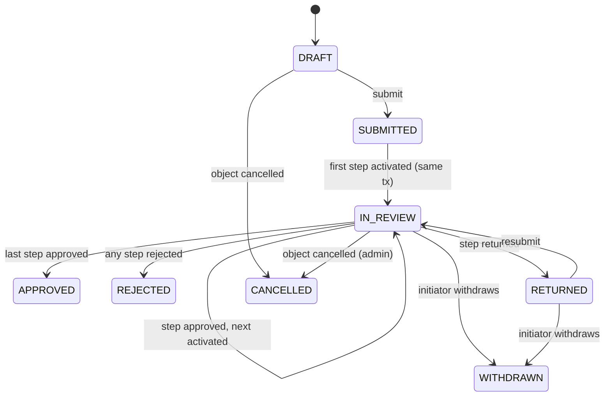

Step: `PENDING → ACTIVE → COMPLETED (decision APPROVED|REJECTED|RETURNED) | SKIPPED (condition false / same-person rule) | ESCALATED (still decidable)`.

| From → To | Verb | Who | Guards | Side effects |
| :-- | :-- | :-- | :-- | :-- |
| DRAFT → SUBMITTED → IN_REVIEW | `submit` (called by module service) | initiator | template active; conditions evaluated against `summary` | steps materialised (conditions false → SKIPPED); step 1 (or parallel group) ACTIVE with `activatedAt`, `dueAt = addSla(activatedAt, slaHours, clock)`; approvers resolved + delegation (CM-21); `APPROVAL_PENDING`; realtime `workflow.step.activated` to approver rooms; module callback `onSubmitted` |
| ACTIVE → COMPLETED(APPROVED) | `approve` | step approver / delegate / escalatee | step ACTIVE; actor eligible; optional `comment`; `signatureId` if template step `requiresSignature` | `WorkflowAction APPROVE`; next step(s) activated or instance APPROVED (`completedAt`); module callback `onStepApproved`/`onApproved`; `APPROVAL_DECIDED` to initiator; realtime |
| ACTIVE → COMPLETED(REJECTED) | `reject` | same | `comment ≥ 10 chars` | instance REJECTED; remaining steps SKIPPED; callback `onRejected`; notify |
| ACTIVE → COMPLETED(RETURNED) | `return` | same | `comment ≥ 10` (aligned with doc 03) | instance RETURNED; callback `onReturned`; notify initiator |
| RETURNED → IN_REVIEW | `resubmit` | initiator | module validates changes | steps from the returning step re-materialised (module may request from step 1) |
| IN_REVIEW → WITHDRAWN | `withdraw` | initiator | no step COMPLETED(APPROVED) unless Setting `workflow.allowWithdrawAfterApproval` (`false`) | notify active approver |
| any ACTIVE | `reassign` | SUPER_ADMIN | reason; target eligible | `WorkflowAction REASSIGN`; approver replaced; audit |
| any ACTIVE | `comment` | any participant | — | `WorkflowAction COMMENT`; initiator + approver notified |

### 16.4 Business rules

| ID | Rule |
| :-- | :-- |
| BR-17-01 | Template `definition.steps[]` fields: `key, approverRule, approverRef (role key | user id | expr), parallel (group id), condition (expr over summary), slaHours, clock, escalateTo, requiresSignature, requiresOtp, isFinal`. Expressions use a safe evaluator (JSON-logic subset) over `summary` fields only. Templates are versioned; instances pin `templateId` (version) at submit. |
| BR-17-02 | Approver resolution: `ROLE` → users holding the role (site-restricted if `UserRole.siteId` set and `summary.siteId` present); `LINE_MANAGER` → initiator's `Employee.lineManagerId` user; `DEPARTMENT_HEAD` → `Department.headUserId` of `summary.departmentId` (fallback parent department head); `USER` → fixed; `DYNAMIC` → expression returning user id. If resolution yields no user → step ESCALATED immediately to `escalateTo`, else SUPER_ADMIN notified `WORKFLOW_UNRESOLVED_APPROVER`. If several users hold a ROLE, the step is claimable: all see it; first decision wins (optimistic lock). |
| BR-17-03 | Same-person rule: if the resolved approver equals the initiator (or the previous step's decider when Setting `workflow.noConsecutiveSameApprover = true`), the step is SKIPPED with remark and audit, unless the step `isFinal` → escalate instead. |
| BR-17-04 | Parallel groups: all steps in a group activate together; group completes when all are APPROVED; any REJECT rejects the instance; any RETURN returns it (others cancelled → SKIPPED). |
| BR-17-05 | **History must distinguish decisions:** `GET /approvals/history` returns `decision ∈ {APPROVED, REJECTED, RETURNED}` per step and instance `status`; UI labels derive from these values — never a constant label. Approver attribution = `decidedById` (actual actor), with `onBehalfOf` when delegated. **(prototype defect)** |
| BR-17-06 | Batch approve: `POST /approvals/batch-approve` with ≤ `workflow.batchMax (25)` step ids; each processed independently in its own transaction; response lists per-step result; steps with `requiresSignature`/`requiresOtp` or `summary.amount > workflow.batchMaxAmount (500000)` are rejected from batch with code `BATCH_NOT_ALLOWED`. |
| BR-17-07 | Inbox ordering default `priority DESC, dueAt ASC`; filters by module, objectType, urgency, overdue, amount range, department; `q` searches `summary.title/refNo`. Counts per module exposed for badges (`GET /approvals/inbox/counts`). |
| BR-17-08 | SLA badges: `remainingPct = (dueAt − now)/(dueAt − activatedAt)`; `danger < 25 %`, `warn < 50 %`; overdue when `now > dueAt`. (Prototype thresholds <12 h / <24 h replaced by percentage of SLA.) |
| BR-17-09 | `requiresOtp` steps (final note-sheet sign, incident closure GM step when enabled, write-off ≥ chairman threshold) enforce CM-32 OTP verified within 10 min before the decision call (`otpToken` in request). |
| BR-17-10 | Module callbacks are idempotent and run in the same DB transaction as the decision; a failing callback rolls back the decision (no half-states). |
| BR-17-11 | `summary` is refreshed by the module on resubmit; conditions re-evaluate only on (re)submit, never mid-route. |
| BR-17-12 | Comments are visible to all participants (initiator, all step approvers); `internalOnly = true` comments (approvers) hidden from the initiator. |
| BR-17-13 | Delegation per CM-20..23; delegation UI lives in Approvals Center ("Out of office"); delegations affecting ACTIVE steps are applied by the next escalation tick (≤ 15 min). |
| BR-17-14 | Every decision emits realtime `workflow.instance.updated` to initiator and participants, and `approvals.inbox.changed` to affected approvers (badge refresh). |
| BR-17-15 | Inbox ordering defaults to most urgent first (least time remaining on the live SLA clock, BR-17-19); alternatives: highest amount, requester A–Z. "Due soon" = < 12 h left; overdue items are flagged distinctly. |
| BR-17-16 | Batch approve acts only on selected items that are visible under the current filters, requires an explicit confirmation listing every file and the total amount, and is offered only to roles with `canBatch`. |
| BR-17-17 | A request opens in a detail panel (details, endorsement trail, decision record) with next/previous navigation; after approving or returning from the panel the next request opens automatically. |
| BR-17-18 | Amounts use lakh/crore grouping (৳48,50,000); KPI tiles may abbreviate (৳94.12 Lakh) and always show the exact total beside it. |
| BR-17-19 | The SLA shown to approvers is a live countdown, not a stored number: remaining time = seeded SLA window − time elapsed since the item entered the queue (items created in-session start at creation; seeded items start with the demo session). It is displayed as `5h 12m left` / `Overdue by 40m`, refreshes about every 30 s, and drives the badge tone, "Due soon" count, sort order and dashboard urgency. Tone: overdue ≤ 0, danger < 12 h, warn < 24 h. |
| BR-17-20 | Every surface that can decide an approval (Approvals page cards, review drawer, dashboard drawer) uses the same flow: Approve opens the executive directive modal and Return opens the structured return-with-query modal. No surface approves or returns with canned text; decision buttons appear only for holders of `approvals:decide`. |

### 16.5 Calculations
`cycleHours = completedAt − submittedAt` (business or calendar per template clock). `stepHours = decidedAt − activatedAt`. `escalationRate = steps ESCALATED / steps COMPLETED`.

### 16.6 Approval workflow templates
The engine itself has none. Registry of all templates: Appendix B.

### 16.7 Notifications

| Type | Recipients | Channels | Deep link |
| :-- | :-- | :-- | :-- |
| `APPROVAL_PENDING` | step approver(s)/delegate | IN_APP, PUSH (+EMAIL for note-sheets, claims > 50k, write-offs) | `/approvals/{instanceId}` |
| `APPROVAL_REMINDER` (50 % SLA) | approver | IN_APP, PUSH | same |
| `APPROVAL_ESCALATED` | escalatee (+approver) | IN_APP, PUSH, EMAIL | same |
| `APPROVAL_DECIDED` | initiator | IN_APP, PUSH | object route |
| `APPROVAL_COMMENT` | initiator / approver | IN_APP | same |
| `APPROVAL_DELEGATED` | delegate (on activation) | IN_APP | same |
| `WORKFLOW_UNRESOLVED_APPROVER` | SUPER_ADMIN | IN_APP, EMAIL | `/admin/workflows/{instanceId}` |

### 16.8 Permissions & scope

| Permission | any approver | initiator | HOD / GM / DIRECTOR / CHAIRMAN | EXEC_ASSISTANT | SUPER_ADMIN |
| :-- | :-- | :-- | :-- | :-- | :-- |
| `approvals:inbox` | SELF | — | SELF | SELF (+ view Chairman, read-only) | SELF |
| `approvals:decide` | SELF (active step) | — | SELF | — | — |
| `approvals:batch` | SELF | — | SELF | — | — |
| `approvals:read-instances` | — | SELF | DEPARTMENT / SITE / COMPANY / COMPANY | COMPANY (read) | COMPANY |
| `approvals:withdraw` | — | SELF | SELF | — | — |
| `approvals:delegate` | SELF | — | SELF | — | COMPANY (on behalf) |
| `approvals:reassign`, `workflow:templates` | — | — | — | — | COMPANY |

### 16.9 Reports / KPIs
`pendingApprovals`, `pendingApprovalValue`, `approvalCycleHoursP50/P90` per template, `escalationRate`, `overdueSteps`, `decisionsByApprover` (approved/rejected/returned counts), `delegationActive`.

### 16.10 Edge cases
- Template deactivated while instances in flight → instances continue on pinned version.
- Approver loses role mid-route → still allowed to decide the ACTIVE step they already hold? **No**: eligibility is re-checked at decision time; the step is re-resolved by the next tick and the user receives 403.
- Two approvers of a ROLE step decide simultaneously → second gets 409 `ALREADY_DECIDED`.
- Object deleted (soft) while instance IN_REVIEW → instance CANCELLED with action metadata.

### 16.11 Acceptance criteria
1. Given a template with steps A (always), B (`amount > 100000`), C (always) and amount 50,000, when submitted, then B is SKIPPED and A is ACTIVE.
2. Given an approver with an active delegation to D for module `claims`, when a claims step activates, then `delegatedToId = D` and D receives `APPROVAL_PENDING`; the delegator sees it read-only.
3. Given a step with SLA 12 h (BUSINESS) activated Thu 16:00, then `dueAt` = Sun 12:00 (skipping Fri/Sat).
4. Given 50 % of SLA elapsed, then one `APPROVAL_REMINDER`; at 100 %, status ESCALATED and the escalatee notified; the original approver can still approve.
5. Given a rejected step, when `/approvals/history` is fetched, then the item shows `decision = REJECTED` and `decidedById` = the actual actor.
6. Given a batch of 3 steps including one with `requiresOtp`, then 2 succeed and 1 returns `BATCH_NOT_ALLOWED`.
7. Given two users of role FINANCE approving the same step within 10 ms, then exactly one `WorkflowAction APPROVE` exists and the other receives 409.
8. Given a module callback throws, then the step remains ACTIVE and no `WorkflowAction` is written.

---

## 17. MOD-18 — Administration & Master Data

### 17.1 Purpose & actors
Users, roles, permissions (RBAC with scope), sites, departments, grades, designations, expense policies, leave types, shifts, geofences, zones, asset categories, regulatory bodies/licence types, bus master data, workflow templates, settings, sequences, audit log viewer, integration adapters.

| Role | Capability | Scope |
| :-- | :-- | :-- |
| `SUPER_ADMIN` | everything; MFA mandatory | COMPANY |
| `HR_ADMIN` | departments, grades, designations, leave types, shifts, holidays, employees; request role grants | COMPANY |
| `FINANCE` | expense policies, GL/cost centres, thresholds (financial Settings) | COMPANY |
| `TRANSPORT_ADMIN` | bus/fleet master data, toll plazas, destination presets | COMPANY |
| `COMPLIANCE_OFFICER` | regulatory bodies, licence types, statutory matrix | COMPANY |
| `HSE_OFFICER` | zones, severity scale, PPE matrix | SITE |
| `PLANT_GM` | geofences for own site (propose; SUPER_ADMIN activates) | SITE |

### 17.2 Entities & references
All Identity & Org and Platform models of doc 02 plus module master tables (`AssetCategory`, `RegulatoryBody`, `LicenceType`, `LeaveType`, `Shift`, `ExpensePolicy`, `BusRoute/Stop/Bus`, `Geofence`, `WorkflowTemplate`, `Setting`, `Sequence`). No business reference numbers.

### 17.3 Lifecycle
Master records: `isActive` toggles (no deletion while referenced). Users: `invited → active → locked (failed logins) → active`; `active → disabled` (`isActive=false`).

| Action | Who | Guards | Side effects |
| :-- | :-- | :-- | :-- |
| `users:create/invite` | SUPER_ADMIN, HR_ADMIN (via onboarding) | unique email/phone | credential setup link (24 h) |
| `users:grant-role` | SUPER_ADMIN (HR_ADMIN for `EMPLOYEE`, `DRIVER`, `LINE_MANAGER`) | role exists; executive roles require MFA enrolled within 7 days | `UserRole`; sessions refreshed (claims re-read); audit; notify user `ROLE_GRANTED` |
| `users:disable` | SUPER_ADMIN | not self; not last SUPER_ADMIN | sessions revoked; tokens deleted |
| `users:reset-mfa` / `unlock` | SUPER_ADMIN | reason | audit |
| `roles:edit-permissions` | SUPER_ADMIN | system roles' core permissions (`approvals:inbox`, `notifications`) cannot be removed | cache bust; audit |
| `settings:update` | per key owner role (Appendix A "Owner") | JSON schema validation per key | audit with before/after; cache bust; dependent jobs re-planned (e.g. `calendar.publicHolidays` → recompute DueItems/attendance) |
| `templates:publish` | SUPER_ADMIN (FINANCE co-sign for financial thresholds, via Setting owner) | definition validated (keys unique, rules valid, at least one final step) | new `version`; previous deactivated for new instances |
| `geofences:activate` | SUPER_ADMIN | radius 50–2000 m or polygon ≥ 3 points; no overlap > 80 % with another fence of a different site | audit; attendance evaluation uses new fence from next punch |
| `sites/departments:edit` | SUPER_ADMIN / HR_ADMIN | code unique; department head is active employee of dept | re-resolve DEPARTMENT_HEAD steps (tick) |
| `sequences:view` | SUPER_ADMIN | read-only (no manual reset) | — |
| `audit:read` | SUPER_ADMIN, auditors (role grant `audit:read`) | filters entityType/entityId/actor/date | read audited as `AUDIT_VIEW` |

### 17.4 Business rules

| ID | Rule |
| :-- | :-- |
| BR-18-01 | Permissions are data: `Permission.key` registry seeded from this document (§x.8 of each module); unknown keys in code fail CI (lint rule compares `permissions.ts` with seed). |
| BR-18-02 | Each `RolePermission` has exactly one `scope`; the effective scope of a user for a permission = max over their roles (`COMPANY > SITE > DEPARTMENT > TEAM > SELF`), with `UserRole.siteId` restricting SITE/COMPANY grants to listed sites when set. |
| BR-18-03 | Seeded system roles (doc 00 §5.3) are `isSystem = true`: cannot be deleted or renamed; custom roles allowed (`isSystem = false`). |
| BR-18-04 | Separation of duties: a user cannot hold both `FINANCE` and `SUPER_ADMIN`; `TRANSPORT_ADMIN` cannot also be `DRIVER` (Setting `admin.sodConflicts` list). Granting a conflicting pair → 409 `SOD_CONFLICT`. |
| BR-18-05 | Settings are typed: each key in Appendix A has a JSON schema (`admin/settings-schema.ts`); invalid values → 422. Changing financial thresholds (`workflow.*Above`, `claims.*`) requires role `FINANCE` **and** `SUPER_ADMIN` dual approval via workflow `SETTING_CHANGE` when Setting `admin.dualControlFinancialSettings = true` (default true). |
| BR-18-06 | Setting changes take effect immediately for new evaluations; in-flight workflow instances keep their pinned template/thresholds (`summary.thresholdsSnapshot`). |
| BR-18-07 | Public holidays list is validated: dates unique, within ±2 years; changes trigger recomputation of future `AttendanceDay` placeholders, leave `days`, and business-hour SLA `dueAt` for ACTIVE steps (job). |
| BR-18-08 | Geofence per site: at least one active fence per site that uses attendance; deactivating the last fence → 409 unless Setting `attendance.enabledSites` excludes the site. Seeded: HQ_BARIDHARA circle 300 m, PLANT_KERANIGANJ 500 m, TERMINAL_CTG 400 m (centres entered during deployment). |
| BR-18-09 | Expense policies are effective-dated; overlapping ranges for the same grade → 409; editing a past policy forbidden (create a new one with `effectiveFrom`). |
| BR-18-10 | Department tree max depth 4; moving a department re-parents children; `costCenter` format `^CC-[A-Z0-9-]{3,20}$`. |
| BR-18-11 | User lockout: 5 failed logins → `lockedUntil = +15 min` (Settings `auth.maxFailedAttempts = 5`, `auth.lockoutMinutes = 15`); password policy min 12 chars, 3 of 4 classes, no reuse of last 5, max age 180 days for executive roles (`auth.passwordMaxAgeDaysExec = 180`). |
| BR-18-12 | Impersonation ("view as") by SUPER_ADMIN is read-only, time-boxed 30 min, banner shown, audited `IMPERSONATE`; disabled for CHAIRMAN/DIRECTOR targets. |
| BR-18-13 | Integration adapters (SMS, Email, Push, SAP, GPS, AD) are configured via Settings `integrations.*` holding non-secret config only; secrets come from environment/KMS and are never stored in `Setting`. A `test` action sends a probe and records result. |
| BR-18-14 | Data exports from admin (users, audit) are CSV, audited, and rate-limited `admin.exportsPerDay (10)`. |
| BR-18-15 | Zones: `hse.zones[siteId]` seeded with the prototype's 10 Keraniganj zones (Storage Tank Yard TK-101–108, Bitumen Thermal Processing Unit #2, Bulk Tanker Loading Gantry, Main Truck Logistics Gate #2, Circulation Pump House Unit-2, Boiler House & Steam Utility, ETP, Central QC Lab, Central Workshop & Fabrication Shed, Electrical Substation #3) each with `level` for MOD-08 (`RED` for tank yard, processing unit, gantry; `YELLOW` for pump house, boiler house, ETP, substation, workshop; `GREEN` for QC lab reception, gate). |

### 17.5 Calculations
None (configuration). `effectiveScope(user, permission)` per BR-18-02.

### 17.6 Approval workflow template
`SETTING_CHANGE` (objectType `Setting`): step 1 `FINANCE_REVIEW` (ROLE FINANCE, SLA 24 h) → step 2 `ADMIN_APPLY` (ROLE SUPER_ADMIN, SLA 24 h). Applies only to keys tagged `financial` in Appendix A.

### 17.7 Notifications
| Type | Recipients | Channels |
| :-- | :-- | :-- |
| `ROLE_GRANTED` / `ROLE_REVOKED` | user | IN_APP, EMAIL |
| `ACCOUNT_LOCKED` | user, SUPER_ADMIN (after 3 lockouts/day) | EMAIL / IN_APP |
| `SETTING_CHANGED` | setting owner roles | IN_APP |
| `INTEGRATION_FAILURE` | SUPER_ADMIN | IN_APP, EMAIL (CRITICAL after 3 consecutive failures) |
| `NEW_DEVICE_LOGIN` | user | PUSH, EMAIL |

### 17.8 Permissions
`admin:users`, `admin:roles`, `admin:permissions`, `admin:sites`, `admin:departments`, `admin:grades`, `admin:designations`, `admin:policies` (FINANCE/HR), `admin:leave-types` (HR), `admin:shifts` (HR), `admin:holidays` (HR), `admin:geofences`, `admin:zones` (HSE), `admin:asset-categories` (FINANCE/PLANT_GM), `admin:regulatory` (COMPLIANCE), `admin:bus-master` / `admin:fleet-master` (TRANSPORT_ADMIN), `workflow:templates`, `settings:read`, `settings:write:<group>`, `audit:read`, `admin:integrations`, `admin:impersonate`, `admin:export`. All COMPANY scope except HSE zones (SITE) and PLANT_GM geofence proposals (SITE).

### 17.9 Reports / KPIs
`activeUsers`, `usersWithoutMfa` (executive roles), `lockedAccounts`, `roleDistribution`, `settingsChanged30d`, `integrationHealth` (last probe per adapter), `auditVolume` per day.

### 17.10 Edge cases
- Last SUPER_ADMIN disables themself → 409.
- Role permission removed while users online → next request fails 403 (permission cache TTL 60 s; Setting `auth.permissionCacheSeconds = 60`).
- Department deleted with employees → 409; must move employees first.
- Setting JSON too large (> 256 KB) → 422.

### 17.11 Acceptance criteria
1. Given a user with roles HOD (DEPARTMENT) and FINANCE (COMPANY) for `claims:read`, then effective scope is COMPANY.
2. Given a grant of `SUPER_ADMIN` to a `FINANCE` user, then 409 `SOD_CONFLICT`.
3. Given `workflow.noteSheet.gmAbove` changed by SUPER_ADMIN alone with dual control on, then a `SETTING_CHANGE` instance is created and the value is unchanged until APPROVED.
4. Given a new public holiday next Monday, then ACTIVE steps with BUSINESS clock crossing that day get `dueAt` shifted by one business day within 15 min.
5. Given 5 failed logins, then the 6th returns 423/401 with `lockedUntil` and `ACCOUNT_LOCKED` is emailed.
6. Given a geofence radius 30 m, then 422; 300 m, then created inactive until `activate`.
7. Given an impersonation session, then every request carries `actorUserId = admin` and `onBehalfOf = target` in audit rows, and mutating endpoints return 403.

---

## Appendix A — Setting Keys (registry)

Owner = role(s) allowed to change via `settings:write:<group>`. Keys tagged **F** are financial (dual control, BR-18-05). Values are JSON.

### A.1 Platform (`calendar`, `sequence`, `files`, `otp`, `sms`, `notifications`, `auth`, `public`, `admin`, `dashboards`)

| Key | Default | Owner |
| :-- | :-- | :-- |
| `calendar.timezone` | `"Asia/Dhaka"` | SUPER_ADMIN |
| `calendar.weekendDays` | `[5,6]` | HR_ADMIN |
| `calendar.workStart` | `"09:00"` | HR_ADMIN |
| `calendar.workEnd` | `"17:00"` | HR_ADMIN |
| `calendar.graceMinutes` | `15` | HR_ADMIN |
| `calendar.publicHolidays` | `[]` (seed BD gazetted list) | HR_ADMIN |
| `sequence.minWidth` | `4` | SUPER_ADMIN |
| `files.maxSizeBytes` | `26214400` | SUPER_ADMIN |
| `files.allowedMime` | list in CM-16 | SUPER_ADMIN |
| `files.maxPerOwner` | `20` | SUPER_ADMIN |
| `otp.length` | `6` | SUPER_ADMIN |
| `otp.ttlMinutes` | `10` | SUPER_ADMIN |
| `otp.maxAttempts` | `5` | SUPER_ADMIN |
| `otp.cooldownMinutes` | `2` | SUPER_ADMIN |
| `otp.maxIssuesPerHour` | `3` | SUPER_ADMIN |
| `otp.allowEmailFallback` | `true` (e-sign only) | SUPER_ADMIN |
| `sms.maxSegments` | `2` | SUPER_ADMIN |
| `notifications.criticalRepushMinutes` | `10` | SUPER_ADMIN |
| `notifications.criticalMaxRepush` | `6` | SUPER_ADMIN |
| `auth.mfaRequiredRoles` | `["CHAIRMAN","DIRECTOR","PLANT_GM","FINANCE","SUPER_ADMIN"]` | SUPER_ADMIN |
| `auth.maxFailedAttempts` | `5` | SUPER_ADMIN |
| `auth.lockoutMinutes` | `15` | SUPER_ADMIN |
| `auth.passwordMaxAgeDaysExec` | `180` | SUPER_ADMIN |
| `auth.permissionCacheSeconds` | `60` | SUPER_ADMIN |
| `public.verifyRateLimitPerMin` | `20` | SUPER_ADMIN |
| `admin.sodConflicts` | `[["FINANCE","SUPER_ADMIN"],["TRANSPORT_ADMIN","DRIVER"]]` | SUPER_ADMIN |
| `admin.dualControlFinancialSettings` | `true` | SUPER_ADMIN |
| `admin.exportsPerDay` | `10` | SUPER_ADMIN |
| `dashboards.cacheSeconds` | `60` | SUPER_ADMIN |
| `dashboards.innerCircleUserIds` | `[]` | EXECUTIVE_ASSISTANT, SUPER_ADMIN |
| `dashboards.roi` | `{ fleetSavings: 21500000, scadaSavings: 14850000, vendorSavings: 7650000, taxSavings: 4250000, accidentFreeBaselineDate: "2026-01-20" }` (prototype declared values) | CHAIRMAN office, FINANCE |

### A.2 Workflow (`workflow`) — all `*Above` keys are **F**

| Key | Default | Owner |
| :-- | :-- | :-- |
| `workflow.slaClock` | `"BUSINESS"` | SUPER_ADMIN |
| `workflow.escalation.reminderPct` | `50` | SUPER_ADMIN |
| `workflow.escalation.maxHops` | `2` | SUPER_ADMIN |
| `workflow.delegation.maxDays` | `60` | SUPER_ADMIN |
| `workflow.allowWithdrawAfterApproval` | `false` | SUPER_ADMIN |
| `workflow.noConsecutiveSameApprover` | `true` | SUPER_ADMIN |
| `workflow.batchMax` | `25` | SUPER_ADMIN |
| `workflow.batchMaxAmount` **F** | `500000` | FINANCE |
| `workflow.noteSheet.financeAbove` **F** | `0` | FINANCE |
| `workflow.noteSheet.gmAbove` **F** | `500000` | FINANCE |
| `workflow.noteSheet.chairmanAbove` **F** | `2500000` | FINANCE |
| `workflow.assetReq.directorAbove` **F** | `1000000` | FINANCE |
| `workflow.assetReq.chairmanAbove` **F** | `5000000` | FINANCE |
| `workflow.writeOff.gmAbove` **F** | `0` | FINANCE |
| `workflow.writeOff.directorAbove` **F** | `500000` | FINANCE |
| `workflow.writeOff.chairmanAbove` **F** | `2500000` | FINANCE |
| `workflow.claim.hodAbove` **F** | `50000` | FINANCE |
| `workflow.claim.gmAbove` **F** | `500000` | FINANCE |

### A.3 Notices & briefings

| Key | Default | Owner |
| :-- | :-- | :-- |
| `notices.requireApprovalForCategories` | `["POLICY"]` | HR_ADMIN |
| `notices.pinnedBackfillDays` | `30` | HR_ADMIN |
| `notices.ackReminderHours` | `48` | HR_ADMIN |
| `notices.ackEscalationHours` | `120` | HR_ADMIN |
| `notices.maxPinned` | `5` | HR_ADMIN |
| `notices.broadcastSmsRateLimitPerDay` | `3` | SUPER_ADMIN |
| `notices.defaultExpiryDays` | `90` | HR_ADMIN |
| `briefings.maxDurationSec` | `180` | EXECUTIVE_ASSISTANT |

### A.4 Note-sheets

| Key | Default | Owner |
| :-- | :-- | :-- |
| `noteSheets.quotesRequiredAbove` **F** | `200000` | FINANCE |
| `noteSheets.minQuotes` | `3` | FINANCE |
| `noteSheets.criticalAmount` **F** | `500000` | FINANCE |
| `noteSheets.restartRouteOnResubmit` | `false` | SUPER_ADMIN |
| `noteSheets.allowDelegatedFinalSign` | `false` | SUPER_ADMIN |

### A.5 Parcels

| Key | Default | Owner |
| :-- | :-- | :-- |
| `parcels.senderMayDispatch` | `false` | TRANSPORT_ADMIN |
| `parcels.sealRequiredAbove` | `100000` | TRANSPORT_ADMIN |
| `parcels.otpTtlHours` | `72` | SUPER_ADMIN |
| `parcels.dwellAlertHours` | `24` | TRANSPORT_ADMIN |
| `parcels.exceptionEscalateAbove` | `500000` | TRANSPORT_ADMIN |
| `parcels.photoRequiredAbove` | `50000` | TRANSPORT_ADMIN |
| `parcels.targetTransitHours` | `48` | TRANSPORT_ADMIN |

### A.6 Assets

| Key | Default | Owner |
| :-- | :-- | :-- |
| `assets.fiscalYearStartMonth` | `7` | FINANCE |
| `assets.custodyAckDays` | `3` | HR_ADMIN |
| `assets.calLeadDays` | `30` | PLANT_GM |
| `assets.capexLifeExtensionYears` | `2` | FINANCE |
| `assets.defaultCmEstimate` | `25000` | PLANT_GM |
| `assets.eolRepairRatioPct` | `50` | FINANCE |
| `assets.eolHealthBelow` | `55` | PLANT_GM |
| `assets.lotoRequiredForPlant` | `true` | HSE_OFFICER |
| `assets.lotoFourEyes` | `true` | HSE_OFFICER |

### A.7 Compliance

| Key | Default | Owner |
| :-- | :-- | :-- |
| `compliance.criticalDays` | `30` | COMPLIANCE_OFFICER |
| `compliance.warningDays` | `90` | COMPLIANCE_OFFICER |
| `compliance.autoCreateRenewal` | `true` | COMPLIANCE_OFFICER |
| `compliance.allowFailedOnComplete` | `false` | COMPLIANCE_OFFICER |
| `compliance.doLetterDays` | `30` | COMPLIANCE_OFFICER |

### A.8 HSE

| Key | Default | Owner |
| :-- | :-- | :-- |
| `hse.allowAnonymous` | `true` | HSE_OFFICER |
| `hse.severityScale` | 5-level text (BR-07-02) | HSE_OFFICER |
| `hse.statutoryMatrix` | matrix in BR-07-03 | COMPLIANCE_OFFICER |
| `hse.statutoryHourlyReminderFrom` | `6` | HSE_OFFICER |
| `hse.triageSlaHours` | `{ EXTREME: 1, HIGH: 4, MEDIUM: 24, LOW: 72 }` | HSE_OFFICER |
| `hse.rcaDueDays` | `{ EXTREME: 3, HIGH: 7, MEDIUM: 14, LOW: 30 }` | HSE_OFFICER |
| `hse.capaDefaultDays` | `{ IMMEDIATE_CONTAINMENT: 1, CORRECTIVE: 30, PREVENTIVE: 60 }` | HSE_OFFICER |
| `hse.closureOtp` | `true` | SUPER_ADMIN |
| `hse.allowSameInvestigatorClosure` | `false` | HSE_OFFICER |
| `hse.zones` | per-site list (BR-18-15) | HSE_OFFICER |

### A.9 Visitors

| Key | Default | Owner |
| :-- | :-- | :-- |
| `visitors.defaultDurationHours` | `4` | SECURITY lead |
| `visitors.overstayGraceMinutes` | `30` | SECURITY lead |
| `visitors.noShowHours` | `24` | SECURITY lead |
| `visitors.photoRequired` | `true` | SECURITY lead |
| `visitors.manualApprovalCategories` | `{}` per site | PLANT_GM |
| `visitors.ppeByZoneLevel` | `{ GREEN: [], YELLOW: ["hardHat","shoes","hiVisVest"], RED: ["hardHat","shoes","hiVisVest","goggles","h2sBriefing"] }` | HSE_OFFICER |
| `visitors.musterAlertMinutes` | `10` | HSE_OFFICER |
| `visitors.maxInsidePerSite` | `{ PLANT_KERANIGANJ: 150, HQ_BARIDHARA: 200, TERMINAL_CTG: 80 }` | SECURITY lead |

### A.10 Fleet

| Key | Default | Owner |
| :-- | :-- | :-- |
| `fleet.minLeadMinutes` | `60` | TRANSPORT_ADMIN |
| `fleet.gateWindowMinutes` | `120` | TRANSPORT_ADMIN |
| `fleet.capacityByClass` | `{ SEDAN_4: 4, MICROBUS_7: 7, PICKUP_4X4: 4, TANKER_HEAVY: 2 }` | TRANSPORT_ADMIN |
| `fleet.stopDistanceFactor` | `0.15` | TRANSPORT_ADMIN |
| `fleet.baseFare` **F** | `1400` | FINANCE |
| `fleet.perStopFare` **F** | `350` | FINANCE |
| `fleet.roundTripSurcharge` **F** | `950` | FINANCE |
| `fleet.costPerKm` **F** | `18` (fallback) | FINANCE |
| `fleet.costPerKmByType` **F** | `{ EXECUTIVE: 32, SEDAN: 18, MICROBUS: 22, PICKUP: 24, TANKER: 55, BUS: 45 }` | FINANCE |
| `fleet.destinationPresets` | seeded 5 presets (Keraniganj 38.4 km/75 min; Chattogram 248 km/330 min; …) | TRANSPORT_ADMIN |
| `fleet.maxDutyHours` | `10` | TRANSPORT_ADMIN |
| `fleet.minRestHours` | `8` | TRANSPORT_ADMIN |
| `fleet.maxContinuousHours` | `4.5` | TRANSPORT_ADMIN |
| `fleet.licenceClassByVehicleType` | `{ TANKER: ["HEAVY_HAZMAT"], BUS: ["PSV","HEAVY"], PICKUP: ["HEAVY","LIGHT"], SEDAN: ["LIGHT","HEAVY","HEAVY_HAZMAT","PSV"], EXECUTIVE: same, MICROBUS: same }` | TRANSPORT_ADMIN |
| `fleet.breathalyzerRequired` | `true` | HSE_OFFICER |
| `fleet.poolWindowMinutes` | `45` | TRANSPORT_ADMIN |
| `fleet.tollPhotoAbove` | `100` | TRANSPORT_ADMIN |
| `fleet.tollPlazas` | `[{ name: "Babubazar Second Buriganga Bridge", tariff: 150 }, { name: "Mayor Mohammad Hanif Flyover", tariff: 260 }, { name: "Dhaka Elevated Expressway (Kuril-Farmgate)", tariff: 80 }, { name: "Padma Multipurpose Bridge", tariff: 800 }, { name: "Kanchpur Second Meghna Bridge", tariff: 120 }]` | TRANSPORT_ADMIN |
| `fleet.fuelMonthlyCapLiters` | `{ TANKER: 3000, BUS: 2500, others: 400 }` | TRANSPORT_ADMIN |
| `fleet.chatRetentionDays` | `180` | SUPER_ADMIN |
| `fleet.autoApproveForHod` | `true` | TRANSPORT_ADMIN |

### A.11 Attendance & leave

| Key | Default | Owner |
| :-- | :-- | :-- |
| `attendance.maxAccuracyM` | `50` | HR_ADMIN |
| `attendance.accuracyToleranceFactor` | `0` | HR_ADMIN |
| `attendance.maxDevicesPerUser` | `2` | SUPER_ADMIN |
| `attendance.allowAnySiteFence` | `true` | HR_ADMIN |
| `attendance.enabledSites` | all site codes | HR_ADMIN |
| `attendance.otEligibleGrades` | `["G7","G8","G9","G10"]` | HR_ADMIN |
| `attendance.regularisationWindowDays` | `7` | HR_ADMIN |
| `attendance.maxRegularisationsPerMonth` | `4` | HR_ADMIN |
| `leave.docRequiredAboveDays` | `2` | HR_ADMIN |
| `leave.hrReviewAboveDays` | `5` | HR_ADMIN |
| `leave.prorateOnJoin` | `true` | HR_ADMIN |
| `leave.elCarryForwardMax` | `60` | HR_ADMIN |
| `leave.countWeekendsForSL` | `false` | HR_ADMIN |
| `leave.maxConsecutiveCl` | `3` | HR_ADMIN |

### A.12 Claims — all amount keys **F**

| Key | Default | Owner |
| :-- | :-- | :-- |
| `claims.da.fullDayHours` | `8` | FINANCE |
| `claims.da.halfDayHours` | `4` | FINANCE |
| `claims.dhakaMetroDistricts` | `["Dhaka"]` | FINANCE |
| `claims.declarationCategories` | `["RICKSHAW","CNG","MEALS"]` | FINANCE |
| `claims.declarationMaxAmount` **F** | `1000` | FINANCE |
| `claims.mileageMaxKmPerLine` | `300` | FINANCE |
| `claims.advanceSettlementDays` | `30` | FINANCE |
| `claims.submitWithinDays` | `60` | FINANCE |
| `claims.maxResubmits` | `3` | FINANCE |
| `claims.criticalAmount` **F** | `50000` | FINANCE |
| (ExpensePolicy rows) | table in BR-11-02 | FINANCE + HR_ADMIN |

### A.13 Bus

| Key | Default | Owner |
| :-- | :-- | :-- |
| `bus.offerWindowHours` | `48` | TRANSPORT_ADMIN |
| `bus.maxActiveAllocationsPerEmployee` | `1` | TRANSPORT_ADMIN |
| `bus.maxShiftPassDays` | `30` | TRANSPORT_ADMIN |
| `bus.maxGuestBookingsPerMonth` | `2` | TRANSPORT_ADMIN |
| `bus.vacatedReofferDays` | `14` | TRANSPORT_ADMIN |
| `bus.ladySeatHoldHours` | `24` | HR_ADMIN |
| `bus.dayPassOfferHours` | `2` | TRANSPORT_ADMIN |
| `bus.autoReleaseAfterDays` | `60` | TRANSPORT_ADMIN |
| `bus.noShowThreshold` | `10` | TRANSPORT_ADMIN |
| `bus.requireAdminConfirm` | `false` | TRANSPORT_ADMIN |
| `bus.broadcastSmsPerDay` | `5` | TRANSPORT_ADMIN |
| `bus.autoVacateLeaveDays` | `5` | TRANSPORT_ADMIN |

### A.14 Chat & workforce

| Key | Default | Owner |
| :-- | :-- | :-- |
| `chat.maxVoiceSec` | `120` | SUPER_ADMIN |
| `chat.editWindowMinutes` | `15` | SUPER_ADMIN |
| `chat.defaultRetentionDays` | `730` | SUPER_ADMIN |
| `chat.directiveAckReminderHours` | `4` | EXECUTIVE_ASSISTANT |
| `chat.directivePresets` | 4 prototype presets | EXECUTIVE_ASSISTANT |
| `chat.maxMessagesPerMinute` | `30` | SUPER_ADMIN |
| `workforce.clearanceOwnerRoles` | map in BR-16-05 | HR_ADMIN |
| `workforce.allowEarlyFinalise` | `false` | HR_ADMIN |
| `workforce.disableLoginOnLateExit` | `true` | SUPER_ADMIN |
| `workforce.piiRetentionDays` | `2555` | SUPER_ADMIN |
| `workforce.protectedRoles` | `["CHAIRMAN","DIRECTOR","SUPER_ADMIN"]` | SUPER_ADMIN |

Total: **169 Setting keys** (+ `ExpensePolicy` rows and `hse.zones` per-site content).

---

## Appendix B — Workflow Template Keys

| Key | objectType | Steps (summary) | Module |
| :-- | :-- | :-- | :-- |
| `NOTICE_PUBLISH` | Notice | HR_REVIEW → EXEC_APPROVE (cond.) | MOD-01 |
| `NOTE_SHEET` | NoteSheet | HOD → FINANCE (>0) → GM (>5 L) → CHAIRMAN (>25 L) | MOD-03 |
| `NOTE_SHEET_HR_POLICY` | NoteSheet | HOD → HR_ADMIN → DIRECTOR → CHAIRMAN | MOD-03 |
| `NOTE_SHEET_CAPEX` | NoteSheet | HOD → FINANCE → PLANT_GM → CHAIRMAN | MOD-03 |
| `ASSET_REQUISITION` | AssetRequisition | HOD → EXECUTIVE (GM / DIRECTOR by amount) → CHAIRMAN (>50 L) | MOD-05 |
| `ASSET_WRITE_OFF` | AssetDisposal | HOD → FINANCE → GM → DIRECTOR (>5 L) → CHAIRMAN (>25 L) | MOD-05 |
| `LICENCE_FUND_APPROVAL` | LicenceRenewal | FINANCE → GM (>5 L) → CHAIRMAN (>25 L) | MOD-06 |
| `INCIDENT_CLOSURE` | Incident | HSE_SIGN → GM_SIGN | MOD-07 |
| `VISIT_VIP_APPROVAL` | Visit | [SECURITY_SCREEN ∥ HOST_HOD] → SITE_HEAD → CHAIRMAN_OFFICE (VVIP) | MOD-08 |
| `VEHICLE_REQUISITION` | VehicleRequisition | HOD_ENDORSE | MOD-09 |
| `FLEET_TOLL_CLAIM` | TollClaim | TRANSPORT_APPROVE | MOD-09 |
| `LEAVE_REQUEST` | LeaveRequest | LINE_MANAGER → HR_REVIEW (cond.) | MOD-10 |
| `ATTENDANCE_REGULARISATION` | Regularisation | LINE_MANAGER (+HR_REVIEW cond.) | MOD-10 |
| `CLAIM` | Claim | MANAGER → HOD (>50 k) → FINANCE → GM (>5 L) | MOD-11/12/13 |
| `TOUR_ADVANCE` | Advance | MANAGER → FINANCE | MOD-13 |
| `BUS_SEAT_CONFIRM` | SeatAllocation | TRANSPORT_CONFIRM (optional) | MOD-14 |
| `EXIT_CLEARANCE` | ExitClearance | 7 parallel item steps → HR_FINALISE | MOD-16 |
| `SETTING_CHANGE` | Setting | FINANCE_REVIEW → ADMIN_APPLY | MOD-18 |

Total: **18 templates**. All seeded at version 1 by `prisma/seed.ts`.

---

## Appendix C — Notification Type Index

`NOTICE_PUBLISHED, NOTICE_ACK_REMINDER, NOTICE_ACK_OVERDUE_TEAM, BRIEFING_PUBLISHED, APPROVAL_PENDING, APPROVAL_REMINDER, APPROVAL_ESCALATED, APPROVAL_DECIDED, APPROVAL_COMMENT, APPROVAL_DELEGATED, WORKFLOW_UNRESOLVED_APPROVER, NOTE_SHEET_PROGRESSED, NOTE_SHEET_RETURNED, NOTE_SHEET_APPROVED, NOTE_SHEET_REJECTED, NOTE_SHEET_WITHDRAWN, ESIGN_OTP, PDF_RENDER_FAILED, PARCEL_DISPATCHED, PARCEL_AT_GATE, PARCEL_OUT_FOR_DELIVERY, PARCEL_DELIVERED, PARCEL_TAMPER_FLAGGED, PARCEL_RETURN_INITIATED, PARCEL_EXCEPTION, PARCEL_DWELL_EXCEEDED, ASSET_CUSTODY_ASSIGNED, ASSET_CUSTODY_ACK_OVERDUE, ASSET_TRANSFER_INITIATED, ASSET_WO_ASSIGNED, ASSET_WO_DUE, ASSET_WO_OVERDUE, ASSET_CALIBRATION_DUE, ASSET_CALIBRATION_EXPIRED, ASSET_LOTO_APPLIED, ASSET_LOTO_RELEASED, ASSET_SPARE_LOW_STOCK, ASSET_DOC_EXPIRING, ASSET_LOST, LICENCE_EXPIRY_REMINDER, LICENCE_RENEWAL_STARTED, LICENCE_APPLIED, LICENCE_INSPECTION_SCHEDULED, LICENCE_INSPECTION_DONE, LICENCE_RENEWED, LICENCE_EXPIRED, INCIDENT_REPORTED, INCIDENT_ASSIGNED, INCIDENT_CAPA_ASSIGNED, CAPA_DUE, CAPA_OVERDUE, INCIDENT_STATUTORY_DUE, INCIDENT_STATUTORY_OVERDUE, INCIDENT_TRIAGE_SLA_BREACH, INCIDENT_READY_FOR_CLOSURE, INCIDENT_CLOSED, INCIDENT_EMPLOYEE_INJURED, VISIT_PASS_ISSUED, VISIT_REGISTERED, VISIT_APPROVED, VISIT_DENIED, VISIT_CHECKED_IN, VISIT_CHECKED_OUT, VISIT_ESCORT_ASSIGNED, VISIT_OVERSTAY, VISIT_WATCHLIST_HIT, VISIT_MUSTER_MISSING, REQUISITION_APPROVED, REQUISITION_REJECTED, TRIP_ASSIGNED, TRIP_STARTED, TRIP_COMPLETED, TRIP_RETURN_OVERDUE, TRIP_SOS, TRIP_POOLED, DRIVER_REST_REQUIRED, DRIVER_BREAK_DUE, DRIVER_LICENCE_EXPIRING, DRIVER_BREATHALYZER_FAILED, VEHICLE_DOC_EXPIRING, VEHICLE_GROUNDED, TOLL_CLAIM_SUBMITTED, TOLL_CLAIM_APPROVED, TOLL_CLAIM_PAID, FUEL_VOUCHER_ISSUED, ATTENDANCE_PUNCH_REJECTED, ATTENDANCE_MISSING_PUNCH, ATTENDANCE_UNINFORMED_ABSENT, ATTENDANCE_DEVICE_ANOMALY, LEAVE_APPROVED, LEAVE_REJECTED, REGULARISATION_DECIDED, LEAVE_BALANCE_LOW, CLAIM_APPROVED, CLAIM_RETURNED, CLAIM_REJECTED, CLAIM_SETTLED, ADVANCE_DISBURSED, ADVANCE_SETTLEMENT_OVERDUE, CONVEYANCE_CAP_WARNING, BUS_WAITLIST_JOINED, BUS_WAITLIST_REORDERED, BUS_SEAT_OFFERED, BUS_OFFER_EXPIRING, BUS_OFFER_EXPIRED, BUS_SEAT_ALLOCATED, BUS_SEAT_RELEASED, BUS_SEAT_RECLAIMED, BUS_DAY_PASS_OFFERED, BUS_NO_SHOW_WARNING, BUS_BROADCAST, BUS_FITNESS_EXPIRING, CHAT_MESSAGE, CHAT_URGENT, DIRECTIVE_ISSUED, DIRECTIVE_ACK_REMINDER, DIRECTIVE_EXECUTED, EMPLOYEE_ONBOARDED, EXIT_INITIATED, EXIT_ITEM_CLEARED, EXIT_ITEM_OVERDUE, EXIT_COMPLETED, ROLE_GRANTED, ROLE_REVOKED, ACCOUNT_LOCKED, SETTING_CHANGED, INTEGRATION_FAILURE, NEW_DEVICE_LOGIN, DUE_ITEM_OVERDUE, FILE_REJECTED_MALWARE`

Each type has an EN/BN template in `server/src/modules/notifications/templates/` with the variables named in its emitting rule.

---

## Appendix D — Inconsistencies & Reconciliation Items

Items found while aligning this document with doc 00, doc 02 and the prototype. Each needs a decision by the architecture owner; this document's position is stated.

| # | Source | Issue | Position taken here |
| :-- | :-- | :-- | :-- |
| D-01 | doc 00 §5.2 | `INC-{YYYY}-{NNN}`, `LV-{YYYY}-{NNN}`, `NOT-{YYYY}-{NNN}` use 3 digits; ~800 staff will exceed 999 leave requests/year. | All references 4 digits (`CM-12`). Update doc 00. |
| D-02 | doc 00 §5.2 vs doc 02 | `AST-{NNN}` listed as asset reference, but doc 02 `Asset.tag` example is `BOGCL-KER-GEN-101`. | `tag = BOGCL-{SITE}-{CAT}-{NNN}` is the business reference; `AST-` dropped (legacy prototype id). |
| D-03 | doc 02 `ExitClearanceItem.ownerRoleKey` comment | Mentions `IT_ADMIN`, which is not in doc 00 §5.3 role list. | Default IT owner = `SUPER_ADMIN` (`workforce.clearanceOwnerRoles`). Recommend adding system role `IT_ADMIN` to doc 00 and seed. |
| D-04 | doc 02 `RegulatoryBody` codes | No `DIFE` (Dept. of Inspection for Factories & Establishments), required for LTI/fatality statutory reports. | Add `DIFE` to seed (§7.2, BR-07-03). |
| D-05 | doc 02 `NoteSheetStatus` | Has no `SUBMITTED`; engine `WorkflowStatus` does. | NoteSheet `IN_REVIEW` ⇔ instance `SUBMITTED`/`IN_REVIEW`; fine as is, documented in §4.3. |
| D-06 | doc 02 `Trip.passNo` | `PASS-{YYYY}-{NNNN}` not listed in doc 00 §5.2 reference list; same for `ARQ`, `TRF`, `GP`, `CAPA`, `FUEL`, `TOL`, `RTO`, `ADV`, `LIC`, `VB`, `CERT`, `BOGCL-DIR`. | Added here (§x.2 per module). Update doc 00 list. |
| D-07 | doc 02 `Visit.expectedEndAt` nullable | Overstay rule needs an end time. | Default `expectedAt + visitors.defaultDurationHours` (4 h) at registration (BR-08 table). |
| D-08 | doc 02 `Employee` | No `gender` column, needed for `LADY_PRIORITY` seats (BR-14-05). | Add `gender` (`M/F/O`, nullable) to `Employee` in doc 02. |
| D-09 | doc 02 `Incident` | No `assetId` link for EQUIPMENT_DAMAGE → CM WO (BR-07-10). | Add nullable `asset_id` FK to `Incident`. |
| D-10 | doc 02 `Vehicle` | No per-document GROUNDED reason; `Driver` has no breathalyser `value`. | Use `statusReason` text; acceptable. Optional columns later. |
| D-11 | doc 02 `WorkflowStep` | No `metadata` column for `escalatedToId` (CM-25) or `thresholdsSnapshot` on instance. | Use `WorkflowAction.metadata` for escalation and `WorkflowInstance.summary.thresholdsSnapshot`; or add `metadata Json?` to `WorkflowStep`. |
| D-12 | doc 00 §6.2 | Reminder plan `[90,60,30,15,7,1,0]` vs brief "90/60/30/15/7/1". | Keep `0` (on-day) — doc 02 default. |
| D-13 | prototype `GRADE_POLICY` | Only G7–G8 has a conveyance cap (৳8,000); other bands undefined. | Proposed defaults in BR-11-02 marked *(proposed)*; Finance to confirm. |
| D-14 | prototype attendance | Shift shown as 09:00–18:00; brief says 09:00–17:00. | 09:00–17:00 general shift (`calendar.workStart/End`); plant shifts via `Shift` rows. |
| D-15 | prototype HSE | EXTREME ≥ 15 and statutory = severity ≥ 3 → Dept. of Explosives. | EXTREME 16–25, HIGH 10–15 (BR-07-01); type-based statutory matrix (BR-07-03). |
| D-16 | prototype licences | Auto-renew 365 days when moved to stage 5 with < 60 days left. | Requires certificate + `newExpiresAt` (BR-06-11). |
| D-17 | prototype fleet | Duty hours +2.0 flat per trip; "AI pooling" hard-coded; scripted chat replies. | Actual durations (BR-09-04); rule-based pooling (BR-09-09); no auto-replies (BR-09-15). |
| D-18 | prototype bus | Immediate FIFO promotion; view ignores `busStore`. | 48 h offer window (BR-14-03); single source of truth is the DB. |
| D-19 | prototype approvals | History shows "✓ Approved" for all; attribution defaults to chairman/hod. | BR-17-05. |
| D-20 | prototype note-sheet | Intermediate sign set file to approved. | §4.3 table. |
| D-21 | prototype parcels | 4-digit OTP, revealed in toast, master `1234`. | CM-32, BR-04-04. |
| D-22 | prototype security claims | SHA-256 seals random; "AES-256 enclave" labelling; face biometric fake. | CM-04; BR-15-05; BR-10-13. |
| D-23 | doc 00 §7 MOD-14 | Says workflow "✔ admin confirm" — made optional here (`bus.requireAdminConfirm=false`). | Confirm with Transport whether admin confirmation is wanted by default. |
| D-24 | doc 02 `Claim.status` | Module status (`PENDING_MANAGER`, `PENDING_FINANCE`) duplicated with engine step keys. | Mapping table in §12.6; `Claim.status` is derived by callbacks, never set directly by clients. |
| D-25 | IAS 16 | Prototype continues depreciation on DECOMMISSIONED assets. | Kept (§6.10) — held-for-sale treatment deferred; Finance to confirm. |
| D-26 | doc 00 §6.1 | Lists "licence renewal steps" and "guest VIP approval" as workflow uses; doc 02 has no `workflowInstanceId` on `LicenceRenewal`/`Visit`. | Engine uses `(objectType, objectId)` unique on `WorkflowInstance`, so no column needed; document in doc 02 §3 notes. |

*End of document.*
