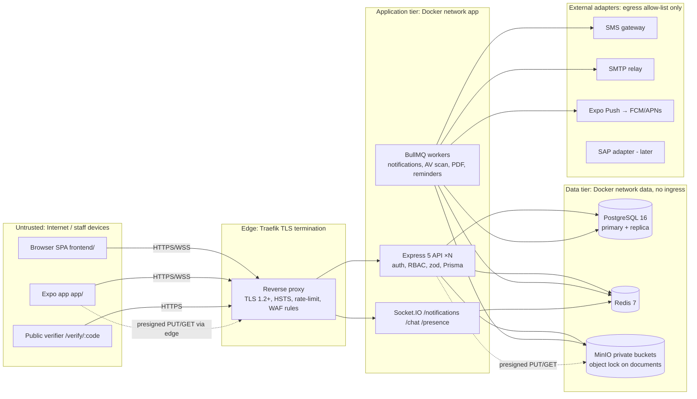

# 07 — Security, Compliance & Non-Functional Requirements

**Document:** 07 of the Production Platform Specification Suite
**Status:** Baseline v1.0 — 1 November 2026
**Audience:** Backend, web, mobile, DevOps, QA, security reviewer, client IT/audit
**Depends on:** `00_PLATFORM_OVERVIEW_AND_ARCHITECTURE.md` (ADR-04/05/06/07/09/11/17/18/24/25, §5, §8), `02_DATABASE_SCHEMA.md` (§5 data-protection columns, §7 migration policy, `AuditLog`), `08_DEVOPS_ENVIRONMENTS_AND_CICD.md` (where controls are enforced in pipelines)
**Normative language:** MUST / SHOULD / MAY as in RFC 2119. Anything marked **Gate** is checked in the pre-go-live checklist (Appendix A).

> The prototype in `client/` simulates every security feature it displays (random "SHA-256" seals, master OTP `1234`, PIN `1234`, no geofence maths, any password accepted — see `docs/00_PROJECT_CURRENT_STATE_COMPREHENSIVE_REPORT.md` §13). Nothing in this document is satisfied by prototype code. `client/` and `app/` are not modified by this specification.

---

## 1. Security Objectives and Scope

| Objective | Why it matters for BOGCL |
| :--- | :--- |
| Confidentiality of Restricted data | NID numbers, visitor ID proofs, MFA secrets, confidential note-sheets, Chairman's inner-circle chat, HSE incident reports naming injured persons |
| Integrity and non-repudiation of approvals | Note-sheet e-signatures replace wet-ink sanction of CAPEX up to crores of BDT; parcel OTP handovers; incident closure sign-offs |
| Availability during business hours | Gate check-in, attendance punch, dispatch and approvals stall operations at three sites when down |
| Accountability | Every state transition attributable to a person, device, time and request |
| Data sovereignty | All data stays on-prem (Bashundhara DC) or in a Bangladesh Tier-III facility (doc 00 ADR-05/21) |

**Engineering rules carried over from `.cursor/rules/project.mdc`** (binding for humans and agents): never expose API keys, tokens, passwords or secrets; never overwrite environment files; no destructive database commands or production configuration changes without approval; TypeScript everywhere, no `any`, nullable values handled; inspect before editing; run lint/typecheck/tests.

---

## 2. Threat Model

### 2.1 Protected assets

| ID | Asset | Where it lives | Classification (§5.1) |
| :-- | :--- | :--- | :--- |
| A1 | Credentials (argon2id hashes, lockout counters) | `user_credentials` | Restricted |
| A2 | Tokens (access JWT, refresh token, OTP, QR tokens, idempotency keys) | memory / httpOnly cookie / SecureStore; `user_sessions.refresh_token_hash`; Redis | Restricted |
| A3 | Employee PII (NID, phone, blood group, emergency contact, photo, SAP PERNR) | `employees`, `users`, `file_objects` | Restricted (NID) / Confidential |
| A4 | Signed documents (final PDFs, signatures, hash chains) | `note_sheets`, `note_paragraphs`, `signatures`, MinIO `documents` bucket | Confidential, integrity-critical |
| A5 | OTPs (parcel delivery/return, signing step-up) | `parcels.otp_hash`, Redis | Restricted, short-lived |
| A6 | Uploaded files (receipts, incident photos, licence certificates, visitor photos) | MinIO private buckets | Internal → Restricted by owner |
| A7 | Chat (inner-circle messages, directives, fleet chat, voice notes) | `chat_messages`, `fleet_chat_messages`, MinIO | Confidential |
| A8 | Location data (attendance punches, trip events, parcel scans) | `attendance_punches`, `trip_events`, `parcel_events` | Confidential |
| A9 | Visitor identity (ID proof number, photo, watchlist) | `visitors`, `watchlist` | Restricted |
| A10 | Audit log | `audit_logs` | Confidential, integrity-critical |
| A11 | Platform secrets (DB password, JWT private key, `ENCRYPTION_KEY`, SMS/SMTP creds) | env / Docker secrets / Vault | Restricted |

### 2.2 Trust boundaries



Boundary rules:

1. Nothing in **DataTier** has a published port; only the `app` network reaches it. **Gate**.
2. Clients never receive raw object-store credentials; presigned URLs are the only path to MinIO (doc 00 ADR-05).
3. Workers are a separate process (ADR-10) with the same DB role as the API; no worker accepts inbound HTTP except `/metrics` on the internal network.
4. External adapters are reached only from workers through an egress allow-list; the API never calls SMS/SMTP synchronously.
5. The public verifier endpoint reads only `note_sheets.verification_code → (file_no, title, approved_at, final_pdf_sha256, signatory names/titles)`; it never serves the PDF bytes without authentication.

### 2.3 STRIDE per asset

| Asset | Spoofing | Tampering | Repudiation | Information disclosure | Denial of service | Elevation of privilege |
| :-- | :--- | :--- | :--- | :--- | :--- | :--- |
| A1 Credentials | Credential stuffing → lockout §3.2, zxcvbn, MFA for executives | Hash swap via SQLi → Prisma only, DB role without DDL | Password change not logged → `AuditLog PASSWORD_CHANGED` | Hash leak → argon2id m=64 MiB | Lockout as DoS → per-IP+user counters, CAPTCHA-free progressive delay, admin unlock | Weak reset flow → reset tokens 15 min, single-use, hashed |
| A2 Tokens | Stolen refresh replay → rotation + reuse detection revokes family | JWT alg confusion → asymmetric only, `alg` pinned, `kid` lookup | Session revoke not attributed → `SESSION_REVOKED` audit | Token in URL/log → never in query string, pino redaction | Mass session creation → max 5 sessions/user | Scope claims forged → permissions re-read from DB per request, JWT carries only `sub`, `sid`, `roles` hint |
| A3 Employee PII | HR impersonation → MFA for `HR_ADMIN` recommended, 4-eyes for role grants | Mass edit via API → row-level scope + audit before/after | — | NID in logs/exports → AES-256-GCM, redaction list, export masking | — | `employees:read` COMPANY scope leaked to wrong role → seed review + permission tests |
| A4 Signed documents | Signing as another user → step-up OTP + MFA for final sanction | Paragraph edit after sign → hash chain, WORM PDF, `finalPdfSha256` printed | "I never signed" → IP, UA, OTP evidence, device, `Signature` row, audit | Confidential note-sheet read by non-signatory → `confidentiality` column drives extra ACL | — | Approver list edited mid-route → template immutable after submit (versioned) |
| A5 OTPs | Guessing → 6 digits, 5 attempts, 10-min TTL, bcrypt | — | — | OTP shown in error (prototype defect) → never echo | SMS flood → OTP issue rate limit per parcel and per phone | Master OTP (prototype) → none exists in production |
| A6 Files | Upload as another user → presign bound to `uploadedById` | Malware upload → ClamAV job, quarantine until `CLEAN` | — | Public bucket / guessable key → private buckets, UUID keys, 5-min GET URLs | Giant upload → size condition in presign, 25 MB default | Path traversal in key → server generates key |
| A7 Chat | Impersonated sender → `senderId` from socket auth, never from payload | Message edit history lost → `editedAt`, previous body in audit (executive channels only) | — | Non-member reads channel → membership checked per emit/room join | Message flood → socket rate limit 20 msg/10 s | Join locked channel → `isLocked` enforced server-side |
| A8 Location | Mock GPS → `isMockLocation`, accuracy ≤ 50 m, server-side fence | Punch timestamp forged → `receivedAt` server time authoritative for lateness disputes | Employee denies punch → device id + idempotency key | Movement profiling → retention 30 d for raw points, aggregates only after | — | Field-duty flag self-granted → requires `attendance:approve-field-duty` |
| A9 Visitor identity | Watchlist bypass by altered ID → HMAC match on normalised number | — | — | ID proof number leak → encrypted, 90-day post-visit purge | — | Gate user reads all visitors → `SITE` scope |
| A10 Audit log | — | Row edit by DBA/app → `REVOKE UPDATE, DELETE`, monthly hash anchor | — | Audit contains PII → `before/after` redacted for Restricted columns | Log flood → async write, partitioned | — |
| A11 Secrets | — | — | — | `.env` committed → gitleaks pre-commit + CI; `.env.example` names only | — | Secret read from container → non-root, read-only FS, Docker secrets |

### 2.4 Attacker profiles considered

| Profile | Capability | Primary controls |
| :--- | :--- | :--- |
| External opportunist | Internet access to frontend/API/verifier | TLS, rate limits, lockout, headers, no public buckets |
| Malicious insider (staff) | Valid account, mobile device, knowledge of process | Scope filters, 4-eyes, audit, break-glass alerts, MFA for executives |
| Compromised employee device | Stolen phone/laptop with app session | Short access token, biometric re-unlock, remote session revoke, SecureStore |
| Vendor/contractor on-site | Guest Wi-Fi, physical access to gate kiosk | Kiosk role `SECURITY_GATE` with SITE scope only, idle logout |
| Privileged admin abuse | `SUPER_ADMIN` | Break-glass reason, alerts to Chairman's Office + IT head, immutable audit |

---

## 3. Identity & Access

### 3.1 Password policy

| Rule | Value |
| :--- | :--- |
| Minimum length | 12 characters; maximum 128 |
| Composition | No character-class rules; strength measured by `zxcvbn` score ≥ 3 (inputs: email, emp code, full name, "bogcl", "bashundhara" added to the user-dictionary) |
| Breached-password check | Local `zxcvbn` only in v1 (offline, no outbound call); HIBP k-anonymity range API MAY be enabled later behind `PASSWORD_HIBP_ENABLED` |
| Hashing | `argon2id`, `memoryCost = 65536` (64 MiB), `timeCost = 3`, `parallelism = 4`, 16-byte salt, 32-byte hash; verify-and-rehash on login if params change |
| History | Last 5 hashes retained in `user_credentials.previous_hashes` (JSONB, new column); reuse rejected |
| Expiry | None by default (NIST 800-63B); forced change on admin reset and on breach notice |
| Initial password | Set by HR through admin UI → one-time reset link (15 min) emailed/SMSed; never printed in UI, never seeded as a literal in production |
| Reset | `POST /auth/forgot` always returns 202; token = 32 random bytes, stored SHA-256, TTL 15 min, single use; email + SMS; successful reset revokes all sessions |

### 3.2 Account lockout (progressive)

| Consecutive failures | Action |
| :--- | :--- |
| 1–4 | Respond 401 with generic message; increment `failed_attempts` |
| 5 | Lock 15 min (`locked_until`), notify user by email/SMS |
| 10 | Lock 1 h |
| 15 | Lock 24 h and flag for admin; alert raised (§9.4) |

- Counter resets on successful login or when the lock expires.
- Counters keyed per **user** (DB) and per **IP** (Redis, `login:ip:{ip}`, 20/15 min). Both must pass.
- Locked accounts still receive the same generic 401 — no user enumeration. Admin unlock via `POST /admin/users/{id}/unlock` (audited).

### 3.3 Multi-factor authentication

| Item | Specification |
| :--- | :--- |
| Algorithm | TOTP (RFC 6238), SHA-1, 6 digits, 30-second step, ±1 step tolerance; replay prevention — last accepted counter stored in Redis for 90 s |
| Secret storage | 20-byte secret, AES-256-GCM encrypted → `users.mfa_secret_enc` (doc 02 §5) |
| Enrolment | `POST /auth/mfa/setup` returns `otpauth://` URI + QR; `POST /auth/mfa/confirm` with one valid code activates; recovery codes shown once |
| Recovery codes | 10 × 10-char base32 codes, argon2id-hashed in `user_mfa_recovery_codes` (new table: `user_id, code_hash, used_at`); single use; regenerate invalidates all |
| Enforced roles | `CHAIRMAN`, `DIRECTOR`, `PLANT_GM`, `FINANCE`, `SUPER_ADMIN` — login completes only after MFA; grace of 7 days from role grant to enrol, after which the account is restricted to the MFA setup screen |
| Recommended | `HR_ADMIN`, `HOD`, `COMPLIANCE_OFFICER` (optional, configurable via `Setting mfa.recommendedRoles`) |
| Step-up | Final e-sign sanction (§7) and break-glass (§4.5) require a fresh TOTP (≤ 5 min old) or SMS OTP for users without MFA |
| Reset by admin | Requires 4-eyes (§4.6) and identity verification note; user notified on all channels |

### 3.4 Session model

```
POST /auth/login ──► credentials + optional TOTP
      │
      ├─ access JWT   (15 min, EdDSA/Ed25519, kid)  → memory (web) / SecureStore (mobile)
      └─ refresh token (30 d, 32 random bytes, opaque) → httpOnly cookie (web) / SecureStore (mobile)
                       stored as SHA-256 in user_sessions.refresh_token_hash
POST /auth/refresh ──► rotate: new refresh + new access; old hash marked rotated_at
                       reuse of a rotated token → revoke whole family, alert
POST /auth/logout  ──► revoke session; mobile also deletes DeviceToken
```

| Element | Specification |
| :--- | :--- |
| Access token | JWT, `alg = EdDSA` (Ed25519) — RS256 accepted only for a future OIDC bridge; claims `sub` (userId), `sid` (sessionId), `roles` (keys, hint only), `iat`, `exp` (+15 min), `iss = oneops`, `aud = oneops-api`, `kid` |
| Key management | Private key in `JWT_PRIVATE_KEY` (PEM, env/secret); public keys served at `GET /.well-known/jwks.json`; rotation = add new `kid`, sign with new, keep old public key 24 h, then remove. Rotate every 90 days or on suspicion |
| Permission source | Permissions and scopes are loaded from DB (cached 60 s in Redis `perm:{userId}`) on every request; the JWT is never the source of authority |
| Refresh token | Opaque; rotation on every use; `user_sessions` gains `family_id uuid`, `rotated_at timestamptz`, `replaced_by_id uuid` (schema amendment, see §13) |
| Reuse detection | Presenting a token whose `rotated_at IS NOT NULL` → revoke all sessions with the same `family_id`, write `AuditLog SESSION_FAMILY_REVOKED`, notify user, raise alert |
| Device binding | `deviceId` (mobile: installation UUID in SecureStore; web: random cookie `oo_did`, 1 y) stored on session; refresh from a different `deviceId` is rejected and counted as reuse |
| Session cap | Max 5 active sessions per user; creating a 6th revokes the oldest `lastSeenAt` |
| Idle timeout | Web: 30 min without API/socket activity → client clears memory token and shows lock screen; server rejects refresh if `lastSeenAt` older than 30 min for roles with MFA enforced, 12 h for others. Mobile: after 30 min background the app requires biometric/PIN re-unlock (`expo-local-authentication`) before using the stored refresh token |
| Absolute lifetime | Refresh family max 30 days from first login, then full re-authentication |
| Revocation | User: "Active devices" screen → `DELETE /auth/sessions/{id}`; Admin: `POST /admin/users/{id}/revoke-sessions`; password change / role change / offboarding → revoke all |
| Socket.IO | Handshake `auth: { token }` with the access JWT; server re-validates on reconnect; expired token → `connect_error` → client refreshes then reconnects |

### 3.5 Cookies and CSRF (web)

| Cookie | Flags |
| :--- | :--- |
| `oo_rt` (refresh) | `HttpOnly; Secure; SameSite=Strict; Path=/api/v1/auth; Max-Age=2592000; Domain` omitted (host-only) |
| `oo_did` (device id) | `HttpOnly; Secure; SameSite=Strict; Path=/; Max-Age=31536000` |
| `oo_csrf` (double-submit) | `Secure; SameSite=Strict; Path=/` (readable by JS) |

CSRF strategy:

1. Access token is sent as `Authorization: Bearer` from memory — not a cookie — so ordinary API calls are not CSRF-able.
2. The only cookie-authenticated endpoints are `/auth/refresh` and `/auth/logout`. They require `SameSite=Strict` **and** the double-submit header `X-CSRF-Token` equal to `oo_csrf`, **and** `Origin`/`Referer` in the CORS allow-list.
3. State-changing requests with `Content-Type` other than `application/json` are rejected (no form posts).
4. `GET` endpoints never mutate.

### 3.6 Mobile authentication specifics

- Tokens in `expo-secure-store` (Keychain / Android Keystore), `WHEN_UNLOCKED_THIS_DEVICE_ONLY`; never in AsyncStorage or redux-persist plain storage (the persist adapter is SecureStore-backed per ADR-17).
- Login returns `deviceId` requirement; app generates and stores it on first run.
- Biometric unlock gates *use* of the refresh token locally; it is not a server credential.
- Offline queue (ADR-18) replays with the current access token; if the session was revoked while offline, queued items are surfaced to the user as "needs re-login", never dropped silently.

### 3.7 Corporate SSO roadmap

| Phase | Deliverable |
| :--- | :--- |
| v1 | Local accounts (email/emp-code + password + TOTP). `User.email` is the join key for future federation |
| v1.1 | OIDC Authorization Code + PKCE adapter (`server/src/modules/auth/oidc/`) targeting Microsoft Entra ID (Azure AD); JIT account link by verified email; local password disabled when `authProvider = OIDC` |
| v1.2 | SAML 2.0 SP only if the group IdP cannot do OIDC; SCIM 2.0 inbound provisioning for joiner/mover/leaver (sets `EmploymentStatus`, triggers session revocation) |
| Constraint | MFA policy then delegated to the IdP for federated users; local MFA remains for break-glass `SUPER_ADMIN` accounts, which MUST stay local |

---

## 4. Authorization

### 4.1 Model (ADR-07 recap)

- `User ↔ UserRole(siteId?) ↔ Role ↔ RolePermission(scope) ↔ Permission(key = module:action)`.
- Scope enum: `SELF < TEAM < DEPARTMENT < SITE < COMPANY` (doc 02). A user's effective scope for a permission is the **maximum** across all held roles, further restricted by `UserRole.siteId` when the winning grant is site-bound.
- `Delegation(fromUserId, toUserId, modules[], maxAmount?, startsAt, endsAt)` extends the delegate with the delegator's permissions for the listed modules only, inside the window.

### 4.2 Evaluation algorithm

```ts
// server/src/core/authz/evaluate.ts  (pseudo-code; real file must be typed, no `any`)
type Scope = 'SELF' | 'TEAM' | 'DEPARTMENT' | 'SITE' | 'COMPANY';
const RANK: Record<Scope, number> = { SELF: 1, TEAM: 2, DEPARTMENT: 3, SITE: 4, COMPANY: 5 };

interface Grant { permission: string; scope: Scope; siteId: string | null; viaDelegationId?: string; maxAmount?: Decimal }
interface Principal { userId: string; employeeId?: string; departmentId?: string; siteId?: string; directReportIds: string[]; grants: Grant[] }

// Built once per request from Redis cache (60 s) → DB on miss
function loadPrincipal(userId): Principal {
  roles      = userRoles(userId)                        // active, not deleted
  grants     = roles.flatMap(r => rolePermissions(r.roleId).map(p => ({ ...p, siteId: r.siteId })))
  delegs     = delegations(toUserId = userId, now between startsAt and endsAt, isActive)
  for d in delegs:
    for g in loadPrincipal(d.fromUserId).grants:        // one level only, no transitive delegation
      if d.modules.length == 0 or d.modules includes module(g.permission):
        grants.push({ ...g, viaDelegationId: d.id, maxAmount: d.maxAmount })
  return { userId, employee fields, directReportIds, grants }
}

function can(p: Principal, permission: string, target?: Target): Decision {
  matching = p.grants.filter(g => g.permission == permission || g.permission == module(permission) + ':*')
  if matching.empty: return DENY('FORBIDDEN')
  best = argmax(matching, g => RANK[g.scope])
  if target == undefined: return ALLOW(best)              // list queries: caller applies scopeWhere(best)
  if !inScope(p, best, target): return DENY('FORBIDDEN_SCOPE')
  if best.viaDelegationId and best.maxAmount and target.amount > best.maxAmount: return DENY('DELEGATION_LIMIT')
  return ALLOW(best)
}

function inScope(p, g, t): boolean {
  switch g.scope:
    case 'SELF':       return t.ownerUserId == p.userId
    case 'TEAM':       return t.ownerUserId == p.userId or p.directReportIds includes t.ownerEmployeeId
    case 'DEPARTMENT': return t.departmentId == p.departmentId (or any descendant of it)
    case 'SITE':       return t.siteId == (g.siteId ?? p.siteId)
    case 'COMPANY':    return g.siteId == null or t.siteId == g.siteId
}
```

Enforcement points (all three are mandatory; **Gate**):

1. **Route middleware** `requirePermission('claims:approve')` — rejects with 403 `FORBIDDEN` before the handler runs; writes `AuditLog PERMISSION_DENIED` on deny.
2. **Service layer** calls `can(principal, permission, target)` after loading the target entity for every single-object read/write; this catches IDOR.
3. **Repository layer** applies `scopeWhere(principal, grant)` to every list/count/aggregate; it is impossible to call a list repository without a scope object (TypeScript signature requires it).

### 4.3 Delegation rules

| Rule | Detail |
| :--- | :--- |
| Who may delegate | Any user with at least one approval permission; executives (`CHAIRMAN`, `DIRECTOR`, `PLANT_GM`) may delegate only to `DIRECTOR`/`PLANT_GM`/`HOD`-holding users |
| Window | `startsAt < endsAt`, max 90 days; future-dated allowed; auto-expires |
| Depth | One level; a delegate cannot re-delegate inherited authority |
| Amount cap | `maxAmount` optional; checked on claims, note-sheets, asset requisitions |
| Self-approval | A delegate cannot approve their own request even with delegated authority (initiator == actor → `CONFLICT`) |
| Visibility | Workflow step records `delegatedToId`; PDFs print "signed by X on behalf of Y (delegation D-…)" |
| Revocation | Delegator or `SUPER_ADMIN` sets `isActive = false`; active steps already assigned remain, future ones re-resolve |
| Audit | `DELEGATION_CREATED/REVOKED` with full before/after |

### 4.4 Row-level filters per scope (repository layer)

`scopeWhere` returns a Prisma `where` fragment merged with the entity's own filters and `deletedAt IS NULL`:

| Scope | Generic fragment (fields per entity mapped in a `ScopeMap` table) |
| :--- | :--- |
| `SELF` | `{ [ownerField]: principal.userId }` — e.g. `claims.claimantId`, `leave_requests.employeeId → employee.userId`, `parcels.senderUserId OR recipientUserId` |
| `TEAM` | `{ [ownerEmployeeField]: { in: [self, ...directReportIds] } }` |
| `DEPARTMENT` | `{ [departmentField]: { in: departmentSubtreeIds } }` — subtree resolved once per request from `departments.parentId` (cached) |
| `SITE` | `{ [siteField]: grant.siteId ?? principal.siteId }` |
| `COMPANY` | `{}` or `{ [siteField]: grant.siteId }` when the role is site-bound |

Entities without a natural owner/site field (e.g. `roles`, `settings`, `regulatory_bodies`) are `COMPANY`-only and gated by permission alone. Views in doc 02 §3 (`v_approval_inbox`, `v_employee_directory`) expose `owner_user_id`, `department_id`, `site_id` columns precisely so the same filter applies.

Negative tests MUST exist per module: a `SELF`-scoped user listing another user's records receives an empty page, and fetching by id receives `404 NOT_FOUND` (not 403, to avoid confirming existence) — except for approval steps assigned to them.

### 4.5 Break-glass (`SUPER_ADMIN`)

- `SUPER_ADMIN` has `*:*` at `COMPANY` scope but **every** mutating request outside `/admin/*` requires header `X-Break-Glass-Reason` (≥ 20 chars) and a fresh step-up TOTP; otherwise 403 `BREAK_GLASS_REQUIRED`.
- Each break-glass request writes `AuditLog action = BREAK_GLASS` with the reason, and an alert (§9.4) goes to the Chairman's Office mailbox and the IT head within 1 minute.
- Break-glass sessions are capped to 60 min; the UI shows a persistent red banner.
- Maximum two `SUPER_ADMIN` accounts; both local, MFA mandatory, reviewed quarterly.

### 4.6 Four-eyes for privileged admin actions

| Action | Rule |
| :--- | :--- |
| Granting/revoking `SUPER_ADMIN`, `CHAIRMAN`, `DIRECTOR`, `PLANT_GM`, `FINANCE`, `HR_ADMIN` roles | Proposer creates `AdminChangeRequest` (new table); a different `SUPER_ADMIN` or `DIRECTOR` approves within 24 h; applied by the system, both ids audited |
| Resetting MFA for an enforced role | Same as above |
| Changing a workflow template used by note-sheets or claims | Same, plus version bump (templates are append-only) |
| Changing `Setting` keys under `security.*` | Same |
| Restoring a soft-deleted employee or note-sheet | Same |

Single-operator emergencies use break-glass instead, which is noisier by design.

---

## 5. Data Protection

### 5.1 Classification

| Level | Definition | Examples (entity.column) | Handling |
| :--- | :--- | :--- | :--- |
| **Public** | May be disclosed without harm | `GET /verify/:code` response fields; published notices flagged `audience = ALL` once exported | TLS only |
| **Internal** | All staff may see | `notices`, `bus_routes`, `bus_stops`, `shifts`, `asset_categories`, `regulatory_bodies`, employee name/designation/department (`v_employee_directory` subset) | Auth required |
| **Confidential** | Need-to-know by role/scope | `note_sheets` (default `confidentiality = INTERNAL` means Confidential here), `claims`, `leave_requests`, `incidents`, `visits`, `trips`, `attendance_*`, `chat_messages`, `audit_logs`, `vehicle_requisitions`, `licences`, asset financials | Scope filters, audit on read for executive channels, exports watermarked |
| **Restricted** | Severe harm on disclosure | `employees.nid_enc`, `visitors.id_proof_no_enc`, `users.mfa_secret_enc`, `user_credentials.*`, `user_sessions.refresh_token_hash`, `parcels.otp_hash`, `watchlist.id_proof_no_hmac`, note-sheets with `confidentiality = RESTRICTED`, inner-circle `chat_channels.key = executive-leadership`, `incident_people.injury_desc`, signature image files, `JWT_PRIVATE_KEY`, `ENCRYPTION_KEY` | App-level encryption or hashing, redacted in logs/audit `before/after`, no export, screenshot-blocked screens on mobile, access logged |

### 5.2 Encryption at rest

| Layer | Control |
| :--- | :--- |
| Disk / volume | LUKS (on-prem) or provider volume encryption for PostgreSQL, Redis AOF, MinIO drives; PostgreSQL has no native TDE in 16 — volume encryption is the baseline. **Gate** |
| MinIO | SSE-S3 with KES or MinIO-managed keys enabled on all buckets; `documents` bucket additionally versioned + object-lock (§7.6) |
| Application-level (field) | AES-256-GCM, 12-byte random IV, AAD = `"{table}.{column}:{rowId}"`, output `v1:{keyId}:{iv_b64}:{ct_b64}:{tag_b64}` stored in the `*_enc` text column. Columns: `employees.nid_enc`, `visitors.id_proof_no_enc`, `users.mfa_secret_enc` (doc 02 §5) |
| Key source | `ENCRYPTION_KEYS` env = JSON `{"k2":"<base64 32B>","k1":"<base64 32B>"}` and `ENCRYPTION_ACTIVE_KEY_ID=k2`; from Vault/KMS in production (doc 08 §4), Docker secret file on single-VM pilot |
| Searchability | Encrypted fields are never searched; watchlist matching uses a separate HMAC (§5.5) |
| Backups | pgBackRest repo encrypted (`repo-cipher-type=aes-256-cbc`) with a key distinct from `ENCRYPTION_KEYS`; MinIO replica bucket SSE on |

**Key rotation procedure (field encryption)**

1. Generate new 32-byte key; add to `ENCRYPTION_KEYS` as `k{n+1}`; keep old keys.
2. Deploy with `ENCRYPTION_ACTIVE_KEY_ID=k{n+1}` — new writes use the new key; reads pick the key by the `{keyId}` prefix.
3. Run worker job `security:reencrypt --column employees.nid_enc` (batches of 500, resumable, audited as `REENCRYPTED`); repeat per column.
4. After all rows carry the new key id (query: `WHERE nid_enc NOT LIKE 'v1:k{n+1}:%'` returns 0), remove the old key on the next deploy.
5. Record rotation in the security log; schedule: annually or on suspicion of compromise.

### 5.3 Encryption in transit

- TLS 1.2 minimum, TLS 1.3 preferred; ciphers: Traefik "modern" profile (ECDHE + AES-GCM/ChaCha20); certificates from an internal CA or Let's Encrypt (public DNS names in doc 00 §8).
- HSTS `max-age=31536000; includeSubDomains; preload` on production only.
- Internal hops (Traefik → API, API → PostgreSQL/Redis/MinIO) run on an isolated Docker network; PostgreSQL `sslmode=require` when the replica or DB is on a different host; Redis `requirepass` + TLS when off-host.
- Mobile: HTTPS only (`usesCleartextTraffic=false`, ATS default).

### 5.4 Hashing and tokens

| Secret | Algorithm | Parameters | Stored in |
| :--- | :--- | :--- | :--- |
| Passwords | argon2id | m=64 MiB, t=3, p=4, salt 16 B | `user_credentials.password_hash` |
| Refresh tokens | SHA-256 | token = 32 random bytes base64url | `user_sessions.refresh_token_hash` |
| Password-reset / email-verify tokens | SHA-256 | 32 random bytes, TTL 15 min | Redis `reset:{hash}` |
| Parcel / return OTPs | bcrypt | cost 10, 6 digits, TTL 10 min, 5 attempts | `parcels.otp_hash`, `parcel_returns.return_otp_hash` |
| Signing step-up SMS OTP | bcrypt | cost 10, 6 digits, TTL 5 min, 3 attempts | Redis `otp:sign:{userId}` |
| MFA recovery codes | argon2id | same params | `user_mfa_recovery_codes.code_hash` |
| Watchlist ID numbers | HMAC-SHA-256 | key `WATCHLIST_HMAC_KEY` (separate secret); input normalised (digits only) | `watchlist.id_proof_no_hmac` (doc 02 updated to HMAC) |
| File integrity | SHA-256 | computed server-side on `complete` | `file_objects.sha256` |
| Note-sheet paragraph chain | SHA-256 | canonical JSON (§7.1) | `note_paragraphs.content_hash` |
| Final PDF | SHA-256 | over bytes | `note_sheets.final_pdf_sha256` |
| Visit / fuel QR tokens | 32 random bytes base64url | single use for fuel, validity window for visits | `visits.qr_token`, `fuel_vouchers.qr_token` |
| Idempotency keys | client-supplied UUID | 24 h | Redis + `idempotency_keys` |

### 5.5 Secrets management

| Rule | Detail |
| :--- | :--- |
| Never in repo | gitleaks pre-commit + CI (doc 08). `.env`, `*.pem`, `*.p12`, `google-play-service-account.json` ignored. **Gate** |
| `.env.example` | Variable names and placeholder values only (`CHANGE_ME`), never real values |
| Local | `.env` files per app, created by developer from `.env.example`; agents MUST NOT overwrite them (`project.mdc`) |
| dev/staging | GitHub Environments secrets injected at deploy; on the VM, Docker Compose reads `/opt/oneops/secrets/*.env` with mode 600, owned by the deploy user |
| production | HashiCorp Vault (KV v2) or Docker Swarm secrets; app reads files under `/run/secrets/` when `*_FILE` variant is set (`DATABASE_URL_FILE`), config loader supports both |
| Rotation | DB password 180 d, JWT key 90 d, `ENCRYPTION_KEYS` 365 d, SMS/SMTP creds on vendor change; runbook in doc 08 §12 |
| Exposure response | Treat any secret seen in a log, ticket, chat or commit as compromised: rotate within 4 h, purge history if committed |

### 5.6 Backups

- Encrypted at rest (§5.2), access restricted to the backup service account, offsite copy in a second site (CTG terminal or BD cloud bucket).
- Restores land in an isolated network; anonymisation job (§5.9) runs before any copy reaches `staging`.
- Retention of backups ≤ data retention; expired PII is not resurrected by old backups beyond the backup retention window (35 days full/WAL, 12 monthly).

### 5.7 PII minimisation

- NID is collected only for employees (HR statutory need) and stored encrypted; it is shown masked (`•••• •••• 1234`) and unmasked only to `HR_ADMIN` with an `employees:read-restricted` permission and an audit entry per reveal.
- Visitor ID proof number: captured at pre-registration or gate, needed for watchlist matching and incident investigation; purged 90 days after check-out (§5.8).
- Photos: employee photo for directory/badge; visitor photo for gate match; no facial-recognition processing in v1.
- Location: only at punch/scan/trip events; no background tracking; mobile requests "while using" permission only.
- Chat: no server-side content analysis; voice notes transcoded but not transcribed.
- Logs never contain request bodies for `/auth/*`, `/files/*`, `/chat/*`, or any field in the redaction list (§9.2).

### 5.8 Retention schedule

| Data (entities) | Retention | Then | Owner |
| :--- | :--- | :--- | :--- |
| `audit_logs` | 7 years | Archive partition to cold object storage (Parquet) then drop partition | IT / Internal Audit |
| `note_sheets`, `note_paragraphs`, `signatures`, final PDFs | 10 years after approval (financial record) | Archive to WORM cold bucket | Finance |
| `claims`, `claim_lines`, `advances`, receipts | 7 years after settlement | Delete receipts, keep ledger rows | Finance |
| `workflow_*` | Lifetime of the owning object | Follows owner | Platform |
| `attendance_punches` (raw with lat/lng) | 3 years | Delete; `attendance_days` kept 7 years | HR |
| `attendance_punches.lat/lng/accuracy_m` precision | 30 days | Nulled by nightly job; `result`, `geofenceId`, `distance_m` remain | HR |
| `trip_events.lat/lng`, `parcel_events.lat/lng` | 30 days | Nulled; event rows kept with the parent | Transport |
| `chat_messages`, `fleet_chat_messages`, voice/document files | 1 year default; `chat_channels.retention_days` may shorten (not lengthen beyond 3 y) | Hard delete rows + objects | Owner / Chairman's Office |
| `visitors.id_proof_no_enc`, visitor photo | 90 days after last `visits.checked_out_at` (or cancelled) | Null the fields; keep name/org/visit rows | Security |
| `visits` | 3 years | Anonymise visitor link | Security |
| `watchlist` | Until removed by `SECURITY_GATE` supervisor + annual review | Hard delete | Security |
| `incidents`, `incident_people`, CAPA | 10 years (statutory HSE) | Archive | HSE |
| `licences`, `licence_renewals`, documents | Life of licence + 7 years | Archive | Compliance |
| `assets`, events, depreciation | Life + 7 years after disposal | Archive | Finance |
| `notifications`, `notification_deliveries` | 180 days | Hard delete | Platform |
| `user_sessions` (revoked/expired) | 90 days | Hard delete | Platform |
| `idempotency_keys` | 24 h (Redis) / 7 d (table) | Hard delete | Platform |
| `file_objects` orphaned (no attachment after `complete`) | 7 days | Delete object + row | Platform |
| Application logs (pino → Loki) | 90 days hot, 1 year cold | Delete | DevOps |
| Metrics | 15 months | Downsample/delete | DevOps |
| Backups | 35 days PITR window; 12 monthly fulls | Delete | DevOps |

Implementation: one BullMQ repeatable job per row (`retention:{entity}`) nightly at 02:00 Asia/Dhaka, each idempotent, batch-limited (10k rows/run), writing `AuditLog RETENTION_PURGE` with counts (not ids). Retention values live in `Setting retention.*` with the above as seeded defaults; raising a value above the table maximum requires 4-eyes.

### 5.9 Right to erasure / anonymisation

**Offboarded employee** (triggered when `ExitClearance` completes + 90 days, or on HR request):

1. `users`: email → `deleted+{uuid}@invalid`, phone null, `isActive=false`, `deletedAt`, all sessions and device tokens revoked, MFA secret null.
2. `employees`: `nid` null, `emergencyContact` null, `bloodGroup` null, photo object deleted; `fullName` retained (appears on approved documents, which are financial records), `empCode` retained.
3. Chat messages authored: body replaced with `[removed]` after the chat retention period; before that they stay (other members' context).
4. Attendance raw punches older than the schedule deleted; `attendance_days` retained.
5. Audit log entries are **not** altered (legal integrity); they reference `actorUserId`, whose PII is now minimal.
6. Write `AuditLog PII_ANONYMISED` with the list of columns touched.

**Visitor**: handled by the 90-day job; an explicit request (`POST /admin/visitors/{id}/anonymise`) runs the same routine immediately unless the visitor is linked to an open incident or watchlist entry (then 409 with reason).

**Staging copies**: the anonymisation SQL (`infra/db/anonymise.sql`) replaces names with Faker-style values, nulls all Restricted columns, rewrites emails/phones, and truncates chat and file references before data reaches staging.

### 5.10 Bangladesh regulatory context (considerations, not legal advice)

| Instrument | Consideration for OneOps |
| :--- | :--- |
| Cyber Security Act 2023 (successor to the Digital Security Act 2018) and any later Cyber Security Ordinance | Unauthorised access, data alteration and identity misuse are offences; the platform's audit trail and access controls support BOGCL in demonstrating due care and in producing evidence. Keep incident records and log retention sufficient for lawful requests. |
| Personal Data Protection Ordinance 2025 (and rules under it) | Expect principles of lawful basis, purpose limitation, minimisation, retention limits, data-subject rights, breach notification and data-localisation preferences. §5.7–§5.9 and §10.5 are designed to meet such obligations; confirm specific timelines and the status of a data-protection authority with BOGCL legal before go-live. |
| Data localisation | Primary storage on-prem or in a Bangladesh facility (ADR-05/21). Any foreign SaaS in the path (Expo Push, Sentry SaaS, Apple/Google push) handles only tokens, device metadata and error payloads — keep PII out of Sentry (redaction) and push payloads (titles only; body fetched after unlock). Self-hosted Sentry is the alternative if legal requires. |
| Labour law / HSE record-keeping | Incident and attendance records may be required by the Department of Inspection for Factories and Establishments and the Department of Explosives; retention above is set conservatively long for these. |
| Evidence Act / electronic records | E-signature non-repudiation evidence (§7.4) is collected so documents can be relied on internally; certified digital signatures from a licensed Bangladesh CA remain a later option (doc 00 §1 out-of-scope). |
| Financial record retention | Approved note-sheets, vouchers and claims kept ≥ 7–10 years to align with tax/audit expectations; confirm with Finance. |

Action item before pilot: a 1-page Data Protection Impact note signed by BOGCL HR, Legal and IT covering NID, visitor IDs, location and chat.

---

## 6. Application Security

### 6.1 Input validation

- Every route declares zod schemas for `params`, `query`, `body` (ADR-08); the `validate()` middleware strips unknown keys (`.strict()` for bodies), coerces query numbers, and returns 422 `VALIDATION_ERROR` with `details[] = { path, message }`.
- IDs are `z.string().uuid()`; enums come from the Prisma-generated enums; money is `z.string().regex(/^\d{1,12}(\.\d{1,2})?$/)` converted to `Decimal`.
- Free text limited: titles 200, bodies 20 000, chat 4 000, comments 2 000 chars; Unicode allowed (Bengali), control characters except `\n\t` rejected.
- File names sanitised to `[\p{L}\p{N} ._-]`, max 150 chars; server generates object keys.
- Socket.IO events validated with the same zod schemas before any handler.
- Webhook/callback bodies (SMS DLR) validated and authenticated by shared secret header.

### 6.2 Output encoding

- JSON only from the API; `Content-Type: application/json; charset=utf-8`; `X-Content-Type-Options: nosniff`.
- Web: React escapes by default; `dangerouslySetInnerHTML` is forbidden by ESLint rule except in one audited `RichText` component that renders notice bodies through DOMPurify with an allow-list (`p, br, b, i, u, ul, ol, li, a[href^=https]`).
- PDF templates (Playwright) are React/Handlebars with auto-escaping; user text never concatenated into HTML.
- CSV/XLSX exports prefix cells starting with `= + - @` with `'` (formula injection).
- Mobile: text rendered via `<Text>`; no WebView of untrusted HTML; notice HTML converted to a restricted native renderer.

### 6.3 Database access

- Prisma client only; `$queryRaw`/`$executeRaw` allowed solely with tagged templates (parameterised) and reviewed in PR; `$queryRawUnsafe` banned by ESLint `no-restricted-syntax`. **Gate**
- App DB role `oneops_app`: `SELECT/INSERT/UPDATE/DELETE` on app tables, `USAGE` on sequences, **no** `UPDATE/DELETE` on `audit_logs`, no DDL. Migrations run with a separate `oneops_migrate` role.
- Statement timeout 15 s for API connections, 5 min for workers; pool 20 per API instance.
- Soft-delete extension ensures `deletedAt IS NULL` on reads; hard deletes only by retention jobs.

### 6.4 File upload controls

| Control | Specification |
| :--- | :--- |
| Flow | `POST /files/presign { fileName, mime, sizeBytes, purpose }` → server validates purpose-specific allow-list and size → returns presigned PUT (5 min) with conditions `Content-Type = mime`, `Content-Length-Range = [1, max]`, key `{bucket}/{yyyy}/{mm}/{uuid}` → client PUT → `POST /files/{id}/complete` |
| Allow-lists | `RECEIPT/PHOTO`: `image/jpeg, image/png, image/webp, application/pdf` ≤ 10 MB; `CERTIFICATE/DOCUMENT`: + `application/vnd.openxmlformats-officedocument.*` ≤ 25 MB; `VOICE`: `audio/mp4, audio/aac, audio/ogg` ≤ 5 MB; `SIGNATURE`: `image/png` ≤ 200 KB; `AVATAR`: images ≤ 2 MB |
| Server verification on `complete` | HEAD object (size matches), stream first 4 KB → `file-type` magic-byte sniff must agree with declared MIME; compute SHA-256 while streaming; mismatch → delete object, 422 |
| AV scan | BullMQ job `files:scan` → ClamAV (`clamd` container, `INSTREAM`); `scanStatus PENDING → CLEAN | INFECTED | FAILED`; `INFECTED` → object moved to `quarantine` bucket, uploader notified, security alert; attachments cannot be linked while `PENDING`; downloads blocked unless `CLEAN` |
| Images | Re-encoded by `sharp` (strips EXIF incl. GPS, limits to 4096 px) for `PHOTO/AVATAR/SIGNATURE`; original discarded |
| PDFs | No JavaScript/launch actions allowed: `pdf-lib` check; flagged PDFs rejected |
| Download | Presigned GET 5 min, `response-content-disposition: attachment; filename="…"`, `response-content-type` forced; inline only for images/PDF previews in the web app |
| Buckets | `uploads` (private, lifecycle: delete `PENDING` > 7 d), `documents` (private, versioned, object-lock), `quarantine` (private, 30 d), `public` bucket does **not** exist. **Gate** |
| Authorisation | Presign records `uploadedById`; `complete` and link require the same user; reading an attachment requires read access to its owner entity |

### 6.5 Rate limiting matrix

Implemented with Redis sliding-window counters (ADR-04); keys include a prefix per environment. Responses `429 RATE_LIMITED` with `Retry-After`.

| Endpoint / action | Key | Limit |
| :--- | :--- | :--- |
| `POST /auth/login` | IP | 20 / 15 min |
| `POST /auth/login` | user (email/emp code, normalised) | 5 / min, plus lockout §3.2 |
| `POST /auth/forgot` | IP + identifier | 3 / 15 min |
| `POST /auth/mfa/verify`, recovery code | user | 5 / 10 min |
| OTP verify (parcel, signing) | object id + user | 5 / 10 min, then OTP invalidated |
| OTP issue (SMS) | phone | 3 / 15 min, 10 / day |
| `POST /auth/refresh` | session | 10 / min |
| API (authenticated) | user | 600 / min |
| API (unauthenticated, e.g. `/verify/:code`) | IP | 60 / min |
| `POST /files/presign` | user | 30 / h |
| Exports (`/reports/*/export`) | user | 10 / h; a single export > 50k rows runs as a job |
| Socket.IO messages | socket | 20 / 10 s; 5 joins / 10 s |
| Push/SMS broadcast | author | 5 broadcasts / h (notices with `sendSms`) |
| Admin mutations | user | 120 / min |
| Global edge (Traefik) | IP | 300 req/s burst 600 — protects against floods before Node |

### 6.6 Security headers (API and web)

`server/src/core/http/security.ts`:

```ts
import helmet from 'helmet';

export const securityHeaders = helmet({
  contentSecurityPolicy: false,                 // API returns JSON; CSP is set by the web nginx config
  crossOriginResourcePolicy: { policy: 'same-site' },
  crossOriginOpenerPolicy: { policy: 'same-origin' },
  referrerPolicy: { policy: 'no-referrer' },
  strictTransportSecurity: { maxAge: 31_536_000, includeSubDomains: true, preload: true },
  frameguard: { action: 'deny' },
  xContentTypeOptions: true,
  xDnsPrefetchControl: { allow: false },
  xPermittedCrossDomainPolicies: { permittedPolicies: 'none' },
  hidePoweredBy: true,
});
```

Web (nginx, see doc 08 §6):

```
Content-Security-Policy: default-src 'self'; script-src 'self'; style-src 'self' 'unsafe-inline';
  img-src 'self' data: blob: https://minio.<domain>; font-src 'self'; connect-src 'self' https://api.<domain> wss://api.<domain> https://minio.<domain> https://<sentry-host>;
  frame-ancestors 'none'; base-uri 'self'; form-action 'self'; object-src 'none'; upgrade-insecure-requests
Permissions-Policy: geolocation=(self), camera=(self), microphone=(self), payment=(), usb=()
```

`style-src 'unsafe-inline'` is required by Tailwind/Radix runtime styles; scripts have no inline exceptions (Vite emits external chunks). Google Fonts used by the prototype are **self-hosted** in production so `font-src` stays `'self'`.

### 6.7 CORS

- `CORS_ORIGINS` env = comma-separated exact origins (`https://oneops.bashundhara.com`, staging, `http://localhost:5173` in local). No wildcard, no regex. `credentials: true` only for listed origins; methods `GET,POST,PATCH,DELETE`; headers `Authorization, Content-Type, X-CSRF-Token, Idempotency-Key, X-Break-Glass-Reason, Accept-Language, X-Request-Id`; `maxAge 600`.
- Mobile apps have no `Origin`; they are not CORS clients and are authenticated by bearer only.
- Socket.IO uses the same allow-list.

### 6.8 Request limits and parsing

- JSON body ≤ 1 MB (`express.json({ limit: '1mb', strict: true })`); chat/notice bodies within that. Multipart is **not** accepted by the API (uploads bypass it).
- URL ≤ 2 KB, headers ≤ 16 KB (Traefik), query arrays capped at 50 items, `pageSize ≤ 100`.
- Server timeouts: `headersTimeout 65 s`, `requestTimeout 30 s`, keep-alive 61 s (> LB 60 s).
- `trust proxy` set to the number of hops (1 behind Traefik) so `req.ip` is correct for rate limiting; `X-Forwarded-For` from outside is overwritten by Traefik.

### 6.9 SSRF / XXE / deserialisation notes

- The API makes no outbound requests based on user-supplied URLs (no link preview, no webhook registration in v1) → SSRF surface is limited to configured adapters; adapter base URLs come from env only. If a future feature fetches user URLs, it MUST go through an egress proxy with a deny-list for RFC 1918/link-local and a DNS re-resolution check.
- No XML parsing anywhere (JSON only, OOXML files are stored, not parsed) → XXE N/A. If OOXML parsing is ever added, use a parser with external entities disabled.
- No `eval`, `new Function`, `vm`, or YAML `load` with custom tags; workflow `condition` expressions are evaluated by a tiny whitelisted expression evaluator (fields, comparison, `&& ||`), not JavaScript.
- Playwright PDF rendering runs in a dedicated worker container with `--no-sandbox` disabled (use proper seccomp), no network access (`network_mode: none`), templates loaded from local files.

### 6.10 Supply-chain security

| Control | Tool | Policy |
| :--- | :--- | :--- |
| Lockfiles | `package-lock.json` per app, `npm ci` in CI | PR fails if lockfile out of date |
| Vulnerability audit | `npm audit --omit=dev --audit-level=high` in CI; Trivy image scan | High/Critical block merge unless an exception issue is linked with expiry ≤ 30 d |
| Updates | Renovate (weekly, grouped minors, auto-merge devDeps patch after CI) | Majors reviewed manually |
| Package reputation | Socket.dev GitHub app (install scripts, typosquats, maintainer changes) | Warnings must be acknowledged in PR |
| Provenance | `npm config set ignore-scripts true` in CI for install, explicit `prisma generate` after | Prevents lifecycle-script attacks |
| SBOM | `syft` generates CycloneDX per image; stored as release artefact | Required for production tag |
| Base images | `node:22-alpine`, `nginx:1.27-alpine`, pinned by digest, Renovate-bumped | Rebuild monthly even without code change |

### 6.11 SAST, DAST, secret scanning

| Stage | Tool | Scope |
| :--- | :--- | :--- |
| Pre-commit (husky + lint-staged) | `gitleaks protect --staged`, ESLint with `eslint-plugin-security` + `@typescript-eslint` strict | server/web/app |
| CI SAST | Semgrep (`p/typescript`, `p/nodejs`, `p/react`, `p/jwt`, `p/secrets`, custom rules: no `$queryRawUnsafe`, no `dangerouslySetInnerHTML`, no `Math.random` for secrets) | Blocking on `ERROR` |
| CI secrets | `gitleaks detect` full history on `main` nightly; TruffleHog verification for high-entropy hits | Blocking |
| CI containers | Trivy fs + image, misconfig checks for Dockerfiles and compose | Blocking on Critical |
| DAST (staging, weekly + before release) | OWASP ZAP baseline + API scan from the OpenAPI document with an authenticated context (test user per role) | Medium+ triaged; High blocks release |
| Dependency review | GitHub dependency-review action on PR | Blocking on High |
| Manual | Annual third-party penetration test (web, API, mobile) before go-live and annually; findings tracked to closure | **Gate** |

### 6.12 OWASP ASVS L2 target and Top-10 mapping

OneOps targets **ASVS 4.0.3 Level 2** (standard for applications handling sensitive personal data). Evidence per chapter is stored in `docs/platform/security-evidence/` (created during hardening sprint, not part of this spec).

| OWASP Top 10 (2021) | Primary controls in this document |
| :--- | :--- |
| A01 Broken Access Control | §4 three-layer enforcement, scope tests, IDOR → 404, CORS allow-list, 4-eyes |
| A02 Cryptographic Failures | §5.2–§5.4 argon2id, AES-GCM, TLS 1.2+, HSTS, no secrets in repo |
| A03 Injection | §6.1 zod, §6.3 Prisma only, §6.2 encoding, CSV guard, Semgrep rules |
| A04 Insecure Design | §2 threat model, workflow templates immutable after submit, break-glass design, retention by design |
| A05 Security Misconfiguration | §6.6 headers, §6.7 CORS, private buckets, non-root containers, Trivy misconfig, prod env validation at boot |
| A06 Vulnerable Components | §6.10 audit, Renovate, Socket, SBOM, pinned digests |
| A07 Identification & Auth Failures | §3 password policy, lockout, MFA, session rotation & reuse detection, device binding |
| A08 Software & Data Integrity | §7 hash chains, WORM, audit anchoring; CI provenance, `ignore-scripts`, signed OTA (§8) |
| A09 Logging & Monitoring Failures | §9 event list, redaction, SIEM JSON, alerts; §10 IR |
| A10 SSRF | §6.9 no user-URL fetch, egress allow-list |

---

## 7. E-Signature and Document Integrity

### 7.1 Paragraph hash chain

Each `NoteParagraph` stores `contentHash = sha256(canonicalJson(payload))` where

```json
{ "v": 1, "noteSheetId": "…", "seqNo": 3, "prevHash": "<hash of seqNo 2 or null>",
  "authorId": "…", "kind": "APPROVAL", "body": "…", "createdAt": "2026-11-01T08:15:30.000Z" }
```

- Canonical JSON = RFC 8785 (JCS): sorted keys, no whitespace, UTF-8, numbers as shortest form. Library: `canonicalize`.
- Append-only: `note_paragraphs` has a DB trigger rejecting `UPDATE` of `body/content_hash/prev_hash` and any `DELETE` once the note-sheet left `DRAFT`.
- `GET /note-sheets/{id}/integrity` recomputes the chain and returns `{ valid, brokenAtSeqNo? }`; run nightly for all `APPROVED` sheets of the last 30 days (job `integrity:notesheets`) and on demand.
- Same scheme for `parcel_events.event_hash` and `asset_events.event_hash` (payload = event fields).

### 7.2 Signing ceremony

1. Signatory opens the sheet; UI shows the current `contentHash` of the last paragraph and the full document.
2. Signatory draws/types/stamps a signature (image → `SIGNATURE` upload, ≤ 200 KB PNG) or reuses a stored one.
3. Step-up: fresh TOTP (MFA users) or SMS OTP (others) — `otpVerified = true` on success.
4. Server creates `Signature { userId, method, imageFileId, otpVerified, ip, userAgent, documentHash = hash of the last paragraph at that moment, stampCode }` and appends an `APPROVAL` paragraph whose body includes the stamp code; the chain therefore binds the signature to the exact document state.
5. `WorkflowStep.signatureId` set; `NoteSignatory.status = SIGNED`; `AuditLog SIGNED`.
6. Delegated signature: `Signature.userId` = actual signer; paragraph text "on behalf of …"; `delegationId` in audit metadata.

### 7.3 Final PDF, verification code, QR

- On final approval the worker renders the PDF (Playwright/Chromium, ADR-25) from the paragraphs, signatory table, vendor quotes and signature images; footer on every page: `File No · Verification code · SHA-256 (first 16 hex) · "Verify at https://oneops.bashundhara.com/verify/{code}"` + QR encoding that URL.
- `verificationCode` = 12 chars base32 (Crockford) from 60 random bits, unique; stored on `note_sheets`.
- Because the hash cannot be printed inside the file it hashes, the printed hash is the hash of the **content manifest** (`canonicalJson({ fileNo, paragraphs[].contentHash, signatures[].stampCode, approvedAt })`), while `finalPdfSha256` (hash of the actual bytes) is stored and shown on the verify page. Both appear on `/verify/:code`.
- `GET /verify/:code` (public, rate-limited): returns `fileNo`, title, department, `approvedAt`, signatories (name, title, signed at), manifest hash, PDF SHA-256, and a status `VALID | REVOKED | NOT_FOUND`. It never returns amounts, body text or the PDF.
- Authenticated users with read access can download the PDF and the client compares the downloaded bytes' SHA-256 with `finalPdfSha256` (web shows a green "integrity verified" badge).

### 7.4 Timestamping and non-repudiation evidence

| Evidence | Source |
| :--- | :--- |
| Time | Server `createdAt` (NTP-synced hosts, `chrony`); device time recorded separately for mobile and never trusted for ordering |
| Identity | `userId`, session id, MFA/OTP result, role at the time (snapshot in audit `after`) |
| Network | IP (from Traefik `X-Forwarded-For`), user agent, platform, app version, device id |
| Intent | The signed `documentHash`, the paragraph appended, any comment |
| Independent anchor | Monthly audit hash anchor (§7.6) covering all `SIGNED` events; optional RFC 3161 TSA stamp of the anchor if a trusted TSA is approved by BOGCL |

### 7.5 WORM storage for final PDFs

- Bucket `documents`: versioning on; **Object Lock** in `COMPLIANCE` mode with default retention 10 years; worker writes once; any overwrite creates a new version and the previous is immutable.
- `FileObject` rows for final PDFs are flagged `isFinal` (new boolean) and excluded from retention jobs until the record's own schedule.
- Revocation of a document (e.g. approved in error) does not delete it: `note_sheets.status = WITHDRAWN` after approval is not allowed; instead a new sheet supersedes it and `/verify` shows `REVOKED` with the superseding file number.

### 7.6 Audit log immutability

- Migration: `REVOKE UPDATE, DELETE ON audit_logs FROM oneops_app;` and a trigger `BEFORE UPDATE OR DELETE … RAISE EXCEPTION` as defence in depth (doc 02 §7).
- Partitioned monthly by `created_at`; closed partitions get a `ALTER TABLE … SET (autovacuum_enabled = false)` and are `pg_dump`ed to the WORM bucket.
- Monthly anchor job: `sha256` over the ordered concatenation of `(id, created_at, actor_user_id, action, entity_type, entity_id, sha256(before||after))` for the month → stored in `audit_anchors(month, row_count, root_hash, previous_root_hash, created_at)` and emailed to Internal Audit; verification tool `npm run audit:verify -- 2026-11` recomputes.
- `before/after` JSON passes through the redaction list (§9.2) before insert so Restricted values never enter the audit table in clear.

---

## 8. Mobile-Specific Controls (`app/`)

| Area | Policy |
| :--- | :--- |
| Secure storage | `expo-secure-store` for access/refresh tokens, device id, biometric flag; redux-persist uses a SecureStore adapter and persists UI state and the offline queue only (queue payloads contain no Restricted fields) |
| Root / jailbreak | Detect with a maintained library (`expo-device` signals + `react-native-device-info`/`jail-monkey` equivalent). Policy: **warn and restrict**, not block — rooted devices cannot perform attendance punch or e-sign (server also receives `deviceIntegrity` flag and enforces); all other read features continue. Play Integrity / App Attest MAY be added in v1.1 for punch and sign |
| Screenshot blocking | `expo-screen-capture` `preventScreenCaptureAsync()` on Restricted screens: note-sheet reader when `confidentiality = RESTRICTED`, inner-circle chat, employee profile (NID), visitor ID capture; Android `FLAG_SECURE`, iOS best-effort blur on app switcher |
| Certificate pinning | **Decision: not pinned in v1.** Rationale: on-prem certificates may be rotated by BOGCL IT without an app release, and Expo managed workflow pinning requires a config plugin; risk mitigated by TLS 1.2+, HSTS and no cleartext. Revisit when a stable public CA chain is in place; if adopted, pin the intermediate CA SPKI with a backup pin and 30-day overlap |
| Mock location | `expo-location` returns `mocked` on Android; app sends `isMockLocation`, `accuracy`, `provider`; server rejects mock/`accuracy > 50 m` (doc 00 §6.7); repeated mock attempts (3/day) raise an alert to HR |
| Permissions | Location "while using" only; camera for scans/photos; microphone for voice notes; notifications; no contacts/SMS read |
| OTA updates | `expo-updates` with code signing enabled (`updates.codeSigningCertificate` + private key held in CI secret); app verifies signature before applying; channels per environment; no JS from untrusted origins |
| Build hardening | `android.allowBackup=false`, Hermes bytecode, ProGuard/R8 enabled, debug logs stripped in release; iOS ATS default, no arbitrary loads |
| Local data | No Restricted fields cached beyond the current screen; RTK Query cache is in memory; images cached by `expo-image` are cleared on logout |
| Lock | 30 min background → biometric/PIN re-unlock; 5 failed PIN attempts → wipe local tokens (server session remains until it expires or is revoked) |
| Push payloads | Title + generic body only (`"New approval pending"`); details fetched after unlock |
| Telemetry | Sentry RN with `sendDefaultPii=false`, breadcrumbs scrubbed of request bodies and auth headers |

---

## 9. Audit and Monitoring

### 9.1 What is logged

**Audit log (`audit_logs`, durable, 7 y):**

| Category | Actions |
| :--- | :--- |
| Authentication | `LOGIN_SUCCESS`, `LOGIN_FAILED` (no password), `LOGOUT`, `MFA_ENROLLED`, `MFA_VERIFIED`, `MFA_FAILED`, `MFA_RESET`, `PASSWORD_CHANGED`, `PASSWORD_RESET_REQUESTED/COMPLETED`, `SESSION_REVOKED`, `SESSION_FAMILY_REVOKED`, `ACCOUNT_LOCKED/UNLOCKED` |
| Authorisation | `PERMISSION_DENIED` (permission, target, scope), `BREAK_GLASS`, `DELEGATION_CREATED/REVOKED/USED` |
| Admin | `ROLE_GRANTED/REVOKED`, `ADMIN_CHANGE_REQUESTED/APPROVED/REJECTED`, `SETTING_CHANGED`, `TEMPLATE_PUBLISHED`, `USER_CREATED/DEACTIVATED`, `GEOFENCE_CHANGED` |
| Data | `CREATE/UPDATE/DELETE` on all audited models (doc 02 §1) with redacted before/after; `RESTRICTED_FIELD_REVEALED` (NID unmask); `EXPORT` (report, filters, row count); `FILE_DOWNLOADED` for Restricted/Confidential attachments |
| Workflow | Every `WorkflowAction` type mirrored: `SUBMITTED`, `APPROVED`, `REJECTED`, `RETURNED`, `ESCALATED`, `WITHDRAWN`, `SIGNED`, `OTP_VERIFIED`; every entity `status/stage` transition |
| Security ops | `RETENTION_PURGE`, `PII_ANONYMISED`, `REENCRYPTED`, `AV_INFECTED`, `INTEGRITY_CHECK_FAILED` |

**Application log (pino JSON → Loki, 90 d):** one line per request `{ ts, level, requestId, userId?, sid?, method, path (templated), status, durationMs, ip, ua, bytes }`; errors with stack; job lifecycle; socket connect/disconnect counts. No bodies.

### 9.2 Redaction list

pino `redact` paths and the audit sanitiser share one list (`server/src/core/logging/redact.ts`):

```
req.headers.authorization, req.headers.cookie, res.headers["set-cookie"],
*.password, *.newPassword, *.currentPassword, *.passwordHash, *.token, *.refreshToken, *.accessToken,
*.otp, *.otpHash, *.code (under /auth/mfa, /parcels/*/verify), *.recoveryCode,
*.nid, *.idProofNo, *.idProofNoEnc, *.mfaSecret, *.mfaSecretEnc, *.secret, *.privateKey,
*.emergencyContact, *.phone (partial: keep last 4), *.email (partial: keep domain) in audit before/after,
*.lat, *.lng (rounded to 2 dp in app logs), *.body (chat), *.transcript
```

Sentry: `beforeSend` applies the same list, drops `request.data`, keeps `requestId` for correlation.

### 9.3 SIEM-ready format

- Every log line and audit row is flat JSON with `@timestamp` (ISO 8601 UTC), `event.kind` (`audit|app|security`), `event.action`, `user.id`, `source.ip`, `trace.id = requestId`, `service.name`, `service.version`, `environment` — ECS-compatible field names so Elastic/Wazuh/Splunk ingest without mapping.
- Audit rows are also emitted to a Redis stream `audit:events` consumed by the SIEM forwarder (optional at pilot; BOGCL IT may point Wazuh at it).

### 9.4 Alert rules (security)

| Alert | Condition | Severity | Route |
| :--- | :--- | :--- | :--- |
| Brute force | > 50 `LOGIN_FAILED` from one IP in 10 min or > 20 across users with same UA | High | On-call + IT security |
| Account lockout cascade | ≥ 15 failures on one account in 24 h | Medium | IT security |
| Impossible travel | Two successful logins for one user from IPs whose geo-distance / Δt > 800 km/h (GeoIP on the edge; BD-only expected) | High | User + IT security |
| Refresh token reuse | Any `SESSION_FAMILY_REVOKED` | High | User + on-call |
| Mass export | `EXPORT` > 10k rows or > 5 exports/h by one user | Medium | Data owner + IT |
| Privilege change | Any `ROLE_GRANTED` for enforced-MFA roles, any `BREAK_GLASS` | High | Chairman's Office mailbox + IT head |
| Restricted reveals | > 20 `RESTRICTED_FIELD_REVEALED` by one user/day | Medium | HR head |
| Malware | `AV_INFECTED` | High | Uploader's manager + IT |
| Integrity | `INTEGRITY_CHECK_FAILED`, audit anchor mismatch | Critical | CTO + Internal Audit |
| Mock GPS abuse | 3 `REJECTED_MOCK` punches by one employee/day | Low | HR |
| Permission denial spike | > 100 `PERMISSION_DENIED` by one user/h | Medium | IT security |
| New admin session | `LOGIN_SUCCESS` for `SUPER_ADMIN` from a device id not seen in 90 d | Medium | Both super admins |

Operational alerts (latency, errors, queues, disk) are in doc 08 §10.

---

## 10. Incident Response

### 10.1 Severity levels

| Sev | Definition | Examples | Response / update cadence |
| :-- | :--- | :--- | :--- |
| SEV-1 | Confirmed breach of Restricted data, integrity compromise of signed documents, or full outage in business hours | Leaked DB dump, forged approval, ransomware | Respond 15 min, update every 30 min, exec notified immediately |
| SEV-2 | Suspected breach, partial outage of a critical module (approvals, gate, attendance), privileged account misuse | Reuse-detection storm, super-admin anomaly | Respond 30 min, update hourly |
| SEV-3 | Vulnerability with no evidence of exploitation; non-critical module degraded | High CVE in dependency, AV hit | Respond 4 h, daily updates |
| SEV-4 | Policy deviation, low-risk finding | Missing header on one route | Next sprint |

### 10.2 Roles and on-call

- **Incident commander**: on-call backend engineer (rotation in doc 08 §10), escalates to engineering lead for SEV-1/2.
- **Security lead**: designated engineer + BOGCL IT security contact.
- **Communications**: BOGCL IT head informs Chairman's Office; vendor PM informs client stakeholders.
- Contact sheet kept in the ops vault, not in the repo.

### 10.3 Runbook outline (`infra/runbooks/security-incident.md`)

1. **Detect & triage** — alert or report → assign Sev → open incident channel and ticket; start timeline.
2. **Contain** — options by case: revoke sessions (user/all), disable account, rotate the affected secret (§5.5), block IP at Traefik, put the API in read-only mode (`MAINTENANCE_MODE=readonly`), isolate a host, stop workers.
3. **Preserve evidence** — snapshot DB (`pg_dump` of relevant tables + audit partitions), copy Loki logs for the window, export Traefik access logs, hash the artefacts, store in the evidence bucket (object-locked).
4. **Eradicate** — patch, rotate, remove persistence (webshells are unlikely in containers: redeploy from image digest), verify with Trivy/Semgrep.
5. **Recover** — restore service, monitor heightened for 72 h, re-enable features.
6. **Notify** — see §10.5.
7. **Post-incident review** within 5 business days: timeline, root cause, contributing factors, actions with owners; blameless; stored in `docs/postmortems/` (no secrets, no PII).

### 10.4 Pre-approved containment actions

Actions that the on-call may take without further approval (logged): revoke sessions of a user, lock an account, block an IP, roll back to the previous image, enable read-only mode. Actions requiring the engineering lead + BOGCL IT head: restoring the database, rotating `ENCRYPTION_KEYS`, disabling a module, purging data.

### 10.5 Breach notification timeline

| Audience | Target |
| :--- | :--- |
| BOGCL IT head and Chairman's Office | Within 1 h of confirming SEV-1/2 |
| Affected users (staff/visitors) | Within 72 h with what, when, impact, actions taken, actions required (password change etc.); via notice module + email/SMS |
| Regulator (data-protection authority / BTRC CIRT as applicable) | Per the obligation in force at the time (PDPO 2025 rules); legal to confirm — draft templates kept ready; default internal target 72 h |
| Vendors (SMS/SMTP/Expo) | Same day if their credentials/tokens are involved |

---

## 11. Non-Functional Requirements

### 11.1 Availability and performance targets

| Metric | Target | Measurement |
| :--- | :--- | :--- |
| Availability (24×7) | 99.5 % monthly (≤ 3 h 39 min downtime) | Uptime checks on `/readyz` + web, 1-min interval |
| Availability (business hours Sat–Thu 08:00–20:00 Asia/Dhaka) | 99.9 % | Same, filtered window |
| API latency reads | p95 < 300 ms, p99 < 1 s | `http_request_duration_seconds` by route, excluding exports |
| API latency writes | p95 < 600 ms, p99 < 1 s | Same |
| Realtime fan-out | < 1 s from commit to socket emit for notifications/chat (p95) | Synthetic probe emits and measures |
| Push delivery | < 10 s to Expo Push handoff (p95) | `NotificationDelivery.sentAt - createdAt` |
| PDF render | < 8 s for a 20-page note-sheet (p95) | Job duration metric |
| Web TTI | < 3 s on 4G, < 1.5 s on office LAN; initial JS ≤ 350 kB gzip per route | Lighthouse CI on staging |
| Mobile cold start | < 2.5 s to interactive on a 2021 mid-range Android | Sentry performance |
| Attendance punch | < 1.5 s end-to-end incl. fence evaluation (p95) | Route metric |
| Error rate | < 0.5 % 5xx of requests (rolling 5 min) | Prometheus |
| Planned maintenance | ≤ 2 h/month, Friday 00:00–04:00, announced 48 h ahead via notice | Change calendar |

### 11.2 Capacity and growth

| Dimension | Launch | 3-year design point |
| :--- | :--- | :--- |
| Users | ~800 staff, 300 daily active web, 600 daily active mobile | 5,000 (group-wide) |
| Concurrent sessions | 2,000 | 6,000 |
| Sustained RPS | 300 with 3× headroom (900 tested) | 1,000 |
| Socket connections | 1,500 concurrent | 5,000 |
| Peak events | 08:45–09:15 punch-in burst: 800 punches/10 min (~1.3/s) + notices broadcast fan-out 800 msgs in < 30 s | 5,000 punches/10 min |
| Files | 50 GB/year (receipts, photos, PDFs, voice) | 400 GB total |

Estimated row growth per year at 800 users:

| Table | Rows/year | Notes |
| :--- | ---: | :--- |
| `audit_logs` | 6–10 M | every write + logins; partition monthly from day 1 |
| `notifications` | 4–6 M | ~20/user/day; purged at 180 d |
| `notification_deliveries` | 8–12 M | 2 channels avg |
| `attendance_punches` | 500 k | 2/day × 300 days; partition yearly |
| `attendance_days` | 250 k | |
| `chat_messages` + `fleet_chat_messages` | 600 k | 1 y retention |
| `workflow_actions` | 300 k | |
| `parcel_events`, `trip_events`, `asset_events` | 150 k combined | |
| `note_paragraphs` | 60 k | |
| `claims` + `claim_lines` | 20 k + 100 k | |
| `visits` | 15 k | |
| `file_objects` | 200 k | |
| Everything else | < 50 k | |

PostgreSQL size after 3 years ≈ 60–90 GB including indexes (audit dominates); provision 500 GB SSD (doc 08 §13).

### 11.3 Resilience: RPO / RTO

| Scenario | RPO | RTO | Mechanism |
| :--- | :--- | :--- | :--- |
| API container crash | 0 | < 1 min | Docker restart policy + health checks, ≥ 2 replicas |
| Redis loss | 0 for data (cache/queues rebuildable); in-flight jobs re-enqueued by BullMQ | < 5 min | AOF every second, restart; sessions survive (DB-backed) |
| PostgreSQL primary loss | ≤ 15 min (streaming replica normally seconds) | ≤ 2 h (manual promote in pilot; Patroni later) | pgBackRest + replica |
| MinIO disk loss | 0 | < 1 h | Erasure coding (4 drives) or bucket replication to second node |
| Whole site loss | ≤ 15 min (offsite WAL ship) | ≤ 8 h | Restore in DR site from offsite backups (doc 08 §11) |
| Bad deploy | 0 | < 15 min | Rollback to previous image; expand/contract migrations |

Degraded modes: if Redis is down the API serves reads and rejects rate-limited writes with 503 `RETRY_LATER`; if MinIO is down uploads/downloads 503 but approvals continue; if SMS gateway is down OTPs fall back to in-app/email and deliveries are retried with backoff (5 attempts, 1→30 min).

### 11.4 Scalability plan

1. **Stateless API** (`server`) ×N replicas behind Traefik; sticky sessions not required (Socket.IO uses Redis adapter and websocket-only transport to avoid polling affinity).
2. **Workers** scaled independently per queue (`notifications`, `files`, `pdf`, `reminders`, `exports`) with concurrency settings in env.
3. **PostgreSQL**: primary + streaming replica; read-only reporting and `/audit-logs` queries routed to the replica via a second Prisma client (`DATABASE_REPLICA_URL`) when lag < 5 s; PgBouncer (transaction mode) once connections exceed 200.
4. **Redis**: single node + replica at pilot; Sentinel or managed cluster at 5,000 users.
5. **MinIO**: single node 4-drive erasure at pilot → distributed 4-node later; CDN not used (internal data).
6. **Partitioning** per doc 02 §4.
7. Kubernetes migration path (ADR-21): the same images, env contract and health endpoints; Helm chart added when the client's platform team is ready.

### 11.5 Accessibility, browser, OS and localisation

| Requirement | Specification |
| :--- | :--- |
| Accessibility | WCAG 2.1 AA for web: keyboard-navigable (Radix primitives), focus management in dialogs, colour contrast ≥ 4.5:1 (brand crimson on white passes; gold on white does **not** — gold used only as decoration or on slate backgrounds), `aria-live` for toasts, form errors linked by `aria-describedby`, reduced-motion support; mobile: dynamic type up to 130 %, 44×44 pt touch targets, screen-reader labels on icons; axe-core in Playwright CI with zero serious violations |
| Browsers (web) | Last 2 versions of Chrome, Edge, Firefox, Safari; Chrome 110+ on Android tablets at gates; no IE; enforced by `browserslist` and a polite unsupported-browser banner |
| Mobile OS | Android 10 (API 29)+ targeting API 35; iOS 16+; tested devices list: Samsung A-series (2021+), Xiaomi Redmi Note (2021+), iPhone 11+ |
| Screen sizes | Web 1280×720 minimum for admin screens, responsive to 360 px for staff self-service; tablet (gate kiosk) 10" landscape |
| Localisation | `en` and `bn` full parity enforced by an i18n lint job (missing-key check); numbers/dates via `Intl` with `bn-BD` digits optional (`Setting i18n.bengaliDigits`), currency `৳` with lakh/crore grouping (`en-IN`-style) in both languages; all server-generated text (notifications, PDFs, SMS) bilingual by `preferredLang`; Hind Siliguri bundled for Bengali in PDF rendering; Asia/Dhaka for all display |
| Offline (mobile) | Punch, incident report, parcel/guest scan queue up to 200 mutations and 50 MB media; replay with idempotency keys; conflicts surfaced, never silently dropped |

### 11.6 Maintainability and quality

| Requirement | Target |
| :--- | :--- |
| Test coverage | Server ≥ 80 % lines/branches on `src/modules` and `src/core` (Vitest + Supertest + Testcontainers); web ≥ 70 % (Vitest + RTL + MSW) with Playwright covering the 6-act demo script and every approval path; mobile ≥ 70 % on `src/features` with jest-expo + RNTL and Maestro smoke flows (login, punch, approve, scan) |
| Security tests | Per module: permission matrix test (every role × every endpoint → expected 2xx/403/404), scope leakage tests, zod negative tests, rate-limit tests with fake timers |
| Static quality | TypeScript `strict`, `noUnusedLocals/Parameters` on, ESLint flat config with security plugin, zero warnings policy in CI, Prettier |
| API contract | OpenAPI generated from zod; breaking-change check (`oasdiff`) against `main` in CI; generated client types committed in frontend/app |
| Documentation | ADR per significant decision in `docs/platform/adr/`; runbooks in `infra/runbooks/`; every module has a `README.md` with permissions and events |
| Observability by default | Every new route gets metrics and request logging automatically through the router factory; every job through the BullMQ wrapper |
| Complexity limits | Files ≤ 400 lines (the prototype's 3,000-line views are explicitly not carried over), functions ≤ 60 lines, cyclomatic ≤ 15 (ESLint `complexity`) |

### 11.7 Capacity test plan (k6)

Scenarios live in `infra/k6/` and run against **staging** with seed + synthetic data (5,000 users, 1 year of history):

| Scenario | Profile | Pass criteria |
| :--- | :--- | :--- |
| `smoke.js` | 10 VUs, 2 min, all core endpoints | 0 errors, p95 within targets |
| `morning-punch.js` | Ramp 0→800 VUs in 5 min, each punches once with GPS payload, then reads dashboard | p95 punch < 1.5 s, 0 % 5xx, no duplicate `attendance_punches` for same idempotency key |
| `approvals-mix.js` | 300 RPS constant-arrival for 30 min: 60 % reads (inbox, lists), 25 % writes (approve/submit/comment), 10 % file presign, 5 % exports | p95 reads < 300 ms, writes < 600 ms, p99 < 1 s, DB connections < 80 % of pool |
| `headroom.js` | Same mix at 900 RPS for 15 min | p95 reads < 600 ms, writes < 1.2 s, no errors from exhaustion (429 allowed only for per-user limits) |
| `broadcast-fanout.js` | Publish a notice to ALL while 1,500 sockets connected | 95 % sockets receive within 1 s; worker queue drains < 30 s |
| `chat-storm.js` | 200 users send 5 msg/s in 10 channels for 5 min | p95 delivery < 1 s; rate limiter engages per socket, not globally |
| `soak.js` | 150 RPS mix for 8 h | No memory growth > 10 %/h in API/worker, no connection leaks, p95 stable |
| `upload-burst.js` | 100 concurrent 10 MB presigned uploads + AV scans | Scan backlog < 5 min; API latency unaffected |

Run cadence: smoke on every staging deploy; full suite before each release candidate and after infra changes; results stored as CI artefacts with Grafana snapshot links.

### 11.8 Chaos and failover tests (quarterly, staging; annually, production window)

| Test | Procedure | Expected |
| :--- | :--- | :--- |
| Kill an API replica under load | `docker kill` one of two during `approvals-mix` | Traefik drains, < 0.1 % errors, no data loss |
| Redis restart | Restart Redis mid-test | Sockets reconnect < 10 s, queued jobs resume, rate limits reset (acceptable) |
| PostgreSQL failover | Stop primary, promote replica, repoint `DATABASE_URL`, restart API | RTO < 2 h measured (target < 30 min with runbook), RPO within 15 min |
| MinIO node loss | Remove one drive/node | Reads/writes continue (erasure) or fail over to replica bucket |
| SMS gateway outage | Point adapter to a black-hole | Deliveries retry, fallback to email/in-app, no API latency impact |
| Disk full on worker host | Fill `/var/lib/docker` to 95 % | Alert fires; PDF jobs fail gracefully and retry after cleanup |
| Clock skew | Shift worker clock +5 min | TOTP window rejects, alert on NTP drift > 30 s |
| Full restore drill | Restore last night's backup to a fresh VM | Application starts, integrity job passes, drill ≤ 2 h documented |

---

## 12. Compliance Checklist — Pre-Go-Live Security Gate (Appendix A)

All items must be ticked by the engineering lead and countersigned by BOGCL IT before production traffic.

**Identity & sessions**
- [ ] argon2id params verified in code and benchmarked (< 500 ms/hash on prod CPU)
- [ ] Lockout and rate limits tested (automated tests + manual)
- [ ] MFA enforced for `CHAIRMAN`, `DIRECTOR`, `PLANT_GM`, `FINANCE`, `SUPER_ADMIN`; recovery codes flow tested
- [ ] Refresh rotation + reuse detection test passes; device binding verified on web and mobile
- [ ] Cookies carry `HttpOnly; Secure; SameSite=Strict`; CSRF double-submit on refresh/logout
- [ ] JWT signing key generated on the server, never in repo; JWKS endpoint serves current key; rotation runbook tested once
- [ ] Both `SUPER_ADMIN` accounts local, MFA on, break-glass alert tested end-to-end

**Authorisation**
- [ ] Permission matrix test suite green for all 17 roles × all endpoints
- [ ] Scope leakage tests green (SELF/TEAM/DEPARTMENT/SITE)
- [ ] 4-eyes flow for role grants and MFA reset demonstrated
- [ ] Seeded role → permission mapping reviewed and signed by BOGCL HR/IT

**Data protection**
- [ ] Volume encryption on PG/Redis/MinIO hosts; MinIO SSE enabled; `documents` bucket object-lock verified by attempting a delete
- [ ] `employees.nid_enc`, `visitors.id_proof_no_enc`, `users.mfa_secret_enc` encrypted — verified by inspecting raw rows
- [ ] `ENCRYPTION_KEYS`, `WATCHLIST_HMAC_KEY`, DB passwords, SMTP/SMS creds stored in Vault/secrets; `.env` absent from images (`docker history` + `trivy` secret scan)
- [ ] Retention jobs enabled with seeded defaults; dry-run report reviewed
- [ ] Anonymisation routine tested on a staging copy; staging DB confirmed anonymised
- [ ] Backup encryption + offsite copy verified; one full restore drill completed with time recorded
- [ ] DPIA note signed by HR, Legal, IT

**Application security**
- [ ] `npm audit` (prod deps) and Trivy: no High/Critical without approved exception
- [ ] Semgrep, gitleaks, dependency-review required checks on `main`
- [ ] ZAP API + baseline scan on staging: no High; Mediums triaged
- [ ] Third-party penetration test report received; Highs/Criticals closed and retested
- [ ] Helmet headers and nginx CSP verified with securityheaders.com-equivalent scan (A rating on internal tool)
- [ ] CORS allow-list contains only production origins
- [ ] No public buckets; presigned URL TTLs 5 min; ClamAV scanning live (EICAR test file quarantined)
- [ ] `$queryRawUnsafe`/`dangerouslySetInnerHTML` lint rules active; zero exceptions outside `RichText`

**Integrity & audit**
- [ ] `audit_logs` `REVOKE UPDATE, DELETE` and trigger present (attempt fails as `oneops_app`)
- [ ] Hash-chain integrity job scheduled; `/verify/:code` tested with a tampered PDF (shows mismatch)
- [ ] First monthly audit anchor produced and emailed to Internal Audit
- [ ] Log redaction verified by grepping Loki for a known test NID/OTP (zero hits)

**Mobile**
- [ ] Tokens only in SecureStore (verified with `adb backup`/filesystem inspection on debug build)
- [ ] Screenshot blocking active on Restricted screens; root detection restricts punch/sign
- [ ] OTA code signing enabled; production channel locked to signed updates
- [ ] Release builds: no debug logs, `allowBackup=false`, cleartext disabled

**Operations**
- [ ] Alerts in §9.4 configured and test-fired; on-call rota published
- [ ] Incident runbook and contact sheet in ops vault; tabletop exercise done
- [ ] k6 `approvals-mix` + `headroom` + `morning-punch` passed on staging with production-equivalent sizing
- [ ] Chaos: API kill + PG failover drills done, RTO recorded
- [ ] WCAG axe scan zero serious; i18n parity job green

---

## 13. Amendments Required in Other Documents

Found while writing this specification; to be applied in the referenced documents (not applied here):

| Doc | Item | Proposed change |
| :-- | :--- | :--- |
| 02 §2 `UserSession` | No support for refresh-token family / rotation tracking | Add `family_id uuid`, `rotated_at timestamptz`, `replaced_by_id uuid`; index `(family_id)` |
| 02 §2 `User` | No MFA recovery codes storage | Add table `user_mfa_recovery_codes(user_id, code_hash, used_at, created_at)` |
| 02 §2 `UserCredential` | No password history | Add `previous_hashes jsonb default '[]'` |
| 02 §2 `Employee.nid` | Column named `nid` but stored encrypted; inconsistent with `*_enc` convention | **Resolved:** renamed `nidEnc` / `nid_enc` in doc 02 |
| 02 §5 `watchlist.id_proof_no_hmac` | Plain SHA-256 of a low-entropy ID number is brute-forceable offline | **Resolved:** doc 02 now `id_proof_no_hmac` (HMAC-SHA-256, `WATCHLIST_HMAC_KEY`) |
| 02 §2 `FileObject` | No marker for WORM/final documents | Add `is_final boolean default false` |
| 02 §2 new | 4-eyes admin workflow | Add `admin_change_requests(id, type, payload jsonb, requested_by, approved_by, status, created_at, decided_at)` |
| 02 §2 new | Audit anchoring | Add `audit_anchors(month date pk, row_count bigint, root_hash text, previous_root_hash text, created_at)` |
| 02 §2 `AuditLog.id` | `BigInt autoincrement` is fine internally; ADR-22 says never expose auto-increment ints | API exposes audit rows by `(entityType, entityId, createdAt)` cursor, not by `id` — note in 03 |
| 00 §8 | Local stack lists MailHog | Use Mailpit (maintained successor); doc 08 uses Mailpit |
| 00 §8 | `dev` auto-deploys from `develop` | Doc 08 adopts trunk-based: `dev` deploys from `main`; update §8 |
| 00 ADR-06 | Access token algorithm unspecified | Record EdDSA (Ed25519) with `kid` rotation as decided here |
