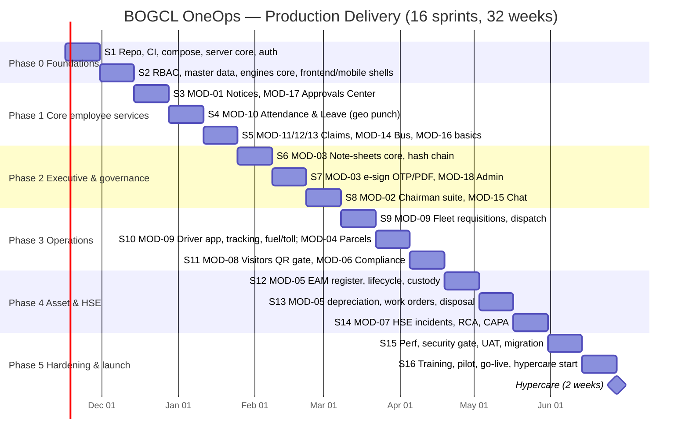

# 09 — Delivery Roadmap & Work Plan

> **Tech-stack change (3 Nov 2026):** the active plan is the 9-phase Flutter pitch roadmap in `05_MOBILE_APP_SPECIFICATION_FLUTTER.md` §14 and `ftr-a/docs/FEATURE_STATUS.md`. The sprint plan below is reference only.

**Document:** 09 of the Production Platform Specification Suite
**Status:** Baseline v1.0 — 1 November 2026
**Audience:** Product owner, tech lead, engineering, QA, DevOps, client steering committee
**Depends on:** `00_PLATFORM_OVERVIEW_AND_ARCHITECTURE.md` (ADR-01..25, §7 module registry), `02_DATABASE_SCHEMA.md`, `06_MODULE_FUNCTIONAL_SPECIFICATIONS.md` (business rules, `BR-<MOD>-<NN>` ids), `07_SECURITY_COMPLIANCE_AND_NFR.md`, `08_DEVOPS_ENVIRONMENTS_AND_CICD.md`, `10_CODING_STANDARDS_AND_CONVENTIONS.md`
**Prototype reference:** `docs/00_PROJECT_CURRENT_STATE_COMPREHENSIVE_REPORT.md` (frozen `client/`)

> Acceptance references in this document use the form `BR-<MOD>-<NN>` (e.g. `BR-04-03` = third business rule of MOD-04 in doc 06). Doc 06 MUST number its business rules with this scheme; if it does not yet, the ids here are the target numbering and doc 06 is updated to match, not the reverse.

---

## 1. Purpose

This document converts the specification suite into an executable plan: who builds what, in which order, with which acceptance baseline, and how the client knows a phase is done. It is the input for the MSA/SOW schedule (see `docs/01` §5) and for sprint planning. It does not change scope; scope is defined by doc 00 §7 and doc 06.

**Planning assumptions**

| Item | Value |
| :--- | :--- |
| Sprint length | 2 weeks, Monday–Friday, demo on the second Thursday |
| Sprint 1 start | Monday 16 November 2026 (after demo + discovery sign-off) |
| Total | 16 sprints / 32 weeks → go-live target week of 21 June 2027, hypercare to 11 July 2027 |
| Working calendar | Bangladesh public holidays and Eid breaks (approx. mid-March and mid-May 2027) are capacity reductions inside the sprints that contain them, not schedule extensions |
| Velocity baseline | Established in Sprint 1–2; all T-shirt sizes in §5 are re-estimated in points at Phase 0 exit |
| Hosting | Decided by Phase 1 exit (on-prem vs BD Tier-III cloud, ADR-21); staging exists from Phase 0 regardless |

---

## 2. Delivery Principles

| # | Principle | Rule |
| :-- | :--- | :--- |
| P1 | **Vertical slices** | A story is done only when it works end-to-end: Prisma model + migration → service/router + OpenAPI → web screen → mobile screen (where doc 00 §7 marks mobile ✔). No "backend-only" sprints after Phase 0. |
| P2 | **Prototype parity is the acceptance baseline** | For every prototype view/feature in §14 the production version MUST do what the prototype *shows* unless the traceability matrix marks it `DEFERRED`, `SIMULATED→REAL` (upgraded) or `DROPPED` (with PO sign-off). Visual fidelity: same tokens (ADR-14), same information architecture; pixel parity is not required. |
| P3 | **Demo every 2 weeks** | Sprint review on the real stack (`dev` environment, seeded data per doc 02 §6), using the 7 personas. No slide-ware demos. |
| P4 | **Engines before modules** | Workflow, notification, due-date, files, audit, sequence (doc 00 §6) are built once in Phase 0–1 and consumed by modules; modules never re-implement them. |
| P5 | **Real where the prototype simulated** | SHA-256, OTP, geofence, PDF, push/SMS are implemented for real in the phase that owns the module (doc 00 report §13). "Simulated" is not an acceptable production state. |
| P6 | **Contract first** | Zod schemas → OpenAPI → generated TS types for web and app (doc 00 §3). Frontends never hand-write DTO types. |
| P7 | **Shift-left quality** | Quality gates (§9) are CI-enforced from Sprint 1; no gate is relaxed to hit a date — scope moves instead. |
| P8 | **One backlog** | Single product backlog in the tracker, epics = this document's epics, stories reference `BR-` ids. |

### 2.1 Definition of Ready (story)

- [ ] Title in the form "As a `<role>` I can `<action>` so that `<outcome>`"
- [ ] Linked `BR-<MOD>-<NN>` ids and the prototype view/feature it reproduces (or `NEW`)
- [ ] API endpoints named (doc 03) and data model fields confirmed against doc 02
- [ ] Permission key(s) and scope (doc 00 §5.2–5.4) identified
- [ ] UX reference: prototype screen or Figma frame; EN + BN copy keys listed
- [ ] Test notes: happy path, 2+ edge cases, offline behaviour (mobile)
- [ ] Estimated; fits in one sprint; no unresolved blocking dependency

### 2.2 Definition of Done (story)

- [ ] Code merged to `develop` via PR meeting doc 10 §9 (reviews, size, conventional commit)
- [ ] Unit + integration tests added; module coverage ≥ 80 % lines (server), ≥ 70 % (frontend/app)
- [ ] OpenAPI updated and types regenerated; no lint/type errors in any affected package
- [ ] i18n keys for EN and BN present (BN may be machine-draft, flagged `needs-review`)
- [ ] Audit log entries verified for create/update/delete and domain actions
- [ ] Permission + scope checks tested (positive and negative)
- [ ] Deployed to `dev`; demoed or recorded; PO accepted against `BR-` ids
- [ ] Docs: doc 06/03 updated if behaviour changed; module README updated

### 2.3 Definition of Done (phase)

All phase exit criteria (§6) met; quality gates (§9) green on `staging`; UAT sign-off form signed by the PO and the client sponsor for the phase's modules; release notes published.

---

## 3. Team Shape & RACI

### 3.1 Team (9.5 FTE)

| Role | FTE | Primary responsibilities |
| :--- | :--: | :--- |
| Tech Lead / Architect | 1 | Owns docs 00–03 & 10, engine design, PR gatekeeper for auth/RBAC/migrations, cross-app contracts |
| Backend Engineer ×2 | 2 | Server modules, engines, jobs, Prisma, OpenAPI, integration adapters |
| Web Engineer ×2 | 2 | React shell, design system port, features, Playwright |
| Mobile Engineer | 1 | Expo app, offline queue, push, driver/gate/punch flows, Maestro |
| QA Engineer | 1 | Test strategy, automation, UAT scripts for 7 personas, defect triage |
| DevOps | 0.5 | docker-compose, CI/CD, environments, observability, backups, security scanning |
| Product Owner | 1 | Backlog, acceptance, client liaison, doc 06 ownership |
| UX Designer | 1 (Phases 0–2), 0.5 after | Design system in Figma from prototype tokens, mobile flows, a11y review, BN copy review coordination |

**If the team is smaller (6 FTE):** merge Tech Lead + 1 backend; 1 web + 1 full-stack; mobile shared with web engineer after Phase 1; QA 0.5 + developers own automation; PO part-time. Schedule stretches ~30 % (Phase 1–4 become 4 sprints each); do not cut quality gates.

### 3.2 RACI

| Activity | TL | BE | WEB | MOB | QA | DevOps | PO | UX | Client |
| :--- | :-: | :-: | :-: | :-: | :-: | :-: | :-: | :-: | :-: |
| Architecture & ADRs | A/R | C | C | C | I | C | I | I | I |
| Prisma schema & migrations | A | R | I | I | C | I | I | — | — |
| Server module implementation | A | R | C | C | C | I | I | — | — |
| Web feature implementation | A | C | R | I | C | I | C | C | — |
| Mobile feature implementation | A | C | I | R | C | I | C | C | — |
| OpenAPI contract | A | R | C | C | I | — | I | — | — |
| Design system / Figma | C | — | C | C | — | — | A | R | C |
| EN/BN copy | I | — | C | C | C | — | A | R | R (BN review) |
| Test automation | C | R | R | R | A/R | I | I | — | — |
| UAT scripts & execution | I | I | I | I | R | I | A | C | R |
| CI/CD, environments | C | I | I | I | I | A/R | I | — | C (hosting) |
| Security gate / pen test | A | R | R | R | C | R | I | — | C |
| Data migration & seed | A | R | I | I | C | C | C | — | R (data) |
| Release decision | C | I | I | I | C | C | A/R | I | C |
| Training & documentation | C | C | C | C | C | C | A/R | C | I |

A = accountable, R = responsible, C = consulted, I = informed.

### 3.3 Ceremonies

| Ceremony | Cadence | Output |
| :--- | :--- | :--- |
| Sprint planning | Day 1, 2 h | Sprint goal, committed stories (DoR met) |
| Daily stand-up | 15 min | Blockers |
| Backlog refinement | Weekly, 1 h | Next sprint stories at DoR |
| Sprint review / demo | Day 9, 1 h, client invited | Accepted stories, feedback log |
| Retrospective | Day 10, 45 min | ≤ 3 actions tracked in next sprint |
| Architecture sync | Weekly, 30 min | ADR updates, contract changes |
| Steering committee | Phase end | Phase sign-off, next-phase SOW confirmation |

---

## 4. Timeline Overview

Phase boundaries: P0 16 Nov–13 Dec 2026 · P1 14 Dec–24 Jan 2027 · P2 25 Jan–7 Mar · P3 8 Mar–18 Apr · P4 19 Apr–30 May · P5 31 May–27 Jun · Hypercare to 11 Jul 2027.

---

## 5. Module Sizing & Dependencies

T-shirt sizes cover server + web + mobile for the module as specified in doc 06. S ≈ ≤ 1 sprint for one pair, M ≈ 1 sprint for the team, L ≈ 1.5 sprints, XL ≈ 2 sprints.

| Module | Size | Phase | Depends on | Notes |
| :--- | :-: | :-: | :--- | :--- |
| Platform core (auth, RBAC, users/employees, master data, files, notifications, audit, sequence, workflow core, OpenAPI) | XL | 0 | — | Everything else depends on it |
| MOD-17 Approvals Center & Delegation | M | 1 | Workflow engine, notifications | First consumer of the engine; inbox view `v_approval_inbox` |
| MOD-01 Notices & Broadcasts | S | 1 | Notifications, files, audience resolution | Realtime banner via Socket.IO |
| MOD-10 Attendance & Leave | L | 1 | Geofence (§6.7), employees/shifts, workflow (leave), offline queue | Mobile-critical |
| MOD-11/12/13 Claims | M | 1 | Workflow, expense policies, files (receipts) | One engine, three types |
| MOD-14 Commuter Bus & FIFO | M | 1 | Employees, notifications, due-date (48 h offer) | Supervisor web + "my seat" mobile |
| MOD-16 Workforce basics | S | 1 | Employees, `v_employee_directory` | Exit clearance workflow in Phase 2 polish |
| MOD-03 Note-Sheets & E-Sign | XL | 2 | Workflow, files, PDF renderer, SMS OTP, sequence | Highest governance risk |
| MOD-18 Administration & Master Data | M | 2 | RBAC, settings, geofences, templates | Replaces seed-only configuration |
| MOD-02 Chairman Suite & Briefings | M | 2 | Dashboards read models, files (audio), notifications | KPIs come from real module data |
| MOD-15 Inner-Circle Chat | M | 2 | Socket.IO `/chat`, `/presence`, files, directives | Retention + lock rules |
| MOD-09 Fleet & Dispatch | XL | 3 | Workflow, employees/drivers, notifications, PDF (trip pass), Socket.IO (fleet chat), due-date (vehicle docs), mobile GPS | Largest mobile surface (driver) |
| MOD-04 Parcel Chain-of-Custody | M | 3 | SMS OTP, files (photo), hash chain util (from MOD-03), due-date (dwell) | Offline scan on mobile |
| MOD-08 Guest & VIP Passes | M | 3 | Workflow (VIP/Govt), QR tokens, notifications, due-date (pass expiry) | Gate mobile flow |
| MOD-06 Licence & Compliance | M | 3 | Due-date engine, workflow (renewal steps), files | Kanban + T-90 auto-renewal |
| MOD-05 Asset Lifecycle & EAM | XL | 4 | Workflow (requisition, write-off), employees (custody), due-date, `v_asset_financials`, sequence | Depreciation engine ported from prototype logic |
| MOD-07 HSE Incidents & CAPA | L | 4 | Workflow (closure), due-date (CAPA), notifications CRITICAL, files (photos), offline report | Statutory timers |

Critical path: Platform core → MOD-17 → MOD-03 → (MOD-09, MOD-05). Any slip on the workflow engine moves every later phase.

---

## 6. Phase Plan

### Phase 0 — Foundations (Sprints 1–2, 16 Nov – 13 Dec 2026)

**Goal:** a deployable, tested skeleton of all three codebases and all cross-cutting engines, demoable with login as any of the 7 personas.

| Epic | Scope | Owner |
| :--- | :--- | :--- |
| E0.1 Repo & tooling | `server/`, `frontend/`, `app/` scaffolds per doc 10; ESLint/Prettier/Husky/commitlint; tsconfig bases (`AGENTS.md`, `.cursor/rules`, `.cursor/skills`, root `.gitignore`/`.editorconfig`/`.nvmrc` already in place) | TL, DevOps |
| E0.2 CI/CD & environments | GitHub Actions: typecheck, lint, test, build, Prisma validate/migrate on disposable PG; Docker images; `docker-compose` (PG 16, Redis 7, MinIO, MailHog, ClamAV); `dev` environment auto-deploy from `develop` | DevOps |
| E0.3 Server core | `core/config.ts` (zod env), pino + requestId, error middleware + `AppError`, health/ready/metrics, OpenAPI from zod, pagination helper, soft-delete + audit Prisma extension, `Sequence` service, idempotency middleware | BE |
| E0.4 Identity & RBAC | Users, credentials (argon2id), sessions, JWT access + rotating refresh, device sessions, TOTP for executive roles, roles/permissions/scopes seed (17 roles), `authorize(permission)` + `scopeWhere` | BE, TL |
| E0.5 Org & master data | Sites, departments, grades, designations, employees (import from seed), `v_employee_directory` | BE |
| E0.6 Engines core | Workflow engine (templates, instances, steps, actions, delegation resolver, SLA jobs), notification service (IN_APP + PUSH + EMAIL real; SMS adapter + mock), due-date engine skeleton, file service (presign/complete/scan), audit log read API | BE, TL |
| E0.7 Web shell | Vite + React 19 + Router 7, Tailwind v4 + shadcn themed with prototype tokens, i18next EN/BN, auth (cookie refresh), layout (sidebar/topbar/bottom nav per role), RTK Query `baseApi`, generated types, error boundary, toasts, command palette (pages only) | WEB, UX |
| E0.8 Mobile shell | Adapt `app/` starter: remove RevenueCat/child/expense features, point `baseApi` to `/api/v1`, SecureStore tokens, auth screens, push registration (`DeviceToken`), offline mutation queue skeleton (persisted, idempotency keys), i18n EN/BN, theme tokens | MOB |

**Deliverables:** running `dev` environment; login for 7 personas; `/api/v1/me`, `/employees`, `/approvals/inbox` (empty), `/notifications`; OpenAPI UI; seed script; test harness in all packages; docs 00–10 in sync.

**Exit criteria**
- CI green with quality gates (§9 Phase 0) on `develop`
- All 17 roles seeded with permission matrix reviewed by PO against prototype nav matrix (report §7.2)
- Workflow engine passes contract tests: sequential, parallel, conditional step, delegation, SLA reminder + escalation
- Web + mobile log in, display employee profile, receive a test push/in-app notification in realtime
- Threat model workshop held; findings logged as stories

### Phase 1 — Core Employee Services (Sprints 3–5, 14 Dec 2026 – 24 Jan 2027)

**Goal:** every employee uses OneOps daily — notices, approvals, attendance, leave, claims, bus.

| Epic | Modules | Key deliverables |
| :--- | :--- | :--- |
| E1.1 Approvals Center | MOD-17 | Unified inbox, approve/reject/return with comment, batch approve, history with correct decision labels (fixes report §15.6), delegation CRUD and routing, SLA badges, realtime updates |
| E1.2 Notices & Broadcasts | MOD-01 | CRUD with audiences, schedule/publish/expire, per-user receipts and acknowledgement, pinned banner via Socket.IO, SMS opt-in broadcast, print/PDF letterhead |
| E1.3 Attendance | MOD-10 | Mobile geo punch (real GPS, accuracy, mock detection), server haversine/polygon check, shifts and assignments, day computation job, live roster web, regularisation workflow, muster CSV |
| E1.4 Leave | MOD-10 | Leave types/balances, request → LINE_MANAGER → HR workflow, informed/uninformed status for Chairman roster, calendar view |
| E1.5 Claims | MOD-11/12/13 | TA/DA, conveyance, tour with advance; grade policy tables; auto DA incl. half-day; receipt upload; policy flags; manager → finance workflow; voucher no.; settlement; CSV export |
| E1.6 Commuter Bus | MOD-14 | Routes/stops/buses, seat map, allocation, release/reclaim, FIFO waitlist, 48 h offer with expiry job, admin confirmation, delay broadcast, manifest PDF |
| E1.7 Workforce basics | MOD-16 | Directory with search/filters, employee profile, onboard form, line-manager tree (exit clearance moves to Phase 2 polish) |

**Exit criteria**
- Prototype parity for views `approvals`, `attendance`, `claims`, `bus`, `workforce` (table/list level) and notice modals — traceability matrix rows marked `DONE`
- Geo punch accepted/rejected correctly at HQ/Plant/CTG fences in field test (≥ 95 % success for in-fence punches, §13 KPI baseline)
- Offline punch and claim submission replay verified on airplane-mode test
- Claims policy engine passes table-driven tests for 5 grade bands
- Phase 1 UAT sign-off by HR Admin, HOD, Employee, Transport Admin personas

### Phase 2 — Executive & Governance (Sprints 6–8, 25 Jan – 7 Mar 2027)

**Goal:** the Chairman and executive team run approvals and communication in OneOps; configuration moves from seed to admin UI.

| Epic | Modules | Key deliverables |
| :--- | :--- | :--- |
| E2.1 Note-sheets core | MOD-03 | File creation with `BOGCL/{DEPT}/{YYYY}/{NNNN}`, paragraphs with SHA-256 hash chain, signatory route from workflow template, vendor quotes, budget head, return/query, withdraw |
| E2.2 E-sign & PDF | MOD-03 | Signature capture (drawn/typed/stamp/uploaded), OTP via SMS before final sanction, server-side PDF (Playwright) with real hash + QR verification URL, public verification page, approval certificate |
| E2.3 Administration | MOD-18 | Users, roles, permissions matrix editor, sites, departments, grades, geofences (map editor), workflow template editor (JSON with validation + preview), settings, notification templates EN/BN, audit log viewer |
| E2.4 Chairman suite | MOD-02 | Executive dashboard from real read models (approvals, attendance, licences, incidents, fleet), priority approvals, leadership roster status, voice briefing record/upload/listen receipts, ROI dossier as report (no hard-coded figures) |
| E2.5 Inner-Circle Chat | MOD-15 | Channels/direct, membership rules, presence, text/voice/document, directives with acknowledgement, pins, read receipts, retention policy, locked channels, mobile push |
| E2.6 Exit clearance | MOD-16 | Clearance workflow with department owners, asset reclaim hook (stub until MOD-05), final settlement, reactivation |

**Exit criteria**
- A note-sheet routed Plant GM → Finance → Chairman is signed on web and mobile with OTP; PDF hash verifies via QR on a device not logged in
- Intermediate "sign & forward" advances the route (fixes report §15.5)
- Admin can create a new role, grant scoped permissions and see effect without redeploy
- Chairman dashboard KPIs reconcile with module lists (QA cross-check)
- Chat survives server restart (Redis adapter), messages delivered to offline device on reconnect
- Legal review of e-sign evidence package completed (risk R4)

### Phase 3 — Operations (Sprints 9–11, 8 Mar – 18 Apr 2027)

**Goal:** movement of vehicles, parcels and people through gates is tracked in real time.

| Epic | Modules | Key deliverables |
| :--- | :--- | :--- |
| E3.1 Fleet requisitions & dispatch | MOD-09 | Requisition with stops/passengers/estimates, HOD endorsement workflow, dispatch queue, assign vehicle+driver with availability/licence-class/duty-hour checks, pooling suggestion (route overlap), trip pass PDF, reject reasons |
| E3.2 Driver app & tracking | MOD-09 | Driver console: assigned trips, gate out/in with odometer, start/complete, SOS, location pings (foreground + background permission UX), live map for dispatcher, route deviation alert |
| E3.3 Fuel, toll, chat | MOD-09 | Fuel voucher QR issue/redeem, toll claim with photo → approval → trip cost, fleet chat channels (REQ/DESK/BROADCAST/SOS), vehicle documents due-dates, breathalyzer log |
| E3.4 Parcels | MOD-04 | Register, waybill/seal, handover scans (QR), checkpoint events with hash chain, gate-in, recipient OTP (SMS, bcrypt, attempts/expiry, no hint), tamper flag → quarantine, return flow with return OTP, dwell-time alerts, audit trail/manifest PDF |
| E3.5 Visitors | MOD-08 | Pre-registration, VIP/Govt approval workflow, QR pass by SMS/email, gate check-in/out on mobile (camera QR), PPE checklist, zones/escort, watchlist check, overdue status job, evacuation roll-call, inspection findings |
| E3.6 Compliance | MOD-06 | Regulatory bodies, licence types, licences with due-dates (T-90 auto renewal instance), 5-stage renewal Kanban with workflow steps, checklist, documents, fee/chalan, dashboard view, DO letter template PDF |

**Exit criteria**
- Driver completes a real trip on Android with GPS trail visible to dispatcher; pass PDF printed at gate
- Parcel delivered with OTP on a device in airplane mode at scan time, replayed on reconnect; hash chain validates
- Visitor QR scanned at gate in < 2 s; VIP approval routed through Approvals Center
- Licence with `expiresAt` in 85 days auto-creates renewal and notifies owner; Kanban stage change updates `v_licence_dashboard`
- Fleet fuel voucher issuance persists (fixes report §15.8)
- Phase UAT by Transport Admin, Driver, Plant GM, Security Gate, Compliance Officer

### Phase 4 — Asset & HSE (Sprints 12–14, 19 Apr – 30 May 2027)

**Goal:** asset register and safety system are live with finance-grade depreciation and statutory incident handling.

| Epic | Modules | Key deliverables |
| :--- | :--- | :--- |
| E4.1 Asset register & lifecycle | MOD-05 | Categories, assets with tags/QR, stages and events (hash), custody assign/ack/reclaim (hooks exit clearance), transfers with gate pass, spares with reorder alerts, mobile scan + custody ack |
| E4.2 Depreciation & finance | MOD-05 | SLM/WDV/UOP engine as pure functions (ported from prototype, property-tested), `v_asset_financials`, yearly snapshots job, policy change audit, FI-AA CSV export |
| E4.3 Work orders | MOD-05 | PM/CM/CBM/CAL with LOTO permit, due-dates (calibration T-30 auto WO), completion → certificate no., capex/opex effects, deficiency flag → auto CM |
| E4.4 Requisition & disposal | MOD-05 | Asset requisition workflow (HOD → executive), commissioning mints tag, disposal checklist, method/proceeds, gain/loss, voucher, archive |
| E4.5 HSE incidents | MOD-07 | Report wizard (web + mobile offline, photos, anonymous option), risk matrix, triage, statutory flag + 24 h timer + Form B-12 PDF, investigation assignment |
| E4.6 RCA, CAPA, closure | MOD-07 | 5-Whys + fishbone, CAPA actions with owners/due-dates/overdue job, evidence upload, verification, two-signature closure workflow, HSE dashboard (TRIR, safe days computed) |

**Exit criteria**
- Depreciation results match prototype engine outputs for the 12 seeded assets and finance-reviewed test cases
- Custody reclaim from exit clearance updates asset custody and clearance item
- Incident with severity ≥ 3 raises CRITICAL notification requiring acknowledgement and a statutory due item
- Incident closes only when all CAPA verified and both signatures present
- Phase UAT by Plant GM, HOD/Finance, HSE Officer, Employee

### Phase 5 — Hardening & Launch (Sprints 15–16, 31 May – 27 Jun 2027; hypercare to 11 Jul)

| Epic | Key deliverables |
| :--- | :--- |
| E5.1 Performance | k6 scenarios (login burst 800 users in 10 min, 500 concurrent punches at 09:00, approvals inbox p95 < 400 ms, notice broadcast to 800 users < 30 s); index/caching fixes; partitioning plan executed if thresholds near |
| E5.2 Security gate | External penetration test (OWASP ASVS L2 scope), dependency audit, secrets scan, RBAC matrix audit per role, fix all High/Critical, retest |
| E5.3 UAT | Scripted end-to-end scenarios for 7 personas across all modules on `staging` with anonymised real data; defect triage daily; exit on zero Sev-1/2 |
| E5.4 Data migration & seed | Master data import (employees, departments, grades, vehicles, drivers, assets, licences, bus routes) from client spreadsheets/SAP extracts via validated CSV importers; reconciliation report signed by data owners |
| E5.5 Training & docs | Role-based training (§11), quick-reference cards EN/BN, admin runbook, support playbook |
| E5.6 Pilot | One site (recommend `PLANT_KERANIGANJ`): attendance, notices, approvals, fleet, visitors live for 1 week; go/no-go review |
| E5.7 Go-live & hypercare | Production cutover (§12), 2-week hypercare with daily triage, on-call rota, KPI dashboard (§13) |

**Exit criteria:** go-live checklist (§12) complete; hypercare closed with no open Sev-1 and Sev-2 within SLA; KPI baseline recorded; handover to support model.

---

## 7. Backlog Seed

Stories are listed by phase; `MVP` = required for phase exit, `LATER` = may slip to the next phase or Phase 5 without blocking sign-off. Acceptance = doc 06 `BR-` ids plus prototype feature parity where noted.

### Phase 0

| ID | Story | Role | Acceptance | MVP |
| :-- | :--- | :--- | :--- | :-: |
| S0-01 | Log in with email/Emp-ID + password; receive access token and refresh cookie/SecureStore | EMPLOYEE | BR-18-01, BR-18-02; lockout after 5 failures | MVP |
| S0-02 | Enrol and verify TOTP MFA | CHAIRMAN | BR-18-03; required for CHAIRMAN, DIRECTOR, PLANT_GM | MVP |
| S0-03 | See only menu items my permissions allow | any | Nav matrix report §7.2 reproduced from permissions | MVP |
| S0-04 | Admin seeds roles/permissions/scopes from seed script | SUPER_ADMIN | 17 roles, permission keys per doc 06 | MVP |
| S0-05 | Workflow template with sequential + conditional step materialises steps on submit | system | Engine spec doc 00 §6.1; contract tests | MVP |
| S0-06 | Delegate my approvals to a colleague for a date range | HOD | Delegation resolver substitutes approver; recorded in step | MVP |
| S0-07 | Receive in-app + push notification in realtime | any | Socket.IO room `user:{id}`; Expo push delivered | MVP |
| S0-08 | Upload a file via presigned URL; file scanned before download allowed | any | doc 00 §6.4; infected file blocked | MVP |
| S0-09 | Every create/update/delete on audited models writes AuditLog | system | doc 02 §1 audited list; append-only grant | MVP |
| S0-10 | View my employee profile and devices; revoke a session | EMPLOYEE | Prototype UserProfileModal parity | MVP |
| S0-11 | Generate reference numbers `PREFIX-YYYY-NNNN` without collision under concurrency | system | Sequence `FOR UPDATE`; 100 parallel calls unique | MVP |
| S0-12 | Mobile queues a mutation offline and replays with Idempotency-Key | EMPLOYEE | doc 00 ADR-18; duplicate replay returns stored response | MVP |
| S0-13 | Switch UI language EN/BN and persist preference | any | i18next; `preferredLang` saved | MVP |
| S0-14 | Reset password via email link | EMPLOYEE | Token 30 min, single-use | LATER |

### Phase 1

| ID | Story | Role | Acceptance | MVP |
| :-- | :--- | :--- | :--- | :-: |
| S1-01 | See all my pending approvals from every module in one inbox with SLA badge | HOD | BR-17-01..03; `v_approval_inbox` | MVP |
| S1-02 | Approve, reject or return with a mandatory comment; source module updates | HOD | BR-17-04; propagation tests per object type | MVP |
| S1-03 | Batch-approve selected items | CHAIRMAN | BR-17-05 | MVP |
| S1-04 | Publish a notice to an audience and require acknowledgement | HR_ADMIN | BR-01-01..04; receipts per user | MVP |
| S1-05 | See a pinned broadcast banner immediately and acknowledge it | EMPLOYEE | BR-01-05; realtime | MVP |
| S1-06 | Punch in from my phone inside the site geofence | EMPLOYEE | BR-10-01..04; accuracy ≤ 50 m, mock rejected | MVP |
| S1-07 | Punch is queued offline and accepted on reconnect with original device time | EMPLOYEE | BR-10-05 | MVP |
| S1-08 | Request regularisation for a missed punch; manager approves | EMPLOYEE / LINE_MANAGER | BR-10-06 | MVP |
| S1-09 | Apply for leave; balance checked; manager and HR approve | EMPLOYEE | BR-10-07..09 | MVP |
| S1-10 | See live roster (present/late/absent/leave) per site | HR_ADMIN | BR-10-10; `v_attendance_live` | MVP |
| S1-11 | Submit a TA/DA claim with auto-DA and receipts; policy flags shown | EMPLOYEE | BR-11-01..05 | MVP |
| S1-12 | Submit conveyance claim within monthly cap | EMPLOYEE | BR-12-01..02 | MVP |
| S1-13 | Submit tour claim against an advance; net settlement computed | EMPLOYEE | BR-13-01..03 | MVP |
| S1-14 | Finance approves claim and records voucher; claimant notified | FINANCE | BR-11-06 | MVP |
| S1-15 | Join bus waitlist; receive 48 h seat offer; accept/decline | EMPLOYEE | BR-14-01..04 | MVP |
| S1-16 | Allocate/release seats on seat map; FIFO promotion | TRANSPORT_ADMIN | BR-14-05..07 | MVP |
| S1-17 | Search employee directory and view profile | HOD | BR-16-01 | MVP |
| S1-18 | Export monthly attendance muster CSV | HR_ADMIN | BR-10-11 | LATER |
| S1-19 | Bus delay broadcast with optional SMS | TRANSPORT_ADMIN | BR-14-08 | LATER |

### Phase 2

| ID | Story | Role | Acceptance | MVP |
| :-- | :--- | :--- | :--- | :-: |
| S2-01 | Initiate a note-sheet with routing preset; file number issued | EMPLOYEE | BR-03-01..03 | MVP |
| S2-02 | Add a paragraph; hash chain links to previous paragraph | HOD | BR-03-04; tamper test fails verification | MVP |
| S2-03 | Sign & forward as intermediate signatory; route advances | PLANT_GM | BR-03-05 (fixes report §15.5) | MVP |
| S2-04 | Final sanction requires OTP; signature stored with evidence | CHAIRMAN | BR-03-06..08 | MVP |
| S2-05 | Download final PDF with hash + QR; verify on public page | any | BR-03-09..10; ADR-25 | MVP |
| S2-06 | Return a note-sheet with reason category and required changes | HOD | BR-03-11 | MVP |
| S2-07 | Compare vendor quotes and mark recommended | HOD | BR-03-12 | MVP |
| S2-08 | Create/edit roles and permission matrix with scopes | SUPER_ADMIN | BR-18-04..06 | MVP |
| S2-09 | Edit geofence on a map and test a coordinate | SUPER_ADMIN | BR-18-07 | MVP |
| S2-10 | Edit workflow template JSON with validation and dry-run preview | SUPER_ADMIN | BR-18-08 | MVP |
| S2-11 | View executive dashboard with real KPIs and priority approvals | CHAIRMAN | BR-02-01..04 | MVP |
| S2-12 | Record/upload voice briefing to an audience; see listen receipts | CHAIRMAN | BR-02-05..06 | MVP |
| S2-13 | Chat in channel/direct with presence, voice, documents | DIRECTOR | BR-15-01..05 | MVP |
| S2-14 | Issue a directive in chat; recipients acknowledge; due reminder | CHAIRMAN | BR-15-06..07 | MVP |
| S2-15 | Initiate exit clearance; owners clear items; finalise | HR_ADMIN | BR-16-02..05 | MVP |
| S2-16 | Edit EN/BN notification templates | SUPER_ADMIN | BR-18-09 | LATER |
| S2-17 | Browse audit log by entity | SUPER_ADMIN | BR-18-10 | LATER |

### Phase 3

| ID | Story | Role | Acceptance | MVP |
| :-- | :--- | :--- | :--- | :-: |
| S3-01 | Request a vehicle with stops/passengers; estimate shown; HOD endorses | EMPLOYEE | BR-09-01..04 | MVP |
| S3-02 | Assign vehicle + driver with eligibility checks; trip pass PDF | TRANSPORT_ADMIN | BR-09-05..07 | MVP |
| S3-03 | Driver gate-out/in with odometer; status updates live | DRIVER | BR-09-08..09 | MVP |
| S3-04 | Dispatcher sees driver location on live map; deviation alert | TRANSPORT_ADMIN | BR-09-10..11 | MVP |
| S3-05 | Driver raises SOS; dispatcher and Plant GM alerted CRITICAL | DRIVER | BR-09-12 | MVP |
| S3-06 | Issue fuel voucher QR; station redeems | TRANSPORT_ADMIN | BR-09-13 (fixes report §15.8) | MVP |
| S3-07 | Driver logs toll with photo; approval adds to trip cost | DRIVER | BR-09-14 | MVP |
| S3-08 | Register parcel; seal and waybill; OTP sent to recipient | MAILROOM | BR-04-01..03 | MVP |
| S3-09 | Scan parcel at each custody handover; chain hash validated | DRIVER / SECURITY_GATE | BR-04-04..05 | MVP |
| S3-10 | Recipient OTP verification with attempts/expiry; no hint on failure | SECURITY_GATE | BR-04-06 | MVP |
| S3-11 | Flag tamper → quarantine → return flow with return OTP | SECURITY_GATE | BR-04-07..09 | MVP |
| S3-12 | Pre-register visitor; VIP/Govt routed for approval; QR pass sent | EMPLOYEE | BR-08-01..04 | MVP |
| S3-13 | Scan QR at gate; PPE checklist; badge issued; watchlist check | SECURITY_GATE | BR-08-05..08 | MVP |
| S3-14 | Evacuation roll-call marks visitors safe | SECURITY_GATE | BR-08-09 | MVP |
| S3-15 | Licence auto-creates renewal at T-90 and reminders at plan days | COMPLIANCE_OFFICER | BR-06-01..03 | MVP |
| S3-16 | Move renewal through 5 stages with checklist and documents | COMPLIANCE_OFFICER | BR-06-04..06 | MVP |
| S3-17 | Pool two overlapping requisitions into one vehicle | TRANSPORT_ADMIN | BR-09-15 | LATER |
| S3-18 | Generate DO letter PDF from template | COMPLIANCE_OFFICER | BR-06-07 | LATER |

### Phase 4

| ID | Story | Role | Acceptance | MVP |
| :-- | :--- | :--- | :--- | :-: |
| S4-01 | Register asset with category defaults; tag and QR generated | PLANT_GM | BR-05-01..03 | MVP |
| S4-02 | Assign custody; custodian acknowledges on mobile | HR_ADMIN / EMPLOYEE | BR-05-04..05 | MVP |
| S4-03 | View NBV and schedule under SLM/WDV/UOP | FINANCE | BR-05-06..09; parity with prototype engine | MVP |
| S4-04 | Change depreciation method/policy with audit | HOD | BR-05-10 | MVP |
| S4-05 | Create and complete work orders; capex/opex effects; certificate | PLANT_GM | BR-05-11..14 | MVP |
| S4-06 | Calibration due auto-creates CAL work order at T-30 | system | BR-05-15 | MVP |
| S4-07 | Asset requisition HOD → executive → commissioning mints tag | HOD | BR-05-16..18 | MVP |
| S4-08 | Transfer asset between sites with gate pass | PLANT_GM | BR-05-19 | MVP |
| S4-09 | Dispose asset with checklist; gain/loss and voucher | FINANCE | BR-05-20..22 | MVP |
| S4-10 | Report incident from mobile offline with photos; anonymous option | EMPLOYEE | BR-07-01..04 | MVP |
| S4-11 | Risk score and category computed; statutory flag + 24 h timer | HSE_OFFICER | BR-07-05..07 | MVP |
| S4-12 | Complete 5-Whys and fishbone RCA | HSE_OFFICER | BR-07-08 | MVP |
| S4-13 | Assign CAPA with owner/due; overdue job; verify evidence | HSE_OFFICER | BR-07-09..11 | MVP |
| S4-14 | Two-signature closure blocked until CAPAs verified | PLANT_GM | BR-07-12 | MVP |
| S4-15 | Spares reorder alert when below level | PLANT_GM | BR-05-23 | LATER |
| S4-16 | Form B-12 statutory PDF | HSE_OFFICER | BR-07-13 | LATER |

### Phase 5

| ID | Story | Role | Acceptance | MVP |
| :-- | :--- | :--- | :--- | :-: |
| S5-01 | Import employees/departments/grades from validated CSV with reconciliation report | SUPER_ADMIN | Row-level errors; dry-run mode | MVP |
| S5-02 | Import vehicles, drivers, assets, licences, bus routes | SUPER_ADMIN | Same importer framework | MVP |
| S5-03 | k6 suite runs in CI nightly against staging with thresholds | DevOps | §9 Phase 5 targets | MVP |
| S5-04 | Pen-test findings High/Critical fixed and retested | TL | Report attached to release | MVP |
| S5-05 | UAT scripts for 7 personas executed; defects triaged | QA | Zero Sev-1/2 open | MVP |
| S5-06 | Admin runbook: backup/restore drill passed | DevOps | RPO ≤ 15 min, RTO ≤ 2 h demonstrated | MVP |
| S5-07 | Training delivered per role; attendance recorded | PO | ≥ 90 % of pilot-site staff trained | MVP |
| S5-08 | Pilot site live for one week; go/no-go documented | PO | §12 checklist | MVP |
| S5-09 | KPI dashboard (§13) populated from production | PO | Daily refresh | MVP |
| S5-10 | SAP adapter interface documented with stub implementation | TL | Out of v1 scope per doc 00 §1 | LATER |

---

## 8. Risks & Mitigations

| ID | Risk | Likelihood | Impact | Mitigation | Owner |
| :-- | :--- | :-: | :-: | :--- | :--- |
| R1 | **GPS accuracy** at plant (metal structures, indoor control rooms) causes false rejections | H | H | Fence radii per site (300/500/400 m) tunable in admin; accept ≤ 50 m, else `PENDING_REGULARISATION` instead of hard reject; Wi-Fi/BLE beacon option as Phase 6 adapter; field test in Phase 1 S4 at all 3 sites | MOB, PO |
| R2 | **SMS provider reliability** in BD (delivery delays, DND, operator outages) breaks OTP flows | M | H | Provider adapter with primary + fallback (e.g. SSL Wireless → operator direct); OTP TTL 10 min with resend; in-app OTP display to logged-in recipients as alternative channel; delivery tracking in `NotificationDelivery`; monitor failure rate | BE, DevOps |
| R3 | **Offline edge cases** (clock skew, duplicate replays, conflicting state) | M | M | Server authoritative time with device time recorded; idempotency keys; replay order preserved; conflict responses (409) surfaced in queue UI; chaos tests in S4/S10 | MOB, QA |
| R4 | **E-sign legal acceptance** — signatures are not CA-certified digital signatures under BD ICT Act | M | H | Evidence package (OTP, IP, device, hash, timestamp, audit) reviewed by client legal in Phase 2; design keeps `Signature` extensible to PKI/CA tokens; label as "electronic approval" in documents until legal confirms | PO, TL |
| R5 | **Data migration** from spreadsheets/SAP extracts is dirty or incomplete | H | M | Importer with validation + dry-run from Phase 1 (employees); data owners named per entity in S1; reconciliation reports; two rehearsal migrations on staging before cutover | PO, BE |
| R6 | **Change management** — staff bypass the app (paper, phone) | M | H | Executive sponsorship (Chairman uses it first in Phase 2); BN-first mobile UX; pilot site; champions per department; adoption KPIs (§13) reviewed weekly in hypercare | PO, Client |
| R7 | **Scope creep from prototype "simulated" features** (SAP sync, biometrics, ANPR, telematics, AI pooling) assumed to be included | H | H | Traceability matrix (§14) signed with the SOW; each `SIMULATED` row has explicit status; change-control board for additions; adapters delivered as interfaces only | PO |
| R8 | Workflow engine design flaw found late | L | H | Contract tests + 3 module consumers in Phase 1 before note-sheets; template versioning so changes don't break in-flight instances | TL |
| R9 | Hosting decision delayed (on-prem vs cloud) | M | M | Containers + compose work on both; decision gate at Phase 1 exit; staging on cloud regardless | DevOps, Client |
| R10 | Key-person dependency (single mobile engineer) | M | M | Web engineers pair on mobile from Phase 1; Expo + RTK shared patterns; documentation in doc 05/10 | TL |
| R11 | Bengali copy quality and review bandwidth | M | L | Machine-draft BN with `needs-review` flag; client reviewer nominated; glossary maintained; review batches each sprint | UX, Client |
| R12 | Push notification delivery on low-end Android (battery optimisation) | M | M | Expo push + FCM high priority for CRITICAL; in-app fallback; user guidance screen for battery settings | MOB |
| R13 | Performance of approval inbox and dashboards at 5,000 users | L | M | Views and indexes per doc 02 §3–4; keyset pagination; Redis caching; k6 in Phase 5 with headroom targets | BE |
| R14 | Holiday-heavy calendar (Ramadan/Eid) in Phases 2–4 reduces capacity | H | M | Plan sprints with 70 % capacity in affected sprints; `LATER` stories absorb the loss | PO |

---

## 9. Quality Gates per Phase

All gates are CI-enforced on `develop` and `main`. A failing gate blocks merge/deploy.

| Gate | Phase 0 | Phase 1 | Phase 2 | Phase 3 | Phase 4 | Phase 5 |
| :--- | :--- | :--- | :--- | :--- | :--- | :--- |
| Typecheck + lint (all packages) | 0 errors | 0 errors | 0 errors | 0 errors | 0 errors | 0 errors |
| Server unit+integration coverage | ≥ 70 % | ≥ 80 % | ≥ 80 % | ≥ 80 % | ≥ 80 % | ≥ 85 % core/engines |
| Web coverage | ≥ 60 % | ≥ 70 % | ≥ 70 % | ≥ 70 % | ≥ 70 % | ≥ 70 % |
| Mobile coverage | ≥ 50 % | ≥ 60 % | ≥ 60 % | ≥ 65 % | ≥ 65 % | ≥ 70 % |
| Playwright critical paths | login | + approvals, punch (web view), claims | + note-sheet sign, admin | + fleet, parcel, visitor | + assets, incidents | full regression < 20 min |
| Maestro flows | login | + punch, leave | + approve/sign | + driver trip, gate scan, parcel OTP | + incident report, custody ack | full smoke |
| API p95 (staging, k6 smoke) | — | list ≤ 500 ms | ≤ 400 ms | ≤ 400 ms | ≤ 400 ms | list ≤ 300 ms, write ≤ 500 ms, inbox ≤ 400 ms @ 200 VU |
| Web bundle | initial ≤ 300 kB gz | route chunks ≤ 150 kB gz | same | same | same | Lighthouse perf ≥ 85, a11y ≥ 95 |
| Security | secrets scan, `npm audit` no High | + ZAP baseline on dev | + RBAC matrix tests | + OTP/brute-force tests | + file scan tests | external pen test, ASVS L2, 0 High/Critical |
| Accessibility | eslint jsx-a11y | axe in RTL tests for shared components | keyboard-only approvals flow | same | same | WCAG 2.1 AA audit on top 20 screens |
| OpenAPI | generated, lint (Spectral) | breaking-change check vs `develop` | same | same | same | published with release |
| Migrations | `prisma validate` + deploy on disposable DB | + expand/contract review | same | same | same | rehearsal on staging copy |
| Observability | health, metrics | + Sentry frontend/server/mobile | + dashboards (RPS, errors, queue depth) | + alerts | + SLO definitions | runbooks linked to alerts |

---

## 10. Release & UAT Process

### 10.1 Branching and environments

| Branch / tag | Deploys to | Rule |
| :--- | :--- | :--- |
| `feat/*`, `fix/*` | PR preview (web only, optional) | Squash-merge into `develop` after review |
| `develop` | `dev` (auto) | Always demoable; seed reset nightly |
| `release/x.y` | `staging` (auto) | Cut at sprint end for UAT; only `fix/*` merged |
| `main` + tag `vX.Y.Z` | `production` (manual approval) | Only from `release/*`; semver; changelog generated from commits |

### 10.2 Release train

1. Sprint review accepted → cut `release/x.y` → deploy `staging` with anonymised data refresh.
2. QA runs regression (Playwright + Maestro + manual exploratory) within 2 working days.
3. UAT window 3 working days: PO + client persona owners execute scripts; defects logged with severity (Sev-1 blocker, Sev-2 major, Sev-3 minor, Sev-4 cosmetic).
4. Exit: zero Sev-1/2; Sev-3 scheduled; sign-off form stored in `docs/releases/`.
5. Tag, deploy production (Phase 5 onwards), smoke test, announce via MOD-01 notice.
6. Mobile: EAS build `preview` for UAT, `production` for store/MDM distribution; OTA updates only for JS-only fixes within the same native build.

### 10.3 UAT personas and owners

| Persona (prototype) | Production role(s) | Client owner nominated by | Modules in scope |
| :--- | :--- | :--- | :--- |
| Chairman | `CHAIRMAN` | Chairman's office | 02, 03, 15, 17, 01 |
| Plant GM | `PLANT_GM` | Plant | 05, 07, 08, 09, 06, 17 |
| HR Admin | `HR_ADMIN` | HR | 01, 10, 16, 14, 11–13, 18 |
| Transport Admin | `TRANSPORT_ADMIN` | Transport | 09, 14, 04 |
| HOD / Finance | `HOD` + `FINANCE` | Finance | 03, 11–13, 05 (depreciation), 17 |
| Employee | `EMPLOYEE` | Sales | 01, 10, 11–13, 14, 04, 08 (host) |
| Driver | `DRIVER` | Transport | 09, 04 |
| + Security Gate, Compliance, HSE, Super Admin | `SECURITY_GATE`, `COMPLIANCE_OFFICER`, `HSE_OFFICER`, `SUPER_ADMIN` | Security, Compliance, HSE, IT | 08, 04, 06, 07, 18 |

### 10.4 Hotfix

`fix/*` from `main` → PR with 2 approvals → tag `vX.Y.Z+1` → production → cherry-pick to `develop`. Post-incident note within 48 h.

---

## 11. Training & Documentation Deliverables

| Deliverable | Audience | Format | Phase |
| :--- | :--- | :--- | :--- |
| Role quick-start cards (EN/BN) | all roles | 1-page PDF per role, in-app help link | 5 (drafts from 1) |
| Mobile app guide: punch, leave, claims, parcels, incidents | Employees, drivers, gate | Short videos (≤ 2 min) + PDF, BN voice-over | 5 |
| Approver guide: inbox, delegation, note-sheet signing | HOD, GM, Chairman, EA | PDF + 30-min session | 2, 5 |
| Admin runbook: users, roles, geofences, templates, settings, audit | Super Admin / IT | Markdown in `docs/ops/` | 2, 5 |
| Operations runbook: deploy, rollback, backup/restore, scaling, alerts | DevOps / IT | Markdown + diagrams | 5 |
| Support playbook: triage, severity, escalation, FAQ | Helpdesk | Markdown | 5 |
| API documentation | Integrators | OpenAPI UI on staging/prod (auth'd) | 0 onward |
| Data dictionary | Finance, HR, Compliance | Generated from Prisma schema + doc 02 | 5 |
| Train-the-trainer | Department champions (≥ 1 per department per site) | 2 half-day sessions | 5 |
| Release notes | all | `CHANGELOG.md` + notice in MOD-01 | every release |

---

## 12. Go-Live Checklist

**Readiness (T-10 working days)**
- [ ] Phase 4 UAT sign-off; Phase 5 security gate passed; k6 thresholds met on staging
- [ ] Production infrastructure provisioned per doc 08; TLS certificates; DNS; nginx; backups scheduled and restore drilled
- [ ] Secrets in vault/env; `.env.example` complete; no secrets in repo (scan)
- [ ] Monitoring, alerting, on-call rota, Sentry projects, log retention configured
- [ ] SMS, email, push providers configured with production credentials and tested
- [ ] Data migration rehearsed twice; final cutover plan with owners and timings
- [ ] Mobile builds signed; distribution path (Play Store internal track / MDM / APK) tested on 5 device models
- [ ] Training ≥ 90 % at pilot site; champions confirmed
- [ ] Support desk ready; severity SLAs published

**Cutover (T-0, weekend)**
- [ ] Freeze; final master data import; reconciliation signed
- [ ] `prisma migrate deploy`; seed system data (roles, permissions, templates, settings)
- [ ] Smoke test by QA for 7 personas; synthetic monitors enabled
- [ ] Switch DNS/traffic; announce via notice and SMS broadcast

**Hypercare (2 weeks)**
- [ ] Daily triage 09:30; Sev-1 response 1 h, Sev-2 4 h
- [ ] KPI dashboard reviewed daily; adoption nudges via MOD-01
- [ ] Exit review: open defects, KPI baseline, handover to support model

---

## 13. Post-Launch KPIs

| KPI | Definition | Target at hypercare exit | Target at +90 days | Source |
| :--- | :--- | :--- | :--- | :--- |
| Active users | Users with ≥ 1 authenticated session / week ÷ active employees | ≥ 60 % | ≥ 90 % | `user_sessions` |
| Mobile adoption | Employees with registered device token ÷ active employees | ≥ 50 % | ≥ 85 % | `device_tokens` |
| Approval cycle time | Median hours from `submittedAt` to `completedAt` per workflow type | ≤ 48 h | ≤ 24 h (note-sheets ≤ 4 h for routine) | `workflow_instances` |
| SLA breach rate | Steps escalated ÷ steps completed | ≤ 15 % | ≤ 5 % | `workflow_steps` |
| Punch success rate | `ACCEPTED` ÷ all punches (excl. mock) | ≥ 95 % | ≥ 98 % | `attendance_punches` |
| Regularisation rate | Regularisation requests ÷ attendance days | ≤ 5 % | ≤ 2 % | `regularisations` |
| Parcel OTP success | Deliveries verified first OTP attempt ÷ deliveries | ≥ 90 % | ≥ 95 % | `parcel_events` |
| SMS delivery | `DELIVERED` ÷ `SENT` within 2 min | ≥ 95 % | ≥ 98 % | `notification_deliveries` |
| Licence on-time renewal | Renewals completed before `expiresAt` ÷ renewals due | 100 % | 100 % | `licence_renewals` |
| Vehicle requisition lead time | Median hours from submit to assignment | ≤ 4 h | ≤ 2 h | `vehicle_requisitions`, `trips` |
| Incident reporting latency | Median `reportedAt − occurredAt` | ≤ 2 h | ≤ 1 h | `incidents` |
| CAPA on-time | CAPA completed by `dueAt` ÷ CAPA due | ≥ 80 % | ≥ 90 % | `capa_actions` |
| Bus offer acceptance | Offers accepted within 48 h ÷ offers made | ≥ 70 % | ≥ 80 % | `seat_offers` |
| Defect escape rate | Production Sev-1/2 per release | ≤ 2 | ≤ 1 | tracker |
| Availability | Monthly uptime of API | ≥ 99.5 % | ≥ 99.9 % | monitoring |

---

## 14. Prototype → Production Traceability Matrix

Status vocabulary: `PARITY` (reproduce as-is), `REAL` (prototype simulated; production implements for real), `UPGRADE` (prototype behaviour corrected per report §15), `DEFERRED` (post-v1, adapter/interface only), `DROPPED` (not built; PO sign-off required). Phase column = phase in which the row reaches `DONE`.

| # | Prototype view / feature (report §) | Module | Phase | Status |
| :-- | :--- | :--- | :-: | :--- |
| T01 | LoginPage persona picker, password not validated (§8) | Core | 0 | `REAL` — real credentials, MFA for executives; persona picker only in `dev` seed banner |
| T02 | Sidebar role nav trees + live badges (§7.2, §7.4) | Core | 0–1 | `PARITY` — derived from permissions; badges from real counts |
| T03 | Topbar: clock, search, notifications, theme, EN/BN, profile menu | Core | 0 | `PARITY` |
| T04 | Command palette (Ctrl+K) pages + live records | Core | 0 (pages), 2 (records) | `PARITY` |
| T05 | NotificationCenter role feed | Core | 0 | `REAL` — persisted notifications, realtime |
| T06 | UserProfileModal: info, security, handover, devices | Core / MOD-17 | 0–1 | `PARITY`; handover becomes real delegation routing (`UPGRADE`) |
| T07 | LockScreen PIN 1234 / fingerprint | Core | 1 | `REAL` on mobile (device biometrics); web lock = session timeout |
| T08 | SapGatewayModal status panel | Core | — | `DEFERRED` — SAP adapter interface only (doc 00 §1) |
| T09 | Switch Role (Preview) | Core | 0 | `DROPPED` in prod; available to SUPER_ADMIN as impersonation with audit in `dev/staging` only |
| T10 | Notice list, detail, print, acknowledge (MOD-01) | MOD-01 | 1 | `PARITY` + per-user receipts (`UPGRADE`) |
| T11 | PublishNoticeModal templates, audience, SMS | MOD-01 | 1 | `REAL` — audience resolution, SMS via adapter |
| T12 | Chairman BroadcastModal + banner | MOD-01 | 1 | `PARITY` |
| T13 | Chairman dashboard KPIs, ROI counters | MOD-02 | 2 | `REAL` — computed from modules; ROI figures from configurable inputs |
| T14 | Voice briefing record/play (speechSynthesis) | MOD-02 | 2 | `REAL` — audio recording/upload; TTS of transcript retained as fallback |
| T15 | Executive ROI Dossier, share to board | MOD-02 | 2 | `PARITY` as report; share = PDF + notification |
| T16 | Priority approvals + AuthorizeDirectiveModal | MOD-02/17 | 1–2 | `PARITY` |
| T17 | Inner-circle roster statuses (informed/uninformed/sick/meeting) | MOD-02/10 | 1–2 | `REAL` — from leave + attendance + presence |
| T18 | Note-sheet file list, paragraphs, signatories, quotes | MOD-03 | 2 | `PARITY` |
| T19 | Signature canvas / 1-click stamp | MOD-03 | 2 | `PARITY` + OTP (`REAL`) |
| T20 | "SHA-256 seal" via Math.random | MOD-03 | 2 | `REAL` — SHA-256 hash chain |
| T21 | Certificate of Final Approval, print, QR placeholder | MOD-03 | 2 | `REAL` — server PDF, hash, verification URL |
| T22 | Intermediate sign sets file approved (defect §15.5) | MOD-03 | 2 | `UPGRADE` |
| T23 | Parcel KPIs, pills, transit corridor, history, specs | MOD-04 | 3 | `PARITY` (corridor map from events) |
| T24 | Register consignment, seal, random OTP | MOD-04 | 3 | `REAL` — OTP hashed, SMS, expiry/attempts |
| T25 | OTP master code 1234 and hint on error | MOD-04 | 3 | `DROPPED` (security) |
| T26 | Scanner handshake button | MOD-04 | 3 | `REAL` — camera QR scan on mobile |
| T27 | Flag broken seal → quarantine → RTO with return OTP | MOD-04 | 3 | `PARITY` |
| T28 | ANPR/RFID checkpoints | MOD-04 | — | `DEFERRED` |
| T29 | Asset register tabs, cockpit, filters, smart next-action | MOD-05 | 4 | `PARITY` |
| T30 | Depreciation engine SLM/WDV/UOP, CSV export | MOD-05 | 4 | `PARITY` — ported with tests |
| T31 | Work orders PM/CM/CBM/CAL, LOTO, certificates, capex/opex effects | MOD-05 | 4 | `PARITY` |
| T32 | Custody sign-off, transfers with gate pass, HR reclaim | MOD-05/16 | 4 | `PARITY` |
| T33 | Requisition stages, commissioning tag mint | MOD-05 | 4 | `PARITY` via workflow engine |
| T34 | Disposal checklist, gain/loss, voucher | MOD-05 | 4 | `PARITY` |
| T35 | QR/RFID/NFC scanner modal, SAP FI-AA capitalisation | MOD-05 | 4 / — | QR `REAL`; RFID/NFC and SAP `DEFERRED` |
| T36 | Compliance Kanban 5 stages, urgency bands, dossier, checklist | MOD-06 | 3 | `PARITY` |
| T37 | Auto-renew on stage 5 with < 60 days | MOD-06 | 3 | `UPGRADE` — renewal records new expiry from entered certificate, not auto 365 d |
| T38 | DO letter dispatch (e-Nothi), ministry sync | MOD-06 | 3 / — | DO letter PDF `PARITY`; external sync `DEFERRED` |
| T39 | Tank integrity / CEMS static tables | MOD-06 | — | `DROPPED` from v1 (no data source); revisit with MOD-05 sensors |
| T40 | Incident KPIs, 5×5 matrix, filters, zones | MOD-07 | 4 | `PARITY` — KPIs computed |
| T41 | Report wizard, quick hazard spotter | MOD-07 | 4 | `PARITY` + offline/photos/anonymous (`UPGRADE`) |
| T42 | RCA 5-Whys + fishbone, CAPA, closure sign-off | MOD-07 | 4 | `PARITY` |
| T43 | Statutory B-12 dossier print | MOD-07 | 4 | `PARITY` (PDF) |
| T44 | Emergency siren / SCADA valve isolation toast | MOD-07 | — | `DROPPED` — replaced by CRITICAL broadcast notification |
| T45 | Guest pills, cockpit tabs, pre-register, pass link | MOD-08 | 3 | `PARITY` + QR token (`REAL`) |
| T46 | Fast gate scan, badge issue, PPE, zones | MOD-08 | 3 | `REAL` on mobile camera |
| T47 | Boom barrier live / ALPR | MOD-08 | — | `DEFERRED` |
| T48 | Evacuation roll-call | MOD-08 | 3 | `PARITY` |
| T49 | Fleet requisition queue, assign, reject, trip pass print | MOD-09 | 3 | `PARITY` (PDF) |
| T50 | Driver pool, sobriety audit, duty hours | MOD-09 | 3 | `PARITY` — breathalyzer result recorded manually |
| T51 | Telematics HUD static speeds/ETA | MOD-09 | 3 | `REAL` from driver app GPS; tracker hardware `DEFERRED` |
| T52 | Fuel vouchers QR | MOD-09 | 3 | `UPGRADE` — persisted (defect §15.8) |
| T53 | Gate roster & odometers | MOD-09 | 3 | `PARITY` |
| T54 | Fleet chat center, scripted auto-replies, VoIP call modal | MOD-09 | 3 | Chat `REAL`; auto-replies `DROPPED`; call = `tel:` deep link |
| T55 | Driver console (missions, odometer, tolls, SOS) | MOD-09 | 3 | `PARITY` on mobile |
| T56 | AI Smart Pooling (hard-coded merge) | MOD-09 | 3 (`LATER`) | `REAL` — route-overlap suggestion |
| T57 | Attendance punch console, face biometric 99.4 % | MOD-10 | 1 | `REAL` — GPS geofence; face biometric `DEFERRED` (device biometrics for app unlock only) |
| T58 | Radar card, recalibrate GPS | MOD-10 | 1 | `PARITY` as accuracy indicator |
| T59 | Roster table | MOD-10 | 1 | `PARITY` from `v_attendance_live` |
| T60 | Leave approve via Approvals Center only | MOD-10 | 1 | `UPGRADE` — leave application form added |
| T61 | Claims pills, KPIs, detail, CSV export | MOD-11/12/13 | 1 | `PARITY` |
| T62 | SubmitClaimModal presets, auto-DA flat per day | MOD-11 | 1 | `UPGRADE` — half-day rule, grade policy table from DB |
| T63 | Allowance policy rates tab | MOD-11 | 1 | `PARITY` from `expense_policies` |
| T64 | Bus seat map 52 seats, filters, dossier | MOD-14 | 1 | `PARITY` |
| T65 | FIFO immediate promotion | MOD-14 | 1 | `UPGRADE` — 48 h offer window |
| T66 | Route builder, register bus, reassign, manifest, conductor scanner | MOD-14 | 1 | `PARITY`; conductor scanner `LATER` |
| T67 | Inner-circle chat 3-pane, directives, vault, call modal | MOD-15 | 2 | `PARITY`; call = `tel:`/`DEFERRED` VoIP |
| T68 | "AES-256 / Sovereign Enclave" labels | MOD-15 | 2 | `UPGRADE` — labels reflect actual TLS + at-rest encryption |
| T69 | Workforce directory, onboard, offboard drawer, reactivate | MOD-16 | 1–2 | `PARITY` + role gating (`UPGRADE`) |
| T70 | Approvals tabs, chips, batch, history mislabel (§15.6) | MOD-17 | 1 | `UPGRADE` |
| T71 | Approver attribution defaults (§15.6) | MOD-17 | 1 | `UPGRADE` — actual actor |
| T72 | Plant GM / HR / HOD / Transport / Employee / Driver dashboards | MOD-02 (dashboards) | 1–4 | `PARITY` — each widget lands with its module's phase |
| T73 | DCS alarms, LOTO permits, shift handover widgets (Plant GM) | MOD-02 | 4 | LOTO from MOD-05 WOs `PARITY`; DCS alarms `DEFERRED` |
| T74 | Admin & master data screens (not in prototype) | MOD-18 | 2 | `NEW` |
| T75 | Dark mode | Core | 0 | `PARITY` (persisted) |
| T76 | Bilingual inline `t(en,bn)` | Core | 0 | `UPGRADE` — i18next catalogues (ADR-16) |

---

## 15. Change Control

- Any request outside §14 `PARITY/REAL/UPGRADE/NEW` rows is a change request: PO logs it, TL sizes it, steering committee approves with schedule/cost impact.
- `DEFERRED` rows become Phase 6+ candidates; `DROPPED` rows need client acknowledgement in the Phase 0 SOW.
- Behaviour changes discovered in UAT update doc 06 (and 03 if API changes) before implementation; the `BR-` id is versioned (`BR-04-06 v2`).
- Re-baseline of this document at each phase exit; version history kept at the bottom.

---

## Appendix A — Sprint Calendar

| Sprint | Dates (2026–27) | Phase | Primary goal | Demo focus (personas) |
| :-- | :--- | :-: | :--- | :--- |
| S1 | 16 Nov – 27 Nov | 0 | Scaffolds, CI, compose, auth, config, logging | Login (all) |
| S2 | 30 Nov – 11 Dec | 0 | RBAC, master data, engines core, frontend/mobile shells | Profile, notification, delegation (HOD) |
| S3 | 14 Dec – 25 Dec | 1 | MOD-17, MOD-01 | Inbox, notice publish/ack (HR, HOD) |
| S4 | 28 Dec – 8 Jan | 1 | MOD-10 attendance + leave | Geo punch, leave (Employee, HR) |
| S5 | 11 Jan – 22 Jan | 1 | MOD-11/12/13, MOD-14, MOD-16 basics | Claims, bus FIFO, directory |
| S6 | 25 Jan – 5 Feb | 2 | MOD-03 core | Initiate, paragraph chain, route |
| S7 | 8 Feb – 19 Feb | 2 | MOD-03 e-sign/PDF, MOD-18 | OTP sign, PDF verify, roles editor |
| S8 | 22 Feb – 5 Mar | 2 | MOD-02, MOD-15, MOD-16 clearance | Chairman dashboard, chat, directive |
| S9 | 8 Mar – 19 Mar | 3 | MOD-09 requisitions/dispatch (Eid capacity) | Request → assign → pass |
| S10 | 22 Mar – 2 Apr | 3 | MOD-09 driver/tracking/fuel/toll, MOD-04 | Driver trip live, parcel OTP |
| S11 | 5 Apr – 16 Apr | 3 | MOD-08, MOD-06 | Gate QR, licence Kanban |
| S12 | 19 Apr – 30 Apr | 4 | MOD-05 register/lifecycle/custody | Asset scan, custody ack |
| S13 | 3 May – 14 May | 4 | MOD-05 depreciation/WOs/disposal (Eid capacity) | NBV, WO, disposal |
| S14 | 17 May – 28 May | 4 | MOD-07 | Incident → RCA → CAPA → closure |
| S15 | 31 May – 11 Jun | 5 | Perf, security, UAT, migration rehearsal | Full persona scripts |
| S16 | 14 Jun – 25 Jun | 5 | Training, pilot, go-live | Pilot site live |
| HC | 28 Jun – 11 Jul | 5 | Hypercare | KPI review |

## Appendix B — Document History

| Version | Date | Change |
| :-- | :-- | :-- |
| 1.0 | 1 Nov 2026 | Baseline aligned with docs 00 and 02 |
