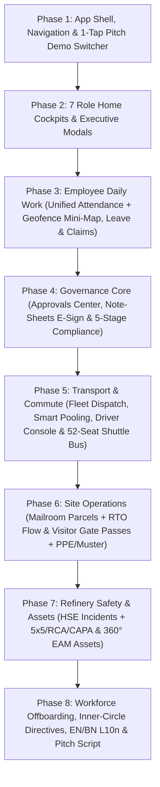

# 00 — Master Roadmap, Gap Audit & Simple Mobile UX Principles

## 1. Objective & Pitch Context

**BOGCL OneOps** is an enterprise B2B internal operations platform built for **Bashundhara Oil & Gas Company Ltd. (BOGCL)** spanning **Head Office (Baridhara, Dhaka)** and the **Keraniganj Bitumen & Refinery Plant**.

The interactive web prototype (`client/`) is complete across **7 canonical personas** and **17 operational modules**. The Flutter mobile application (`ftr-a/`) was started with a solid technical backbone (Riverpod, `go_router`, Dio with an in-app interceptor, `MockDatabase` persisted in Drift, and EN/BN localization), but **many screens are either hidden behind overly stripped-down navigation, missing critical business workflows from the web prototype, or left as partial stubs**.

This documentation suite (`ftr-a/docs/app-doc/`) is the **authoritative, phase-wise blueprint** to bring `ftr-a/` to **100% logical and operational parity** with the web prototype (`client/`), while keeping the mobile UI/UX **radically simple, self-explanatory, and pitch-ready**.

---

## 2. The 7 Canonical Personas (Must Match Web Prototype 1:1)

Every persona in `ftr-a/lib/mock/seed/seed_users.dart` must align with `client/src/types.ts` and `client/src/auth/permissions.ts`:

| Role Key | Employee ID | Name | Designation | Primary Site | Pitch Storyline Role |
| :--- | :--- | :--- | :--- | :--- | :--- |
| `chairman` | `EMP-0001` | **Ahmed Akbar Sobhan** | Chairman & Managing Director | Head Office, Baridhara | Executive oversight, high-value note-sheet e-sign, voice briefings, Inner-Circle directives, strategic KPIs |
| `plant_gm` | `EMP-0012` | **Engr. Md. Harunur Rashid** | General Manager (Plant Operations) | Keraniganj Refinery | Bitumen batch release (BDS 1238:2020), LOTO safety permits, plant HSE incidents, EAM work orders & statutory licences |
| `hr_admin` | `EMP-0028` | **Sayeda Afroza Sultana** | GM — Human Resources & Admin | Head Office, Baridhara | Workforce onboarding, 7-desk exit clearance, company-wide attendance/leave regularisation, mailroom & visitor oversight |
| `transport_admin` | `EMP-0045` | **Md. Kamruzzaman** | Transport & Logistics Supervisor | Keraniganj Refinery | Vehicle requisition dispatch, smart carpooling, driver roster & breathalyzer checks, fuel vouchers, 10-bus shuttle command |
| `hod` | `EMP-0062` | **Farida Begum** | Head of Finance & Approver | Head Office, Baridhara | Department budget ceiling control, batch approvals, note-sheet budget/price verification, statutory challan fee sign-off, claim settlement |
| `employee` | `EMP-1042` | **Tanvir Ahmed** | Senior Sales Officer | Head Office, Baridhara | GPS geofence punch-in/out, leave requests, car booking, shuttle seat booking/vacate, expense claims, visitor invites, assigned assets |
| `driver` | `EMP-0821` | **Md. Rafiqul Islam** | Senior Company Driver | Head Office, Baridhara | Pre-trip vehicle & licence readiness, active trip odometer start/complete, passenger arrival alert, toll slip logging, parcel pouch handover, SOS |

---

## 3. Comprehensive Gap Audit: Web (`client/`) vs Flutter (`ftr-a/`)

| Module | Web Prototype (`client/src/views/`) | Current Flutter State (`ftr-a/lib/features/`) | Key Broken / Missing Features to Complete |
| :--- | :--- | :--- | :--- |
| **App Shell & Demo Switcher** | Instant persona switcher, role badge, notification drawer, command search | Persona switcher hidden behind **7 secret taps** on version string in `MoreScreen`; `/home/dashboards` redirects to `/home` | Add 1-tap **Pitch Persona Switcher Sheet** in app bar; organize `MoreScreen` into clear B2B categories; surface live pending counts on tabs |
| **MOD-00: Role Home Cockpits** | `DashboardView.tsx` + 7 dedicated role dashboards (`ChairmanDashboard`, `PlantGmDashboard`, etc.) | `HomeScreen` stripped to 1 sentence + 3 rows + 3 tiles; `DashboardScreen` is **unreachable dead code** | Merge `DashboardScreen` into `HomeScreen` with role sub-tabs, Chairman Voice Briefing bar, Plant GM Bitumen Batch Release modal, HOD Budget ceiling bar, Employee Digital Gate Pass QR, Driver Mission & Toll console |
| **MOD-17: Approvals Center** | `ApprovalsView.tsx` — urgency verdict, `<12h` due-soon pill, search, category counts, 4-way sort, batch approve, structured rejection modal, prev/next drawer | `approvals_screen.dart` — basic list, lacks search, sort, `<12h` filter toggle, structured rejection categories, and full cross-engine state sync | Add urgency summary banner, search/sort/due-soon filter bar, structured Return/Reject sheet (`reasonCategory` + `improvementsRequired`), prev/next navigation, and two-way sync with Notesheets, Claims, Leave & Fleet |
| **MOD-03: Note-Sheets & E-Sign** | `NotesheetView.tsx` — `RouteStepper`, `BudgetCheck` card, `PriceComparison` table, SHA-256 paragraph chain, OTP e-sign, `CertificateModal`, `OfficialDocumentModal` | `note_sheets_screen.dart` & `note_sheet_detail_screen.dart` — basic detail view missing visual signatory stepper, vendor comparison table & official memo preview | Add visual `RouteStepper`, `BudgetCheck` GL allocation card, `PriceComparison` vendor table with lowest-quote verdict, structured Return/Query sheet, Cryptographic Certificate sheet, and Official Memorandum preview |
| **MOD-06: Compliance & Permits** | `ComplianceView.tsx` — 5-stage renewal pipeline, checklist gate, Finance fee approval gate, inspector findings, DO Letter Generator (`e-Nothi` / `Courier` -> creates Parcel in MOD-04), daily shutdown risk BDT | `licences_screen.dart` — basic stage increment without checklist/fee gates, no DO Letter generator, no Parcel integration | Implement 5-stage gated pipeline, interactive Audit Checklist gate, HOD Finance Fee Approval gate, Stage 3 Inspector Findings modal, Stage Revert with reason, Shutdown Risk banner, and DO Letter -> Parcel (`MOD-04`) auto-creation |
| **MOD-09: Fleet & Pool Cars** | `FleetView.tsx` — Requisitions (multi-stop, cost estimate, Smart Pooling merger), Drivers Roster (breathalyzer check), Vehicles & Fuel Vouchers, Gate Manifest, Tri-party Chat, Trip Pass & 1–5 star rating | `fleet_screen.dart` — `_fleetForm` only has 2 text fields; `_poolCards` is a non-clickable `ListTile`; no Drivers tab, no Vehicles/Fuel tab, no rating flow | Build 4 role-aware sub-tabs (`Requisitions`, `Drivers Roster`, `Vehicles & Fuel`, `Gate & Chat`), multi-stop requisition sheet, clickable Smart Pool execution, Fuel Voucher sheet, Breathalyzer log, Digital Trip Pass, and Passenger Rating sheet |
| **MOD-14: Staff Shuttle Bus** | `BusView.tsx` — Staff vs Supervisor toggle, Inbound/Outbound toggle, 10-Bus Fleet Grid, interactive 52-Seat Map, Vacate/Reclaim, Seat Swap, Direct Shift-Pass booking, FIFO Waitlist promote, QR Boarding scanner, Route Builder | `bus_screen.dart` — simple route list and basic bottom sheet; no 10-bus overview, no Inbound/Outbound toggle, no Seat Swap, no Direct Booking, no QR Boarding or Route Builder | Build Staff/Supervisor & Inbound/Outbound toggles, 10-Bus Fleet Grid, interactive 2×2 52-Seat Coach Map with category tags, Vacate/Reclaim, Seat Swap, Direct Shift-Pass booking, FIFO Waitlist promotion, Conductor QR Boarding sheet, and Route Builder |
| **MOD-04: Office Mail & Parcels** | `ParcelView.tsx` — Personal vs Mailroom Desk toggle, 5-stage forward custody chain with SHA-256 hashes, 3-stage Reverse Return (RTO) with `returnOtp`, Tamper/Quarantine flow, 3-attempt OTP lock & reissue, Pouch Manifest | `parcels_screen.dart` — basic forward step button; missing Reverse Return (RTO) workflow, Tamper/Quarantine handling, Personal vs Desk scope toggle, and Pouch Manifest | Add Personal/Mailroom Desk toggle, visual 5-stage forward stepper, 3-stage Reverse Return (RTO) flow with `returnOtp`, Tamper/Discrepancy quarantine modal, OTP attempt counter + PIN reissue, and Driver Pouch Manifest sheet |
| **MOD-08: Visitor Gate Passes** | `GuestView.tsx` — Host vs Security Gate toggle, 5-item Refinery PPE & H2S checklist, Green/Yellow/Red Plant Zones, VIP & Regulator Inspection Findings logger, ALPR Gate Barrier control, Emergency Muster Roll, WhatsApp/SMS/Email pass share | `visitors_screen.dart` — basic check-in/out; missing 5-item PPE/H2S checklist gate, Plant Zone matrix, Regulator Findings logger, ALPR barrier simulator, and WhatsApp/SMS share | Add Host/Gate mode toggle, interactive 5-item PPE & H2S Safety Checklist (with 1-tap Approve All), Permitted Zones badge/escort rules, Regulator Inspection Findings logger, ALPR Gate Barrier simulator, Emergency Muster Roll bar, and Pass Share sheet |
| **MOD-10: Attendance & Leave** | `AttendanceView.tsx` — Unified Attendance & Leave view, `GeofenceMiniMap` schematic (live pin vs HQ 300m / Plant 500m perimeter), shift selector, regularisation, leave balance cards, team KPIs & filterable roster | `attendance_screen.dart` & `leave_screen.dart` split into separate screens; no `GeofenceMiniMap` visual schematic; Leave hidden inside `MoreScreen` | Unify Attendance & Leave into a single tabbed workspace (`My Shift & Leave` / `Team Roster & Leave`), build the `GeofenceMiniMap` custom widget (with demo Inside/Outside toggle), shift selector, regularisation flow, and handover-enabled Leave Request sheet |
| **MOD-11/12/13: Expense Claims** | `ClaimsView.tsx` — Verdict banner, Grade 1–10 Allowance Policy reference table, 3-step settlement (`HOD Verify` -> `Finance Approve & SAP Voucher` -> `Mark Paid`), structured return query & 1-click Claimant `Fix & Resubmit` | `claims_screen.dart` — basic submit & approve; missing Grade 1–10 Allowance Policy sheet, 3-stage HOD->Finance->Paid distinction, and Claimant Fix & Resubmit flow | Add Verdict banner, Grade 1–10 Entitlement Policy bottom sheet, 3-stage workflow (`Verified` -> `Approved + SAP Voucher` -> `Settled/Paid`), structured Return with Query modal, and Claimant `Fix & Resubmit` editor |
| **MOD-07: HSE Safety Incidents** | `IncidentView.tsx` — Days-since-LTI & CAPA % KPIs, 10 Plant Zones, 5×5 Risk Matrix, 1-click Quick Hazard modal, 3-step Incident Wizard, 5-Whys + 6M Fishbone RCA editor, CAPA tracker, Statutory Form B-12 dossier, sign-off guard | `incidents_screen.dart` — single basic form; lacks Quick Hazard modal, 5×5 Risk Matrix, 5-Whys + 6M Fishbone RCA workspace, Statutory Form B-12 view, and CAPA completion guard | Add Safety KPI strip, 5×5 Risk Matrix badge/filter, 1-tap Quick Hazard sheet, 3-step Incident Wizard, interactive 5-Whys + 6M Fishbone RCA tab, CAPA checklist guard before closure, and Statutory Form B-12 Dossier preview |
| **MOD-05: Enterprise Assets (EAM)** | `AssetView.tsx` — 5 tabs (`Register`, `Work Orders & Calibration`, `Financials & Depreciation`, `Custody Transfers`, `Decommissioning`), 8-stage stepper, Spare Parts BOM consume/restock, SL vs DDB depreciation, Disposal Checklist, QR Passport | `assets_screen.dart` — single flat list of chips; missing Work Orders view, Spare Parts BOM consume/restock, Depreciation method toggle, and Disposal Checklist | Reorganize into clean mobile sub-tabs (`Register`, `Work Orders`, `Financials`, `Transfers & Disposal`), add 8-stage lifecycle stepper, Spare Parts BOM consume/restock actions, SL/DDB depreciation calculator, Disposal Checklist, and QR Asset Passport |
| **MOD-16: Workforce & Offboarding** | `WorkforceView.tsx` — Active vs Former Archive tabs, Site/Dept filters, Onboard Employee modal (auto SAP PERNR), 7-Department Exit Clearance drawer with asset recovery blocker & final archive | `people_screen.dart` — basic list; lacks Active/Archive split, auto-PERNR onboarding modal, and interactive 7-Department Exit Clearance checklist | Add Active/Archive tabs, KPI strip, Onboard Employee sheet with auto `EMP-xxxx` & SAP PERNR generation, and interactive 7-Department Exit Clearance sheet with asset recovery check and archive action |
| **MOD-15: Inner-Circle Chat** | `InnerCircleChat.tsx` — Channels + DMs with presence, Executive Directive mode (4 BOGCL presets + formal Directive Ack), Urgent flag, Voice Note recording/waveform, Document attach, Reactions, Pins, Search, Call modal | `chat_screen.dart` — basic message list; missing 4 Executive Directive presets, Voice Note recorder/waveform player, Emoji reactions, Pinned message bar, and Call modal | Add Channels/DMs selector with online status, Executive Directive composer (with 4 one-tap BOGCL templates & `Acknowledge Directive` button), Voice Note waveform player/recorder, Emoji reactions bar, Pin banner, and simulated Voice/Video Call screen |

---

## 4. Simple Mobile UI/UX Architecture ("Minimum Data, Maximum Understanding")

To ensure the Flutter app (`ftr-a/`) feels effortless during a live executive pitch on a phone screen, every screen must obey these mobile-first rules:

### 4.1 The 4-Question Clarity Rule
Within 2 seconds of opening any screen or bottom sheet, the user must see in plain language:
1. **What this is** — Clear title + 1-line subtitle explaining the business purpose.
2. **Where it came from & Why** — Requester name, site (`HQ Baridhara` or `Keraniganj Plant`), reference code, and reason/context.
3. **Current Status Verdict** — A single tinted status banner at the top of the screen (e.g., *"3 items waiting for your sign-off · BDT 14.2L total · 1 due within 12h"*).
4. **What happens next** — One primary filled CTA button for the next logical step, plus a secondary outline button for return/query/alternate action.

### 4.2 Mobile Progressive Disclosure (Replacing Wide Desktop Tables)
Never squeeze a 9-column desktop table onto a 390px phone screen:
- **List Cards (Max 4 Data Points)**: Title/Ref, Primary Actor + Site, Key Metric (Amount / Stage / Time / Seat), and Status Pill + Primary Quick Action.
- **Detail Bottom Sheets (`showModalBottomSheet` with `isScrollControlled: true`)**: Tapping any card opens a clean, scrollable 85%-height sheet with segmented tabs or collapsible sections (`Summary`, `Workflow & Gates`, `Documents / History`) and a sticky bottom action bar.
- **1-Tap Presets Everywhere**: During a live pitch on a phone, typing long paragraphs on a virtual keyboard slows down the demo. Every approval, return query, directive, hazard report, and inspection finding must include **3–4 realistic BOGCL 1-tap preset chips** that populate the fields automatically while still allowing custom text input.

### 4.3 Zero Dead Ends Rule
- Every button, filter chip, badge, and card in `ftr-a/` must perform a real state transition in `MockDatabase`, persist via Drift, show a clear confirmation `SnackBar`, and update related counters across the app.
- Never show "Coming soon", disabled placeholder buttons, or unclickable `ListTile` cards.

---

## 5. Master 8-Phase Execution Plan

All implementation work that follows this documentation will execute strictly in these **8 sequential phases**:

| Phase | Document File | Modules Covered | Core Outcome |
| :--- | :--- | :--- | :--- |
| **Phase 1** | `01_PHASE_1_SHELL_NAVIGATION_AND_DEMO_CONTROLS.md` | Shell, Router, Persona Switcher, `MoreScreen`, Cross-Engine Sync | Instant 1-tap switching across all 7 personas, zero hidden modules, live badge counts, unified cross-module state sync |
| **Phase 2** | `02_PHASE_2_ROLE_HOME_COCKPITS_AND_DASHBOARDS.md` | `MOD-00` Home & Role Dashboards (All 7 Personas) | Each persona lands on their tailored operational cockpit with Voice Briefing, Bitumen Batch Release, Budget Ceiling, Digital Gate Pass & Driver Mission Console |
| **Phase 3** | `03_PHASE_3_ATTENDANCE_LEAVE_AND_CLAIMS.md` | `MOD-10` Attendance & Leave, `MOD-11/12/13` Expense Claims | Unified Attendance + Leave workspace with `GeofenceMiniMap` visualization, team roster, Grade 1–10 claim policy & 3-stage SAP voucher settlement |
| **Phase 4** | `04_PHASE_4_APPROVALS_NOTESHEETS_AND_COMPLIANCE.md` | `MOD-17` Approvals, `MOD-03` Note-Sheets, `MOD-06` Licences | Full governance chain: SLA/search/batch Approvals, Note-Sheet RouteStepper + Budget/Vendor tables + Certificate, and 5-stage Compliance with DO Letter -> Parcel creation |
| **Phase 5** | `05_PHASE_5_FLEET_DISPATCH_AND_SHUTTLE_BUS.md` | `MOD-09` Fleet & Pool Cars, `MOD-14` Staff Shuttle Bus | Complete transport suite: multi-stop requisitions, clickable Smart Pooling, Drivers & Breathalyzer, Fuel Vouchers, 10-Bus Fleet Grid & interactive 52-Seat Map |
| **Phase 6** | `06_PHASE_6_PARCELS_AND_VISITOR_GATE_PASSES.md` | `MOD-04` Parcels, `MOD-08` Visitor Gate Passes | 5-stage forward + 3-stage Reverse Return (RTO) parcels with tamper quarantine; Visitor passes with 5-item PPE/H2S checklist, Plant Zones, ALPR barrier & Emergency Muster Roll |
| **Phase 7** | `07_PHASE_7_HSE_SAFETY_INCIDENTS_AND_ENTERPRISE_ASSETS.md` | `MOD-07` HSE Incidents, `MOD-05` Enterprise Assets (EAM) | 5×5 Risk Matrix, Quick Hazard, 3-step Wizard, 5-Whys + 6M Fishbone RCA, CAPA closure guard; 8-stage EAM lifecycle, Work Orders, Spare Parts BOM, SL/DDB Depreciation & Disposal |
| **Phase 8** | `08_PHASE_8_WORKFORCE_INNER_CIRCLE_CHAT_AND_PITCH_POLISH.md` | `MOD-16` Workforce, `MOD-15` Inner-Circle Chat, `MOD-01` Notices | Onboarding with auto SAP PERNR, 7-desk Exit Clearance drawer, Inner-Circle Executive Directives + Voice Notes + Call screen, EN/BN polish & 10-minute Pitch Walkthrough |

