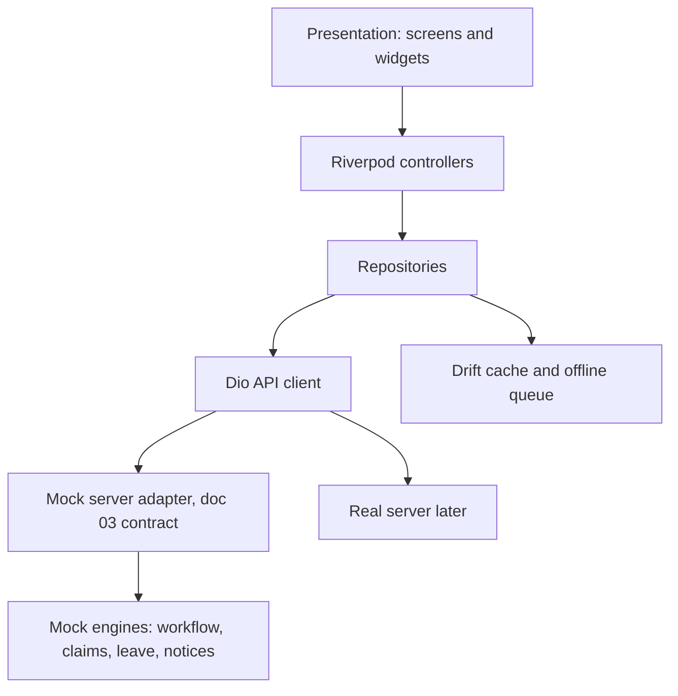

# BOGCL OneOps: Flutter mobile app plan

## Decisions already made
- Scope: a pitch prototype, mobile app only, in `ftr-a/`. Android first, iOS-ready code. There is NO backend and none is planned. The `server/` and `frontend/` specs are not built.
- Goal: it must look, feel and behave like a real production app (visuals, flows, validation, offline, notifications, realtime, errors), driven entirely by realistic local data. Nothing in the demo may be a dead link or a "coming soon" screen.
- Data: an in-app mock layer with a seeded, persisted local database. It keeps doc 03's shapes (envelope, errors, pagination) so the repositories are clean, but there is no live-server switch and no server code.
- The React Native `app/` and `client/` stay in the repo as read-only reference. I port their mock logic and business rules, and I do not edit them any more.
- Rules carried over: no tests during development (they run once at the end, when you ask). I never start emulators or builds from the terminal. You run the app on your phone and I give you the command.

## Starting state
- `ftr-a/` is empty. Flutter and Dart are NOT installed on this PC. I cannot install them without your approval, so Phase 0 includes a short guided install.

## Stack (industry standard, each choice explained in the docs)
- State: Riverpod with code generation.
- Routing: go_router, with auth guards, role guards and deep links.
- Networking: dio with interceptors (auth refresh with single-flight, idempotency key, error mapping to doc 03 codes, mock adapter).
- Models: freezed and json_serializable. Money is handled as decimal strings, never doubles.
- Local data: drift (SQLite) for the offline cache and the persisted mutation queue.
- Security: flutter_secure_storage for tokens, local_auth for biometric re-unlock, screen-privacy flag, and root detection.
- Device features: geolocator (with mock-location detection), mobile_scanner (QR), camera and image_picker, file picker, url_launcher, and flutter_local_notifications.
- Notifications: flutter_local_notifications. A scheduled "event simulator" fires realistic push-style notifications (approval arrived, notice published, pass expiring), so no Firebase is needed.
- Realtime: simulated by the mock layer (streams): chat replies, live approval updates, trip location moving on a map, presence.
- i18n: Flutter `gen_l10n` ARB files for EN and BN, with Asia/Dhaka date and number formats.
- Design: Material 3 themed with the brand tokens (crimson `#A51C30`, slate `#0B132B`, gold `#D4AF37`, canvas `#F8FAFC`), light and dark mode, a Bangla-capable font, and a shared component kit.
- Quality: `very_good_analysis` lints, `dart format`, and a feature-first clean architecture. Each feature has `data`, `domain` and `presentation` folders.

## Architecture

Folder layout: `ftr-a/lib/{app, core, shared, features/<module>}` and `ftr-a/docs/`.

## Phases (I do one at a time and stop for your device check after each)

### Phase 0: Setup and documentation
- Guided Flutter install: a short document with the exact steps for Windows, Android Studio SDK and `flutter doctor`. I run only read-only checks.
- Create the Flutter project in `ftr-a` (org id, app name BOGCL OneOps, flavors dev, staging and prod) and add the dependencies.
- Rules in `.cursor/rules/`:
  - Keep `project`, `security`, `no-tests-during-development`, `no-emulator-or-device-runs`, and `handoff-summary`, rewritten for Flutter and Dart.
  - Add `flutter` (path-scoped to `ftr-a/**`), `flutter-state-and-data`, `flutter-ui-and-i18n`, and `flutter-offline-and-security`.
  - Retire `mobile.mdc` for the Expo app, and update `testing.mdc` so tests are deferred to the end.
- Skills in `.cursor/skills/`: `flutter-add-feature`, `flutter-add-screen`, `flutter-port-rn-module`, `flutter-mock-endpoint`, `flutter-i18n-keys`, and `flutter-release-android`. `update-platform-docs` is adapted.
- Docs: new `docs/platform/05_MOBILE_APP_SPECIFICATION_FLUTTER.md` (adapted from doc 05: RTK Query becomes Riverpod and Dio, Expo becomes Flutter, EAS becomes Gradle and Fastlane, Jest becomes Flutter test and Patrol). Short update notes go into docs 00, 08, 09 and 10, and `AGENTS.md` is updated. Features missing from the old docs (listed in Phase 8) are added to doc 06 and doc 05.
- Extend `.cursorignore` (build, `.dart_tool`, generated files) to save tokens. Add `ftr-a/docs/FEATURE_STATUS.md` as the tracker.
- Run guide for your phone: `ftr-a/docs/RUN_ON_DEVICE.md` (USB debugging, `flutter run -d <device>`).

### Phase 1: Foundation
- App shell: theme, typography, the shared component kit (buttons, inputs, cards, status chips, empty/error/loading skeletons, bottom sheets), and adaptive navigation.
- Core: Dio client, error model, env config, logging with PII redaction, connectivity monitor, and the Drift database.
- Mock server: in-memory DB persisted to SQLite, seed data for the 7 personas (versioned), and the doc 03 envelope. This is ported from `app/src/mock`.
- Auth: login (email, employee code or phone), secure token storage, refresh rotation, biometric unlock, MFA for executive roles, and device session list.
- i18n EN and BN with an in-app language switch.
- Role-based home variants (doc 05 §10) and the permission and scope helper.
- Offline foundation: connectivity banner, mutation queue, idempotency keys, replay on reconnect.
- Settings, profile, and notification inbox shell.

### Phase 2: Engines used by every module
- Workflow and approvals engine (mock side): states, steps, actions, return, resubmit, delegation, and escalation display.
- Notification engine (in-app first), deep-link routing, and unread badges.
- Files and media: camera and gallery capture, compression, upload queue with progress (mock presigned flow), and previews.
- Reference-number and audit-trail display components.

### Phase 3: Employee modules
- MOD-10 Attendance and Leave: geofenced punch with a mock-location check, offline punch, history, regularisation, leave balance, apply, withdraw.
- MOD-01 Notices and Broadcasts: read, acknowledge, compose, targeted broadcast.
- MOD-11/12/13 Claims (TA/DA, conveyance, tour): grade bands, policy flags, receipts, resubmit up to 3 times (port of the finished React Native claims logic).
- MOD-14 Commuter Bus: my seat, requests, the 48 h offer.

### Phase 4: Approvals and documents
- MOD-17 Approvals Center: inbox, history, delegation, bulk actions, filters.
- MOD-03 Note-Sheets and E-Sign: view, comment, approve and sign with OTP, SHA-256 hash and QR verification display, PDF preview.
- Approver flows for HOD, Finance, HR, Plant GM and Chairman across all modules built so far.

### Phase 5: Operations modules
- MOD-04 Parcels: scan, chain of custody, OTP handover, dwell alerts.
- MOD-08 Guest and VIP Passes: gate check-in, pass issue, approvals.
- MOD-09 Fleet and Dispatch: requisitions, driver trip flow, GPS tracking with background handling, fuel and toll receipts, SOS, trip chat.
- Roles covered: Transport admin, Gate, Mailroom, Driver.

### Phase 6: Safety, assets, compliance, workforce
- MOD-07 HSE Incidents and CAPA: offline report with photos, severity routing, closure.
- MOD-05 Asset Lifecycle: scan, custody acknowledgement, requisition, transfer, write-off.
- MOD-06 Licence and Compliance (read, alerts) and MOD-16 Workforce (directory, exit clearance).

### Phase 7: Executive, chat, realtime feel, demo polish
- MOD-02 Chairman Command Suite: animated dashboards and charts, voice briefing playback, and an ROI view.
- MOD-15 Inner-Circle Chat with simulated realtime (typing, replies, presence).
- Local notifications from the event simulator (channels, badges, deep links).
- Pitch-readiness: a hidden "demo menu" (reset data, switch persona instantly, trigger an event), onboarding or splash, app icon, store-quality screenshots, and polished empty/loading/error states.

### Phase 8: Hardening and release (tests happen here, once)
- Performance: list virtualization, image caching, const widgets, rebuild profiling, startup time, app size, and Impeller checks on a real device.
- Accessibility: TalkBack, large text, contrast, and touch targets.
- Security review: certificate pinning, root detection, screen privacy, PII redaction, and an `outdated` and `pub audit` check.
- Full test pass when you ask: unit, widget, golden and integration flows for the 7 personas.
- Feature-completeness audit against doc 06 `BR-xx-nn` rules and doc 05 §9, with no stubbed screens left.
- Release: signing, flavors, Play Store internal track guide, versioning, and the final handoff summary.

## Working method for every phase
1. I read the matching spec sections, then write a short phase brief.
2. I build vertical slices (mock endpoint, repository, state, screen, EN and BN strings) and update `FEATURE_STATUS.md`.
3. I run only `dart analyze` and `dart format` (not tests) and report the results.
4. I give you the exact `flutter run` command for your phone and a role-by-role checklist, then wait for your feedback before the next phase.

## Open risks
- Flutter, Android SDK and Java need to be installed or verified on your PC in Phase 0.
- With no backend, "real" behaviour (OTP, SHA-256 hashes, PDF, GPS, geofence, scanning) is implemented on the device, so the demo is genuine and not just visuals.
- The Bangla font and text shaping need device verification in Phase 1.
